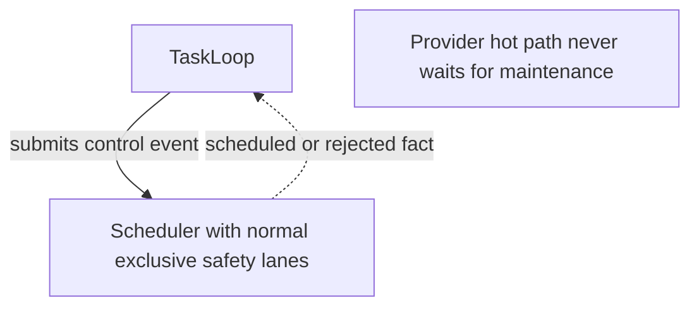

# Designing Workstream Diagrams

Use this skill to turn a Workstream into a diagram set that a reader can follow top-down and that a verifier can check. The diagram set is the architecture contract; prose explains it, and no code is written until the relevant layer is settled.

Sibling split:

| Artifact | Owns |
| --- | --- |
| this skill | how a diagram set is designed |
| `verify-architecture-diagrams` | whether an existing diagram set holds |

## 1. Eight questions the diagram set must answer

A Workstream spec is incomplete until its diagrams answer all eight. Each question has exactly one owning layer.

| # | Question | Layer |
| --- | --- | --- |
| 1 | Who owns each fact, slot, lease or resource? | L0 |
| 2 | What are the lifecycles, and what composes or opens what? | L0 |
| 3 | In which direction do control and data move? | L1 |
| 4 | Which edges command and which report facts? | L1 |
| 5 | What runs on the hot path, and what may block it? | L2 |
| 6 | What is stable and what is replaceable? | L3 |
| 7 | How does the system fail, release and converge? | L4 |
| 8 | What is not implemented yet, and who owns it? | L5 |

A cross-cutting diagram (for example resource admission, which touches ownership, the hot path and release) may answer more than one question. Declare each with its own `%% answers:` line and tag the diagram with the single layer whose rules it must obey; the verifier checks it against that layer.

## 2. Layer set

One diagram per question group. Layer tags are mandatory and are the mechanism the verifier uses for inter-level checks.

| Layer | Role | Typical content |
| --- | --- | --- |
| L0 | ownership and lifetime | process/host scope, canonical slots, single writers |
| L1 | control and data flow | top-down commands, lower-layer facts, data vs control |
| L2 | hot path | per-operation sequence, admission, bounded work |
| L3 | replacement and handoff | candidate assembly, sealed handoff, publication |
| L4 | failure and convergence | rejection, release, resume, recovery |
| L5 | delivery and switch | integration order, cutover, removal |

Rules:

- A layer may hold several diagrams; each diagram answers one question unless it is declared cross-cutting as above. Do not merge two questions merely to save a diagram.
- Never skip a layer to hide an unresolved decision. If L3 cannot be drawn, the design is not ready.
- Lower layers refine upper layers. Never let a lower layer decide what an upper layer owns.

### Two diagram kinds

A diagram is either a **structure** diagram or a **flow** diagram, and the two obey different cycle rules. Mixing them is the most common way a sound protocol gets reported as a dependency defect.

| Kind | Describes | Solid edges | Cycle rule |
| --- | --- | --- | --- |
| `structure` | who depends on whom, who composes what, who writes which store | dependency and composition | must be acyclic; a required pair is declared with `%% cycle: allowed` |
| `flow` | a protocol, state progression or decision sequence over time | the step order of the protocol | loops are allowed, but every loop must have a solid edge leaving it; a loop with no exit cannot converge |

L0 and L1 are structure. L2 to L5 are usually flow, but a hot-path diagram that only names modules is structure. A diagram without `%% kind:` is checked as structure, so a protocol drawn without the annotation will be reported as cyclic until it declares itself.

The normative arrow-label sentence binds structure diagrams at L0 and L1. Flow diagrams use their own step vocabulary and still label every solid edge.

Annotate every diagram so the verifier can work without guessing:



| Annotation | Meaning |
| --- | --- |
| `%% id: <diagram-id>` | stable identity of this diagram; required for anything to refine it, and keeps reports readable when line numbers move |
| `%% layer: L<n>` | layer of this diagram; required for inter-level checks |
| `%% kind: structure\|flow` | which cycle rule applies; omitted means structure |
| `%% refines: <id>[, <id>]` | the coarser diagram(s) this one refines; without it the verifier guesses by node overlap and reports the inter-level findings for review only |
| `%% answers: <question>` | the question this diagram answers; repeat the line for a cross-cutting diagram |
| `%% cycle: allowed owner=<task> reason=<why>` | exempt one structure cycle; owner and reason are mandatory |
| `%% module: <nodeId> = <path>` | binds a diagram node to a real module for the implementation gate |
| `%% concept: <nodeId> = <ConceptName>` | names the architectural concept a node stands for, so differently named nodes in other diagrams resolve to one thing |
| `%% local-only: <nodeId>` | this node is a task-local detail, not a Workstream authority |
| `%% note-node: <nodeId>` | this node renders a visible constraint and asserts no relation; it is excluded from graph checks |
| `%% ignore: owner=<task> reason=<why>` | skip this diagram; owner and reason are mandatory |
| `%% note: <text>` | prose for the verifier report; it does not render, so a constraint the reader must see goes in a note node |

## 3. Node rules

1. A node is a stable architectural concept, not a class, file or path. Class names and paths belong in `%% module:`.
2. One concept keeps one identity across the set. When two diagrams must name it differently (a short id here, a descriptive label there), bind both with `%% concept:`; the verifier resolves concept, then id, then normalized label, and refuses to guess beyond that.
3. A node belongs to at most one `subgraph`, and the innermost `subgraph` decides its lifetime.
4. `subgraph` means lifetime, and its label names that lifetime. Do not use `subgraph` as a visual grouping.
5. Every canonical fact has exactly one writer node. A derived node has exactly one inbound producing edge.
6. A node that is not implemented carries `not yet verified` in its label and names its owning task in the same diagram or in the layer prose.
7. A node with no inbound and no outbound edge is either a constraint the reader must see, declared with `%% note-node:`, or a mistake. Declare it or wire it.

## 4. Edge rules

The two edge styles carry different semantics, and the verifier checks them separately.

| Style | Carries | May form a cycle |
| --- | --- | --- |
| `-->` solid | intent, command, composition and its effect | no |
| `-.->` dotted | completion, failure, durability or state fact; or a constraint | yes |

1. **In a structure diagram, solid edges form the dependency graph and must be acyclic.** A cycle in solid edges is a design defect, not a rendering accident. In a flow diagram a loop is a step of the protocol and is accepted only when some solid edge leaves it.
2. **Dotted edges report facts or state constraints; they never grant the lower layer authority to orchestrate the upper layer.** A lower layer may call back into a port the upper layer injected, but it must not import the upper layer's concrete module, hold it as a concrete type, or branch on a callback result to choose the next lifecycle step.
3. A dotted edge may not carry a command. If the label is an instruction, use a solid edge and fix the direction.
4. A dotted edge may not carry a pure annotation. Use `%% note:`. An edge that expresses nothing is a false relation.
5. Every edge states its meaning. An unlabeled solid edge is unverifiable because the effect is not written down.
6. A cycle that is genuinely required, such as a request/response pair, must be declared with `%% cycle: allowed` plus an owner task and a reason. An undeclared cyclic dependency fails verification.
7. Label vocabulary: the spec's normative label sentence lists the solid meaning categories. Dotted labels use fact nouns (`fact`, `readiness`, `failure`, `published`, `rejected`, `durability`, `released`, `unavailable`, `completion`, `pending`, `superseded`, `adopted`, `held`) or an explicit constraint (`no new …`, `remains …`, `must not …`).

## 5. Authority rules

1. Each canonical fact, slot, lease and resource names one owning node in L0.
2. A store is written by one writer. Readers are separate nodes with `projects` style edges.
3. A coordinator that transfers authority must show both the command and the resulting fact, so the reader can see that authority moved rather than was shared.
4. Replacement is expressed as prepare → sealed handoff → adopt → publish. Do not draw a replacement as a direct overwrite.
5. No layer may introduce a writer that the coarser layer does not own. Introduce the writer one layer up, then refine it.

## 6. Task slicing

Cut tasks from the graph, not from the file tree.

1. One task owns one coherent authority or one coherent stage transition.
2. The task's `owns` boundaries name the modules and symbols that realize its nodes.
3. The Workstream plan's Task Graph mirrors the diagram dependencies. `Depends On` must be a subset of the diagram's solid reachability: when B depends on A, a solid Workstream path must lead from a node A draws to a node B draws. The verifier checks this in `--scope cross-task` once both tasks have diagrams.
4. If a task needs an edge that no diagram declares, the diagram is wrong. Fix the diagram before the task.
5. A task diagram lives in the task's `plan.md` under `## Architecture Design`; that is the only place the verifier reads task diagrams from.

## 7. Flow

```
0 Trigger and boundary
1 Evidence of current state
2 L0 ownership and lifetime
3 L1..L5 layered set
4 Slice tasks from the graph
5 Contracts and acceptance
6 Verify the set
7 Independent review and user confirmation
8 Evolve
```

**0 Trigger and boundary.** Name the Workstream, the decision it must settle and what is out of scope. Stop if the scope is a code change with no architectural decision.

**1 Evidence of current state.** Read the real entry points, owners and persistence boundaries. Diagrams describe the code that exists or is approved, never an imagined tree.

**2 L0 ownership and lifetime.** Draw scope, canonical slots, single writers and lifetimes. This layer is the contract for everything below; do not continue with an unresolved ownership question.

**3 L1..L5.** Draw one diagram per remaining question, in order. Each diagram refines its parent. When a lower layer exposes a contradiction in an upper layer, return to the upper layer instead of patching locally.

**4 Slice tasks.** Convert the graph into tasks with `owns` boundaries that match the nodes. Every node belongs to exactly one task, or is explicitly assigned as a detail.

**5 Contracts and acceptance.** Write acceptance criteria that a verifier can check: ownership, direction, lifecycle, failure path. Do not use "the diagram is reviewed" as an acceptance criterion.

**6 Verify the set.** Load `verify-architecture-diagrams` and run it. Fix findings whose attribution is local; return to the owning layer for findings whose attribution is overall.

**7 Independent review and confirmation.** Architecture changes require an independent review and explicit user confirmation before implementation. A pure clarification with identical semantics may proceed.

**8 Evolve.** When implementation reveals a structural fact, update the diagram and re-verify. Never let code drift away from the contract silently.

## 7a. Adopting an existing spec

A spec written before this skill has diagrams without annotations, and the verifier will read every one of them as an unlayered structure diagram. Bring it in in this order, and do not redraw anything until step 3:

1. Run the verifier once and keep the report as the inventory. Every finding at this point is an annotation gap, not yet a design verdict.
2. Give every diagram `%% id:`, `%% layer:` and `%% kind:`. Deciding the kind is the real work: a diagram whose cycles are protocol steps is `flow`; a diagram whose cycles are module dependencies is `structure` and its cycles are defects.
3. Re-run. Remaining structure cycles are now genuine findings: usually a fact edge drawn solid (a completion, result or published event pointing back at its orchestrator). Change the style, not the direction.
4. Add `%% refines:` from each lower diagram to the diagram(s) it refines, and `%% concept:` wherever one concept carries different ids across diagrams. Inter-level findings become verifiable only after this step.
5. Convert free-standing annotation nodes to `%% note-node:` and label every unlabelled solid edge.
6. Only then treat the exit code as a design verdict, and record in the Workstream plan that the diagram set is verifier-checked from this revision on.

## 8. Anti-patterns

| Symptom | Consequence |
| --- | --- |
| a class or file path used as a node | the contract renames itself whenever the code moves |
| two nodes writing the same canonical fact | split authority, unrecoverable conflict |
| dotted edge used to give an order | the reader cannot tell command from fact |
| dotted edge used as a comment | a relation that asserts nothing |
| a completion, result or published event drawn as a solid edge back to its orchestrator | a false dependency cycle in a structure diagram |
| a protocol drawn without `%% kind: flow` | every loop is reported as a dependency defect |
| `subgraph` used for visual grouping | lifetime inference becomes wrong |
| a required cycle without `%% cycle: allowed` | undeclared dependency, fails verification |
| a lower layer that decides the next upper-layer step | inverted control, untestable lifecycle |
| one concept with a different id in every diagram and no `%% concept:` | every refinement check resolves to "unverifiable" |
| a lower diagram with no `%% refines:` | its anchor is guessed, and its findings cannot block |
| `not yet verified` without an owning task | an orphan that never converges |
| diagrams that skip L3 to look finished | the handoff risk is hidden, not removed |
