# WS-106 Unified Task Platform

Architecture-Mode: diagram-driven-v1

> **状态：** planned。2026-10-16 经用户决定创建，吸收 WS-075、WS-090、WS-091、WS-093、WS-096、WS-097、WS-099、WS-101 的未实施合同，以一次终态切换完成 Controller、Task、数据库、投影、capability、AI approval 与 Main/child composition 重构。
> **调查依据：** `investigations/INVEST-119-workstream-convergence.md`。修订过程、审查轮次与评分记录只保存在 `progress.md` 与对应 Review，不进入本规范正文。

## User Architecture Requirements

本节固定用户要求与已确认的产品目的，先于后文当前方案。`Design Invariants`、模块、端口、图和任务分工是满足要求的设计选择，不能倒过来替代需求。架构调整先说明保持了哪项目的、改变了什么可见行为；无法保持时应明确提出取舍，而不是通过改写不变量或评分理由静默降低要求。

### Purpose

建立一个统一、低重复成本、可恢复、可扩展的Task平台：不同Task角色共用同一运行与持久化基础；控制和恢复不被无关生成工作阻塞；用户能够用统一DPTL定义Prompt而不再维护多条固定拼装路径。目标是减少长期维护与扩展时的隐性耦合，不是增加协调器、注册表、类型层或追求某个图的形式分数。

### Required outcomes

- **UR-1 统一Task。** Main、Subagent、AI approval与未来角色共用平台，差异由角色/功能/权限数据表达；不另建轻量Task生命周期、专用provider loop或独立Prompt引擎。
- **UR-2 DPTL接替固定Prompt。** 内建`standard`与`lite`必须以DPTL模板/Profile实现并接替现有工作；完成统一切换后，旧固定Prompt定义、拼装器和fallback不再生产可达。DPTL不是给现有固定Prompt链再包一层模板。
- **UR-3 顶层设计生命周期。** 创建、恢复、替换、撤权、关闭与删除由顶层完整定义，再向下传递；调用者和底层模块不得自行解释交接顺序或补齐隐藏阶段。
- **UR-4 实际性能与故障隔离。** Prompt/source准备和后台维护不能无差别阻塞控制、人工响应与取消；共享工作不重复扫描，资源真实释放，错误有可恢复边界。阶段改名、移动计时起点或写上bounded不构成性能改善。
- **UR-5 清晰扩展与单一authority。** 领域事实、持久化、权限、视图和共享资源各有明确owner；新增功能沿稳定接口扩展，不复制业务状态、添加临时adapter或长期双实现。
- **UR-6 整体架构先行。** 先完成并审查完整总体设计，之后再从图推导Task；现有Task可后续增加、删除、重写，本轮不审查其划分。不靠细粒度AC、Ledger或中间接线测试冻结错误架构。
- **UR-7 及时纠正且诚实验证。** 实现发现结构问题须回到总体图纠正，经独立审查并按用户授权确认后向下传递。设计质量从性能、解耦、扩展和腐烂风险评估；独立审查不读历史分数，不以期望分数诱导结论，图通过不冒称运行通过。
- **UR-8 保留已确认产品边界。** 现有可观察行为、checkpoint模式、人工审批与隐私、current-schema恢复、read-only视图必须可追溯地保留；历史Task不迁移、生产一次authority切换、无长期双读/双写/fallback沿既有合同。未来独立可执行程序的host-neutral边界保留，但本次不扩大为其发布实现。

- **UR-9 损坏后必须自动自愈。** 用户明确要求：“不论损坏都成功”“主任务必须可自动治愈”“未知态合理返回，重新启动循环”。这是状态机的约束逻辑，不是可选恢复策略。对已有主任务，状态损坏、缺失、未知或无法继续时，自动形成带诊断的可解释结果、重建可运行状态并重新启动控制循环；不得把损坏变成永久read_only、unavailable、需人工修文件或反复点Resume仍失败。恢复成功指任务重新可驱动，不伪造丢失数据或未知effect已成功。
- **UR-10 现有lock/unlock足够。** 沿用当前TaskLockService与unlock交互，不引入跨进程fencing、新增所有权epoch、跨库写入隔离协议或额外协调服务。正常锁竞争与History只读展示保留；本Task内opening/operation身份仅用于拒绝旧回调与取消后的继续，不扩成跨进程机制。
- **UR-11 核心状态机承载任务流。** TaskRuntime是唯一任务业务状态流；介入、接管、审批与权限细化通过受控事件、转换条件和所属领域端口参与。TaskControl只编排该Runtime的生命周期，不复制业务状态；新增功能不另建provider/tool/审批驱动循环。
- **UR-12 workspace常驻审批与独立配置。** 一个workspace只有一个审批器，汇集本工作区请求进行协调。现有Auto-Approve勾选启用，Settings按独立image provider模式管理审批专用配置，不借Plan/Act；无配置或未开启立即人工。Activities旁提供审批器入口，允许用户对话说明审批原则，但日常无需介入：无害、命令正确、理由正当且在许可范围内即自主放行。审批器不带checkpoint，复用普通Task Runtime与存储；用户对话和各请求以work隔离，不每请求创建child，四类结果幂等回原Task。
- **UR-13 人工等待与AI执行分开。** 普通审批等待20秒后开放人工审批；只有AI审批器自身的相关上下文正在压缩时可延长，相关请求最多等待5分钟。人工入口开放不是取消AI、请求失效或最终拒绝；AI仍可返回，未结算请求仍可采用其有效结果，已结算结果不能被覆盖。
- **UR-14 通信是平台扩展边界。** 总体架构必须容纳Task与subagent、点对点与群组、同进程与跨进程通信，以及按权限level逐级审批。身份、消息关联、幂等、权限和Runtime摄入不绑死parent/child或Controller内存对象；本轮固定承载边界，不把未来全部邮件产品、跨机器服务或额外协调机制混入当前实现范围。
- **UR-15 为旁路cache warmup保留扩展能力。** 后续可在会话Task工作期间，通过侧会话/旁路在指定有效期接近结束时发送一次warmup，以维持该会话可复用缓存。当前算法未定，只固定可接入的身份、策略、调度、Provider能力、取消与观测边界；不提前选择TTL、提前量、周期或模型请求算法，不改变主会话状态和历史。
- **UR-16 顺带消除被改写链路上的现有耦合。** 用户2026-10-19要求：“现有的这些，存在耦合的可疑做改进，如api error做统一处理，provider提供error接口处理，不提供的回落默认。”WS-106改写的Runtime、Provider执行与视图链路上，同一事实被多层重复判断、Provider专属知识散落在共享层或UI解析原始文本的位置，应收敛到唯一owner与类型化值；可观察行为（错误卡片外观、文案、按钮、重试与恢复结果）保持不变，确需改变时单独提出取舍。

### Change discipline

用户已明确纠正：把自动自愈改成损坏后拒绝运行，以及把现有unlock扩成跨进程fencing，均偏离设计意图，禁止再次引入。UR-9/UR-10优先于本文件残留方案及旧Review意见；后续修订必须同步清理冲突，不能只加免责声明。审查建议若要求恢复已否决设计，应说明与用户合同冲突并拒绝采纳，不能为了评分重引入。

先检查变更是否仍满足UR，再修改总体图与对应协议，最后才改派生Task。2026-10-18确认的UR-12～14取代每请求审批child、ack后销毁、固定超时丢弃AI结果和仅总开关的旧方案；审查不得把它们重新引入。自动修复不能变成紧密无限重试：一次失败返回可解释状态，循环继续，不能反复卡在同一坏记录。

## Goal

**WS-106是图驱动架构设计的Workstream。** 总体图与Task局部图承载设计；图集按 `designing-workstream-diagrams` 的分层与注解约定编写，由 `verify-architecture-diagrams` 做结构性机械检查，再由独立图审查判断性能、解耦、扩展性和腐烂风险。本文模块名、接口示意、步骤与性能建议解释当前方案，不冻结后续实现；现场证据支持更好方案时，通过更新图并重新通过机械检查与独立审查继续演进。Review意见不自动新增AC或实现清单。

建立 Dline 唯一 Task 平台，使 Main Task、完整 child Task 和未来 Reviewer/Orchestrator 在同一 identity、lock、`TaskProcess → TaskControl → TaskRuntime`、`TaskInstanceFactory`、instance storage、read model、projection、ToolCatalog、SelectedToolSet 和 capability substrate 上运行。

本 Workstream 同批完成：

1. Controller 退回 surface/transport/global application coordinator；
2. TaskProcess 成为外部稳定控制接口；
3. TaskControl 成为所有外部 Task 控制事件的唯一入口；
4. 现有 TaskRuntime 保持 canonical kernel event/state authority；
5. ActiveTaskSession/TaskSessionOwners 收敛为不可外泄的 TaskIncarnation；
6. Task identity、process ownership、instance binding/layout/repositories 统一；
7. journal/messages/activities/metrics/state 与 derived recovery projection 完成 bounded reopen；
8. TaskMessage/TaskHistory/compact shell 三个 Webview 数据面一次切换；
9. runtime registry、ToolCatalog、SelectedToolSet 与 hierarchical skill/capability catalog 同源；
10. Main/child Task 经唯一 TaskInstanceFactory 创建；
11. 以内建常驻普通Task role交付AI审批器，请求级隔离与并发共用核心状态机；当前SubagentRunner由统一child Task替换，但AI审批器不归任一请求方child生命周期；
12. 为DPTL、受控插件与Task通信提供稳定消费边界，包括未来点对点/群组/跨进程投递和逐level权限接入。

生产authority的切换采用单一版本选择：新平台在隔离入口完成组合验证，production entry在切换时直接选择新Task平台。明确识别为旧平台格式的历史Task不进入迁移或双读流程，投影为`legacy_unsupported`。当前decoder读取可识别字段，忽略未知optional字段与已移除feature payload；已有当前Task缺identity/journal/layout文件、结构损坏或状态未知均按UR-9自动自愈，不能仅凭缺失或解析失败判为旧平台。

## Design Invariants

以下是满足User Architecture Requirements的当前设计不变量，不高于用户需求。图、协议和实现应保持一致；冲突时回到UR判定并明确修订设计，不用“以某段为准”掩盖另一个未修正的执行路径。

- **I-1 唯一Task种类，角色和寿命是配置。** Main、subagent、常驻AI审批器与未来角色共用TaskProcessComposer、TaskInstanceFactory、四DB + state vault、TaskRuntime、read model、恢复与通信端口。TaskFeatureSet裁剪功能，role声明调用方拥有或host常驻的寿命策略；创建者只能在permission ceiling内收窄。每个Task都使用同一请求级工作上下文能力；普通会话默认一个工作上下文，常驻服务允许多个，并非第二Runtime或每请求child。
- **I-2 通用惰性。** 候选装配只解析InstanceLayout并打开journal/state；messages/activities/metrics、views、checkpoint、source订阅按实际需求启用。被TaskFeatureSet关闭的功能返回typed feature_disabled。常驻审批器空闲时保持可接收请求的正常Task，不空转Provider或轮询全部Task；请求完成清理工作资源和有限保留记录，不销毁其Runtime。
- **I-3 一个任务流核心，生命周期与业务分层。** TaskRuntime是唯一业务状态机，按event转移TaskState并产出durable commands；TaskControl是外层纯生命周期转换`transition(state, event) → { nextState, effects[] }`，只决定控制接纳、启动/替换/停止/恢复顺序和完成条件，不复制turn/dialog/approval状态、不做I/O。ControlInbox提供全序、短段调度与效果派发。效果目标按inbox、kernel、factory、slot、lock、snapshots与checkpoint职责区分；不新增通用工作流引擎或第二任务业务循环。
- **I-4 关联与完成条件在同一控制聚合。** lifecycle、当前opening操作、来源身份、待确认生命周期效果、安全目标及关闭责任均由TaskControl持有；业务转换只在Runtime内发生，ApprovalAuthority提供无状态判定，ChildRegistry等领域owner提供所属记录端口。控制事实按operation/effect/subject分类；领域事件按task/work身份进入Runtime，二者不混排为业务调度。异步工作不占用inbox mutex；端口受理顺序不冒充跨端口完成顺序。
- **I-5 本地身份与现有锁分开。** OpeningGuard只判断当前Task进程的opening/operation与取消状态；RevisionTuple表达输入相容性，OpeningBound绑定不可变值。跨窗口所有权复用现有TaskLockService的check/acquire/touch/release与force unlock，不新增lock epoch或逐库fencing。清理只释放既有资源，不因opening换代失去释放资格。
- **I-6 声明按变化原因归属。** role、feature、extension point、revision relevance、command/event与domain port各由所属领域声明一次。沿已有语义增加条目不需要在Controller/Factory/kernel复制分支；新增安全、持久化或资源生命周期语义必须修订总体合同，不承诺任意功能只需增加注册项。转换表允许表达真实的协议分支，不为消除所有条件而制造注册表。
- **I-7 owner与订阅分离。** child实例恰有一个存储/生命周期owner，结果有独立consumer links；outbox/inbox/ack保证幂等应用，活动未完成订阅的有界补拉保证通知丢失后仍可发现结果。History通知只是提示。
- **I-8 工作按实际需求准备。** 控制opening不等待完整Prompt或source freshness；候选prepare不持整个生命周期的exclusive reservation。Provider、approval、replacement合同分别由HP/AP/RP承载，同步依赖与后台成本都必须如实表达。
- **I-9 分层图与语义核验互补。** Workstream自身包含L0～L5；structure命令图无环，事实边不授予编排权，flow的失败与退出明确。机械exit 0不证明活性、安全或未检查关系；本阶段只验证总体图，Task与cross-task校验在后续重建Task时进行。
- **I-10 架构先于任务划分。** 总体关系是唯一设计依据；现有Task安排暂存，后续可增加、删除或重写，不限制本次总体设计。架构变化由总体图向下传递；不通过临时adapter、第二authority或细粒度验收清单调和冲突。

## Task Platform Architecture

Arrow labels are normative: `constructs/opens` is lifecycle composition, `submits control event` is ordered input, `injects immutable snapshot` is opening-bound data, `commits` is canonical state, and `projects` is derived read state.

### Ownership and Lifetime

```mermaid
flowchart TB
    %% id: L0-ownership
    %% layer: L0
    %% kind: structure
    %% answers: who owns each fact, slot, lock and resource, and which lifetime composes which
    Surface[Webview / CLI / Host Surface]

    subgraph HostProcess["Extension-host / process scope"]
        HostOwner[Host lifecycle owner\nshared services startup and shutdown]
        Controller[Controller\nRPC DTO surface and global coordination]
        Composer[TaskProcessComposer\nhost-owned composition root; composes one stable facade and injects factory lock catalog and maintenance ports]
        FacadeTable[TaskFacadeTable\nComposer-owned sole authority for one live facade per taskId + bindingRevision + creationNonce in this host; single-flight lookup-or-compose; exactly one owner handle per entry plus delete and attached handles]
        ChildLifecycleAdapter[ChildTaskLifecycleAdapter\nhost-owned cross-instance composition/open port; owns only child facade lifecycle handles, no business state]
        DeletionCoordinator[TaskDeletionCoordinator\nhost-owned close/inventory/delete lifecycle adapter]
        RootAdmission[RootAdmissionBoundary\nTaskBinding + TaskDeleteIntent transaction and enrollment receipts\nclosed admission permits only same-deleteId sealed-receipt rebind and close-only settlement; no new lock lease or fencing service]
        BlueprintResolver[TaskBlueprintResolver\npure profile/effective-tool/role resolution from immutable inputs; no resource effects]
        Factory[TaskInstanceFactory\nstaged candidate assembly from one TaskBlueprint]
        SettingsAuthorities[SettingsRepository / WorkspaceSettingsRepository\nRemoteConfig / session overlays / profile catalog]
        ConfigurationCoordinator[TaskConfigurationProjectionCoordinator\nrevision vector + typed invalidation]
        WatchRegistry[WorkspaceCapabilityWatcherRegistry\nPhysicalWatchPool]
        WorkspaceCatalog[WorkspaceCapabilityCatalog\nsource snapshot + revision + single-flight]
        CapabilitySources[Rules / Workflows / Skills / Subagents / MCP source owners]
        PromptAssets[DPTL asset owner\nsource resolver and public compiled module store]
        PromptProfiles[PromptProfileRegistry\nversioned definition snapshots; no Task-private values]
        ToolCatalog[ToolCatalog\nshared immutable descriptors only]
        ExtensionCatalog[ExtensionCatalog / typed contribution registries]
        HostMaintenance[HostMaintenanceScheduler\nprocess-wide bounded budgets]
        ResidentOwner[ResidentTaskOwner\none resident slot per workspace; host lifecycle only]
        Communication[TaskCommunicationPort and transport adapters\naddressed delivery; no business decision or task ownership]
        Directory[TaskEndpointDirectory\nrouting and group projection; not lock authority]
        HistoryProjector[TaskHistoryProjector\nmonotonic revision and tombstone projection; no Task authority]
    end

    subgraph StableTask["Stable Task process scope"]
        Process[TaskProcess\nTaskId + TaskProcessId]
        Inbox[ControlInbox\nordered submission and reservation]
        Control[TaskControl\npure control aggregate; lifecycle operation safety and completion obligations]
        Slot[OpeningSlot\ncurrentOpening slot + atomic swap + openingChanged]
        KernelPort[KernelPort\nbounded command submission into the current opening]
        CheckpointPort[CheckpointPort\nvalidate target and execute restore; no lifecycle decisions]
        SnapshotsPort[OpeningSnapshotPublisher\nadopt revisions or restrictions; never swaps the opening]
        CanonicalWriter[CanonicalWriterGate\nsingle local repository mutation capability; Runtime business holder with revocable attempt-scoped delegations, or Control-authorized maintenance stage, never concurrent]
    end

    subgraph Opening["Replaceable opening scope"]
        Candidate[UnpublishedOpeningCandidate]
        OpeningRef[TaskOpeningRef\nopeningId incarnationId openingGeneration]
        Incarnation[TaskIncarnation\nprivate functional ports]
        Runtime[TaskRuntime microkernel\none aggregate; isolated work contexts]
        AttemptWriter[Attempt-scoped delegated writer\nissued by Runtime from its held CanonicalWriterGate capability for one dispatched executor attempt; journal records only; revoked before that work's stop receipt and before every writer-stopped fact]
        ApprovalAuthority[ApprovalAuthority\npure requester approval rules; no independent state or writer]
        Warmup[Provider-owned cache maintenance\noptional side-session policy; algorithm deferred]
        ProviderCache[ProviderCacheWarmupPort\noptional prefix-preserving provider capability]
        ReadModel[TaskReadModel]
        ChildDomain[TaskChildDomain\nowner records links delivery and reclamation intents; no direct peer-store write]
        CapabilityDemand[Opening capability domain\ndemand refs and cancellable waiters; owns demand-scoped view publication]
        CapabilityView[TaskCapabilitySnapshot\nimmutable work-demand projection under an adopted target]
        SelectedTools[SelectedToolSet\nopening-scoped immutable ToolId and descriptor revisions]
        PromptBinding[TaskPromptBindingAdapter\nprivate work contract cache and render port]
        OpeningSnapshots[EffectiveTaskConfigurationSnapshot and adopted domain target revisions\nPrompt and capability content remain demand-prepared]
    end

    subgraph PeerScope["Other Task instances; each repeats the same platform composition"]
        PeerEndpoint[Addressed peer TaskProcess endpoint\nordinary child or workspace reviewer facade]
        PeerKernel[Peer KernelPort\nsame ordinary platform route]
        PeerRuntime[Peer TaskRuntime\nseparate instance and sole business writer]
    end

    subgraph RetiredScope["Retired opening resources until confirmed release"]
        Retired[Retired owned and borrowed receipts\nno business execution authority]
    end

    subgraph Persistent["Persistent authority"]
        Administrative[TaskBindingRepository / TaskDeleteIntentRepository]
        TaskSettings[TaskSettingsRepository\ncanonical per-Task override document]
        Lock[TaskLockService\nexisting TaskId lock algorithm; no epoch]
        InstanceStores[InstanceLayout\njournal messages activities metrics state]
        GlobalHistory[TaskHistoryRepository\ntaskHistory.db]
    end

    subgraph Presentation["Surface and read-only projection"]
        ViewProjectionOwner[TaskViewProjectionOwner set\none per taskId plus bindingRevision plus creationNonce across main child and resident; stable view-handle lifetime; owns lazy read-only queries feeds opening attachment and dispose]
        ViewSource[TaskViewSource / MessageFeed / HistoryFeed]
        WebviewStores[WebviewMessageWindowStore\nWebviewTaskHistoryStore / compact shell]
        LinkedOverlayStore[WebviewLinkedInteractionOverlayStore\nrequester-filtered cross-Task cards only]
    end

    HostOwner -->|constructs/opens and closes surface coordinator| Controller
    HostOwner -->|constructs/opens task composition capability| Composer
    HostOwner -->|constructs/opens child lifecycle adapter| ChildLifecycleAdapter
    HostOwner -->|constructs/opens deletion coordinator| DeletionCoordinator
    HostOwner -->|constructs/opens root admission transaction boundary| RootAdmission
    HostOwner -->|constructs/opens candidate factory| Factory
    HostOwner -->|constructs/opens configuration projection| ConfigurationCoordinator
    HostOwner -->|constructs/opens capability source adapters| CapabilitySources
    HostOwner -->|constructs/opens tool catalog| ToolCatalog
    HostOwner -->|constructs/opens extension catalog facade| ExtensionCatalog
    HostOwner -->|constructs/opens shared catalog lifetime| WorkspaceCatalog
    HostOwner -->|constructs/opens shared watch lifetime| WatchRegistry
    HostOwner -->|constructs/opens and closes shared DPTL assets| PromptAssets
    HostOwner -->|constructs/opens and closes profile registry| PromptProfiles
    HostOwner -->|constructs/opens process capacity| HostMaintenance
    HostOwner -->|constructs/opens resident service owner| ResidentOwner
    HostOwner -->|constructs/opens delivery transport| Communication
    HostOwner -->|constructs/opens endpoint projection| Directory
    HostOwner -->|constructs/opens metadata projection| HistoryProjector
    ConfigurationCoordinator -.->|live Auto-Approve enablement and independent configuration availability facts| ResidentOwner
    ResidentOwner -->|lookup-or-compose the configured ordinary Task; holds the returned owner handle until correlated closed fact| Composer
    Composer -->|constructs/opens and is sole writer of the live-facade table; single-flight lookup-or-compose; issues one owner handle per entry plus delete and attached handles; retires the entry| FacadeTable
    Composer -->|returns a typed holder handle to the single live peer facade recorded in the facade table; no caller composes a second facade| PeerEndpoint
    Process -.->|correlated closed fact; Composer retires the entry once every handle it issued is disposed| Composer
    ResidentOwner -->|queries deletion terminal and root admission facts before every compose or reopen| RootAdmission
    RootAdmission -.->|live terminal-deleted or unfinished-delete fact| ResidentOwner
    ResidentOwner -->|owns resident facade handle; submits lifecycle intents through ordinary Control; disposes only after correlated closed fact| PeerEndpoint
    PeerEndpoint -.->|opened ready foreign-lock closed and access facts| ResidentOwner
    ResidentOwner -.->|slot availability or failure facts; no request payload| Communication
    ResidentOwner -->|publishes only the deterministic resident-slot alias to TaskId; alias is distinct from endpoint binding| Directory
    Process -->|ordinary facade is sole writer of its endpoint binding while live; unpublishes before correlated closed fact; close-only recovery remains unpublished| Directory
    ResidentOwner -.->|resident process availability fact only; view lifetime is independent| Controller
    Communication -.->|first unresolved delivery fact for configured resident slot; no request payload| ResidentOwner
    Communication -->|resolve addressed recipients and required scope| Directory
    Communication -->|deliver authorized message to another instance entry| PeerEndpoint
    PeerEndpoint -.->|correlated replies receipts and availability facts| Communication
    Communication -.->|verified inbound data delivery fact at the injected Process port; Runtime admission remains receiver-local| Process
    Surface -->|RPC or host intent; Auto-Approve toggle and Settings configuration are distinct| Controller
    Controller -->|commits global workspace session Profile or policy configuration to its canonical owner| SettingsAuthorities
    Controller -->|commits authenticated per-Task override through its canonical owner| TaskSettings
    Controller -->|lookup-or-compose the main stable facade through the single-flight facade table| Composer
    Controller -->|authenticated delete intent| DeletionCoordinator
    DeletionCoordinator -->|close admission and seal the exact enrolled responsibility set| RootAdmission
    DeletionCoordinator -->|after binding tombstone receipt submit monotonic listing tombstone; stale metadata cannot recreate it| HistoryProjector
    DeletionCoordinator -->|lookup-or-compose the exact sealed-owner facade; obtains a delete handle to a live facade or composes close-only with the owner handle; retains its handle until settlement| Composer
    DeletionCoordinator -->|owner handle of a close-only recovered facade, or delete handle of a live main facade; submits ordinary close after admission closes and disposes only after correlated closed settlement| Process
    Process -.->|close-only closed or settlement fact after endpoint unpublish| DeletionCoordinator
    DeletionCoordinator -->|ordinary close intent for an enrolled child or resident owner| PeerEndpoint
    Controller -->|owns main surface facade handle; submits lifecycle intent and disposes only after correlated closed fact| Process
    Process -.->|correlated closed fact after endpoint unpublish| Controller
    Controller -->|submits authenticated reviewer dialogue response or surface-status event via domain RPC| PeerEndpoint
    PeerEndpoint -->|submits validated domain event through its own ordinary port| PeerKernel
    PeerKernel -->|dispatches into that peer instance only| PeerRuntime
    PeerEndpoint -->|is sole writer of its own endpoint binding while live; unpublishes before correlated closed fact| Directory
    Controller -->|publishes separate linked-card overlay; no requester journal write| LinkedOverlayStore
    Composer -->|composes the stable facade only on a facade-table miss and injects named ports| Process
    Composer -->|constructs/opens one control aggregate per facade| Control
    Process -->|submits lifecycle control event| Inbox
    Process -->|submits addressed domain event; no lifecycle dispatch| KernelPort
    Inbox -->|ordered event under one reservation| Control
    Control -->|effect: durably enroll new existing-acquire or candidate responsibility before resource access| RootAdmission
    RootAdmission -.->|enrolled closed released or sealed-set facts as events| Inbox
    Control -->|effect: prepare adopt or abandon candidate through the factory port using the matching enrollment receipt| Factory
    Control -->|effect: quiesce seal resume close or command| KernelPort
    Control -->|effect: validate or restore checkpoint at the selected stage| CheckpointPort
    Control -->|after writer-stopped or before first Runtime publication grant one bounded maintenance writer stage, then revoke it on every success failed or unknown outcome; restore Runtime writer only after publication| CanonicalWriter
    CanonicalWriter -.->|maintenance stage granted released or unavailable fact| Inbox
    CheckpointPort -->|uses the owning checkpoint domain| Incarnation
    CheckpointPort -->|checkpoint canonical mutation command only inside the Control-granted maintenance stage| CanonicalWriter
    CheckpointPort -.->|validated restored rejected or uncertain facts| Inbox
    Control -->|effect: publish swap or drain| Slot
    Slot -->|revalidates the same root enrollment receipt before authority transfer| RootAdmission
    Control -->|effect: check acquire or release existing task lock; adapter owns heartbeat touch| Lock
    Control -->|effect: adopt revisions or install restrictions at the selected boundary| SnapshotsPort
    SnapshotsPort -->|publishes immutable effective values; no writer transfer| OpeningSnapshots
    SnapshotsPort -.->|applied target or rejected fact| Inbox
    KernelPort -->|lifecycle command through the installed opening ports| Incarnation
    KernelPort -->|submits validated domain event through installed Runtime input port| Runtime
    KernelPort -->|locates the current opening; every effect revalidates its fence| OpeningRef
    Factory -->|builds and finalizes an unpublished candidate shell only after matching snapshot adoption| Candidate
    OpeningSnapshots -->|binds the immutable adopted tuple into the unpublished candidate| Candidate
    SelectedTools -->|binds the matching effective tool identity into the unpublished candidate| Candidate
    Slot -->|receives the adopted candidate handle inside the publish effect; no factory dependency| Candidate
    Factory -->|attaches opening-lifetime capability declaration only; no source acquisition| WorkspaceCatalog
    Factory -.->|candidateReady adopted failed or abandoned facts as events| Inbox
    KernelPort -.->|sealed quiesced resumed closed completed recovery-needed and boundary facts as events; writes held until resume or publish| Inbox
    Lock -.->|existing lock acquired failed lost or released facts as events| Inbox
    Slot -.->|published rejected or drained facts as events| Inbox
    Control -->|after matching slot publication fact, command KernelPort to apply the exact from-to handoff receipt| KernelPort
    Slot -->|atomically transfers authority and current slot| OpeningRef
    Slot -->|owns receipt-only retirement and release| Retired
    Retired -.->|released pending or failed resource facts| Slot
    Slot -->|releases previous opening demand on drain| WorkspaceCatalog
    OpeningRef -->|identifies current opening generation| Incarnation
    Incarnation -->|constructs/opens| Runtime
    Incarnation -->|constructs/opens approval domain| ApprovalAuthority
    Incarnation -->|constructs/opens optional provider maintenance owner when enabled| Warmup
    Incarnation -->|injects optional provider cache capability| ProviderCache
    Incarnation -->|constructs/opens| ReadModel
    Incarnation -->|constructs/opens child ownership domain| ChildDomain
    Incarnation -->|constructs/opens demand-scoped capability port| CapabilityDemand
    Incarnation -->|constructs/opens private work prompt adapter| PromptBinding
    OpeningSnapshots -->|adopted target revisions and scope| CapabilityDemand
    CapabilityDemand -->|acquire actual work-scoped source demand within the opening declaration; join refresh or release own waiter| WorkspaceCatalog
    WorkspaceCatalog -.->|snapshot ready revision unavailable or waiter-cancelled facts| CapabilityDemand
    CapabilityDemand -->|publishes immutable demand-scoped view; no lifecycle authority| CapabilityView
    Runtime -->|dispatches committed child create close result ack reclaim and orphan-cleanup commands| ChildDomain
    ChildDomain -.->|committed child create open close result acknowledgement reclaim or orphan-cleanup intent fact| ChildLifecycleAdapter
    ChildLifecycleAdapter -->|durably enrolls child resource responsibility once and passes the receipt into composition or reopen| RootAdmission
    RootAdmission -.->|child enrollment accepted rejected or closed fact| ChildLifecycleAdapter
    ChildLifecycleAdapter -->|lookup-or-compose the child facade through the facade table| Composer
    ChildLifecycleAdapter -->|owns child facade lifecycle handle; sends addressed open or acknowledgement intent and disposes only after closed or settled fact| PeerEndpoint
    PeerEndpoint -.->|opened closed or settled child-facade fact after its own endpoint unpublish| ChildLifecycleAdapter
    ChildLifecycleAdapter -->|owner-authorized child-scoped delete intent after retention decision| DeletionCoordinator
    ChildLifecycleAdapter -.->|composition open failure or availability facts| Process
    ChildDomain -.->|child result availability settlement and retention facts| Runtime
    Runtime -->|requests work-specific immutable prompt contract| PromptBinding
    CapabilityView -->|injects demanded rules skills and host facts| PromptBinding
    SelectedTools -->|injects selected neutral tool facts| PromptBinding
    OpeningSnapshots -->|injects adopted resolved Profile binding and pure extension fragment references| PromptBinding
    PromptProfiles -->|injects selected immutable definition by adopted revision| PromptBinding
    PromptAssets -->|injects referenced immutable public modules; no hot-path source read| PromptBinding
    OpeningSnapshots -->|immutable cache-relevant inputs; no live mutation| Warmup
    ReadModel -.->|committed main-work use and accepted maintenance observation facts| Warmup
    Runtime -->|submits cache-maintenance cancellation intent by original target identity| Warmup
    Warmup -->|schedule or cancel one eligible bounded maintenance attempt| HostMaintenance
    HostMaintenance -.->|opening-bound due and capacity-ready fact; not execution permission| Process
    Runtime -->|admitted side-work command via existing provider executor| ProviderCache
    ProviderCache -.->|side-work completion and usage facts through the existing executor| Runtime
    Warmup -.->|non-authorizing maintenance observation facts; Runtime commits before projection| Runtime
    Runtime -->|evaluates approval transition with immutable state and event| ApprovalAuthority
    Runtime -->|dispatches committed addressed commands through its communication executor| Communication
    ApprovalAuthority -.->|decision proposal fact; durable only after Runtime commit| Runtime
    SettingsAuthorities -.->|canonical global workspace session Profile and policy revision facts| ConfigurationCoordinator
    TaskSettings -.->|canonical per-Task override revision fact| ConfigurationCoordinator
    ConfigurationCoordinator -->|typed configuration invalidation event| Inbox
    ConfigurationCoordinator -->|source-affecting revisions only| WorkspaceCatalog
    ConfigurationCoordinator -->|process-only keys; no Task fanout| Controller
    WorkspaceCatalog -->|acquires or releases watch claims and read-watch barrier| WatchRegistry
    WatchRegistry -.->|watch readiness invalidation overflow and fence facts| WorkspaceCatalog
    WorkspaceCatalog -->|bounded source refresh| CapabilitySources
    CapabilitySources -.->|immutable source snapshot facts| WorkspaceCatalog
    WorkspaceCatalog -.->|workspace snapshot revision fact as event| Inbox
    WorkspaceCatalog -->|refreshes demanded DPTL source graph and public modules| PromptAssets
    PromptAssets -->|publishes validated profile definitions| PromptProfiles
    PromptAssets -.->|compiled snapshot and complete source-graph facts| WorkspaceCatalog
    PromptProfiles -.->|immutable profile-definition revision fact| WorkspaceCatalog
    PromptProfiles -->|injects immutable definitions for pure selection by role allowlist model mode and transport| BlueprintResolver
    SnapshotsPort -->|invokes pure effective tool resolution under the ordered adoption effect| BlueprintResolver
    BlueprintResolver -.->|candidate resolved Profile binding and semantic policy fact| SnapshotsPort
    ToolCatalog -->|injects immutable descriptor catalog| BlueprintResolver
    BlueprintResolver -.->|candidate effective tool snapshot fact after profile feature runtime and permission ceilings| SnapshotsPort
    SnapshotsPort -->|injects immutable snapshot as the only matching effective tool revision| SelectedTools
    ExtensionCatalog -->|injects immutable artifact and contribution metadata ceiling| BlueprintResolver
    ConfigurationCoordinator -->|captured initial revision vector for first-open resolution| BlueprintResolver
    OpeningSnapshots -->|adopted configuration profile extension and provider-capability ceilings for later revisions| BlueprintResolver
    OpeningSnapshots -->|injects immutable snapshot| Incarnation
    Factory -->|resolves committed binding under the matching enrollment receipt| Administrative
    Factory -->|prepares or borrows repository handles after TaskControl supplies the acquired lock fact; Factory never calls check/acquire| InstanceStores
    Factory -->|new-instance initialization REC repair or close-only structural repair only while holding the exact Control-granted maintenance stage| CanonicalWriter
    WorkspaceCatalog -->|schedules bounded refresh work| HostMaintenance
    ReadModel -->|schedules bounded projection work| HostMaintenance
    Factory -->|requests resource headroom| HostMaintenance
    Runtime -->|business commits through its sole Runtime-owned capability| CanonicalWriter
    Runtime -->|issues and revokes one attempt-scoped delegated write capability per dispatched executor attempt; revokes it before that work's stop receipt settles; KernelPort stop revokes all before the writer-stopped fact| AttemptWriter
    AttemptWriter -->|commits attempt-owned journal records through the Runtime-held gate; rejected after revocation| CanonicalWriter
    Lock -.->|synchronous held or lost status read at every gate admission; flips to lost before lock_lost is published, so no business delegated or maintenance write lands after local detection| CanonicalWriter
    CanonicalWriter -->|commits through existing repository writers; exactly one Runtime or maintenance holder| InstanceStores
    Runtime -.->|committed runtime delta facts| ReadModel
    Runtime -.->|committed bounded task metadata facts| HistoryProjector
    HistoryProjector -->|commits revisioned metadata projection| GlobalHistory
    InstanceStores -->|bounded recovery inputs| ReadModel
    InstanceStores -->|bounded read-only queries; no CanonicalWriterGate and no opening required| ViewProjectionOwner
    RootAdmission -->|commits binding admission enrollment and delete phases| Administrative
    GlobalHistory -->|bounded global listing queries| ViewProjectionOwner
    Process -.->|current process availability fact when a facade exists; no view ownership| ViewProjectionOwner
    RootAdmission -.->|current exact binding and delete-phase fact consumed immediately before and after read-adapter open; deleting or tombstoned closes the handle| ViewProjectionOwner
    DeletionCoordinator -->|after closing admission revoke exact-scope local read adapters before contents deletion; retain tombstoned view facade| ViewProjectionOwner
    ViewProjectionOwner -.->|local read handles released or still-pending fact; foreign OS handle failure remains recoverable| DeletionCoordinator
    Controller -->|opens and owns any main child or resident exact-instance view projection; may exist without facade or opening; closes it on surface dispose| ViewProjectionOwner
    ViewProjectionOwner -->|owns and disposes each stable feed facade| ViewSource
    ViewProjectionOwner -.->|resident exact-instance dialogue and sanitized linked-interaction facts| Controller
    ReadModel -.->|current opening committed deltas only; opening-scoped producer| ViewProjectionOwner
    Slot -.->|openingChanged fact attaches current ReadModel or detaches the closed or replaced producer and emits reset| ViewProjectionOwner
    ViewSource -->|snapshot page delta reset| WebviewStores
    Slot -.->|openingChanged published fact; prior generation drains only| Process
```

### Top-down Lifecycle Ownership

生命周期由TaskControl从顶层决定，端口执行并回报关联事实；调用方不拼接prepare/handoff/swap/close。inbox区分排队、正式接纳和工作完成；kernel、factory、slot、lock、snapshots与checkpoint各守一个执行边界。长期工作不占控制段，跨端口完成条件只在同一控制聚合中汇聚，完整协议见§5。

```mermaid
flowchart TB
    %% id: L1-lifecycle-ownership
    %% layer: L1
    %% kind: structure
    %% refines: L0-ownership
    %% answers: which edges command and which report facts between host, task top level and modules
    %% concept: TaskTop = Control
    %% concept: Scheduler = Inbox
    %% concept: Current = Incarnation
    %% concept: Opening = Slot
    %% concept: Storage = Lock
    %% concept: Admission = RootAdmission
    %% concept: Shared = WorkspaceCatalog
    %% concept: Active = OpeningRef
    %% concept: Kernel = KernelPort
    %% concept: Host = HostOwner
    %% concept: Caller = Process
    Caller -.->|completion fact after every issued handle is disposed| Composer
    Composer -->|constructs/opens one stable facade on a facade-table miss| Caller
    Kernel -->|submits control event through the current opening fence| Active
    Opening -.->|published openingChanged fact| Caller
    Host[Host lifecycle owner] -->|constructs/opens composition capability| Composer[TaskProcessComposer]
    Composer -->|constructs/opens once per facade| TaskTop[TaskProcess control layer\nTaskControl]
    Host -->|constructs/opens root admission transaction boundary| Admission[RootAdmissionBoundary\nTaskBinding + TaskDeleteIntent enrollment receipts]
    Host -->|constructs/opens| Shared[Workspace Catalog / Watch Pool / shared resources]
    Caller[TaskProcess declared route mapping\nfor Controller parent or external caller] -->|submits lifecycle event| Scheduler[ControlInbox\nordered lifecycle submission and reservation]
    Caller -->|submits addressed domain event| Kernel
    Scheduler -->|ordered event under one reservation| TaskTop
    TaskTop -->|effect: quiesce seal resume close command| Kernel[KernelPort]
    TaskTop -->|effect: validate or restore checkpoint| CheckpointPort[CheckpointPort]
    CheckpointPort -->|checkpoint domain operation| Current
    CheckpointPort -.->|validated restored rejected or uncertain facts as events| Scheduler
    Kernel -->|lifecycle command through opening ports| Current[TaskIncarnation ports]
    Kernel -->|validated domain event through installed input port| Runtime
    Current -->|constructs/opens| Runtime[Existing TaskRuntime]
    TaskTop -->|effect: durably enroll exact create existing-acquire child or candidate responsibility before access| Admission
    Admission -.->|enrolled closed released or sealed-set fact| Scheduler
    TaskTop -->|effect: check acquire or release under the matching enrollment receipt; adapter owns heartbeat touch| Storage[TaskLockService\nexisting lock and unlock path]
    TaskTop -->|effect: prepare adopt or abandon candidate under matching enrollment and lock facts| Factory[TaskInstanceFactory]
    TaskTop -->|effect: publish swap or drain| Opening[OpeningSlot]
    Opening -->|revalidate the same enrollment receipt before authority transfer| Admission
    TaskTop -->|effect: ordinary adoption or restrictive-policy installation| SnapshotsPort[OpeningSnapshotPublisher]
    SnapshotsPort -.->|applied target or rejected fact| Scheduler
    Factory -->|attach declared opening demand| Shared
    Opening -->|release previous opening demand on drain| Shared
    Opening -->|one authority and current-slot activation| Active[Current opening]
    Active -->|identifies current opening generation| Current
    Factory -.->|candidateReady adopted failed or abandoned facts as events| Scheduler
    Kernel -.->|sealed quiesced resumed closed completed and boundary facts as events| Scheduler
    Storage -.->|existing lock acquired failed lost or released facts as events| Scheduler
    Shared -.->|published snapshot or unavailable facts as events| Scheduler
    Opening -.->|published rejected or drained facts as events| Scheduler
```

实线表达顶层意图/阶段命令及其效果，虚线是完成、失败或状态事实回报，不反向授予底层编排权。Task顶层决定何时开始、交接、放弃和恢复；Runtime决定自己的canonical状态如何封住与接续，repository决定durability，Catalog执行host层给定的共享生命周期及局部refresh策略。Task关闭只撤销本Task订阅，host关闭在Task drain后再处置共享服务。新stable facade由host侧`TaskProcessComposer`经其独占写入的`TaskFacadeTable`按`taskId + bindingRevision + creationNonce`做single-flight lookup-or-compose：同一host同一key只存在一个live facade，Controller、ChildLifecycleAdapter、ResidentTaskOwner与DeletionCoordinator都只取得typed handle。每个表项恰有一个owner handle，归该Task角色的生命周期owner：main归Controller、child归ChildLifecycleAdapter、resident归ResidentTaskOwner，只为close-only恢复而组合的facade归DeletionCoordinator；owner handle可提交全部生命周期意图。DeletionCoordinator对已由他人持有owner的live facade取得delete handle，只能在root admission关闭后提交该密封删除所需的ordinary close，并与进行中的close幂等汇合。其余holder取得attached handle，只观察和投递，不提交生命周期意图。Task仍由TaskControl按普通close协议关闭；closed fact与handle释放都回到Composer，各holder在correlated closed fact后dispose，最后一个handle释放后由Composer退役表项，之后同key请求组合新的TaskProcessId。facade建立后Task生命周期走同一顶层协议；Composer与Factory都不激活Runtime，Factory不创建facade。Kernel executor completion仍直达Runtime，不因顶层编排而绕回TaskControl。

### Unified Creation, Control and Projection

```mermaid
flowchart LR
    %% id: L1-creation-control-projection
    %% layer: L1
    %% kind: structure
    %% refines: L0-ownership
    %% answers: in which direction control and data move from surface to kernel and back to views
    %% concept: CreatedProcess = Process
    %% concept: CreatedLoop = Control
    %% concept: Kernel = KernelPort
    %% concept: Scheduler = Inbox
    %% concept: Opening = Slot
    %% concept: Active = OpeningRef
    %% concept: ViewOwner = ViewProjectionOwner
    %% concept: View = ViewSource
    %% concept: LinkedOverlay = LinkedOverlayStore
    %% local-only: Commit
    %% concept: Blueprint = BlueprintResolver
    %% concept: SnapshotPublisher = SnapshotsPort
    %% local-only: RoleInputs
    %% local-only: Bindings
    %% concept: ParentLoop = ChildDomain
    %% concept: ChildLifecycle = ChildLifecycleAdapter
    %% concept: ApprovalAuthority = ApprovalAuthority
    %% local-only: Executors
    %% concept: FacadeTable = FacadeTable
    Controller -->|submits control event for authenticated deletion| DeletionCoordinator
    DeletionCoordinator -->|constructs/opens the exact sealed-owner facade| Composer
    DeletionCoordinator -->|submits control event to the recovered or live owner| CreatedProcess
    CreatedProcess -.->|completion fact after close-only settlement| DeletionCoordinator
    DeletionCoordinator -->|submits control event to enrolled peer owners| PeerEndpoint
    Kernel -->|submits control event through the current opening fence| Active
    Kernel -.->|completion fact for sealed quiesced resumed closed or recovery-needed state| Scheduler
    Incarnation -->|constructs/opens the read model| ReadModel
    ChildLifecycle -.->|unavailable or opened fact| CreatedProcess
    ParentLoop -.->|completion and settlement fact| Runtime
    ConfigurationCoordinator -->|submits control event for typed invalidation| Scheduler
    ConfigurationCoordinator -->|injects immutable snapshot for process-only configuration| Controller
    ConfigurationCoordinator -->|injects immutable snapshot for first-open resolution| Blueprint
    Factory -->|constructs/opens instance stores after lock acquisition| InstanceStores
    InstanceStores -->|injects immutable snapshot for bounded recovery| ReadModel
    CreatedProcess -.->|published process-availability fact| ViewOwner
    DeletionCoordinator -->|submits control event to revoke local read adapters| ViewOwner
    ViewOwner -.->|released or pending fact| DeletionCoordinator
    Opening -.->|published openingChanged fact| CreatedProcess
    Surface[Surface action] -->|Main intent or Auto-Approve toggle or independent Settings edit| Controller[Controller]
    Controller -->|commits live enablement or independent configuration| SettingsAuthorities[Canonical settings and profile owners]
    SettingsAuthorities -.->|canonical configuration commit facts| ConfigurationCoordinator
    ConfigurationCoordinator -.->|enablement configuration and availability facts| ResidentOwner
    Controller -->|lookup-or-compose the main stable facade through the single-flight facade table| Composer[TaskProcessComposer\nhost-owned composition root]
    Composer -->|constructs/opens and is sole writer of the live-facade table keyed by taskId bindingRevision creationNonce; issues one owner handle per entry plus delete and attached handles| FacadeTable[TaskFacadeTable\none live facade per key in this host]
    CreatedProcess -.->|correlated closed fact; Composer retires the entry once every handle it issued is disposed| Composer
    Controller -->|owns main facade handle; submits lifecycle intent and disposes only after correlated closed fact| CreatedProcess[TaskProcess]
    CreatedProcess -.->|correlated closed fact after endpoint unpublish| Controller
    Controller -->|submits authenticated reviewer dialogue response or surface-status event via domain RPC| PeerEndpoint
    Controller -->|publishes linked-card overlay separate from task feed| LinkedOverlay[WebviewLinkedInteractionOverlayStore]
    RoleInputs[TaskRoleDescriptor defaults plus creator TaskFeatureSet override] -->|declared data rather than lifecycle branches| Blueprint[TaskBlueprintResolver\npure resolution into one TaskBlueprint]
    Bindings[Validated Tool / Provider / Extension / Capability bindings] -->|facts from owning domains| Blueprint
    SnapshotPublisher[OpeningSnapshotPublisher] -->|invokes pure resolution once under the ordered opening adoption effect| Blueprint
    Blueprint -.->|immutable TaskBlueprint and matching tuple candidate fact| SnapshotPublisher
    Factory[TaskInstanceFactory\nrole-neutral staged candidate assembly]

    Composer -.->|bounded child composition port availability fact; commands are in L4-child-result-delivery| ParentLoop[Parent task instance ChildDomain\na different task instance, not a second Runtime]
    CreatedProcess -->|submits addressed child lifecycle result and acknowledgement domain event| Kernel
    Runtime -->|commits child lifecycle result and next intent through its sole writer| ParentLoop
    ParentLoop -.->|committed child lifecycle result acknowledgement reclaim or orphan-cleanup intent fact| ChildLifecycle[ChildTaskLifecycleAdapter]
    ChildLifecycle -->|lookup-or-compose the ordinary child facade through the facade table| Composer
    ChildLifecycle -->|owns child facade handle; sends open or acknowledgement intent and disposes only after closed or settled fact| PeerEndpoint
    PeerEndpoint -.->|opened closed or settled child-facade fact after its own endpoint unpublish| ChildLifecycle
    ChildLifecycle -->|owner-authorized child-scoped delete intent| DeletionCoordinator[TaskDeletionCoordinator]
    ResidentOwner[ResidentTaskOwner] -->|lookup-or-compose the configured resident through the same root and facade table| Composer
    ResidentOwner -->|owns resident facade handle; submits lifecycle intents and disposes only after correlated closed fact| PeerEndpoint
    PeerEndpoint -.->|opened ready foreign-lock closed and access facts after its own endpoint unpublish| ResidentOwner
    PeerEndpoint -->|sole writer of its endpoint binding while live; unpublishes before correlated closed fact| Directory[TaskEndpointDirectory]
    ResidentOwner -.->|slot availability or failure facts| Communication
    ResidentOwner -->|publish only deterministic resident-slot alias to TaskId; distinct from endpoint binding| Directory
    ResidentOwner -.->|resident process availability fact only; view projection is independently opened| Controller
    Runtime -->|evaluates request and response transitions| ApprovalAuthority[ApprovalAuthority pure rules]
    ApprovalAuthority -.->|proposed decision fact; Runtime owns commit| Runtime
    Executors -->|dispatch committed review message| Communication[TaskCommunicationPort]
    Communication -->|resolve recipient and required scope| Directory
    Communication -.->|first unresolved delivery fact for configured resident slot| ResidentOwner
    Communication -->|addressed request to the resident instance| PeerEndpoint[Resident or peer TaskProcess endpoint]
    PeerEndpoint -.->|correlated structured response fact| Communication
    Communication -.->|verified inbound data or correlated delivery failure facts| CreatedProcess

    Composer -->|composes the role-neutral stable facade only on a facade-table miss; every holder receives a typed handle to that one facade| CreatedProcess
    CreatedProcess -->|ordinary facade is sole writer of its endpoint binding while live; unpublishes before correlated closed fact; close-only recovery remains unpublished| Directory
    CreatedProcess -->|submits lifecycle event| Scheduler[ControlInbox\nordered lifecycle submission and reservation]
    CreatedProcess -->|submits addressed domain event| Kernel
    Scheduler -->|ordered event under one reservation| CreatedLoop[TaskControl\npure phase state machine]
    CreatedLoop -->|effect: quiesce seal resume close command| Kernel[KernelPort]
    Kernel -->|lifecycle command through opening ports| Incarnation[TaskIncarnation]
    Kernel -->|validated domain event through installed input port| Runtime
    CreatedLoop -->|effect: prepare finalize adopt or abandon candidate| Factory
    CreatedLoop -->|effect: resolve and adopt the exact opening snapshot tuple| SnapshotPublisher
    CreatedLoop -->|effect: publish swap or drain| Opening[OpeningSlot]
    Factory -.->|candidateReady adopted failed or abandoned facts as events| Scheduler
    SnapshotPublisher -.->|applied exact tuple or rejected facts as events| Scheduler
    Opening -.->|published rejected or drained facts as events| Scheduler
    Opening -->|atomically transfers authority and current slot| Active[TaskOpeningRef]
    Active -->|identifies current opening generation| Incarnation
    Incarnation -->|constructs/opens| Runtime[TaskRuntime]
    Runtime -->|submits ordered batch| Commit[Runtime-owned CommitPipeline / Durable Outbox]
    Commit -->|commits through sole repository writers| InstanceStores[Instance repositories]
    Commit -->|dispatches durable command| Executors[CommandRouter / Executors]
    Executors -->|attempt-scoped delegated journal writes through the Runtime-held writer; revoked before the work stop receipt or KernelPort stop| InstanceStores
    Executors -.->|completion fact with operation and opening identity| Runtime
    Runtime -.->|committed runtime delta facts| ReadModel[TaskReadModel\nopening-scoped producer]
    ReadModel -.->|committed-delta fact for the current opening identity| ViewOwner[TaskViewProjectionOwner\nstable exact-identity view-handle lifetime]
    InstanceStores -->|bounded read-only query inputs; no opening or writer gate required| ViewOwner
    Opening -.->|openingChanged fact attaches or detaches the current ReadModel and emits reset| ViewOwner
    Controller -->|opens owns and disposes any main child or resident exact-instance view projection independently of process/opening lifetime| ViewOwner
    ViewOwner -->|snapshot page delta reset and owned facade disposal| View[TaskViewSource / Webview stores]
    ViewOwner -.->|resident exact-instance dialogue status and sanitized linked-card facts| Controller
    Controller -->|holds stable main process handle; every view handle is owned through ViewOwner| CreatedProcess
```

### Workspace Reviewer: Entrances and Lifetime

```mermaid
flowchart TB
    %% id: L1-workspace-reviewer
    %% layer: L1
    %% kind: structure
    %% refines: L0-ownership
    %% answers: how one workspace reviewer combines separate enablement configuration conversation and request entrances
    %% local-only: AutoApprove
    %% local-only: ProfileEditor
    %% local-only: ReviewerPanel
    %% concept: Admission = RootAdmission
    %% concept: ViewOwner = ViewProjectionOwner
    %% concept: ReviewerView = ViewSource
    %% concept: LinkedOverlay = LinkedOverlayStore
    %% note-node: RoleBoundary
    HostOwner -->|constructs/opens the surface coordinator| Controller
    HostOwner -->|constructs/opens configuration projection| ConfigurationCoordinator
    HostOwner -->|constructs/opens delivery transport| Communication
    Composer -->|constructs/opens the single live peer facade| PeerEndpoint
    Process -.->|completion fact after all issued handles are disposed| Composer
    Communication -.->|unavailable first-delivery fact| ResidentOwner
    Controller -->|constructs/opens the main stable facade| Composer
    Controller -->|submits control event through its owned facade handle| Process
    Process -.->|completion fact after endpoint unpublish| Controller
    Composer -->|constructs/opens one stable facade on a table miss| Process
    ConfigurationCoordinator -->|injects immutable snapshot for process-only keys| Controller
    Process -.->|published process-availability fact| ViewOwner
    Admission -.->|published exact-binding and delete-phase fact| ViewOwner
    AutoApprove[Auto-Approve\n启用审批器] -->|submits enablement change| Controller[Controller\n可信用户入口]
    ProfileEditor[Settings\n独立审批Provider配置] -->|submits configuration edit only| Controller
    ReviewerPanel[Activities旁的审批器入口\n状态与用户原则对话] -->|submits user message or interaction response| Controller
    Controller -->|commits through existing owner| SettingsAuthorities[Settings与Profile owner]
    SettingsAuthorities -.->|canonical commit facts| ConfigurationCoordinator[配置投影]
    ConfigurationCoordinator -.->|live enablement and usable configuration facts| ResidentOwner[ResidentTaskOwner\n每workspace一个确定性slot]
    HostOwner[Host lifecycle owner] -->|constructs/opens| ResidentOwner
    ResidentOwner -->|before every compose or reopen including unresolved delivery| Admission[Root admission / deletion terminal read boundary]
    Admission -.->|open terminal-deleted or unfinished-delete fact| ResidentOwner
    ResidentOwner -->|compose or reopen only when live or explicitly re-enabled after terminal deletion| Composer[TaskProcessComposer]
    ResidentOwner -->|lifecycle intents through ordinary TaskControl; no review decisions| PeerEndpoint[Workspace审批TaskProcess\n同一普通Runtime与存储]
    PeerEndpoint -.->|opened ready foreign-lock closed and access facts| ResidentOwner
    ResidentOwner -.->|slot availability or failure facts| Communication
    ResidentOwner -.->|stable process availability fact only; view does not depend on enablement or facade lifetime| Controller
    Runtime[本workspace请求Task A/B\n各自拥有最终授权] -->|dispatches committed requests| Communication[TaskCommunicationPort]
    Communication -->|addressed request delivery| PeerEndpoint
    PeerEndpoint -.->|correlated reply or service-status facts| Communication
    Communication -.->|correlated delivery failure or service-unavailable fact| Process[请求方TaskProcess]
    Process -->|domain input; not lifecycle dispatch| KernelPort[请求方KernelPort]
    KernelPort -->|immediate manual fallback event on known unavailability| Runtime
    Controller -->|authenticated dialogue or manual response| PeerEndpoint
    Controller -->|open and subscribe through the unified projection for the exact reviewer instance identity even while disabled unavailable or deleted| ViewOwner[TaskViewProjectionOwner]
    ViewOwner -->|owns stable read-only feed facade; published opening contributes only through TaskReadModel and OpeningSlot attachment| ReviewerView[审批器TaskViewSource]
    ViewOwner -.->|committed dialogue status and card facts| Controller
    Controller -->|publishes requester-filtered reviewer dialogue and linked-card overlays| LinkedOverlay[WebviewLinkedInteractionOverlayStore]
    RoleBoundary["checkpoint=false；开视图不等于启用；关闭视图不关闭服务\n无可用配置立即人工；不按请求新建审批Task"]
```

图中服务生命周期只归ResidentTaskOwner；用户通过既有配置owner改变启用意图，或通过domain入口对话/响应，不直接操作服务Runtime。所有窗口解析同一workspace slot；当前无跨进程transport时，foreign lock窗口人工处理，不创建第二审批器。

### Module Responsibilities

| Module | Receives | Owns | Produces |
|---|---|---|---|
| Controller | RPC/host events, surface identity and resident process availability | surface selection, DTO mapping, requester-filtered linked-card subscriptions, main-facade holder and unified exact-instance TaskViewProjectionOwner handles for its surfaces; no cross-task state copy | TaskProcess calls, correlated facade disposal after closed facts, separate Webview overlays and response-surface availability facts |
| TaskProcessComposer | lookup-or-compose request keyed by `taskId + bindingRevision + creationNonce`, carrying an accepted durable creation intent or enrollment receipt | sole writer of `TaskFacadeTable`; single-flight lookup, composing TaskProcess/control/inbox and injected kernel/factory/slot/lock/snapshot/checkpoint ports only on a miss; issues exactly one owner handle per entry to the role's lifecycle owner, delete handles to DeletionCoordinator and attached handles to other holders; receives handle disposal and closed facts and retires an entry only after the correlated closed fact and the last handle disposal; no runtime lifecycle decisions |
| TaskBlueprintResolver | resolve command from OpeningSnapshotPublisher under one TaskControl-ordered target, with one `TaskRoleDescriptor`, the creator's `TaskFeatureSet` override and immutable inputs from ToolCatalog, ExtensionCatalog, ConfigurationCoordinator and WorkspaceCatalog | pure, side-effect-free resolution of role/feature/resource/permission/tool/capability-demand contract; narrows features to the ceiling, never widens; has no scheduling or publication authority | immutable `TaskBlueprint` and matching tuple candidate facts returned only to OpeningSnapshotPublisher |
| TaskInstanceFactory | prepare/finalize/adopt/abandon for one operation and target plus an already adopted matching tuple receipt | bounded candidate resource-shell preparation and finalization without re-resolving blueprint; no second writer or publisher; owns resources until adopted handle is handed over; abandon settles only resources still owned | correlated shell-ready/candidateReady/adopted/settled/failed facts; no current-slot or facade ownership |
| TaskRoleMap / TaskRoleDescriptor | built-in role declarations | prompt binding, semantic contract, default `TaskFeatureSet`, delegation, execution policy, retention and approval eligibility per role | data consumed by resolver, factory stages, child registry and approval policy |
| Identity/Lock/Layout | task identity/location and existing lock/unlock calls | existing TaskLockService behavior and canonical instance paths; no new epoch service | TaskAccess, layout and lock status |
| RootAdmissionBoundary | create/existing-acquire/child/candidate resource intent, publication recheck and authenticated delete scope | one transaction over TaskBinding + TaskDeleteIntent, durable enrollment receipts and sealed deletion inventory; no lock/lease/fencing algorithm | open/closed/released enrollment facts and exact delete scope for TaskControl, Factory, ChildLifecycleAdapter, OpeningSlot and DeletionCoordinator |
| TaskProcess | external Task API calls | stable identity, declared lifecycle/domain route and result mapping; no state decisions; publishes its endpoint only while live and unpublishes before correlated closed disposal | lifecycle requests to ControlInbox; domain events to KernelPort; process and closed facts |
| ChildTaskLifecycleAdapter | committed child create/open/ack/reclaim facts from the owner Runtime | only child facade lifecycle handles until closed/settled; the addressed TaskProcess owns its endpoint binding; no child business state | composition/open/delete intents, availability/closed facts and deterministic handle disposal |
| TaskDeletionCoordinator | authenticated delete intent and sealed RootAdmission inventory | delete lifecycle, exact-scope local read-adapter revocation and any exact close-only recovery facade until correlated settlement; no Runtime business authority | close/read-drain/inventory/delete phases, terminal or recoverable-pending facts and post-close facade disposal |
| TaskControl | lifecycle/control requests, effect receipts and registered source events | one control aggregate: lifecycle, opening operation, safety obligations and close barrier; no approval/mail/warmup business routing | typed lifecycle effects and accepted/rejected/completed control outcomes |
| ControlInbox | control requests, correlated effect facts and registered lifecycle source events | total order, bounded priority queues, short reservation scheduling and effect dispatch; never rewrites source identity | admitted inputs into TaskControl; domain events are routed to KernelPort instead |
| KernelPort | lifecycle commands or validated domain events addressed to a captured opening/task/work | bounded submission to existing Runtime; no independent phase and no waiting on other ports | submitted/failed domain result, or sealed/quiesced/resumed/closed/recovery-needed boundary fact with original identity |
| OpeningSlot | publish candidate, retire receipt, release candidate and close-owned-resources commands | unique current slot; atomic candidate ownership claim, authority transfer, bounded retired receipt inventory and idempotent cleanup | publication receipt, rejected candidate, resource completion or unresolved-release facts |
| OpeningSnapshotPublisher | ordinary adoption or restrictive-policy installation for one target | immutable effective configuration and minimal safety-state adoption; expensive capability/prompt preparation stays demand-driven | exact applied target or rejected/unavailable fact; never decides when to resume |
| CheckpointPort | validate target; restore a validated mode after top-level permission | existing checkpoint domain algorithms and exact restore outcome, including supported partial success | validation, restoration result/canonical recovery reference or uncertain result |
| TaskConfigurationProjectionCoordinator | source commits and overlay revisions | ordered desired target plus independent restrictive obligations, replacement requirements and ordinary changes | one classified change intent; no mutable source objects escape |
| TaskIncarnation | blueprint, repositories, host/resource ports | one opening's private functional domains, assembled per `TaskIncarnationPortTable` | narrow ports consumed by KernelPort and TaskRuntime |
| TaskRuntime | kernel events and executor completions with work identity | one TaskState aggregate, isolated work flow/dialog/intake/approval projection and stop barriers, revision and commit ordering | durable commands and correlated runtime events; async work may overlap, state commits do not |
| ResidentTaskOwner | live Auto-Approve enablement, independent approval Profile, host lifecycle and unresolved endpoint observations | ordinary resident facade handle and lifecycle through correlated closed fact plus deterministic resident-slot alias; TaskProcess owns endpoint binding and Controller independently owns view projection; no request payload, provider loop or decisions | same Composer/TaskProcess lifecycle intents, bounded process availability and slot-alias facts |
| TaskCommunicationPort / transport adapters | committed addressed message and scoped send authority | delivery, routing lookup, bounded retry and receipts; not domain decisions | verified inbound DTO or pending/rejected delivery result |
| TaskEndpointDirectory | endpoint and group availability facts | routing projection and resolved recipients; not task lock/ownership authority | location/scope and membership revision for permission evaluation |
| Provider-owned cache maintenance | frozen main-work cache target, provider capability/observations and task lifecycle | optional replaceable warmup policy and pending maintenance demand; not remote cache authority | bounded schedule/cancel intents and status; no conversation mutation |
| ProviderCacheWarmupPort | admitted side-work request with captured cache identity | provider-specific safe cache touch/renewal through existing observed transport | supported/unsupported and observed/unknown cache outcome plus usage; no business tool dispatch |
| Repository set | resolved InstanceLayout and typed operations | journal/messages/activities/metrics/state/task-settings persistence | bounded queries, append results and recovery data |
| TaskReadModel | current opening committed runtime and repository facts | opening-scoped rebuildable presentation producer; no stable view lifetime or canonical write authority | bounded deltas tagged with the current opening identity |
| TaskViewProjectionOwner | exact instance identity `taskId + bindingRevision + creationNonce`, bounded read-only store queries, optional current TaskReadModel, delete-phase facts and surface subscriptions | one unified stable view-handle contract for main/child/resident independent of facade/opening; feed adapters, attach/detach/reset, backpressure, exact-scope query drain and read-handle release on delete/host shutdown | TaskViewSource/message/history/shell snapshots, pages, deltas, tombstoned/reset state and release receipts |
| ToolCatalog / SelectedToolSet | trusted built-ins and validated tool contributions | static tool identity, descriptor revision, selection facts | immutable tool facts for Blueprint, Prompt and runtime bindings |
| Capability source owners | filesystem/remote/MCP/extension source inputs | canonical source content, parsing and source-specific diagnostics | immutable source snapshots and revisions |
| WorkspaceCapabilityCatalog | watcher fences, source snapshots and source-affecting configuration revisions | process-owned per-workspace published source snapshot, monotonic revision and single-flight refresh | reusable WorkspaceCapabilityCatalogSnapshot; never a second source-content authority |
| TaskCapabilitySnapshotBuilder | workspace catalog snapshot plus effective task configuration | task/role/toggle/permission projection | immutable TaskCapabilitySnapshot without source I/O |
| HostMaintenanceScheduler | bounded owner work from all active Tasks | process-wide CPU/I/O/timer budgets, fairness and cancellation | bounded refresh/projection/checkpoint execution that provider admission never awaits |
| ExtensionPlatform | persisted selection, typed contribution descriptors, grants and health | effective binding, opening snapshot and brokered invocation | TaskExtensionSnapshot and capability-port results |
| ApprovalAuthority | immutable requester work approval slice, policy facts, stamped event and time | pure eligibility, deadline, winner and grant rules invoked by Runtime transition; no timers, mutable aggregate or store handle | proposed approval facts and commands; only Runtime CommitPipeline can make them durable |

## Prompt and Context Architecture — Direct DPTL Integration

Main、普通child、AI approval与未来角色共用DPTL。Role/parent传typed facts与binding，不传预拼system prompt；Subagent contextPrefix与任何绕过DPTL的独立拼装器不属于终态。

### Built-in Standard / Lite replacement contract

- 内建Profile身份保留`standard`与`lite`。两者各有显式DPTL system entrypoint与受控fragment依赖；不是调用旧固定builder返回整段字符串的semantic function。Standard承接完整工作模式，Lite承接精简模式，实际工具选择、权限、native/XML协议与已确认差异保持一致，不因模板迁移静默删功能。
- Role-specific内容与RequiredSemanticContract引用的唯一声明权属于TaskRoleDescriptor；DPTL领域拥有合同schema、compiler/validator，不另定一份Task角色策略。Task平台把角色声明转换为不可变DPTL输入，minimal reviewer只暴露允许数据；不增加第三条固定Prompt链。用户/YAML/插件资产仍经同一编译、选择、预算及安全检查。
- DPTL语言、compiler/toolchain、runtime evaluation、Profile registry与Standard/Lite模板资产由WS-106交付（用户2026-10-18决定：“DPTL 也是WS-106 的实现”）。语言、AST、compiler pipeline、compiled module与诊断的规范合同沿用`WS-086/spec.md`，本spec只引用不复制；`src/core/prompts/dptl`保持独立module，public API仍是adapter-neutral DTO、纯`DptlRenderPort`与`cacheIdentityOf`，DPTL不import Task、Provider或host模块。WS-106同时拥有Task facts adapter、冻结身份、统一消费与production cutover。模板资产就绪和真实组合验证属于切换前置，仅compiler可运行不等于生产已完成替换。
- 切换后的model-readable Prompt定义以DPTL资产及其受控语义输入为唯一生效路径。旧固定system/Profile/role模板、旧字符串拼装、`@KEY@`生产替换器和旧model-family分支退出生产可达图；不保留遇错回旧Prompt的fallback。转换器/旧输出仅可作为离线迁移或回归fixture，不能被生产调用。
- ToolCatalog/权限/协议schema仍是所属事实源，native/XML projector继续表达传输合同；这些结构事实不是旧固定Prompt。可共享的文本迁为DPTL资产/fragment或明确的data-only语义来源，禁止借semantic callback恢复第二拼装器；parser依赖的结构标记不得被文案迁移破坏。
- DPTL compile/render失败只阻止依赖该Prompt的工作并报告source-aware诊断；控制、取消和恢复呈现仍按自身有效权限工作。不用旧Prompt掩盖失败。
- 切换验证分别覆盖Standard/Lite的工具暴露、权限、模式/角色、native/XML、语义数据最小化、缓存身份与错误路径；旧输出可作回归参考，但不得仅靠字符串快照宣称行为等价。

此合同落实UR-2；任何恢复旧固定Prompt生产路径的变更都是需求偏离，不是兼容优化。

```mermaid
flowchart LR
    %% id: L1-prompt-pipeline
    %% layer: L1
    %% kind: structure
    %% refines: L0-ownership
    %% answers: how adopted profile tool capability and semantic facts move to one provider-round contract without creating another selector
    %% concept: Capability = CapabilityView
    %% concept: Target = OpeningSnapshots
    %% concept: DemandOwner = CapabilityDemand
    %% concept: Tools = SelectedTools
    %% local-only: Sources
    %% local-only: SourceResolver
    %% local-only: Compiler
    %% concept: Modules = PromptAssets
    %% concept: Profiles = PromptProfiles
    %% concept: Binding = PromptBinding
    %% local-only: PromptRef
    %% local-only: Builder
    %% local-only: TaskFacts
    %% local-only: Semantics
    %% local-only: EffectfulResult
    %% local-only: Contract
    %% local-only: Cache
    %% local-only: PromptPort
    %% local-only: ProviderFactory
    HostOwner -->|constructs/opens shared catalog lifetime| WorkspaceCatalog
    HostOwner -->|constructs/opens shared watch lifetime| WatchRegistry
    SnapshotsPort -.->|completion fact for applied or rejected target| Inbox
    WorkspaceCatalog -.->|readiness or unavailable fact| DemandOwner
    Capability -->|injects immutable snapshot of demanded capability facts| Binding
    Tools -->|injects immutable snapshot of selected neutral tool facts| Binding
    HostOwner[Host lifecycle owner] -->|constructs/opens and closes shared assets| Modules[DPTL asset owner / CompiledPromptModuleStore]
    HostOwner -->|constructs/opens and closes registry| Profiles[PromptProfileRegistry]
    WorkspaceCatalog -->|bounded demanded source graph refresh| Modules
    Modules -->|owns source adapter invocation| SourceResolver[DptlSourceResolver]
    SourceResolver -->|reads complete include and profile graph| Sources[Built-in / workspace / user .pmt and YAML / validated plugin assets]
    SourceResolver -->|immutable source graph| Compiler[DptlCompiler]
    Compiler -.->|compiled modules and source-graph facts| Modules
    Modules -->|publishes validated definition snapshot| Profiles
    Modules -.->|compiled source revision and graph facts| WorkspaceCatalog
    Profiles -.->|profile definition revision facts| WorkspaceCatalog
    WorkspaceCatalog -->|acquire watch barrier or release claims| WatchRegistry
    WatchRegistry -.->|readiness invalidation and overflow facts| WorkspaceCatalog
    WorkspaceCatalog -.->|source revision or unavailable fact| Inbox[ControlInbox]
    Inbox -->|ordered source adoption event| Control[TaskControl]
    Control -->|snapshots.adoptOrdinary effect for the exact opening target| SnapshotsPort[OpeningSnapshotPublisher]
    SnapshotsPort -->|injects immutable snapshot| Target[OpeningSnapshots\nadopted configuration profile extension and source target refs]
    SnapshotsPort -->|injects immutable snapshot| Tools[SelectedToolSet\nopening-scoped effective identity]
    Target -->|adopted scope and target facts| DemandOwner[Opening capability domain]
    DemandOwner -->|acquire compatible snapshot or join one shared refresh| WorkspaceCatalog
    DemandOwner -->|publishes immutable demand-scoped view; cannot change tools| Capability[TaskCapabilitySnapshot]

    PromptRef[TaskBlueprint.promptBinding] -->|declared role binding reference only; resolved Profile comes from Target| Binding[TaskPromptBindingAdapter / binding resolver]
    Target -->|adopted resolved Profile binding semantic policy and pure extension fragment refs| Binding
    Profiles -->|selected immutable definition by adopted revision| Binding
    Modules -->|injects selected immutable compiled module references| Binding
    Binding -->|resolved profile and role fragments| Builder[ResolvedPromptContractBuilder]

    TaskFacts[Captured Task / role / lineage / canonical input facts] -->|one current or adopted read boundary| Semantics[PromptSemanticSnapshotBuilder]
    Target -->|adopted configuration and source-target facts| Semantics
    Capability -->|injects demanded rules skills and host facts only| Semantics
    EffectfulResult[Committed work semantic result\nfrom Runtime and owning Broker executor] -->|next semantic revision only| Semantics
    Tools -->|injects the same immutable effective tool facts used by every consumer| Builder
    Semantics -->|injects immutable semantic snapshot| Builder

    Builder -->|creates one immutable provider-round identity; render cannot change profile or tools| Contract[ResolvedPromptContract]
    Contract -->|cached by complete input identity| Cache[PromptContractCache]
    Cache -->|projects| PromptPort[TaskPromptPort]
    PromptPort -->|bounded projection; no source I/O| ProviderFactory[TaskProviderRequestFactory]
```

### DPTL Package Boundary and Dependency Direction

DPTL 作为可独立构建、执行和测试的 Prompt domain module，建议落在 `src/core/prompts/dptl/`：

```text
src/core/prompts/dptl/
├── language/       # tokens, lexer, parser, AST, type system
├── compiler/       # include graph, dependency analysis, IR, source map, diagnostics
├── runtime/        # pure selection/evaluation/render
├── profiles/       # profile descriptors and deterministic selection contracts
├── semantics/      # symbol schemas, typed values, phase/version contracts
├── artifacts/      # compiled module and manifest codecs
├── testing/        # in-memory source resolver, builders and golden fixtures
└── index.ts        # public DTO/API surface

src/core/task/prompt/
└── TaskPromptBindingAdapter.ts  # WS-106 adapter: Task facts → DPTL DTO → ResolvedPromptContract
```

依赖方向：

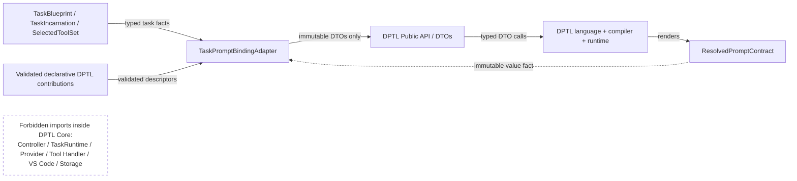

- DPTL core 只消费 source、profile、semantic snapshot、tool-feature summary 等 immutable DTO；
- 文件、workspace watcher、compiled artifact storage 与 plugin asset discovery 通过 adapter 实现 `DptlSourceResolver`/`CompiledPromptModuleRepository`，不进入 language/compiler core；
- Task、Provider 和 host types 在 `TaskPromptBindingAdapter` 处转换，DPTL public API 不 import 这些模块；
- `ResolvedPromptContract` 是 DPTL 的输出值，不持有 Task、registry、store 或 Provider client 引用；
- Task平台对DPTL的依赖收敛为`dptl/index.ts` DTO、纯`DptlRenderPort`与`cacheIdentityOf`。TaskPromptBindingAdapter是唯一导入边界；PromptContractCache位于adapter侧，CompiledPromptModuleStore位于DPTL侧。两者生命周期不得混同：编译模块只含公共模板/静态资产，可按source identity跨work复用；含Task/work语义值、渲染文本或私有fragment的ResolvedPromptContract只允许在对应Task/work与相容重试scope内复用。
- Prompt owner为两类缓存分别维护条目/字节预算、最后引用和淘汰；work完成/取消、Profile或redaction撤销、Task close必须释放私有contract引用，不能由常驻审批器无限保留已结束请求的派生文本。共享纯资产可继续存在，但不得引用请求payload、secret或完整私有Prompt。具体LRU/TTL算法留待实现测量，不新增cache authority。
- Cache引用释放不等于删除journal中的冻结调用记录。WS-086要求为重试/复现持久化的Prompt材料由现有journal/context owner按Task/work、原publication/attempt身份保存，受role的有限条目/字节保留策略及Task删除约束；不是PromptContractCache的磁盘副本。Pending/未ack工作的最小恢复证据保留至结算，之后原owner裁剪私有材料而保留必要的hash、结果与诊断引用。Profile/redaction撤销立即禁止旧材料用于新请求；若隐私策略要求删除，则经原owner裁剪并把不能再复现的旧请求明确标为不可重放，不用旧Prompt fallback或假装完整复现。Task删除覆盖这些记录；缓存淘汰本身不擅自删除可读会话历史。
- 单元测试可用 in-memory sources/semantic values 覆盖 compile/select/render；Task 集成测试只验证 adapter 的 typed mapping、revision tuple 和 identity。

### Prompt Material Lifetimes

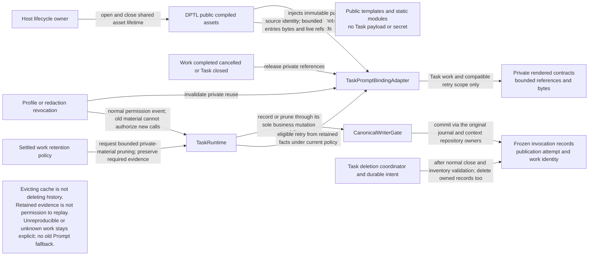

三类材料分别沿图示owner和scope回收；公共资产不得持有私有work值。Pending/未ack只保留必要恢复证据，材料被裁剪后如实标为不可复现，不伪造原Prompt。

### DPTL Modules

| Module | Responsibility | Runtime boundary |
|---|---|---|
| `DptlSourceResolver` | Resolve built-in、code/YAML owner、workspace/user `.pmt` and validated plugin assets into canonical source identities | compile-time/source refresh only; no provider-round I/O |
| `DptlCompiler` | Lexer、parser、typed AST、type/dependency/include analysis、IR、source map、semantic hash and diagnostics | deterministic and side-effect free apart from bounded source reads |
| `CompiledPromptModuleStore` | Cache immutable compiled modules by source/semantic identity | current module schema only; stale artifacts recompile |
| `PromptProfileRegistry` | Normalize code/YAML/plugin profile descriptors, deterministic selection and conflict resolution | shared definitions are versioned; adopted snapshot is immutable per promptRevision, not frozen for the whole opening |
| `PromptSemanticRegistry` | Register schema-backed values、predicates、functions and fragment producers with phase/type/version metadata | registration comes from platform or validated contribution adapters |
| `PromptBindingResolver` | Resolve `TaskBlueprint.promptBinding` to profile、role fragments、feature policy and source manifest | executed at opening and safe refresh boundaries |
| `PromptSemanticSnapshotBuilder` | Materialize Task/role/lineage/input/rules/skills/host facts into immutable typed values | external/plugin materialization happens before render with timeout/cancellation |
| `ResolvedPromptContractBuilder` | Atomically combine profile、compiled modules、semantic snapshot、SelectedToolSet、provider/model/mode and source identities | produces one provider-round contract |
| `PromptContractCache` | Reuse immutable contracts by complete dependency identity within declared Task/work/retry scope | private rendered contracts are budgeted and release references on work end/cancel/Profile-redaction revoke/Task close; public compiled assets are separate |
| `TaskPromptPort` | Expose the frozen contract to TaskIncarnation/provider request construction | consumer cannot mutate compiler/profile/semantic registries |

### Prompt Contracts

领域DTO（configuration/capability/prompt/extension snapshot与contract）是opening-free的不可变值：它们只携带自身内容身份与`RevisionTuple`成员，不携带`openingId/openingGeneration`。与opening的绑定只发生一次，由Task侧采用者在采用时用`OpeningBound<T>`（携带`OpeningIdentity`，不含operation fence）包装；下游比较统一走`assertAdmissible`，不在各DTO内重复opening字段。

```ts
/** Which published opening a value or business authority belongs to. */
interface OpeningIdentity {
  readonly openingId: string
  readonly openingGeneration: number
}

/** Local operation guard. The counter belongs to this operation, never to all works. */
interface OpeningGuard extends OpeningIdentity {
  readonly operationId: OperationId
  readonly operationGeneration: number
  readonly scope:
    | { readonly kind: "lifecycle" }
    | { readonly kind: "work"; readonly taskGeneration: number; readonly workId: TaskWorkId; readonly workGeneration: number }
}

/** Whether captured inputs are still compatible. Extended only here. */
interface RevisionTuple {
  readonly configurationRevision: string
  readonly capabilityRevision: string
  readonly promptRevision: string
  readonly extensionSnapshotIdentity: string
  readonly selectedToolSetIdentity: string
}

/** One-time binding of an opening-free value to the opening that adopted it; data, not authority. */
interface OpeningBound<T> {
  readonly identity: OpeningIdentity
  readonly value: T
}

interface TaskPromptBinding {
  readonly profileRef: PromptProfileRef
  readonly roleRef: TaskRolePromptRef
  readonly fragmentBindings: Readonly<Record<string, PromptFragmentRef>>
  readonly semanticPolicyRevision: string
}

interface PromptSemanticSnapshot {
  /** Cross-domain identity is a RevisionTuple subset chosen by RevisionRelevanceTable, never mirrored fields (I-6). */
  readonly revisions: RevisionsOf<"promptSemantic">
  readonly semanticRevision: string
  readonly values: Readonly<Record<string, PromptValue>>
  readonly fragments: Readonly<Record<string, MaterializedPromptFragment>>
  readonly sourceIdentities: readonly PromptSemanticSourceIdentity[]
  readonly redactionPolicyRevision: string
}

interface ResolvedPromptContract {
  readonly identity: string
  readonly revisions: RevisionTuple
  readonly profile: ResolvedPromptProfile
  readonly systemText: string
  readonly providerProjection: PromptProviderProjection
  readonly cacheIdentity: string
  readonly sourceManifest: PromptSourceManifest
  readonly diagnostics: readonly PromptDiagnostic[]
}

/** The only round-time DPTL entries the task platform calls; both pure and side-effect free. */
interface DptlRenderPort {
  render(input: PromptRenderInput): ResolvedPromptContract
}
declare function cacheIdentityOf(input: PromptRenderInput): string

/**
 * The single declaration of which RevisionTuple members each consumer compares (assertAdmissible) or carries
 * (DTO `revisions`). Call sites and DTOs name a row; they never spell a member list (I-6).
 */
declare const RevisionRelevanceTable: {
  readonly providerRound:         readonly ["configurationRevision", "capabilityRevision", "promptRevision", "extensionSnapshotIdentity", "selectedToolSetIdentity"]
  readonly inputAdmission:        readonly ["configurationRevision", "capabilityRevision"]
  readonly capabilityAdoption:    readonly ["configurationRevision"]
  readonly promptSemantic:        readonly ["configurationRevision", "capabilityRevision"]
  readonly capabilitySnapshot:    readonly ["configurationRevision", "capabilityRevision", "extensionSnapshotIdentity"]
  readonly configurationSnapshot: readonly ["configurationRevision"]
}
type RevisionConsumer = keyof typeof RevisionRelevanceTable
type RevisionsOf<C extends RevisionConsumer> = Pick<RevisionTuple, (typeof RevisionRelevanceTable)[C][number]>

interface ProviderRoundIdentity {
  readonly guard: OpeningGuard
  readonly revisions: RevisionTuple
}

/**
 * Shared published-opening business/input comparison; first publication and cleanup have separate ownership contracts:
 *  - any OpeningIdentity field differs            → revoked(reason)
 *  - operationId/scope differs (guard present)     → revoked(scope)
 *  - the same operation's generation differs      → superseded(operation)
 *  - task/work generation differs in work scope   → superseded(operation)
 *  - target and captured differ on any member in `relevance` (default: all) → superseded(revision)
 *  - otherwise                                     → admitted
 * A Provider round always uses a work-scoped guard. Cancelling work A never compares
 * or increments work B's operation counter. Lifecycle-operation cancellation only
 * invalidates that lifecycle operation; task-wide stop uses TaskState.taskGeneration.
 * Adopted data (OpeningBound) carries no operation fence and is not invalidated by work cancel.
 * `relevance` names one RevisionRelevanceTable row (default providerRound: every member);
 * call sites never spell a member list.
 */
declare function assertAdmissible(
  expected: OpeningGuard | OpeningIdentity,
  live: OpeningGuard,
  target?: RevisionTuple,
  captured?: RevisionTuple,
  relevance?: RevisionConsumer,
): { kind: "admitted" } | { kind: "superseded"; reason: "operation" | "revision" } | { kind: "revoked"; reason: string }
```

### Prompt Runtime Flow

1. `TaskBlueprint` selects a role and stores only `TaskPromptBinding`; Main/child creation never accepts an arbitrary preassembled system prompt.
2. `TaskExtensionSnapshot` contributes validated DPTL Profile/fragment/semantic descriptors to the opening-scoped binding overlay before a work contract is resolved；它不写共享`PromptProfileRegistry`。Opening-time semantics are pure、pre-materialized DTOs and perform no network/secret/host side effect.
3. `PromptBindingResolver` selects the effective Profile and compiled modules. Role fragments distinguish Main、Subagent、AI approver and Reviewer without creating separate prompt engines.
4. `PromptSemanticSnapshotBuilder` materializes only facts required by the declared role/profile/work contract, from a compatible capture of Task/input and demanded capability inputs. Effectful semantic work is not an initial control-opening prerequisite; it uses bounded proposal/execution segments with reservation-free approval waiting through the existing Broker/ApprovalAuthority. Secret/private facts follow the owning redaction contract before entering values.
5. `ResolvedPromptContractBuilder` atomically combines semantic facts、effective configuration、profile、role、SelectedToolSet and provider identity. Prompt text、native/XML tools、cache identity and metadata therefore share one `promptRevision` rather than overloading opening generation.
6. `TaskProviderRequestFactory` captures one `ProviderRoundIdentity` over compatible frozen inputs: the resolved prompt and bounded request/history projection use the same captured canonical input facts where their dependencies overlap. A prepared contract is reusable only when its relevant dependency values still match that capture; mismatch returns to the owning preparation path without dispatch. Mid-round changes do not mutate or invalidate an otherwise authorized admitted round merely because newer facts or revisions exist.
7. Child Task creation passes typed `ChildTaskPromptInput`—objective、parent summary/context references、delegation ceiling、result contract and lineage. DPTL renders the child prompt from its role Profile; the parent does not concatenate `contextPrefix` text.
8. Resident approval uses its dedicated API Profile and the same DPTL engine. The role selects purpose-specific inputs: the dialogue work receives authenticated user conversation; each review work receives one redacted request, explicit workspace approval principles and minimal relevant coordination facts. `resident_approval` requires rubric, redaction manifest, target/risk, four-outcome schema and tools_def; `toolPolicy=effective_set` may be empty and remains role/delegation-bounded. It never inherits a requesting Main Task's system_info/user_instructions or another work's private conversation. This replaces WS-086's former explicit_empty role assumption without changing the language or validator.
9. Compile、selection、semantic materialization or render failure blocks only work requiring that contract and returns source-aware diagnostics, not control opening or recovery presentation. Candidate snapshot发布校验当前target；已admit结果校验冻结输入/operation与登记的execution attempt及live执行opening/lock/safety。普通新revision不使合法旧round失效；跨opening续行只能通过Runtime的durable recovery授权关系，不能改写原始round或旧callback身份。

#### Revision identity and ordering

- Revision identity表示内容相等，不代表时间顺序；hash的词法大小也不表达新旧。Opaque/branded types是区分domain的一种实现选择，不把接口示意中的字段形式作为架构验收标准。
- 每个source提供自己的sequence/epoch；无法提供有序版本的source由projection owner分配process-lifetime sequence。TaskConfigurationFeed使用明确的`feedEpoch + sequence`排序，完整source vector用于一致性与equality，不充当跨store事务。
- ProviderRoundIdentity在request boundary一次性捕获，各consumer使用同一冻结身份。恢复后重新捕获当前source/epoch，另一进程的catalog/feed计数属于不同序列。
- 本Task的回调/提交使用OpeningGuard与RevisionTuple检查opening、operation和输入相容性；它是进程内控制合同，不提供跨进程物理写入隔离。锁检查、unlock与接管复用TaskLockService，repository继续使用已有事务及atomic-file，不在每个DB/JSON写入前增加lock epoch协议。Source watcher身份仍只在catalog内部使用。
- `assertAdmissible`为纯同步标量比较，无I/O或await；只在业务准入、commit/dispatch、capability begin/commit等权限边界调用，不进token/chunk或read projection。相关revision数量由声明表决定。以`guardCheckCount/guardCheckMs`独立观测，不能用“只有常数比较”替代实际CPU证据。

### Capability Snapshot and Provider Admission

性能结论以当前production基线与最终相同fixture的分段测量为准；本规范只规定终态依赖与成本归属，不把历史观察或图上的bounded标注当作实测SLO。

Source-specific domain 继续拥有各自 authority；统一层只建立 immutable read projection，不创建第二 catalog：

| Contract | Responsibility | Boundary |
|---|---|---|
| `CapabilitySourceSnapshot` | 由 rules、workflows、skills、subagents、MCP 与 validated extension adapters 扫描/解析并产出 descriptor、content hash、diagnostic 与 source revision | source owner 内完成文件读取；snapshot 发布后不持有 watcher、文件句柄或 mutable registry |
| `WorkspaceCapabilityCatalog` | 以 host storage boundary、ordered logical topology、remote source document revision、source policy 与 watch plan 形成 immutable key；合并 watcher/settings invalidation，对同 key 执行 single-flight refresh并发布 process-lifetime monotonic catalog revision | workspace/process scoped reusable read authority；拥有“当前已发布 source snapshot/revision”，但不拥有 source 内容或 task toggle；provider round不直接触发目录扫描 |
| `TaskCapabilitySnapshotBuilder` | 把 workspace catalog snapshot 与 `EffectiveTaskConfigurationSnapshot` 投影为 Task/role/toggle/permission 可见的 immutable catalog 与 prompt facts | 绑定 opening identity和独立 capability revision；不复制 source authority，不执行 network/secret/host effect |
| `TaskCapabilitySnapshot` | 保存 catalog/source/config/toggle/policy revisions、content fingerprints 与 diagnostics | 一个 provider round只捕获一个 identity；同 opening内后续 refresh发布下一 capability revision，不自动替换 opening |
| `ProviderAdmissionTiming` | 分离 catalog refresh、task capability projection、prompt contract resolve、request/history projection、fence check、retry/reprepare 与 upstream wait | `localPrepareMs`只保留为兼容诊断，不作为单一性能归因或最终SLO |

#### Provider hot-path contract (single source)

以下HP规则是provider热路径的唯一事实源；本文其它章节、Behavior与AC只引用HP编号，不重述规则。审批路径与opening替换路径各有同级的单一合同（§11 `AP-1～AP-4`、L3 `RP-1～RP-4`），三者共用同一分段观测与基线方法：

- **HP-1 零源读取：** 没有source invalidation的provider round对settings、capability directory scan与full-content reread为0；prompt freshness、input projection与DPTL render只读取已发布的immutable snapshot。
- **HP-2 同步依赖链：** round所需工作准备包含canonical input capture、相关capability投影、Prompt cache lookup/必要render与bounded request/history projection；这些CPU成本必须计量，不因改名为admission就算消失。冻结相容输入后transport不再等待source读取、checkpoint、History/activity maintenance、full projection或observer；Broker不进入token/chunk路径。源或effectful语义未就绪只暂停依赖工作，控制/人工响应仍可进展。
- **HP-3 等待位置：** 首次scoped demand没有可用snapshot，或输入明确要求变化后capability时，在该工作准入路径有界等待可取消的共享refresh；失败返回typed unavailable，不阻塞无关控制。已有相容snapshot上的plain input或已解析invocation不等待freshness refresh。Provider transport preparation不扫描源，也不通过隐式回旧scope消除等待。
- **HP-4 一次捕获：** 每个round在admission原子捕获一个`ProviderRoundIdentity`，所有consumer使用同一冻结身份；普通新revision不使已admit round失效，mid-round变化只影响后续round。
- **HP-5 分段观测：** 最终观测分别记录`controlAdmissionMs`（仅生命周期inbox接纳与kernel命令派发）、`domainAdmissionMs`（KernelPort校验、Runtime排队/转换）、`catalogRefreshMs`、`taskCapabilityProjectionMs`、`promptContractResolveMs`、`requestProjectionMs`、`fenceCheckMs`、`providerAdmissionMs`、`retryDelayMs`、`reprepareMs`与per-attempt `upstreamTtfbMs`；普通provider round不虚构一次ControlInbox跳转，聚合`localPrepareMs`不作为根因证据。

#### Capability Snapshot and Provider Hot Path

```mermaid
flowchart LR
    %% id: L2-capability-provider-hot-path
    %% layer: L2
    %% kind: flow
    %% refines: L0-ownership, L1-prompt-pipeline
    %% answers: what runs on the provider hot path, what may block it, and where shared, task and admitted-round validity are decided
    %% concept: Catalog = WorkspaceCatalog
    %% concept: SettingsProjection = ConfigurationCoordinator
    %% concept: SourceAdapters = CapabilitySources
    %% concept: CapabilitySnapshot = CapabilityView
    %% concept: SelectedTools = SelectedTools
    %% concept: PromptSemantics = Semantics
    %% concept: PromptBuilder = Builder
    %% concept: ProviderRequest = ProviderFactory
    %% concept: TaskControl = Control
    %% concept: Snapshots = OpeningSnapshots
    %% note-node: Maintenance
    %% note-node: HotPathRule
    %% concept: TaskCapability = CapabilityDemand
    %% local-only: SourceReady
    %% local-only: CancelWait
    %% local-only: WorkUnavailable
    %% local-only: FeatureDemand
    %% local-only: PhysicalWatchers
    %% local-only: SourceCheck
    %% local-only: CatalogSnapshot
    %% local-only: SourceUnavailable
    %% local-only: Demand
    %% local-only: SnapshotBuilder
    %% local-only: Empty
    %% local-only: AdoptionCheck
    %% local-only: CandidateUnavailable
    %% local-only: ConfigSnapshot
    %% local-only: PureExtensions
    %% local-only: PromptContract
    %% local-only: Transport
    %% local-only: Reprepare
    %% local-only: ResultCheck
    %% local-only: LiveFence
    %% local-only: LateResult
    %% local-only: InputCommit
    %% local-only: EffectfulSemantic
    %% local-only: InvocationBroker
    TaskControl -->|effect quiesce seal resume close or command| KernelPort
    SnapshotsPort -.->|applied target or rejected fact| Inbox
    KernelPort -.->|sealed quiesced resumed closed or recovery-needed fact| Inbox
    Catalog -.->|source revision or unavailable fact| Inbox
    SnapshotsPort -->|injects immutable matching effective-tool snapshot| SelectedTools
    PhysicalWatchers[PhysicalWatchPool] -->|filesystem events only| WatchRegistry[WorkspaceCapabilityWatcherRegistry]
    Catalog[WorkspaceCapabilityCatalog] -->|acquire watch claims and barrier before source read| WatchRegistry
    WatchRegistry -.->|readiness invalidation overflow and CapabilityWatchFence facts| Catalog
    SettingsProjection[TaskConfigurationProjectionCoordinator] -->|source-affecting revision only| Catalog
    Catalog -->|catalog-owned single-flight and cancellation| SourceAdapters[Rules / Workflows / Skills / Subagents / MCP / Extension source adapters]
    SourceAdapters -.->|immutable source snapshot and revision facts| Catalog
    Catalog -->|source key and watch fence after barrier ack| SourceCheck{Shared-source publish check\nCatalog owner; no Task opening}
    SourceCheck -->|valid shared source| CatalogSnapshot[WorkspaceCapabilityCatalogSnapshot]
    SourceCheck -->|invalid; no publication| SourceUnavailable[Superseded or unavailable source result]
    CatalogSnapshot -->|catalog revision event| Inbox[ControlInbox]
    SettingsProjection -->|view-only configuration revision event| Inbox
    Inbox -->|ordered event| TaskControl[TaskControl]
    TaskControl -->|adopt revisions after matching kernel boundary fact| SnapshotsPort[OpeningSnapshotPublisher]
    SnapshotsPort -->|publishes matching effective target| Snapshots[OpeningSnapshots]
    FeatureDemand[TaskFeatureSet.capabilityDemand from the blueprint] -->|declared upper bound; data not a branch| Demand{Capability domain source demand\nowned by TaskCapabilitySnapshotBuilder}
    Snapshots -->|published revision triggers lazy reprojection on next demand| Demand
    Demand -->|scoped source required| SourceReady{Already published compatible source?}
    SourceReady -->|yes; no source I/O| SnapshotBuilder[TaskCapabilitySnapshotBuilder]
    SourceReady -->|first or invalidated scope; wait outside control opening| TaskCapability[Opening capability domain\nbounded cancellable work waiter]
    TaskCapability -->|acquire snapshot or join one shared refresh| Catalog
    Catalog -.->|published snapshot or unavailable facts for registered waiters| TaskCapability
    TaskCapability -->|ready and still relevant| SnapshotBuilder
    TaskCapability -->|timeout unavailable or cancelled| WorkUnavailable[Only this work unavailable\nunrelated control continues]
    CancelWait[Work cancellation or opening disposal] -->|release this waiter and its demand ref only| TaskCapability
    SourceUnavailable -->|notify affected waiters; no false fresh snapshot| WorkUnavailable
    Demand -->|no source required by the declared contract| Empty[Explicit source-free Task view\nno watcher or catalog subscription]
    Empty -->|source-free candidate; same Task adoption fence| AdoptionCheck
    ConfigSnapshot -->|configuration and policy identity| Empty
    CatalogSnapshot -->|injects immutable snapshot| SnapshotBuilder
    ConfigSnapshot[EffectiveTaskConfigurationSnapshot] -->|injects immutable snapshot| SnapshotBuilder
    SnapshotBuilder -->|candidate and complete projection identity| AdoptionCheck{Task adoption check\nopening target revision and scope}
    Snapshots -->|OpeningGuard and target RevisionTuple for assertAdmissible| AdoptionCheck
    AdoptionCheck -->|valid Task candidate| CapabilitySnapshot[TaskCapabilitySnapshot]
    AdoptionCheck -->|invalid; no adoption| CandidateUnavailable[Superseded or unavailable Task candidate]

    CapabilitySnapshot -->|injects immutable snapshot| PromptSemantics[PromptSemanticSnapshotBuilder]
    ConfigSnapshot -->|injects immutable snapshot| PromptSemantics
    SelectedTools[SelectedToolSet] -->|injects immutable tool facts| PromptBuilder[ResolvedPromptContractBuilder]
    PureExtensions[Pure TaskExtensionSnapshot descriptors] -->|validated declarative descriptors| PromptSemantics
    PromptSemantics -->|injects immutable semantic snapshot| PromptBuilder
    PromptBuilder -->|creates one immutable contract| PromptContract[ResolvedPromptContract]
    PromptContract -->|prepared contract with its input dependencies| ProviderRequest[TaskProviderRequestFactory\ncoherent capture with bounded request projection]
    ProviderRequest -->|compatible captured inputs; freeze ProviderRoundIdentity| Transport[Provider transport attempt]
    ProviderRequest -->|dependency mismatch; no dispatch| Reprepare[Superseded preparation\nreturn to owning admission path]
    ProviderRequest -->|frozen origin input and registered execution attempt| ResultCheck{Admitted-round completion check\nnot the latest candidate target}
    Transport -->|attempt result| ResultCheck
    LiveFence[Current execution opening / lock / safety fence] -.->|live fence state| ResultCheck
    ResultCheck -->|valid admitted round even after ordinary revision changes| Runtime[Existing TaskRuntime]
    ResultCheck -->|revoked or superseded operation| LateResult[Ack / cancelled / unknown outcome by operation kind]

    InputCommit[Captured canonical input and committed runtime facts] -->|state-dependent semantic inputs| PromptSemantics
    InputCommit -->|same captured facts for bounded request projection| ProviderRequest
    Maintenance["Outside provider admission (HP-2):\ncheckpoint / History and activity hydrate / full projection / observer and OTel"]
    HotPathRule["Provider hot-path contract HP-1..HP-5 applies to this diagram"]
    style Maintenance stroke-dasharray: 5 5,fill:none
    style HotPathRule stroke-dasharray: 5 5,fill:none

    EffectfulSemantic[Effectful plugin semantic request] -->|addressed domain event| KernelPort[KernelPort]
    KernelPort -->|validated task and work event| Runtime
    Runtime -->|committed command via owning plugin executor| InvocationBroker[PluginInvocationBroker]
    InvocationBroker -.->|typed materialized result fact with original work identity| Runtime
    Snapshots -->|publishes next semantic/prompt revision| PromptSemantics
```

三个菱形分别属于共享Catalog发布、Task候选采用和已admit round完成边界，不是新增validation service，也不合并成一个“current generation”判断。前两者分别对共享source目标、当前Task目标判断；第三者同时核对冻结的origin round/operation与Runtime登记的execution attempt及其live执行opening/lock/safety。普通路径二者来自同次admission；跨opening的差异只由durable recovery关系授权，旧callback不能自建该关系。普通新配置不会误杀合法旧round。

图中canonical facts同时进入semantic准备与request投影，避免“prompt来自旧输入、history来自新输入”的拼接。依赖由已有Prompt/输入owner表达，不引入全局dependency manager；不相关的canonical提交不要求全量重建prompt。尚未admit的准备不兼容时返回所属准备流程，已admit round仍保留自己的冻结输入；检查的是相容性而非强求每次请求都使用全局最新状态。

```ts
interface TaskCapabilitySnapshot {
  readonly identity: string
  /** Cross-domain identity is a RevisionTuple subset chosen by RevisionRelevanceTable; own fields below are content identity only (I-6). */
  readonly revisions: RevisionsOf<"capabilitySnapshot">
  readonly sourceDemand: "none" | "scoped"
  readonly workspaceCatalogIdentity: string | null
  readonly workspaceCatalogRevision: number | null
  readonly workspaceTopologyIdentity: string
  readonly sourceRevisions: Readonly<Record<string, string>>
  readonly sourceFreshness: Readonly<Record<string, CapabilitySnapshotFreshness>>
  readonly effectiveToggleRevision: string
  readonly promptInputFingerprint: string
  readonly diagnostics: readonly CapabilityDiagnostic[]
}
```

#### Catalog reuse and workspace watcher boundary

共享source、Task投影与物理watcher各有owner。总体合同自足，后续Task只能细化，不能追加控制opening的source就绪前置。

- **Fanout与投影分别计量。** 单个已发布catalog revision对每个受影响订阅至多一个pending通知；latest-wins只折叠尚未消费的更新。空闲且无需求的Task不投影；活跃Task在不同更新之间消费时允许再次投影，总成本取决于实际消费revision数、活跃订阅数与相关内容量，不声称任意K次更新总共只有O(N)。
- **Prompt复用不新增owner。** CompiledPromptModuleStore与adapter侧PromptContractCache分别持有公共编译结果和受scope约束的contract；key含真实依赖输入，不含可变对象引用。Owner必须观测hash/render/lookup、条目/字节、eviction和private-reference lifetime；新增缓存须有实测价值，不能把Catalog authority或Task投影改名为另一个Prompt缓存。
- **共享取消域与Task取消域分离。** Catalog job使用共享owner的取消域；Task的AbortSignal只撤销本Task的waiter/adoption/demand。
- **Watcher只发布barrier与invalidation。** Registry是process-owned，key = host storage boundary + logical topology + static watch plan + source policy（不含TaskId/cwd/exact paths）；source adapter是唯一内容authority，`WorkspaceCapabilityCatalog`是唯一refresh/single-flight/publish authority；`full_rescan_required`是sticky state；degraded/exhausted时返回typed stale/unavailable，不在provider round同步扫描兜底。
- **Topology变化形成composition target。** 控制发布原子采用topology identity、permission/tool roots与opening environment，不等待完整source refresh；缺失的新scope数据标为unavailable，绝不把旧scope的snapshot冒充新scope。root移除等收紧先走safety。仅当实际工作需要scoped source时才acquire新key并完成watch-before-read握手。

运行规则：

1. 控制opening不以workspace source扫描为前提。`TaskFeatureSet.capabilityDemand`是该Task的声明上界：`none`产生显式空source视图（catalog/watch字段无值，不伪造freshness），不acquire watcher；`scoped`时capability owner再按实际工作需求决定何时acquire对应watch barrier、共享refresh并投影Task view——上界是数据，实际获取时机由owner在上界内决定，不存在第二个demand来源。
2. 文件、remote source document、MCP descriptor、extension source或workspace topology变化只使对应catalog key dirty并产生一次shared refresh。Task-local/global/workspace toggle变化只发布configuration revision并重算Task view，**不得**重新扫描filesystem source。
3. Catalog refresh完成后，各Task只收到同一workspace catalog revision事件；TaskControl在safe/exclusive refresh boundary采用同opening内新的configuration/Profile/extension/tool与source-target引用tuple。`CapabilityDemand`随后只在该已采用target下按实际work发布不可变`TaskCapabilitySnapshot`，它不能产生或扩大`SelectedToolSet`。只有lifecycle/resource-class变化才进入opening replacement。
4. 共享source refresh发布只校验catalog key/source target与适用watch/topology/source-policy fence；Task采用结果时以`assertAdmissible`校验自身`OpeningGuard`与target `RevisionTuple`及subscription scope，并以`OpeningBound<TaskCapabilitySnapshot>`绑定一次。某个Task的opening失效只使它的采用结果过期，不使其它Task仍需要的共享source结果过期。
5. 零源读取遵循HP-1。BUGFIX-210的`WorkspaceCapabilityCatalogRegistry`是该边界的生产前置实现，WS-106基于稳定产物演进key、source覆盖、barrier和TaskControl接线，不建立平行catalog。终态Task投影只消费`WorkspaceCapabilityCatalogSnapshot + EffectiveTaskConfigurationSnapshot`；当前`projectTaskCapabilityView`直接接收`StateManager`的形态在cutover时移除。
6. 等待位置遵循HP-3：plain input与current snapshot中已解析的capability invocation不等待refresh。
7. Source refresh采用bounded batch/quantum、cooperative yield与catalog-owned cancellation，通过process-scoped `HostMaintenanceScheduler`共享物理预算。Provider admission、promotion与safety可让维护工作让出执行片；单Task取消不终止其它需求仍有效的共享job。无需跨opening恢复的refresh不进入durable `TaskJobRegistry`。
8. Provider admission路径与后台lane遵循HP-2。
9. 分段观测遵循HP-5；provider retry/reprepare不混入catalog/capability/prompt性能归因。

Watcher总体协议：key由host storage boundary、ordered logical topology、static physical plan、source policy组成，不包含TaskId/cwd/dynamic exact path。PhysicalWatchPool只合并相同canonical claim/backend options，不丢弃nested root与precedence语义；exact overlay按subscription scope计数和定向失效。Canonical path由host resolver处理realpath/case与remote identity，无法确定则typed reject。

实际demand发生时：安装watch → bounded operational ready → capture barrier → source owner读取/解析 → validate-and-ack → Catalog publish。期间相关事件、overflow、recovery或topology变化使barrier失效；`full_rescan_required`保持sticky直到完整受影响scope刷新成功。共享job使用catalog取消域，Task取消只撤销waiter/adoption；source owners不各自保留第二watcher。Dynamic exact add/remove使用相同握手。

Entry epoch不复用，backend replacement推进watch generation。Health区分ready/error/overflow/terminal；deadline、retry/backoff+jitter与circuit-open probe有界。Degraded仅按明确stale_usable策略服务不要求新数据的工作；新scope不能使用旧scope输入。Active/idle entries、physical handles、refs、backlog和timers均有预算；只驱逐idle，不驱逐active subscriber。Host shutdown关闭新acquire/rearm，等待实际watch/source cleanup；Task退出仅detach自己的refs。所有上限集中配置并在代表性现场测量，不在图中编造性能数字。

### Provider Failure Interpretation and Presentation Contracts

UR-16要求在本Workstream改写的Provider执行、Runtime与视图链路上收敛现有耦合。2026-10-19只读调查（主执行者复核关键位置）确认的现状：

- **同一失败被多处各自判断。** `isRetryableProviderError`（`src/core/task/auto-retry.ts`）、`isRejectedCredentialError`、`checkContextWindowExceededError`（`src/core/context/context-management/context-error-handling.ts`）与`ClineError.getErrorType`分别读取原始错误；Provider的`ApiHandler.parseError?`只影响显示，不参与重试、恢复或上下文判断。`getErrorType`把401～428一律视为auth，`auto-retry.ts`再用状态码补偿。状态/code提取至少有八份实现。
- **Provider专属知识在共享层。** `context-error-handling.ts`集中维护OpenAI/OpenRouter/Anthropic/Cerebras/Bedrock/Vercel/Qwen的文本匹配，其中Anthropic任意`invalid_request_error`都会被当作上下文超限；Cerebras、SAP AI Core、Dify、OpenRouter等把status塞进message或丢弃。
- **重试owner分裂。** Provider `withRetry`装饰器、Task、Subagent与compaction各有一套策略；Task请求跳过装饰器后，Provider给出的Retry-After或Gemini RetryInfo从未被主流程读取。
- **UI解析原始Provider文本。** `api_req_failed`的text有四种格式，`error_retry`内为双重JSON；Webview导入后端`ClineError`重新分类，并按`providerId`分支；`ClineError.serialize()`未做脱敏与长度上限。
- **呈现层依赖窗口位置与重复映射。** 行组件用“窗口内最后一行”推导运行状态，presentation combiner在窗口边界产生不同结果，行内JSON payload缺少共享codec，ask→interaction kind与presentation kind映射分散在registry、callbacks owner、adapter和Webview多处，工具呈现按名字在多处switch。

```mermaid
flowchart LR
    %% id: L2-provider-failure-presentation
    %% layer: L2
    %% kind: flow
    %% refines: L0-ownership
    %% answers: how a raw provider failure becomes one typed failure that retry, recovery and presentation all consume, and how typed rows reach the Webview without provider knowledge or window-position inference
    %% local-only: Attempt
    %% local-only: Interpreter
    %% local-only: DefaultInterpreter
    %% local-only: Failure
    %% local-only: RetryPolicy
    %% local-only: Recovery
    %% local-only: Codec
    %% local-only: InteractionTable
    %% local-only: Renderer
    %% local-only: Diagnostics
    %% local-only: Executors
    %% local-only: Finalizer
    %% local-only: LegacyUpgrade
    %% local-only: RowProjection
    Attempt[Provider adapter attempt\nprepare send or stream; keeps status code headers and cause] -->|raw failure from any attempt phase inside the provider executor| Interpreter[Provider-owned failure interpreter\noptional; lives in the provider module]
    Interpreter -->|undecided not implemented or interpreter error| DefaultInterpreter[Default failure interpreter\nruns for every failure; ordered provider-agnostic heuristics]
    Interpreter -->|partial typed draft merged field by field over the default draft| Finalizer[Shared failure finalizer\nstrips raw data; one detail filter; decision-gated redaction caps and link checks; freezes the value]
    DefaultInterpreter -->|complete typed default draft| Finalizer
    Finalizer -->|sole constructor| Failure[ProviderFailure\nkind phase retry hint recovery hint and allowlisted presentation fields]
    Failure -.->|redacted status code and request id only| Diagnostics[Diagnostics and export]
    Failure -.->|typed failure inside the single-attempt outcome fact; raw error never crosses| Executors[CommandRouter / Executors]
    Executors -.->|completion fact with operation and opening identity| Runtime[TaskRuntime]
    Runtime -->|typed attempt outcome with the role and operation retry policy rows| RetryPolicy[Runtime retry policy\nsingle decision owner per role and operation; shared budget across prepare first-chunk and mid-stream; manual retry opens without automatic retries]
    Runtime -->|kind and recovery hint only| Recovery[Recovery routing\ntool-pairing repair context truncation profile change billing sign-in or manual retry]
    RetryPolicy -.->|scheduled retry phase or exhausted decision fact| Runtime
    Recovery -.->|selected interaction kind withdrawal and continuation fact| Runtime
    Runtime -.->|committed runtime delta facts including the retry phase| ReadModel[TaskReadModel]
    ReadModel -.->|current opening committed deltas only| ViewProjectionOwner[TaskViewProjectionOwner]
    Runtime -->|encodes row payloads through the shared codec before commit| Codec[Shared UI message codec\nversioned typed DTOs per say and ask; no classification and no core imports]
    ViewProjectionOwner -->|ordered committed rows and existing legacy row text| LegacyUpgrade[Backend legacy row upgrade\nlegacy failure text through the failure module; legacy tool kinds to tool id and variant]
    LegacyUpgrade -->|typed rows in commit order| RowProjection[Shared incremental row projection\ncursor bounded carry state stable row ids and upsert remove reset deltas]
    ViewProjectionOwner -->|owns stable feed facade| ViewSource[TaskViewSource / MessageFeed]
    RowProjection -.->|projected row delta results with tail request status merge and superseded state| ViewSource
    ViewSource -->|snapshot page delta reset| WebviewStores[WebviewMessageWindowStore]
    Codec -->|decode typed payload once on arrival; no legacy parsing| WebviewStores
    InteractionTable[Shared interaction and row kind table plus ToolCatalog presentation variants\nno second tool table] -->|kind and tool variant to renderer mapping| Renderer[Interaction and row renderers]
    WebviewStores -->|decoded projected rows plus TaskViewState retry phase| Renderer
```

合同：

1. **PF-1 一个失败值，唯一构造者。** Provider执行器在attempt边界（prepare、send、首chunk前与流中任一阶段）对每次失败恰好解释一次。Profile准入拒绝（`ProfileNotValidError`）与执行器自身合成的失败（如“stream ended without content”）同样经同一finalizer成为`ProviderFailure`，不存在绕过finalizer的原始失败结果。Provider解释器与默认解释器只产出`ProviderFailureDraft`；`src/core/api/failure`的共享finalizer是`ProviderFailure`的唯一构造者。值包含：
   - 封闭`kind`：`rate_limited | overloaded | server_error | retryable_status | timeout | network | stream_interrupted | auth_rejected | auth_other | balance | spend_limit | quota | context_window | output_limit | invalid_request | not_found | profile_invalid | tool_pairing_rejected | cancelled | unknown`；
   - `phase`：`prepare | first_chunk | mid_stream`，旧行升级时为`legacy_unknown`；
   - `status`与`statusSource`（`structured | text | none`）：记录状态码来自结构化字段还是message文本，供策略复现今日两种提取口径；
   - Provider提示：最小等待（Task流量是否采用由BD-2决定），以及输出上限重放提示（如OpenAI max-output时的缩减上限）；
   - 封闭recovery提示：`profile_change | add_credits | request_limit_increase | force_truncate | manual_retry | none`，与kind独立计算。`profile_change`严格等于今日`isRejectedCredentialError`规则（结构化status 401或凭据错误码），对应`profile_failure`交互；
   - 独立的`signInPrompt`呈现字段（见下文登录提示），与recovery提示并存：今日Dline 401既是Profile失败卡，又显示登录提示；
   - 重现现有卡片所需的allowlist呈现字段：`providerId`（按现状原样显示，不改为label）、model、status、code、requestId、卡片message、detail条目；额度卡的`currentBalance`、`totalSpent`、`totalPromotions`与充值目标；消费上限卡的已用、上限、`budget_period`、重置时间与可否申请提额。
   - 充值目标是封闭union：`explicit(url)` | `provider(url)` | `dline_account`。选择顺序与今日一致：
     1. 错误给出的链接；
     2. Provider元数据声明的充值页，取代Webview的`PROVIDER_RECHARGE_URLS`；其中Dline Provider（字面id `cline`）声明用户credits页，与今日一样不随组织变化；
     3. Provider未声明时为`dline_account`，由Webview按当前组织选择Dline用户页或组织页。

     Webview对URL包含`app.dline.bot`的任何目标追加回调参数，与目标类型无关，与今日的子串规则一致。
   - 登录提示：今日条件为`ClineError.getErrorType`判为Auth（status 401～428或`ERR_BAD_REQUEST`、auth message规则、`CLINE_ACCOUNT_AUTH_ERROR_MESSAGE`、`AuthInvalidTokenError`），且providerId为字面值`cline`。该完整规则迁入Dline Provider解释器，产出`signInPrompt: true`；Webview不再判断。

   Finalizer按固定顺序执行：
   1. 剥离原始SDK错误、headers与响应体；用户不可见，始终执行。
   2. 按今日`ApiErrorBox.parseApiErrorDetails`的完整推导生成卡片message与detail条目：`details.message`优先作为message；省略敏感key名；最多16个原始值条目，深度不超过2；去除与已显示字段重复的值；原始值数组拼接。额度与消费上限卡沿用今日的message来源。该推导迁入finalizer成为唯一策略，可见结果不变。
   3. BD-5采纳时，先对message与detail值遮蔽密钥形态子串（复用`safe-diagnostic-value`的识别规则），再按BD-5常量截断并标注；status、code、requestId不遮蔽、不截断；复制文本与展示文本相同。未采纳时不遮蔽、不截断。
   4. BD-6采纳时，`explicit`链接只在https且origin属于该Provider元数据声明的受信origin时保留，否则按上述顺序回落。未采纳时`explicit`链接按现状使用。
   5. 规范化kind与hint组合，冻结。

   原始SDK错误、headers与响应体不进入Runtime、journal、kernel dialog state、UI消息或Webview。现有执行器`ProviderFailure`（Error子类）与`ProviderFailureRecovery`被该值取代。kernel新增携带该值的Provider/compose失败dialog变体；旧失败dialog分支保留到TASK-10638移除（PF-8）；其他dialog kind的`presentationRef`不变。
2. **PF-2 Provider可选解释、默认回落、通用启发式保留。** Provider模块可实现`interpretFailure(raw, ctx): ProviderFailureDraft | undefined`。它由现有`ApiHandler.parseError?`演进而来，不另建平行hook；`ctx = { providerId, modelId, phase, attempt }`。
   - 默认解释器对每个失败都先运行，给出完整draft。Provider draft只给出它确定的字段，finalizer逐字段覆盖默认结果；例如Gemini只在429给出RetryInfo，DeepSeek只处理401/402/429，其余字段沿用默认。
   - Provider解释器返回undefined、未实现或自身抛错时，使用默认结果并记录诊断，与今日回落`ClineError.transform`一致；不得退化为`unknown`而丢失auth、rate-limit与上下文启发式。
   - 默认解释器的判定顺序与今日`ClineError.getErrorType`及各分类器一致：
     1. 取消/abort；
     2. 确定性tool pairing拒绝，先于上下文超限；
     3. 上下文超限；输出上限；
     4. 额度（`insufficient_credits`且带数值`current_balance`）与消费上限（`SPEND_LIMIT_EXCEEDED`）；
     5. 凭据拒绝：结构化status 401或凭据错误码，即`auth_rejected`；与今日`isRejectedCredentialError`一样在嵌套字段中查找；
     6. 402～428区间，即今日`getErrorType`的status区间auth：
        - 408→`timeout`，409与425→`retryable_status`；与今日auto-retry的豁免一样在嵌套字段中查找；
        - 其余值→`auth_other`；与今日`getErrorType`一样只看顶层status；
     7. `INFERENCE_CAP_ERROR`→`quota`；
     8. 非status的auth信号→`auth_other`：`ERR_BAD_REQUEST`、`AuthInvalidTokenError`、auth message规则、`CLINE_ACCOUNT_AUTH_ERROR_MESSAGE`；
     9. rate-limit文本（含“quota exceeded”）→`rate_limited`；
     10. 其余结构化status，按提取器的结构化字段（顶层与嵌套）取得。它位于文本规则之后，所以第7～9步对这些status照常生效：
        - 400→`invalid_request`，429→`rate_limited`，529→`overloaded`；
        - 其他5xx→`server_error`，其他4xx→`invalid_request`；
     11. 网络、超时、流中断；
     12. unknown。

     第5、6、10步只使用结构化status，查找深度按各步所述。文本取得的status（`statusSource: text`）只供PF-3的eligibility谓词使用，不参与kind判定。

     一般的402不判为`balance`，与今日一样显示普通失败卡。重试是否发生由PF-3的eligibility谓词决定，不由kind名称推断。
   - 当前对所有Provider生效的通用启发式保留在默认解释器：
     - OpenRouter/Bedrock/Vercel风格的上下文超限文本；
     - Anthropic SDK形态规则（BD-1已采纳，收窄）：适用于anthropic、vertex、minimax、claude-code、litellm、oca、sapaicore、aihubmix等基于Anthropic SDK的适配器。Anthropic SDK形态的`invalid_request_error`只有同时带有上下文超限证据时才判为`context_window`。证据复用`src/core/context/context-management/context-error-handling.ts`中OpenRouter与Vercel检查已有的上下文超限文本模式（`CONTEXT_ERROR_PATTERNS`）。没有证据时按后续规则判定，通常为`invalid_request`，显示失败卡片；
     - auth与rate-limit文本规则；
     - 通用400按现状可重试。
   - 迁入各自模块的Provider专属知识：Gemini RetryInfo、DeepSeek余额、Cerebras、OpenAI输出上限重放的缩减上限，以及Dline的登录提示与充值页。
   - 提取器只有`src/core/api/failure`一份。它返回status及其`statusSource`：先取结构化字段，再按今日`extractHttpStatus`使用的message文本模式取得。仍服务非Task流量的`withRetry`改用它。Provider适配器按已采纳的BD-3补齐结构化status/code，范围见BD-3细表。
   - `upgradeLegacyFailureRow`把当前Task中已有的旧格式`api_req_failed`/`error_retry`文本（四种格式与双重JSON）转为`ProviderFailure`。它以行内可得的providerId与model（缺失为`unknown`）、`phase: legacy_unknown`、`attempt: 0`调用默认解释器与同一finalizer。它只由后端投影只读调用，呈现DTO只由PF-4的编码器产生；Webview与共享codec不包含分类规则。
3. **PF-3 Runtime是唯一决策owner，执行器只做单次attempt。** Provider执行器每次只执行一个attempt，上报封闭结果：`succeeded`、`failed(ProviderFailure)`或`stale_handler`。`stale_handler`表示handler配置已变、需重新准备，不是失败；与今日一样，stale检查先于失败分类。tool pairing拒绝与上下文超限都是`ProviderFailure`的kind，由Runtime路由。

   重试策略按role×operation作键，operation取`turn | compaction_auto | compaction_manual`。`TaskRoleDescriptor.execution.retry`指向的`RetryPolicy`为每个operation给出一行：

   `{ eligibility, maxAttempts, delaySchedule, providerDelayHint, budgetScope, midStreamRetry, truncationSpendsBudget, pairingRepair, correctableReplyRetry, outputCapReplay }`

   - `eligibility`是封闭名称，由Runtime以穷尽谓词解释为对（`kind`, `status`, `statusSource`）的判定。今日turn规则只看结构化status，compaction allow-list还会从文本取得status，并对未知status重试；两种口径都由谓词复现。
   - `budgetScope`取`request | pass`；`providerDelayHint`取`ignore | floor`，由BD-2决定。

   各行的值由`TaskRolePolicies`的owner按现状盘点写入，eligibility谓词由Runtime解释，二者逐条映射现状：
   - **main×turn**：今日Task deny-list与`ProviderRetryGate`节奏；按request共享预算，覆盖prepare、首chunk前与流中；允许流中重试；上下文截断不耗预算；pairing修复一次，只在首chunk前。
   - **subagent×turn**：今日SubagentRunner行为。只在可观察输出之前重试（`midStreamRetry: false`）；上下文压缩消耗attempt（`truncationSpendsBudget: true`）；无pairing修复。失败run按现有child结果合同向父级返回`retryable`。
   - **main/subagent×compaction_auto**：今日`compaction-retryability` allow-list与`CompactionRetryPolicy`计数，固定等待，预算按pass身份计；可纠正回复追加提醒后重试，与重试共用预算；OpenAI输出上限按缩减上限重放，不计入预算。
   - **main×compaction_manual**：只对可纠正回复重试2次；无Provider重试，无输出上限重放。
   - **approvalReviewer×turn**：其当前请求路径的重试行为；当前路径无重试时为不自动重试。

   以下现有语义保持，每条都是验证项：
   - main×turn的三阶段共享一份预算；prepare阶段失败同样按策略重试；重放同一已准备请求。
   - 确定性tool pairing拒绝先于上下文超限判定，只在首chunk前获得一次修复重发。
   - main的上下文超限（首chunk前与流中）触发截断并重新准备，不消耗重试预算，可多次发生。
   - `retryNow`立即重试；Profile切换时交还（handBack）。
   - 预算耗尽时发布`error_retry`交互转人工；用户手动Retry打开的请求不再自动重试，即现有manual takeover与`releaseTakeover`语义。
   - `profile_invalid`显示现有Retry卡片，且不自动重试。
   - Profile切换时的撤回：
     - 今日：`TaskInteractionOwner.dismissProviderFailure`只检查当前primary dialog。若它是`profile_failure`（含401凭据拒绝），或是文本包含“Profile not valid:”的`error_retry`，就撤销该交互，并删除该交互的行和最近一条`error_retry`行。
     - 改为：Runtime只对当前primary待决交互判断：其失败recovery提示为`profile_change`或kind为`profile_invalid`时，提交类型化`interaction_withdrawn(reason: profile_changed)`事实；投影隐藏该交互的行，并与今日一样隐藏最近一条`error_retry`行。
     - 可见结果相同，不再按文本匹配，也不再改写存储。
   - 重试阶段（等待截止时间、attempt/maxAttempts、`retryNow`是否可用、`forceTruncateAvailable`）作为work state事实发布，由视图投影承载到`TaskViewState`，取代`TaskViewMessageAdapter`读取gate的做法；倒计时页脚与强制截断入口保持现状。
   - 重试保留原operation身份，遵守Behavior第8条的attempt规则；Task流量不再经过Provider `withRetry`装饰器。
4. **PF-4 类型化呈现。** UI消息payload由`src/shared/ui-message-codec`编码一次，在Webview store到达时解码一次。
   - codec只含版本化DTO与encode/decode，不含分类规则，不导入`src/core/**`或`src/services/**`。
   - `ProviderFailure`到失败呈现DTO（kind、phase、PF-1的allowlist字段、attempt/maxAttempts/delay、recovery提示）只有一个编码器，位于`src/core/task/presentation`。Runtime的行写入方与后端旧行升级都调用它。
   - 当前Task中已有的旧格式行，由后端视图投影在发送前只读升级：失败行经`upgradeLegacyFailureRow`与该编码器，工具行经ToolCatalog声明的旧tool kind；不改写存储。kernel中已持久化的旧失败`presentationRef`同样只读解码。
   - 新数据路径的Webview按kind与recovery提示选择卡片（含额度、消费上限、登录提示与强制截断入口）。chat与task-interaction代码不直接导入后端代码、不按providerId分支、不解析Provider原文，也不保留第二套detail推导。
5. **PF-5 后端增量行投影拥有生命周期事实。** `src/shared/chat-row-projection`提供纯增量reducer：`(state, committedRow) → (state, deltas)`。
   - 输入：已提交行与投影配置（如`hooksEnabled`）；配置变化时发出reset。
   - `state`包含已处理cursor（message事件序号）与有界carry：未结束请求、未结束重试序列、未结束命令、未闭合分组、每请求最近失败。
   - 输出带稳定projected row id的`upsert | remove | reset` delta。
   - 它计算的事实：
     - 尾部行事实：类型与ask/say种类，取代组件对`lastModifiedMessage`、最后/倒数第二条消息与`isLast`的读取；
     - 请求状态（pending/streaming/completed/cancelled/failed）；
     - 请求与结束、命令与输出、hook序列、错误与重试的归并；
     - 分组成员与分组id：低风险工具组、exploration run、browser session、turn-end放置；
     - 被后续失败取代的失败隐藏；
     - `interaction_withdrawn`行隐藏；
     - BrowserSessionRow依赖的终止错误位置。
   - 失败卡片与失败动作同源（不变量）。来源是用户2026-10-19报告的“只剩Retry/Start New Task、错误卡片不显示”，同类症状见BUGFIX-208：
     - Retry、Start New Task、`retryNow`与强制截断等失败动作，只能由同一失败交互（同一interaction identity与同一`ProviderFailure`）给出；投影发出某个动作可用时，该交互的失败卡片行必须同时可见；
     - 卡片编码或呈现失败时不得吞掉错误后只保留动作；改由同一`ProviderFailure`产出降级卡片（kind、message与status），并记录诊断；
     - 实时、消息窗口重同步、分页、重启与恢复路径都适用；被取代或撤回的失败，其卡片与动作一起隐藏；
     - TASK-10638切换前，现有生产路径的该缺陷由BUGFIX-208在旧路径修复，WS-106不原地修改旧路径；新路径必须从第一天满足该不变量。
   - 归并与分组规则只有一份：`combineApiRequests`、`combineCommandSequences`、`combineHookSequences`、`supersededFailureIndexes`以及`groupMessages`、`groupLowStakesTools`、`groupExplorationRuns`、`placeTurnEndLast`中的规则，抽成共用纯规则函数。投影、后端全量helper（checkpoint、usage与environment投影）与切换前的旧Webview推导都调用这同一份；全量helper行为不变。`combineErrorRetryMessages`只服务呈现，并入投影，在TASK-10638删除。
   - 投影由后端`TaskViewProjectionOwner`按提交顺序运行，cursor与carry随视图基线一起建立；checkpoint恢复、重建、generation变化或carry超限时从基线重算并发出reset。
   - 新数据路径的Webview窗口store只分页已投影行，不再运行归并或分组；组件不得用窗口内最后一行或全数组扫描推导上述事实。
   - 合同验证：同一事实流以任意分块（包括在请求、重试、命令、hook与分组内部切分）喂入，拼接delta后的结果须与整流oracle逐行一致。
6. **PF-6 唯一交互、行与工具呈现来源。**
   - ask、interaction kind、presentation kind之间的映射，以及非工具say kind（如`focusChainChanged`、`statusUpdate`、`genericTool`），只在`src/shared/interaction-presentation`中声明一张typed表。`InteractionRegistry`消费该表，并以类型级等价检查保持一致；kernel、dialog adapter与视图投影只发出由该表给出的kind。
   - 工具呈现按`{toolId, variant}`作键。每个ToolCatalog描述符声明封闭的`presentationVariants`，例如`apply_patch`的edited、created、deleted；每个variant定义类别、标题、动词、图标键、头部颜色类、分组与折叠属性，并声明它对应的旧`UiSayTool.tool`值。这是AC-09的同一工具事实源。
   - 新工具结果payload携带`{toolId, variant}`；旧行由后端按ToolCatalog声明的旧值升级为同一键。
   - 新数据路径不按工具名或旧tool kind switch。`PresentationRenderers`、`ToolGroupRenderer`、ChatRow、RequestStartRow、`getIconByToolName`与`task-header/util`中的现有映射，在切换前只服务旧路径（PF-8），在TASK-10638删除。删除variant的头部颜色由BD-4决定。
7. **PF-7 行为保持与决定门禁。**
   - 以下保持现状：错误卡片外观、文案、字段与按钮；自动重试次数与节奏；倒计时与强制截断入口；Profile失败、额度、消费上限与登录卡片的出现条件；充值链接与回调；Profile切换撤回；手动重试后不再自动重试；compaction与subagent的重试行为。
   - BD-1～BD-6列出的可见差异只按记录的用户决定改变。每个受影响的PF条款与VER期望值都以该决定为条件：采纳时断言新行为；未采纳时断言现状，并由相应解释器、finalizer步骤或策略行显式复现旧行为。
   - 决定记录在下表的“决定”列。某行仍为“待定”时，该行“受影响的Task与VER”列中的步骤不得实施，对应VER不得声明通过；同一Task中不受影响的部分照常进行。
8. **PF-8 迁移顺序与基线。**
   - TASK-10638之前生产路径不变：旧Provider重试循环、kernel旧失败dialog分支、旧行JSON writer，以及Webview对旧行的解析与推导，继续服务生产。
   - 新后端路径只从隔离组合（TASK-10637）与测试可达，包括attempt执行器、Runtime决策、kernel新失败dialog变体、投影宿主与旧行升级。新Webview数据路径（窗口store与投影行）只从组件测试与Storybook可达。
   - 两条路径共用的Webview行组件只做行为保持重构，改为接收类型化props：
     - 组件内现有的旧解析原样移入Webview legacy row adapter，只服务当前生产数据路径，包括`ClineError`分类、充值映射、detail推导与工具kind switch；
     - `processMessages`等旧推导保持原位，但其中的归并与分组规则改为调用PF-5的共用规则函数。
   - TASK-10626的工具呈现VER直接对照现有组件；按本条规则，它们在TASK-10638前不会被原地改变行为，因此该对照与golden等价。
   - TASK-10640开始时，先从当前生产路径采集golden基线：原始Provider错误fixture及其旧分类器输出、渲染后的卡片模型，以及失败、重试、撤回与分组场景的行序列。之后所有呈现与重试parity VER都以它为oracle，TASK-10638切换后不需要再运行旧路径。
   - golden基线不得固化已知缺陷。采集时出现“有失败动作而无可见失败卡片”的场景（BUGFIX-208与2026-10-19用户截图所示症状）不作为oracle，对应行标注为已知缺陷，期望值改为PF-5的同源不变量；该不变量由独立断言检查，不从旧路径输出推导。
   - TASK-10638一次切换两侧，并移除旧路径：Webview legacy row adapter、旧推导、`combineErrorRetryMessages`、旧payload类型与kernel旧失败dialog分支。

#### Behavior differences requiring confirmation

以下差异由PF-1～PF-3的正确分类与收敛自然产生，需用户逐项决定采纳或保持现状：

| ID | 现状 | 采纳后 | 未采纳时的实现 | 受影响的Task与VER | 决定 |
|---|---|---|---|---|---|
| BD-1 | 任意Anthropic SDK形态的`invalid_request_error`被视为上下文超限，在首chunk前与流中都触发截断重试；覆盖所有基于Anthropic SDK的适配器（见PF-2） | 仅有上下文超限证据时截断；其他invalid request显示失败卡片 | 默认解释器保留Anthropic SDK形态规则 | 仅TASK-10640 Step 2中默认解释器的Anthropic SDK形态规则子项；VER-TASK-10640-INTERPRETATION、VER-TASK-10640-PARITY中对应fixture | 采纳（用户2026-10-19） |
| BD-2 | Task、Subagent与compaction重试忽略Retry-After与Gemini RetryInfo，只用本地固定节奏 | 以Provider给出的最小等待作为退避下限，不缩短本地节奏 | 策略行`providerDelayHint: ignore` | 仅TASK-10626 Step 9中`providerDelayHint`的取值（其余行字段照常实施）；VER-TASK-10626-ROLE-POLICIES、VER-TASK-10624-RETRY-OWNER中对应断言 | 采纳（用户2026-10-19） |
| BD-3 | 丢失结构化status的适配器按message文本分类，结果因Provider和operation而异（见下表） | 适配器保留结构化status/code，分类与其他Provider的现行规则一致 | 对应解释器与eligibility谓词按下表“现状”列显式复现 | TASK-10640 Step 3的Cerebras子项与Step 4；VER-TASK-10640-PARITY、VER-TASK-10624-RETRY-OWNER中对应fixture | 采纳（用户2026-10-19） |
| BD-4 | 任务头部按`deletedFile`判断，实际payload为`fileDeleted`，删除文件块显示默认米色 | 删除variant与编辑/新建相同的蓝色 | `apply_patch`的deleted variant颜色类为米色 | 仅TASK-10626 Step 8中deleted variant的颜色类与TASK-10641 Step 6；VER-TASK-10626-TOOL-PRESENTATION、VER-TASK-10641-PARITY中对应断言 | 采纳（用户2026-10-19） |
| BD-5 | 卡片message全文无上限；detail最多16个原始条目、深度不超过2、敏感key名省略，但允许key的值与message中的密钥形态子串不遮蔽，均不截断；复制文本与显示相同 | 先遮蔽密钥形态子串再截断：message不超过2,000、每个detail值不超过300个Unicode code point，超出处追加`…[truncated]`；status、code、requestId不变；复制文本与显示相同 | finalizer只执行剥离与现有detail推导 | TASK-10640 Step 2中finalizer第3步与TASK-10641 Step 6；VER-TASK-10640-SANITIZE、VER-TASK-10641-PARITY中对应断言 | 采纳（用户2026-10-19） |
| BD-6 | 错误给出的充值链接直接使用，否则回落Provider或Dline默认链接 | 只有https且origin属于Provider声明受信origin的链接直接使用，否则按PF-1顺序回落 | `explicit`链接按现状使用 | TASK-10640 Step 2中finalizer第4步与Provider受信origin元数据；VER-TASK-10640-SANITIZE中对应断言 | 采纳（用户2026-10-19） |

BD-3涉及的路径（“状态码可见性”指turn提取口径 / compaction提取口径，即`auto-retry.ts`的结构化提取 / `compaction-retryability.ts`的`extractHttpStatus`）：

| Provider/路径 | 状态码可见性 | 现状：main与subagent turn | 现状：compaction | 采纳后 |
|---|---|---|---|---|
| Cerebras 401（适配器换成无status的Error） | 无 / 无 | 文本命中auth规则：`error_retry`卡片，不自动重试，不是Profile失败卡 | 未知status：重试 | `auth_rejected`：Profile失败卡；各operation均不重试 |
| Cerebras 403 | 无 / 无 | 未命中任何规则：自动重试 | 未知status：重试 | `auth_other`：`error_retry`卡片，不自动重试 |
| Cerebras 400上下文超限 | 无 / 无 | Cerebras上下文判断不可达：自动重试后显示卡片 | 未知status：重试 | `context_window`：截断并重新准备 |
| Dify（`Dify API error: NNN`写入message） | 无 / 文本可见 | 401命中`/unauthorized/`：`error_retry`卡片；403/404/422自动重试 | 按文本status：只重试408/409/425/429与5xx | 结构化status；turn与其他Provider一致（401显示Profile失败卡，403/404/422不自动重试），compaction结果不变 |
| OpenRouter（`OpenRouter API Error NNN`与流中`"code":NNN`写入message） | 无 / 文本可见 | 按message文本规则分类 | 按文本status：只重试408/409/425/429与5xx | 结构化status/code；turn与其他Provider一致，compaction结果不变 |
| SAP AI Core（`404 Not Found:`、`HTTP n:`；部分路径已有结构化status） | 部分 / 文本可见 | 有结构化status的路径与其他Provider一致；其余按文本规则 | 按文本status：只重试408/409/425/429与5xx | 全部路径结构化status；turn与其他Provider一致，compaction结果不变 |
| 其他只把status写入文本的适配器（如vscode-lm） | 由TASK-10640 Step 1盘点 | 盘点后补入本表 | 盘点后补入本表 | 盘点后补入本表；补入前不得实施BD-3相关步骤 |

### External Settings and Task Configuration Flow

外部settings、remote config、session override、task settings与profile/policy变化不由Task或provider round主动轮询。各canonical owner发布带revision的commit，由process-owned projection协调器归一化为typed Task configuration feed：

```mermaid
flowchart LR
    %% id: L1-configuration-feed
    %% layer: L1
    %% kind: structure
    %% refines: L0-ownership
    %% answers: how external settings become one typed feed and how one resolver plus one publisher adopts configuration and tool revisions
    %% concept: Projection = ConfigurationCoordinator
    %% concept: GlobalSettings = SettingsAuthorities
    %% concept: HostServices = Controller
    %% concept: OpeningCommit = Slot
    %% concept: ConfigSnapshot = OpeningSnapshots
    %% concept: TaskControl = Control
    %% concept: SnapshotPublisher = SnapshotsPort
    %% concept: Blueprint = BlueprintResolver
    %% concept: Tools = SelectedTools
    %% concept: ToolDescriptors = ToolCatalog
    %% concept: ProfileDefinitions = PromptProfiles
    %% local-only: CapabilityView
    %% local-only: Prompt
    %% local-only: WorkspaceSettings
    %% local-only: RemoteConfig
    %% local-only: SessionOverrides
    %% local-only: TaskSettings
    %% local-only: ProviderProfiles
    %% local-only: Coalesce
    %% local-only: Feed
    %% local-only: Fence
    %% local-only: Classifier
    %% local-only: ConfigResolver
    %% local-only: ConfigCandidate
    %% local-only: SelectionContext
    %% local-only: ProfileSelection
    %% local-only: ToolCandidate
    ResidentOwner -.->|published resident-process availability fact| HostServices
    HostServices -->|commits configuration to its canonical owner| GlobalSettings
    Blueprint -.->|completion fact for the resolved candidate target| SnapshotPublisher
    ConfigSnapshot -->|injects immutable snapshot of adopted ceilings| Blueprint
    GlobalSettings[Global SettingsRepository] -.->|canonical commit and revision facts| Projection[TaskConfigurationProjectionCoordinator]
    WorkspaceSettings[Workspace SettingsRepository\nscoped keys only] -.->|canonical commit and revision facts| Projection
    RemoteConfig[RemoteConfig snapshot + policy revision] -.->|snapshot and policy revision facts| Projection
    SessionOverrides[Session override revision] -.->|overlay revision fact| Projection
    TaskSettings[TaskSettingsRepository] -.->|task override revision fact| Projection
    ProviderProfiles[Provider ProfileCatalog / permission policy revisions] -.->|catalog and policy revision facts| Projection

    Projection -->|process-only keys; no Task fanout| HostServices[Controller / host services]
    Projection -.->|live approval enablement configuration and availability facts| ResidentOwner
    Projection -->|classifies one coherent desired target| Classifier{Configuration intent\nrestrictions replacement requirement and ordinary changes}
    Classifier -->|same_opening: ordinary replaceable snapshot| Coalesce[Scoped notification coalescing]
    Coalesce -->|latest unadmitted ordinary state| Feed[TaskConfigurationFeed]
    Classifier -->|safety: revocation retained independently; never coalesced| Fence[Safety fence / revocation epoch]
    Classifier -->|replacement: lifecycle or resource intent| Feed
    Fence -->|safety-class typed event| Inbox[ControlInbox]
    Feed -->|typed event carrying change class and revision vector| Inbox
    Inbox -->|ordered event| TaskControl[TaskControl]
    Feed -->|captured desired target data for the ordered snapshots effect| ConfigResolver[EffectiveTaskConfigurationResolver]
    SnapshotPublisher -->|invokes pure configuration resolution under the ordered effect| ConfigResolver
    ConfigResolver -->|candidate only; not yet published| ConfigCandidate[Candidate EffectiveTaskConfigurationSnapshot]
    ConfigCandidate -->|captured role allowlist provider model mode transport and revision inputs| SelectionContext[Profile selection context]
    ProfileDefinitions[PromptProfileRegistry definition snapshot] -->|immutable definitions| ProfileSelection[Pure Profile selection]
    SelectionContext -->|selection-phase inputs only| ProfileSelection
    ProfileSelection -->|selected Profile tool feature and semantic policy| Blueprint[TaskBlueprintResolver / effective tool resolver]
    ConfigCandidate -->|extension runtime-context and permission ceilings| Blueprint
    SnapshotPublisher -->|invokes pure Profile and effective tool resolution under the same effect| Blueprint
    ToolDescriptors[ToolCatalog descriptor snapshot] -->|trusted descriptors| Blueprint
    Blueprint -->|candidate from the same pure resolver; no direct publication| ToolCandidate[Candidate opening-scoped SelectedToolSet revision]
    TaskControl -->|snapshots.adoptOrdinary or installRestrictions effect at one safe boundary| SnapshotPublisher[OpeningSnapshotPublisher\nowns ordered resolve-and-adopt; pure resolvers have no scheduling authority]
    ConfigCandidate -.->|matching configuration candidate fact| SnapshotPublisher
    ToolCandidate -.->|matching tool candidate fact| SnapshotPublisher
    SnapshotPublisher -->|publishes immutable configuration revision| ConfigSnapshot[EffectiveTaskConfigurationSnapshot]
    SnapshotPublisher -->|publishes the only matching opening-scoped effective tool revision| Tools[SelectedToolSet]
    SnapshotPublisher -.->|applied exact target or rejected receipt fact| Inbox
    TaskControl -->|replacement: transition-table path; slot.publish is the state-ready step| OpeningCommit[OpeningSlot\nprotected authority and current-slot transfer]
    OpeningCommit -.->|published or rejected fact as event| Inbox

    ConfigSnapshot -->|injects immutable snapshot| CapabilityView[TaskCapabilitySnapshotBuilder]
    ConfigSnapshot -->|injects immutable snapshot| Prompt[ResolvedPromptContractBuilder]
    Tools -->|same identity used by prompt native/XML executor permission lane presentation and recovery| Prompt
```

```ts
interface TaskConfigurationRevisionVector {
  readonly globalSettingsRevision: number
  readonly workspaceSettingsRevision: number | null
  readonly remoteConfigRevision: string
  readonly sessionOverrideRevision: number
  readonly taskSettingsRevision: number
  readonly profileCatalogRevision: string
  readonly policyRevision: string
}

interface EffectiveTaskConfigurationSnapshot {
  readonly identity: string
  /** Cross-domain identity is a RevisionTuple subset (I-6); sourceRevisions is this domain's own content identity. */
  readonly revisions: RevisionsOf<"configurationSnapshot">
  readonly sourceRevisions: TaskConfigurationRevisionVector
  readonly workspaceTopologyIdentity: string
  readonly providerBinding: ProviderBindingRef
  readonly capabilityToggleRevision: string
  readonly permissionPolicyRevision: string
  readonly extensionSelectionRevision: string
  readonly values: EffectiveTaskConfigurationValues
}
```

规则：

1. 普通settings保持现有兼容precedence：remote forced value/policy → session override → explicit task setting → canonical global setting → declared default。Workspace settings只参与schema声明为workspace-scoped的字段；capability sparse toggle在remote policy ceiling内按global → workspace → task解析。
2. `SettingsRepository`、workspace repository、remote config、session override、task settings和ProfileCatalog通过各自owner暴露revision identity及有序change通知；opaque revision不要求自身可排序。Local RPC与external file/process commit进入同一projection路径，不再由Controller分别手工`prompt.flush`。Controller保留向canonical owner提交写入、RPC durability barrier和surface projection职责。
3. Task只订阅与自身scope相关的`TaskConfigurationFeed`。TaskControl在admission与publish两端验证expected opening和target revision；provider/tool/prompt代码不直接读取`StateManager`、repository、remote cache或mutable settings object。
4. UI-only或host-process-only设置不进入Task snapshot。Profile、prompt、tool selection、toggle与provider request参数通常在同一opening内发布下一configuration/capability/prompt revision：Profile只用selection-phase输入纯选择，`TaskBlueprintResolver`将其`toolIds/features`与role allowlist、extension/runtime/context及permission ceiling合成唯一candidate，`OpeningSnapshotPublisher`在同一安全边界发布匹配的configuration与`SelectedToolSet` revision；任何下游不得直接重算或发布第二份工具集合。Workspace topology、credential/transport resource、required provider/extension implementation或其它composition资源变化才组装replacement candidate。
5. Permission收紧、enterprise revoke和credential撤销走safety operation：立即阻止新dispatch并撤销未消费grant，再在安全边界发布新snapshot或replacement opening。宽松变化不追溯改变已冻结provider round或已批准effect。
6. Snapshot只保存resolved values和credential references，不保存secret material。Provider round原子捕获`ProviderRoundIdentity`；mid-round settings变化只影响后续round。
7. Source-affecting settings（ordered roots、remote capability documents、source policy、extension source revision）使`WorkspaceCapabilityCatalog`对应key失效并共享一次refresh；view-only toggle/profile变化只重算Task projection，不触发filesystem读取。
8. 图中的baseline和有序通知共同处理订阅时的变化窗口，默认采用snapshot+subscribe握手。Fanout默认结构是per-Task scoped latest-wins mailbox：feed按Task scope过滤后只保留最新未admit的普通状态，Task在下一次safe boundary或实际需求时读取一次；改用其它mailbox结构属于架构修正，需回到图上并说明测量理由。
9. 合并对象是尚未admit、没有独立副作用的普通配置状态，不包括撤权、cancel/close、command或commit/ack。独立的safety fence保留中间撤权事实，即使随后又收到放宽配置，原grant也不会因此复活；丢通知或resync期间以可信安全状态决定是否可dispatch。
10. 发布前复核source vector，使迟到candidate不会覆盖新状态；这与已admit Provider round继续使用自身冻结identity不同。持续变化可表现为superseded/unavailable，而不是把无限追赶推回Provider热路径。
11. Live global permission、Task override、Profile默认值和frozen prompt生效时机沿用各自owner的语义。图中的configuration feed是传递机制，不是重新定义precedence、强制每次重建prompt或扩展授权的理由。

## Controlled Extension Platform Architecture

WS-106 fixes the Task-facing plugin architecture so future plugin activation does not require changing TaskProcess、TaskControl、TaskRuntime、DPTL or approval ownership. WS-105 remains the domain record for future packaging/distribution decisions; the modules and runtime flow consumed by Task are defined here.

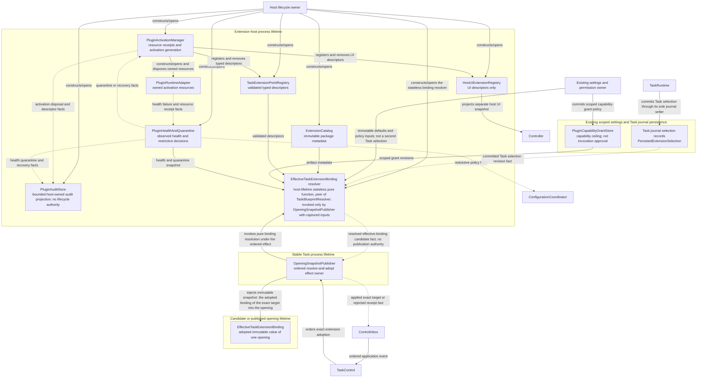

Task选择只由Runtime写入自己的journal；全局/workspace配置是默认值与策略输入，不是同条Task选择的第二份authority。EffectiveTaskExtensionBinding resolver与TaskBlueprintResolver同级，是host-lifetime无状态纯函数，只由OpeningSnapshotPublisher在TaskControl排定的adoption effect内以捕获的输入调用；Factory不构造resolver，也不产出binding，同一opening内不换candidate的采用由Publisher对同一捕获输入重算并比对完成。

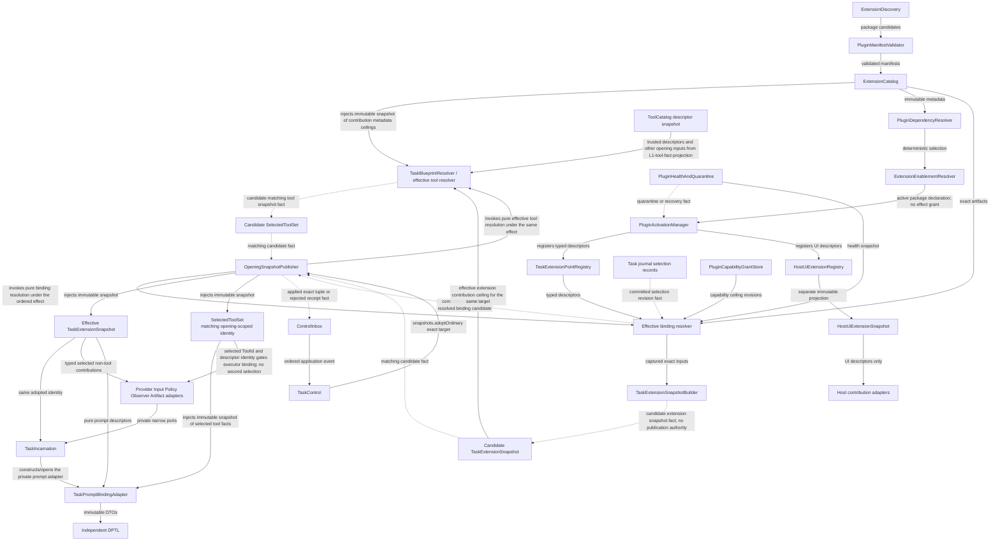

```mermaid
flowchart LR
    %% id: L2-plugin-invocation
    %% layer: L2
    %% kind: flow
    %% refines: L0-ownership, L0-extension-authority, L1-extension-platform
    %% answers: how a selected plugin action receives one durable approval and begin record before bounded execution
    %% local-only: Proposal
    %% local-only: Responses
    %% local-only: Broker
    %% local-only: Commit
    %% local-only: Wait
    %% local-only: Grant
    %% local-only: NoEffect
    %% local-only: Outbox
    %% local-only: Verifier
    %% local-only: Begin
    %% local-only: Executor
    %% local-only: Ports
    %% local-only: Revocation
    Process -->|submits lifecycle control event| Inbox
    KernelPort -.->|sealed quiesced resumed closed or recovery-needed fact| Inbox
    Runtime -.->|committed runtime delta fact| ReadModel
    Proposal[Plugin action proposal] -->|declared domain input| Process[TaskProcess]
    Responses[Authenticated human or verified review response] -->|declared response route| Process
    Process -->|validated envelope| KernelPort[KernelPort]
    KernelPort -->|work event; no control reservation| Runtime[TaskRuntime]
    Runtime -->|normalize target before approval; no external effect| Broker[PluginInvocationBroker]
    Broker -.->|normalized target and risk facts| Runtime
    Runtime -->|pure approval rules| ApprovalAuthority[ApprovalAuthority]
    ApprovalAuthority -.->|decision proposal facts| Runtime
    Runtime -->|ordered draft and publication| Commit[Runtime CommitPipeline]
    Commit -->|sole journal writer commits decision grant and effect records| InstanceStores
    Commit -->|durable pending| Wait[Work waits; no held reservation]
    Commit -->|durable rejection or cancellation| NoEffect[Settle without effect]
    Commit -->|durable approve| Grant[Single-use ExecutionGrant]
    Grant -->|original publication identity| Outbox[Existing Runtime outbox]
    Outbox -->|owning executor| Verifier[Live scope target opening and revocation checks]
    Verifier -->|request consumption and begin under current authority| Begin[Begin event]
    Begin -->|same Runtime transition and writer| Runtime
    Commit -->|confirmed consumption and begin receipt| Executor[Resumed owning plugin executor]
    Executor -->|live restrictions rechecked on each call| Ports[Bounded capability ports]
    Ports -->|DTO signal and timeout only| RuntimeAdapter[PluginRuntimeAdapter]
    RuntimeAdapter -.->|known result or unknown with original identity| Runtime
    InstanceStores -->|committed audit and results| ReadModel[TaskReadModel]
    Revocation[Security revoke or quarantine] -->|revoke unconsumed execution authority| Verifier
    Revocation -->|registered safety event| Inbox[ControlInbox]
```

创建图中的role差异先成为Blueprint数据；本图把已选择contribution交给所属domain adapter，prompt仍经窄adapter进入独立DPTL，Host UI沿独立snapshot进入host。图中adapter集合是既有领域入口的展开，不是统一dispatcher或新registry；ControlInbox只保留顺序与reservation，TaskControl只保留生命周期阶段，Factory只保留装配，三者都不吸收工具、Provider、role或插件的领域算法。

新增一个Task-facing extension point只触碰两处：在`TaskExtensionPointMap`中声明一个`ExtensionPointDescriptor<T>`（point id、descriptor schema、cardinality/conflict policy、snapshot projection、所属domain adapter factory），以及消费它的owning domain adapter。registry、binding resolver、snapshot builder、grant scope与审计identity都从该descriptor表派生，`TaskExtensionSnapshot`的typed field由map类型生成，不需要逐处手改。只有新point带来新的资源生命周期或effect语义时才修订Invocation子图与对应合同，不把所有新功能伪装成纯注册。

### Extension Platform Modules

| Module | Responsibility | Runtime boundary |
|---|---|---|
| `ExtensionDiscovery` | Discover platform/global/workspace plugin packages and built-in adapters | produces package candidates only |
| `PluginManifestValidator` | Validate identity、SPI/core version、extension points、schemas、dependencies and requested capabilities | invalid package never reaches activation |
| `ExtensionCatalog` | Store immutable plugin/contribution metadata and revisions | no executable instance or Task state |
| `PluginDependencyResolver` | Resolve plugin dependencies and extension-point cardinality/conflict policy deterministically | no last-loaded-wins behavior |
| `ExtensionEnablementResolver` | Resolve global/workspace enablement and enterprise policy | enablement is separate from capability grant |
| `PluginCapabilityGrantStore` | Persist granted capability scopes and revisions | capability grant is separate from invocation approval |
| `PluginActivationManager` | Create/dispose runtime adapters, track resource receipts and activation generation | activation never exposes raw host objects |
| `ExtensionPointDescriptor<T>` / `TaskExtensionPointMap` | Declare each Task-facing point once: id、descriptor schema、cardinality/conflict policy、snapshot projection and owning domain adapter factory | the single declaration from which registry、binding resolver、snapshot field、grant scope and audit identity are derived |
| `TaskExtensionPointRegistry<T>` | Hold validated typed contribution descriptors for the points declared in `TaskExtensionPointMap` (DPTL、Tool、Provider、Input、Policy、Observer、Artifact) | descriptor is data plus bounded factory reference; typed snapshot field is generated from the map, not hand-maintained |
| `HostUiExtensionRegistry<T>` | Hold validated host/Webview UI contribution descriptors | UI contributions resolve into a separate HostUiExtensionSnapshot and never enter TaskExtensionSnapshot or TaskRuntime |
| `TaskExtensionSnapshotBuilder` | Resolve enabled Task-facing contributions、grants、health and role/workspace scope into an immutable opening snapshot | active Task reads snapshot, not mutable global registry |
| `PluginInvocationBroker` | Normalize already-selected action proposals/invocations, bind plugin/contribution/opening identity and collect result/diagnostics | owns invocation protocol/effect coordination only; discovery、selection、policy authority and provider token transport remain elsewhere |
| `PluginExecutionGrantVerifier` | Validate execution grant scope、target、risk、expiry、policy revision、opening and revocation on every capability-port call | plugin never mints or broadens grant |
| Capability ports | Provide bounded workspace/network/terminal/browser/credential-reference/artifact/publish operations | no raw resource handles escape the port |
| `PluginHealthAndQuarantine` | Attribute timeout/crash/protocol/resource failures, revoke activation/grants and quarantine unhealthy revisions | health changes trigger candidate snapshot refresh |
| `PluginAuditStore` | Record activation、contribution、snapshot、invocation、approval、grant、revoke and failure identities | audit data is not canonical Task lifecycle state |
| `PluginRuntimeAdapter` | Async DTO/AbortSignal/timeout interface implemented by built-in、trusted in-process、worker、child-process or remote transports | isolation transport is replaceable behind one contract |

### TaskExtensionSnapshot

```ts
/** Declared once per Task-facing point; everything else is derived from this map. */
interface ExtensionPointDescriptor<TBinding> {
  readonly pointId: string
  readonly descriptorSchema: ContributionDescriptorSchema<TBinding>
  readonly cardinality: "single" | "multiple"
  readonly conflictPolicy: "deterministic_rank" | "reject_duplicate"
  readonly project: (validated: readonly ValidatedContribution[]) => readonly TBinding[]
  readonly adapterFactory: DomainAdapterFactory<TBinding>
}

interface TaskExtensionPointMap {
  readonly dptl: ExtensionPointDescriptor<DptlContributionBinding>
  readonly tool: ExtensionPointDescriptor<ToolContributionBinding>
  readonly provider: ExtensionPointDescriptor<ProviderContributionBinding>
  readonly input: ExtensionPointDescriptor<InputContributionBinding>
  readonly policy: ExtensionPointDescriptor<PolicyContributionBinding>
  readonly observer: ExtensionPointDescriptor<ObserverContributionBinding>
  readonly artifact: ExtensionPointDescriptor<ArtifactContributionBinding>
}

type ExtensionBindingsOf<M> = {
  readonly [P in keyof M]: M[P] extends ExtensionPointDescriptor<infer B> ? readonly B[] : never
}

interface TaskExtensionSnapshot {
  readonly identity: string
  readonly extensionRevision: string
  readonly pluginRevisions: readonly PluginRevisionRef[]
  readonly bindings: ExtensionBindingsOf<TaskExtensionPointMap>
  readonly capabilityFingerprint: string
  readonly requiredContributionStatus: readonly RequiredContributionStatus[]
}

interface HostUiExtensionSnapshot {
  readonly identity: string
  readonly hostRevision: string
  readonly uiBindings: readonly UiContributionBinding[]
}
```

### Provider Contribution Boundary

第三方Provider是opening-scoped typed contribution，不是插件任意网络调用：

```ts
interface ProviderContributionBinding {
  readonly contributionId: string
  readonly pluginRevision: PluginRevisionRef
  readonly apiFormat: ApiFormat
  readonly modelCatalogRevision: string
  readonly credentialReference: CredentialReference
  readonly transportPolicyRevision: string
  readonly attemptObserverRevision: string
  readonly serverToolPolicyRevision: string
}
```

- `TaskInstanceFactory`只把validated binding和credential reference放入snapshot；secret在每次attempt开始前由Credential Port按target/profile解析，不进入prompt、blueprint或plugin memory。
- 普通generation transport通过共享、proxy-aware、observed provider transport发起，继承bounded timeout、AbortSignal、attempt identity、sanitized failure和response-body cleanup；不得绕过provider attempt observability。
- `PluginInvocationBroker`不进入token/chunk hot path。Provider暴露的side-effect server tool或其它Core-owned effect以proposal经KernelPort进入Runtime，再由所属executor与纯policy/approval规则处理；只有撤权等生命周期事实进入TaskControl，不把提案、审批等待或结果转成控制事件。
- Provider adapter只接收immutable request DTO和窄transport/credential ports；不得取得Controller、TaskControl、TaskRuntime、StateManager、stores或raw host objects。
- Provider binding、credential reference、transport policy或required implementation变化按configuration classifier决定revision或replacement。普通同opening revision不改在途身份；需要replacement时按RP的attempt边界先结算旧attempt再seal，不让其在退休opening继续业务写入。

### Side-session Cache Warmup Extension

本节只规定未来feature承载能力，不实施或冻结warmup算法。目标是在会话Task仍有工作需求时，利用旁路在策略指定的有效期窗口快结束前发起一次cache warmup。它不是AI审批的20秒/5分钟计时器，也不是把“缓存命中率低”直接转换为每轮重发请求。

#### Ownership and inputs

- **本地与远端缓存分开。** DPTL编译缓存与PromptContractCache保持原owner，远端cache维护归Provider。PromptCacheHealthTracker只观察，不拥有warmup调度；其普通会话badge仅采样default work的conversation请求，review/warmup成本另记。WS-012的UI消费在本平台经TaskReadModel/compact shell投影，Controller不直接读Task快照；这不改变其健康/reset语义。
- **纯策略与Provider操作分开。** 可替换CacheWarmupPolicy只消费不可变目标、能力、时间线索与预算，返回不需要/稍后检查/安排一次的决定；ProviderCacheWarmupPort执行特定provider支持的操作。不得把任意定时闭包、第二provider loop或全局cache协调服务塞入TaskControl。
- **目标不是另开一个缓存。** 目标包含原Task/work、Provider/Profile/credential scope、模型与transport绑定、真实请求的cache key/handle及可缓存前缀身份、相关Prompt/tool/context revision。旁路有独立执行attempt身份，但必须指向原会话可复用的缓存，不因换work/session标识生成另一个cache namespace。
- **时间线索有来源和可信度。** 策略可消费用户指定保活窗口、Provider明确给出的有效期、最后一次合格使用与估计值；known/estimated/unknown分开。用户指定时间是调度目标，不自动变成服务端TTL保证。普通请求的实际使用事实可以取消或推迟旧warmup安排，不以单纯发起请求冒充缓存已续期。

#### Scheduling and isolation

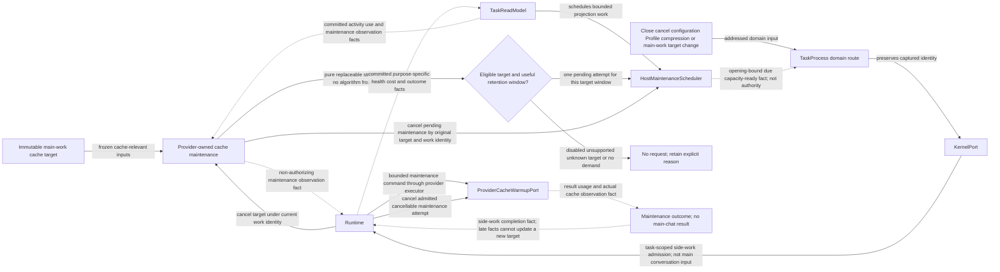

- 旁路复用同一Runtime的隔离work上下文与已有Provider executor/共享observed transport；不新增普通聊天turn，不推进主会话dialog/approval/completion，不把输出混入主会话journal历史或压缩材料。可记录带purpose的维护事件与真实费用，但不物化成用户/assistant对话内容。
- HostMaintenanceScheduler管理低优先级、有限并发、timer与I/O预算；前台生成、审批、安全控制和close优先。每cache目标/窗口至多一个pending或in-flight warmup；普通请求已满足窗口时可撤销计划，不能因多个订阅通知重复发送。
- 到期仅产生候选意图，执行前重新检查Task工作需求、opening、Profile/credential、cache-prefix/revision、授权与预算；失效候选不发送。暂停/取消/关闭、功能禁用、配置变化和成功压缩改变目标时，取消尚未开始的工作并中止可取消的在途请求；迟到结果不更新新目标。
- Warmup是可丢弃的opening-local维护，不把过期timer或发送命令放入durable TaskJobRegistry重放。其隔离work带`purpose=cache_warmup`及opening-local恢复策略；works map即使被snapshot记录，也只用于停止责任/费用恢复，不取得重发资格。恢复时未begin的旧计划按not_started结算并丢弃；已begin缺结果的attempt保持outcome_unknown且不重发；已有结果只补计费/ack。资源责任结算后移出active works map，有限审计/用量留在原journal/metrics owner。新opening只根据当前主会话事实与策略重新评估新计划，不继承旧timer。
- Feature经现有TaskFeatureSet/role/owning-domain声明链启用，未来策略配置仍归canonical settings及effective snapshot；默认没有实现/没有选择策略时不产生请求。预留端口不构成实际发送有费用Provider请求的授权。

#### Provider safety and observation

- Provider port必须说明是否可在保留目标cache身份/前缀的同时发起安全的旁路操作；不能简单删掉tools、改system prompt或发送一个不同前缀的ping后声称原会话缓存已保持。无法安全匹配或无对应能力时返回unsupported，不伪造通用保活支持。
- 旁路不得执行业务工具、server-side tool或插件effect；若Provider无法禁用这类副作用而保持目标cache语义，则该方式不具备执行资格。复用已有proxy、credential、timeout、AbortSignal、stream cleanup与attempt观测，不绕开权限和费用预算。
- outcome区分成功发起、实际观察到缓存命中/续期、未确认、失败或unsupported；不能将HTTP成功或本地cache命中写成远端续期保证。TTL、最小前缀长度、请求形状和续期效果由后续provider专项合同与验证确认，本规范不虚构数值。
- 记录purpose=cache_warmup、目标的不敏感身份、调度等待、耗时、token/费用和取消原因，真实费用计入账目并与普通生成分开。不能让旁路样本污染普通对话的缓存健康统计或伪增主任务有效轮次；日志不保存prompt、凭据或完整请求。

### Extension Runtime Flow

1. Discovery emits package candidates; manifest validation and dependency resolution produce deterministic catalog revisions.
2. Enablement resolution chooses active packages. Capability requests are evaluated separately and stored as scoped grants; enablement alone creates no execution permission.
3. Activation creates a `PluginRuntimeAdapter`, registers typed descriptors against the points declared in `TaskExtensionPointMap` and returns resource receipts tracked by the activation generation.
4. Control open follows REC. Missing Provider/Prompt/tool contributions fail only dependent work; their owners can reprepare them without changing the recovery contract.
5. DPTL/Profile/Semantic、ToolCatalog、Provider、Input、Policy、Observer and Artifact adapters consume the same Task snapshot identity while building `TaskBlueprint` and `TaskIncarnation`. UI contributions consume only the separate HostUiExtensionSnapshot.
6. Declarative contribution is compiled/validated into the owning domain. Executable contribution receives only an invocation DTO and capability ports.
7. A plugin action becomes an addressed `PluginActionProposal` through KernelPort into TaskRuntime. PluginInvocationBroker normalizes targets/risk facts; Runtime evaluates pure policy/ApprovalAuthority rules and commits through its sole journal writer before any effect begins.
8. Each capability-port call revalidates plugin、contribution、opening、scope、target、expiry、policy revision and revocation. The broker returns typed result/activity/diagnostics through TaskRuntime-owned paths.
9. Observer contribution consumes committed facts asynchronously. Its failure updates plugin health and activity diagnostics but does not rewrite canonical Task state.
10. Registry/enablement/health changes build a candidate snapshot. Normal changes swap at a safe boundary; security revoke schedules a safety refresh, revokes grants immediately and drains in-flight plugin work.
11. Resume resolves usable bindings under REC and the DPTL cutover contract; it never selects the old fixed Prompt pipeline.
12. Disable/quarantine disposes registered resources, subscriptions and runtime adapter, revokes grants, removes descriptors from future snapshots and preserves audit identity for recovery.

## Task Runtime Flow

### Lifecycle contract navigation

本节图表达执行顺序，详细规则按下表单点维护；不在overview重述另一套恢复或准入协议。

| 场景 | 详细合同 | 入口与责任 |
|---|---|---|
| 创建、打开与恢复 | §4、§5 lifecycle表/REC、§9 Factory | Controller/parent child domain/ResidentTaskOwner提交意图；Composer经TaskFacadeTable lookup-or-compose，只在表中没有live facade时构造，Factory只构造candidate，Slot发布 |
| 普通输入与领域结果 | §5领域入站身份、§7 | TaskProcess按声明route进入KernelPort/Runtime；opening-local executor completion保留已登记身份 |
| 配置与权限变化 | §5 Compound configuration changes | 配置owner分类，Control处理义务；Task不live-read StateManager |
| 健康热替换 | RP及handoff输入规则 | Control决定阶段，所属端口执行；不能提前写canonical数据 |
| aggregate或writer故障 | REC | 先结算旧writer再修复；单work故障由§7处理 |
| checkpoint恢复 | §5 checkpoint模式与L4图 | chat/combined与workspace-only保持不同恢复范围 |
| 视图与通信 | §11.1、Controller/views章节 | committed facts投影；跨Task卡不复制canonical状态 |

#### Opening replacement and canonical state handoff

```mermaid
flowchart LR
    %% id: L3-opening-replacement
    %% layer: L3
    %% kind: flow
    %% refines: L0-ownership
    %% answers: what is stable and what is replaceable, and in which order a replacement is prepared, sealed, adopted and published
    %% concept: Control = Control
    %% concept: Opening = Slot
    %% concept: Prepare = Factory
    %% concept: Active = OpeningRef
    %% concept: Kernel = KernelPort
    %% local-only: Intent
    %% local-only: Prepared
    %% local-only: Cut
    %% local-only: Current
    %% local-only: ControlUse
    %% local-only: Derived
    %% local-only: WorkAdmission
    %% local-only: WorkUnavailable
    %% local-only: Drain
    %% local-only: Resources
    %% local-only: Failed
    %% local-only: ReleaseCandidate
    %% local-only: Resume
    %% local-only: Unavailable
    %% local-only: RecoveryPath
    Kernel -->|locates the current opening and revalidates its fence| Active
    Opening -->|hands the adopted candidate into the publish effect| Candidate
    Intent[Replace / reopen / takeover intent] -->|replace event via ControlInbox| Control[TaskControl\npure phase table; fence and sealed cut are its state]
    Control -->|effects: prepare adopt abandon through the factory port; all I/O inside prepare RP-1| Prepare[Factory prepares candidate resources and bindings]
    Prepare -.->|candidate ready adopted or failed facts as events via ControlInbox| Control
    Prepare -->|unpublished; writer and dispatch disabled; adopt effect later hands it the sealed cut| Candidate[Candidate Runtime]
    Prepare -->|available optional precomputed values; no blocking source demand| Prepared[Prepared immutable domain inputs]
    Control -->|candidate ready; stop new begin and settle admitted attempts before seal| Kernel[KernelPort]
    Kernel -->|seal current opening under the fence| Cut[Runtime seals a coherent canonical handoff cut]
    Current[Current Runtime or durable canonical recovery] -->|committed state plus outbox and effect disposition| Cut
    Cut -.->|sealed cut fact as event via ControlInbox; writes held until resume or publish RP-3| Control
    Cut -->|canonical state as data| Candidate
    Control -->|publish or query publication receipt; adopted unpublished handle uses releaseCandidate| Opening[OpeningSlot\npublication and receipt-owned cleanup]
    Opening -->|assertAdmissible on the effect fence; take ownership of the adopted candidate object; transfer kernel authority| Active[New current Runtime]
    Active -->|bounded views and eligible control events| ControlUse[Control and recovery presentation available]
    Active -->|after queued work-cancel intents are admitted; then actual work demand| Derived[Existing Prompt Capability and input owners\nprepare compatible inputs for that work]
    Prepared -->|reuse only compatible dependencies| Derived
    Derived -->|ready and current permission checked| WorkAdmission[Owning work admission\nregistered execution attempt and applicable grant]
    Derived -->|missing invalid or superseded inputs| WorkUnavailable[Only demanded work unavailable\ncontrol remains available]
    Opening -.->|published or rejected fact| Control
    Control -->|after matching publication fact, command Kernel to apply the exact from-to handoff receipt| Kernel
    Opening -->|after committed swap; drain old generation| Drain[Old opening resource drain]
    Drain -->|release own or borrowed references only| Resources[Owning resource lifetime]
    Control -->|failure while factory still owns receipts; abandon only those resources| Failed[Factory releases untransferred candidate resources]
    Failed -.->|abandoned and settled facts| Control
    Opening -->|adopted but publication rejected; releaseCandidate by original handle| ReleaseCandidate[Slot releases transferred unpublished candidate]
    ReleaseCandidate -.->|released pending or failed receipt fact| Control
    Control -->|unpublished failure; old authority still valid| Resume[Resume old Runtime at latest committed state]
    Control -->|damaged or unknown state; automatic reconstruction| Unavailable[Recoverable result and restarted control loop\nno corruption-induced permanent read-only]
    Unavailable -->|registered recovery-needed episode with original identity| RecoveryPath[REC path in L4-self-healing]
```

Handoff cut由Runtime与repository durability边界产生，包含kernel/journal前沿、pending outbox及§7定义的effect disposition；旧writer、派生写入与durable inbox均参加自己的交接屏障。它是数据交接，不是新authority。候选不能凭配置未变覆盖更新的canonical状态；具体时序只由RP定义。

#### Replacement path contract (single source)

- **RP-1 普通replacement的I/O边界：** 仅适用于旧Runtime/writer健康的热替换。Prepare完成binding/资源/可选输入I/O，只能借用repository或只读打开候选，不修复、隔离或重写canonical内容。Candidate ready后停止新begin，在短handoff段外收敛已登记attempt，取消/人工响应仍可处理。Provider/tool在自身期限内结束则提交结果；取消或超时须确认本地执行/回调停止，外部结果按§7分类。未确认本地停止则本次replacement保持pending及安全旧opening，不启第二writer。随后seal/adopt/publish只包含内存交接与durable cut，不等待模型、repository重建或Prompt/source扫描；故障转REC。
- **RP-2 原始身份与当前authority分开：** 控制聚合保存操作、期待效果和sealed cut，事实保留起因身份。Publish在短保护边界验证captured authority与desired/restriction target，由OpeningSlot原子claim candidate并转移current-slot/kernel authority；Control收到matching publication fact后再按exact handoff receipt把CanonicalWriterGate业务能力交给新Runtime，中间允许writes-held的零持有者窗口但绝不并存双holder。未知提交结果查询slot publication receipt，不用迟到回执猜测。Cleanup只针对原resource receipt，不经过current-opening业务比较。端口不保存阶段也不互相等待。
- **RP-3 交接与清理：** Writer封住直至publish或明确安全的resume；发布后先按handoff规则处理已排队取消，再释放相关outbox。Unknown先查slot/canonical receipt，不可解释转REC，锁丢失走§5 local drain。旧receipt独立retire，有界重试并计费至实际释放，不用清理pending冻结无关工作。
- **RP-4 分段观测：** 分别记录candidatePrepare、handoffQueue、sealHold、adopt、rootAdmissionRevalidate、slotTransfer、drain与replacementTotal；`rootAdmissionRevalidate`是publish保护段内真实administrative I/O，不能并入纯内存slot transfer或被隐藏。Topology、checkpoint restore和takeover各测各的完整路径，不拿短sealed窗口冒充端到端延迟。数值由相同基线fixture比较确定。
- 同instance repository可借用稳定resource owner或在交接时转移writer capability；旧代close只释放自己的receipt/ref，不关闭新代仍借用的共享handle。实际资源销毁由最后有效引用的owner负责。
- Publication后的工作遵守HP与§7：只从captured事实准备相容输入，重用compiled/source/pure结果；缺材料只影响该work。Pending command的冻结输入不改写，执行资格由下述durable continuation关系恢复，不因opening发布而盲重放。

#### Handoff input admission

Seal期间KernelPort不能向旧Runtime提交业务写入，也不能吞掉新收到的work取消。它使用已有有界入口队列保留**尚未接纳**的外部意图和原operationId/origin opening/task/work身份；排队只返回pending，不返回成功或终态stale。队列没有持久authority，超容量/期限或进程退出前未完成的请求返回可重试结果；调用方保留原请求身份，只有durable应用才确认完成。

- 只有受信route声明为可跨普通handoff的、非授权且幂等的`work cancel`允许该接续；executor callback、grant和外部effect结果从不走此规则，其他领域请求返回handoff-pending并由原发送方按当前合同重试。
- OpeningSlot的已确认publication receipt给出from/to关系。KernelPort原样保留origin，将该关系作为接纳依据交给新Runtime；不修改原expectedOpening、不由调用者自造关系。新Runtime必须验证同一Task、未变的task/work generation及仍对应的目标work，然后按原operationId幂等应用取消。Task级halt、checkpoint回退、work重建或目标终结导致不相容时返回明确superseded/settled，而非取消新工作。
- 发布边界截取已有取消意图的有限集合；新Runtime完成其接纳/拒绝之后才放开受影响work的已恢复commands。边界之后的新取消按正常Runtime事件顺序处理，不无限等待后续输入。Publish失败而旧Runtime安全resume时，由旧Runtime处理原队列；取消本身不要求放弃replacement。
- TaskControl只决定seal/publish/resume，OpeningSlot只报告publication事实，KernelPort只按声明转交；只有Runtime解释work取消。排队期间的abort请求也不证明effect已经停止，停止receipt仍按原owner结算。

#### Durable work intent and current execution authority

原始command、input/round identity与payload是工作意图和因果来源，不是可跨opening搬运的执行许可。Runtime从durable disposition判断已完成、等待、可续行或unknown，不把旧callback改名为新opening事件；原idempotency identity保留。恢复与清理总体图见§5。

- 现有Runtime recovery按operation kind与durable disposition决定settle / 等待 / 续行；OpeningSlot、Broker、outbox与旧executor都不能自行把opening替换为当前值。
- 每个operation最多一个已登记的当前execution attempt；它把原operation与当前opening/fence绑定，并在begin/commit处复核lock、operation fence、target与适用grant；未登记的旧callback只进入ack/diagnostic或owning reconciliation。
- Opening变化使旧执行grant失去使用资格，但不撤销journal已确认的winner。对于可解释cut中已approve且未消费/未begin的同一逻辑effect，Runtime调用ApprovalAuthority按原targetDigest、request revision、当前policy/lock/权限重新校验；仍相容则经同一journal writer刷新opening-bound grant引用，保留原decision/publication/effect身份，不再次人工或AI审批。旧/新grant共用同一逻辑effect消费记录，最多消费一次。目标/策略实质变化、原grant已消费、结果未知或决定不可解释时不得刷新；按所属规则返回执行受限/unknown，只有真实新提案才创建新interaction，不把恢复伪装成新effect。
- crash/reopen/checkpoint hydrate本身只恢复控制与呈现，不直接启动Provider或工具；发布后的Runtime再按role execution/recovery策略处理已登记意图。普通会话保留现有用户继续规则；常驻审批器按§11的请求恢复表作有界处置，warmup旧计划不可重放。原effectId/idempotency key不重造，未知effect不能靠role差异跳过对账。

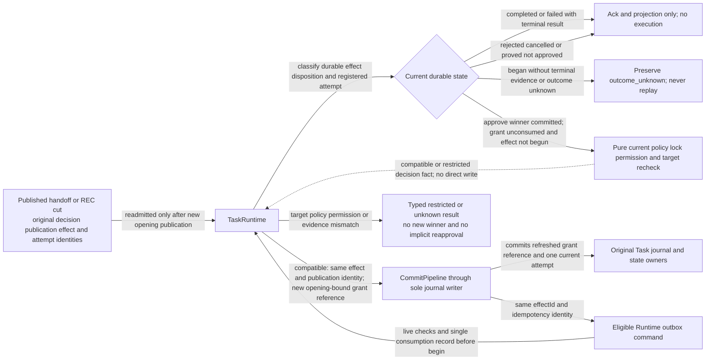

该图恢复的是当前opening下的执行资格，不重写原决定。新提案才创建新interaction；旧callback、已begin unknown与已消费grant都不能进入刷新分支。

### Child Tasks and Resident AI Approval

1. 普通child仍由parent请求统一Factory，lineage、permission ceiling、budget与InstanceLocation进入blueprint，foreground/background/batch/retry共用Task平台。
2. 常驻AI审批器由host的ResidentTaskOwner按选定Profile管理，不以请求方Task为parent；其普通TaskRuntime拥有独立实例root与请求级work contexts。
3. 请求方Runtime调用ApprovalAuthority纯规则冻结请求，经CommitPipeline提交journal中的审批记录和通信命令；常驻审批器并行处理独立work，将关联结构化结果投递回请求方Runtime。
4. 无Profile立即走人工；普通20秒、审批器自身压缩相关请求最多5分钟后开放人工入口但AI继续。只有尚未结算且身份/权限仍有效的终态响应才能胜出。
5. Profile选择、常驻生命周期、结果/计时与幂等的唯一详细合同见§11；共用通信边界见§11.1。

### Isolated Integration and Production Cutover

总体交付见`L5-delivery-switch`。先在非production入口组合identity/storage/runtime、configuration/capability/prompt、child/approval、plugin/views；每个组合切片保留已验证代码/构建回退点，不叠加未解决的authority差异。只有真实组合一致才切唯一production root并清理旧可达路径；最终验证覆盖生产树。此处不指定Task编号，旧DAG不再约束架构。

## Implementation Task Execution and Calibration

WS-106以架构图及独立设计审查作为架构验收标准。审查关注性能、解耦、扩展性和腐烂风险，不把某次review推荐的类名、接口字段、调度算法、预算数字或检查工具变成新的验收条件。

1. 启动Task时复读当前spec、相关实现和上游产物，核对authority、lifetime、依赖方向、热路径及失败恢复。
2. 总体方案确定后才重新派生Task；每个Task必须在自己的`plan.md / ## Architecture Design`绘制细化图，声明refines、owned节点/边、输入输出及失败出口。Progress只保存实际执行与验证，不承载第二份设计图。现有`tasks/`原样保留为旧记录，不是本版待执行DAG，也不作为当前评分输入。
3. 设计或实施中发现架构问题时，及时暂停依赖错误方向的实现，回到总体图提出修正，自上而下重新审查生命周期、authority、依赖方向、资源及受影响模块。独立审查用于判断修正是否合理，不授权继续错误实现或由底层补丁反推总体结构。
4. 架构修正经独立审查后交由用户确认；只有用户明确授权“由你决定”时，执行者才在授权范围内自主决定。确认前的修订图与关联Task说明都是提案，不作为实施依据；确认后再自上而下同步并恢复受影响工作。已批准架构内不改变边界的局部实现优化可沿原Task进行，不能以“局部优化”为名绕过架构修正确认。

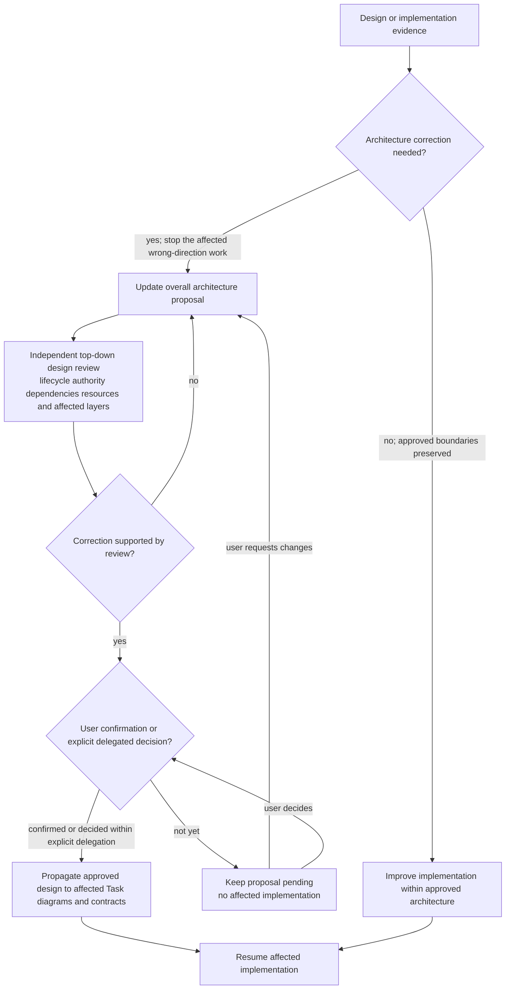

### Canonical architecture and anti-rot governance

- Workstream总体图及其协议说明是共同事实源，Task安排不决定总体边界。现有Task文件暂存，后续根据稳定图重新增删/改写；本阶段不审查、不执行旧DAG。
- 图先明确owner、lifetime、命令/事实、实际等待与失败结果，说明文字不得另外建立隐藏阶段。类型示意不冻结类数或模块行数。
- 总体图做workstream scope机械检查并逐项说明not-checked；图DAG不替代异步事实的相关性、完成屏障与恢复推演。工具缺陷不通过改图规避。
- 当前阶段只做架构。后续owned-module自然可观察验证与首次真实组合仍分开，不造中间跨域接线、临时adapter、第二authority或新增细粒度AC/VER。
- 生产继续使用当前系统，只有隔离真实组合验证一致后才执行一次production-root switch；失败按代码/构建整体回退，不保留双authority运行时fallback。
- 已完成行为必须保留；遇到实现合同与总体设计不一致时在总体层明确修订，不由底层或集成方补丁调和。

### Delivery Ownership and Task DAG

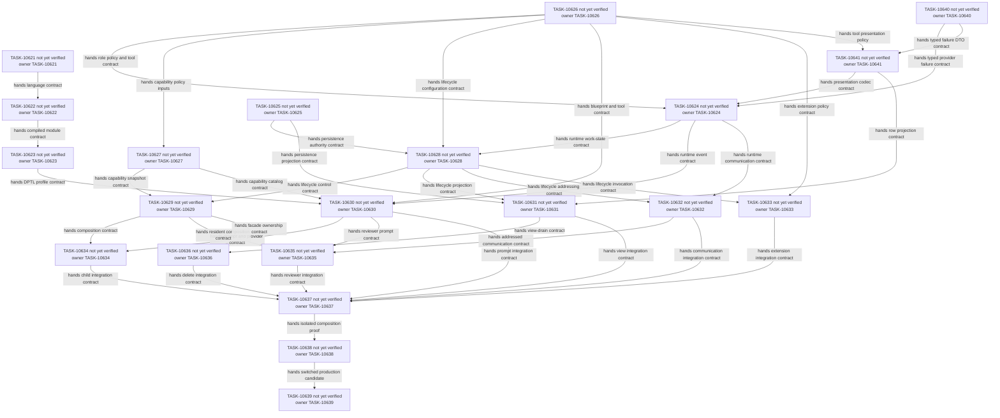

### Delivery and Production Switch

```mermaid
flowchart LR
    %% id: L5-delivery-switch
    %% layer: L5
    %% kind: flow
    %% refines: L0-ownership
    %% answers: how design becomes isolated composition and one production switch, and what failure returns to
    %% concept: Root = Composer
    %% local-only: Design
    %% local-only: Build
    %% local-only: DptlGate
    %% local-only: CompositionGate
    %% local-only: ContractGate
    %% local-only: Proof
    %% local-only: Reject
    %% local-only: Switch
    %% local-only: Removal
    %% local-only: Final
    %% local-only: Released
    %% local-only: Rollback
    Design[Reviewed whole architecture\nimplementation not claimed] -->|derive graph-owned Task boundaries after design settles| Build[Owner-local implementations\nthen one isolated real composition]
    Build -->|compiler plus standard/lite assets plus Task adapter and real consumer| DptlGate{DPTL is the only candidate Prompt path?}
    DptlGate -->|no or old fixed Prompt remains reachable| Reject[Resolve discrepancy in the owning graph\nwithout compatibility glue]
    DptlGate -->|yes; role tool mode and permission semantics preserved| CompositionGate{Identity storage Runtime configuration capability\nchild approval plugin and views compose through declared owners?}
    CompositionGate -->|discrepancy hidden adapter second writer or parallel authority| Reject
    CompositionGate -->|yes| ContractGate{Same-version schema proto generated contracts\nand host shutdown watcher ownership agree?}
    ContractGate -->|mismatch or incomplete generated surface| Reject
    ContractGate -->|candidate contract complete| Proof{Integrated behavior failure paths performance\nand architecture agree on the candidate tree?}
    Proof -->|no; return to the owning design| Reject
    Reject -->|revise overall graph before implementation| Design
    Proof -->|yes; verified candidate only| Switch[Authorized production composition-root change]
    Switch -->|selects the unified root| Root[TaskProcessComposer]
    Root -->|one production authority; old entry no longer reachable| Removal[Remove old Task/Subagent loops fixed Prompt builders and fallback\nparallel stores projections catalogs and watcher bindings]
    Removal -->|verify final production tree and reachability| Final[Final regression performance artifact and release evidence]
    Final -->|all candidate checks pass; publication remains separately authorized| Released[Verified release candidate]
    Final -->|production-tree verification fails before release| Rollback[Restore the whole code and build candidate]
    Switch -->|code or build validation fails| Rollback
    Rollback -->|no runtime fallback between authorities| Build
```

Release/deployment remain separately authorized. The graph describes design and delivery order, not proof that any new module is implemented. Task IDs will be assigned only after the whole architecture is accepted; no current Task count is a constraint.

## Scope

### 1. Task Identity, Opening and Ownership

平台使用三层身份，分别表达持久对象、稳定 facade 和可替换 opening：

```ts
type TaskId = string
type TaskProcessId = string

interface TaskOpeningRef {
  readonly openingId: string
  readonly incarnationId: string
  readonly openingGeneration: number
}

/** A read projection only; no separate ownership transition or persistence. */
type TaskAccessView =
  | { readonly kind: "writable" }
  | { readonly kind: "read_only"; readonly reason: "foreign_lock" | "view_only" }
  | { readonly kind: "transitioning"; readonly reason: "acquiring" | "opening" | "recovering" | "revoking" | "closing" }
  | { readonly kind: "unavailable"; readonly reason: "not_acquired" | "acquire_failed" }
  | { readonly kind: "closed" }

interface TaskProcessSnapshot {
  readonly taskId: TaskId
  readonly processId: TaskProcessId
  readonly opening: TaskOpeningRef | null
  readonly access: TaskAccessView
}
```

- `TaskId` 是持久逻辑身份；TaskHistory 中旧 ID 只作为 opaque metadata 展示；
- `TaskProcessId` 标识 Controller 持有的稳定 facade；opening replacement 不替换 facade；
- TaskOpeningRef是稳定Task进程内当前实例的引用。重开、资源替换和会话恢复更新openingGeneration；workspace-only restore不改聊天opening。它不携带跨进程lock epoch。
- OpeningGuard捕获opening、operationId及该operation自己的generation。Lifecycle guard归TaskControl的操作记录，work guard归Runtime的task/work/attempt记录；没有全opening共享的业务operationGeneration。Work取消只推进目标workGeneration，全Task停止才推进taskGeneration。旧callback不改写成当前身份，锁与资源清理仍沿既有owner，不产生跨进程epoch。
- child facade的组合由parent opening内的child domain经注入的composer port请求，这是跨task实例的递归（parent实例→host composer→child实例），不是单个Task内部的环；`L0-ownership`只描述一个实例的所有权，`L1-creation-control-projection`以`ParentLoop`本地节点表达该跨实例边；
- mutation保留operationId与origin opening；生命周期操作由TaskControl在admission/publication边界比较，领域输入由KernelPort/Runtime在所属接纳/提交边界比较，不绕回TaskControl；
- `OpeningSlot`是唯一current slot/swap owner；process event包含有序`openingChanged(previous, current, reason)`，surface/read model以opening identity丢弃迟到结果。

TaskProcessSnapshot只暴露一个`TaskAccessView`，直接从TaskControl及现有锁观察派生，不再串接OwnershipState→TaskAccessProjection两套枚举。它不持久化、不接收事件、没有独立transition；按以下优先级解释：

| 来源（先满足者） | 访问视图 |
|---|---|
| 显式close屏障已满足 | closed |
| close或失锁排空义务未结算 | transitioning: closing / revoking |
| 当前真实foreign lock，或用户仅打开History视图 | read_only: foreign_lock / view_only |
| acquire尚未结算 | transitioning: acquiring |
| 已持锁但首个opening、promotion或REC尚未发布 | transitioning: opening / recovering |
| current opening有效且仍持锁 | writable |
| 未持锁、无foreign lock且没有acquire在途 | unavailable: not_acquired；最近一次真实acquire失败则为acquire_failed |

最后一行覆盖首次意图前、撤销acquire、失锁排空后及有界重试间隔；它只解释当前锁访问不可用，不表达数据损坏、feature失败或第二生命周期。重试计划属于TaskControl，不能把等待下次尝试谎报为acquire在途。损坏处理按REC投影为recovering。取消acquire只结算本操作，所有视图仍只读派生，UI不能写回。

跨窗口使用现有`src/core/locks/TaskLockService.ts`，算法保持check/acquire/touch/release、TTL、unreadable grace与force unlock。现有路径`{tasksBasePath}/{taskId}/.lock`被定义为**TaskId锁命名空间**，不从`TaskBindingRecord.canonicalRoot`或child `InstanceLocation`重建；即使目录物理上与旧Main root重合，其权限语义仍是管理锁，不是InstanceLayout数据。独立root和child仍按自身TaskId取得该命名空间的锁；lock-only目录没有Task marker，不得被binding/orphan reconciliation识别为canonical task root。

持有writable opening的TaskProcess lock adapter负责启动/停止既有heartbeat timer并调用`touchTaskLock`；false产生当前opening的`lock_lost` source event。Heartbeat是不可丢弃的生命周期工作，不依赖可丢弃maintenance队列。Release端口必须把实际删除尝试映射为`released | already_absent | failed_or_unknown`；当前`releaseTaskLock(): Promise<void>`吞掉删除错误，实施时须补足结果返回/适配证据，但不得改变锁竞争算法。Force unlock只有在删除结果确认后才显示成功，随后仍由既有Controller takeover路径重新acquire。

`checkTaskLock`的“不可读视为无锁”是防止永久锁死的既有准入语义，不能用作close阶段“刚刚释放成功”的证明。Close只在release端口给出confirmed released/already_absent时完成锁责任；failed/unknown保留closing诊断。Delete coordinator在删除canonical root前先结算writer和锁；若Main root物理含`.lock`，release发生在内容删除前；外置canonical root和child data删除不得误删其它TaskId的锁目录。

Task内opening/operation检查用于丢弃旧回调、取消和释放资源，不承担跨进程stale-writer证明。删去“所有store原子写边界校验lock epoch”和“暂停进程跨库旧写为零”等新增目标；不为了理论上的失联owner窗口扩建协调协议。正常锁被另一窗口持有时仍走已有只读视图/unlock交互；**损坏恢复不能借用这个只读分支**。恢复未知的操作结果交回循环决定下一步，不把整个主任务永久挂起。

### 2. Task Binding, Instance Layout and Delete Lifecycle

目录外 `TaskBindingRepository` 是 TaskId → root/schema 的唯一索引：

```ts
interface TaskBindingRecord {
  readonly taskId: TaskId
  readonly canonicalRoot: string
  readonly schemaMajor: number
  readonly bindingRevision: number
  readonly creationNonce: string
  readonly state: "reserved" | "committed" | "deleting" | "tombstoned"
  readonly markerDigest: string | null
}
```

Create/open flow：

1. reserve binding record 与 canonical root；
2. 对独立root claim执行realpath、祖先/后代重叠、专用目录和marker预检；既有binding内的child位置分配不是新的独立root claim；
3. 创建 `InstanceLayout` 与 current-schema stores；
4. 写 marker/schema identity；
5. commit binding，随后发布 TaskHistory metadata。

Reopen 只从 committed binding 解析 root。Dangling `reserved` 与 orphan root 通过 creation nonce/marker 对账：未发布实例可清理，已形成 current canonical data 的实例恢复 commit，不猜测另一个 root。

`InstanceLocation`表达独立Main/常驻服务实例，或既有binding下的`<task-root>/subagents/<subagent-id>` child。常驻审批器使用自己TaskId的正常实例root，由ResidentTaskOwner持有，不放在任一被审批会话目录内；它使用同样四DB/state与layout resolver，不创建审批专用数据库。关闭/删除请求方只结束自己的请求，不删除审批器。

Child location由parent binding与子实例身份解析，不另申请任意嵌套root。TaskChildRegistry持久记录location、attempt、link与terminal状态；普通child沿既有retention回收，未ack的结果仍保留可投递的payload。审批器不进入child的ack后回收路径。Child结果仍使用durable outbox与parent owner pull，push只是提示；未来通信adapter可承载同一结果信封，但不能引入第二份结果authority或要求WS-092先完成。

目录外TaskDeleteIntentRepository与TaskBindingRepository共享administrative fault domain。Create/acquire/child creation必须先在root准入边界durably enrollment，首次Main创建用reserved binding的creation nonce；publication在同一边界复核未关闭。Enrollment只记录资源创建责任，不复制child业务状态。删除流程由以下总体图固定。

```mermaid
flowchart LR
    %% id: L4-root-delete
    %% layer: L4
    %% kind: flow
    %% refines: L0-ownership, L0-persistence-authority, L3-task-assembly
    %% answers: how one admission transaction enrolls every acquisition seals deletion responsibility and safely removes an independent root or one owner-authorized child location
    %% concept: Request = DeletionCoordinator
    %% concept: Admission = RootAdmission
    %% concept: Resident = ResidentOwner
    %% concept: ClosingProcess = Process
    %% concept: ChildLifecycle = ChildLifecycleAdapter
    %% concept: DeleteComposer = Composer
    %% concept: HistoryProjector = HistoryProjector
    %% concept: DeleteWriter = CanonicalWriter
    %% concept: ViewOwner = ViewProjectionOwner
    %% concept: RecoveryFactory = Factory
    %% concept: RecoveryInbox = Inbox
    %% concept: RecoveryControl = Control
    %% concept: RecoveryLock = Lock
    %% local-only: RecoveredOwner
    %% local-only: Scope
    %% local-only: Acquisition
    %% local-only: Rejected
    %% local-only: Settle
    %% local-only: Inventory
    %% local-only: Pending
    %% local-only: Validate
    %% local-only: Remove
    %% local-only: Tombstone
    %% local-only: ChildTerminal
    %% local-only: RootAdminCleanup
    %% local-only: ChildAdminCleanup
    %% local-only: OwnerProcess
    %% local-only: OwnerKernel
    %% local-only: OwnerRuntime
    %% local-only: OwnerJournal
    %% local-only: Recovery
    %% local-only: Resume
    %% local-only: Deleted
    %% local-only: Reenable
    %% local-only: RecreateCheck
    %% local-only: RecreatePending
    %% concept: RecreateComposer = Composer
    %% concept: RecreateProcess = Process
    %% concept: RecreateInbox = Inbox
    %% local-only: NewCreate
    ClosingProcess -.->|completion fact after every issued handle is disposed| DeleteComposer
    Resident -->|queries terminal deletion and admission before compose or reopen| Admission
    Admission -.->|live terminal-deleted or unfinished-delete fact| Resident
    ChildLifecycle -->|enrolls child resource responsibility before access| Admission
    Admission -.->|child enrollment accepted rejected or closed fact| ChildLifecycle
    ChildLifecycle -->|constructs/opens the child facade through the facade table| DeleteComposer
    ChildLifecycle -->|submits owner-authorized child delete intent| Request
    ChildLifecycle -.->|composition availability or failure fact| ClosingProcess
    RecoveryLock -.->|synchronous held or lost fact at writer admission| DeleteWriter
    GlobalHistory -->|projects bounded listing state| ViewOwner
    ClosingProcess -.->|published exact-process availability fact| ViewOwner
    Admission -.->|published exact-binding and delete-phase fact| ViewOwner
    RecoveryLock -.->|acquired foreign failed or lost fact| RecoveryControl
    Admission -.->|same-receipt rebound released or pending fact| RecoveryControl
    DeleteWriter -.->|maintenance stage granted released or unavailable fact| RecoveryControl
    RecoveryFactory -.->|close-only repair outcome fact| RecoveryControl
    Acquisition[New create existing acquire child creation or candidate publication] -->|enroll before resource access or revalidate the same receipt before publication| Admission[RootAdmissionBoundary\ntransaction over TaskBinding + TaskDeleteIntent]
    Admission -.->|while open: durable enrollment receipt; while closed: typed rejection| Acquisition
    Admission -.->|closed-admission rejection fact before any new resource is obtained| Rejected[Rejected acquisition or publication\noriginal receipt cleanup only]
    Request[TaskDeletionCoordinator] -->|resolve authenticated delete scope| Scope{Independent Main/resident binding root\nor owner-authorized child InstanceLocation?}
    Scope -->|exact root or child identity plus original owner authorization| Admission
    Admission -->|one administrative commit closes admission and freezes the exact enrolled set| DeleteIntent[TaskDeleteIntentRepository]
    DeleteIntent -.->|closed fence deleteId scope inventory and phase facts| Admission
    Admission -.->|closed-admission deleteId and sealed enrolled-owner facts| Request
    Request -->|after admission close revoke exact-scope local read adapters and stop new attachments; retained facade becomes tombstoned/reset| ViewOwner[TaskViewProjectionOwner]
    ViewOwner -.->|accepted queries drained and local read handles released or still-pending fact; foreign OS handles remain recoverable| Request
    Request -->|ordinary close intents for every enrolled owner| ClosingProcess[TaskProcess]
    ClosingProcess -.->|close release unavailable or foreign-lock facts| Request
    Request -->|aggregate only verified owner creation and read-handle release receipts| Settle[Settle committed owners candidates pending creation receipts and view attachments]
    Settle -->|all enrolled work stopped and released| Inventory[Sealed exact-scope inventory and phase outside the deleted contents]
    Settle -->|unknown or unfinished release before destructive work| Pending[Recoverable pending; contents not yet touched]
    Pending -->|same owner still reachable or matching release evidence| Settle
    Pending -->|prior-host enrollment has no live facade| DeleteComposer[TaskProcessComposer]
    DeleteComposer -->|compose the exact sealed-owner stable facade with ordinary injected ports| ClosingProcess
    ClosingProcess -->|ordinary delete-recovery lifecycle event under the original receipt| RecoveryInbox[ControlInbox]
    RecoveryInbox -->|ordered event| RecoveryControl[TaskControl]
    RecoveryControl -->|check or acquire the existing TaskId lock; same algorithm as ordinary takeover and no epoch| RecoveryLock[TaskLockService]
    RecoveryLock -.->|acquired foreign failed or lost fact| RecoveryInbox
    RecoveryControl -->|only after acquired fact; rebind the same deleteId and sealed enrollment responsibility; no new enrollment| Admission
    Admission -.->|same-receipt close-only rebound or rejection fact| RecoveryInbox
    RecoveryControl -->|after matching lock and rebound facts grant one bounded close-only maintenance stage for the Factory port, then revoke it on every repair outcome; business admission and outbox remain closed| DeleteWriter[CanonicalWriterGate]
    RecoveryControl -->|invoke close-only responsibility read and structural repair under the same operation; no Runtime publication| RecoveryFactory[TaskInstanceFactory close-only maintenance port]
    RecoveryFactory -->|holds only the exact granted maintenance capability; never business writer| DeleteWriter
    DeleteWriter -.->|maintenance stage granted released or unavailable fact| RecoveryInbox
    RecoveryFactory -.->|responsibility read and structural repair completed failed or unknown fact| RecoveryInbox
    RecoveryControl -->|after matching repair and maintenance-stage-released facts close Kernel Factory and resource duties without activating Runtime Provider tools or new business input| RecoveredOwner[Recovered enrolled owner obligations]
    RecoveredOwner -.->|writer callback resource and release settlement facts for the original enrollment| Settle
    Inventory -->|start exact marker scope and identity check| Validate{Sealed inventory still matches?}
    Validate -->|yes; persist deleting phase| Remove[Idempotent exact-scope contents deletion]
    Validate -->|no or evidence unavailable; do not delete| Recovery[Keep admission closed and original deleteId\nphase and actual completion facts retained]
    Remove -->|independent root contents confirmed| RootAdminCleanup[Clean every released owned-child TaskId lock-only directory and child listing from the sealed inventory]
    RootAdminCleanup -->|submit child listing tombstones keyed by taskId bindingRevision and creationNonce; only older facts for the same instance are rejected| HistoryProjector[TaskHistoryProjector]
    HistoryProjector -.->|all sealed child listing tombstone facts committed| RootAdminCleanup
    RootAdminCleanup -->|all owned-child administrative cleanup confirmed| Tombstone[Commit binding tombstone]
    RootAdminCleanup -->|partial failure or outcome unknown| Recovery
    Remove -->|owner-authorized child contents confirmed; parent binding siblings and parent TaskId lock namespace untouched| ChildTerminal[Commit child-scoped terminal delete phase\nno parent binding tombstone]
    ChildTerminal -->|remove only the released child TaskId lock-only directory and submit its monotonic listing tombstone| ChildAdminCleanup[Child administrative cleanup]
    ChildAdminCleanup -->|submit child listing tombstone at the terminal instance revision and creationNonce| HistoryProjector
    HistoryProjector -.->|child listing tombstone committed and stale metadata rejected fact| ChildAdminCleanup
    ChildAdminCleanup -.->|terminal child deletion receipt fact| ChildLifecycle[ChildTaskLifecycleAdapter]
    ChildAdminCleanup -->|partial failure or outcome unknown| Recovery
    Remove -->|partial failure or outcome unknown| Recovery
    Tombstone -->|commit failed or outcome unknown| Recovery
    Tombstone -->|binding tombstone confirmed; submit parent listing tombstone last with bindingRevision and creationNonce| HistoryProjector
    HistoryProjector -->|commits monotonic per-instance listing tombstone; rejects older queued facts for that instance while allowing a later binding identity| GlobalHistory[TaskHistoryRepository]
    GlobalHistory -.->|listing removal confirmed fact| Deleted[Terminal delete intent retention]
    HistoryProjector -.->|listing commit failure or outcome unknown fact| Recovery
    ChildLifecycle -->|owner-local result envelope; never direct owner-store write| OwnerProcess[Owner TaskProcess]
    OwnerProcess -->|domain route| OwnerKernel[Owner KernelPort]
    OwnerKernel -->|validated deletion result| OwnerRuntime[Owner TaskRuntime]
    OwnerRuntime -->|commit ChildInstanceRecord and link terminal state through sole writer| OwnerJournal[Owner journal]
    OwnerJournal -->|owner record settlement confirmed| Deleted
    Recovery -->|re-read durable phase and idempotently prove completed steps| Resume{Persisted phase scope and evidence}
    Resume -->|settling| Settle
    Resume -->|inventory sealed| Validate
    Resume -->|deleting contents| Remove
    Resume -->|independent contents confirmed| RootAdminCleanup
    Resume -->|owned-child administrative cleanup| RootAdminCleanup
    Resume -->|child contents confirmed| ChildTerminal
    Resume -->|child administrative cleanup| ChildAdminCleanup
    Resume -->|tombstoned| HistoryProjector
    Reenable[Explicit Auto-Approve re-enable intent with usable independent approval configuration] -->|enablement fact; never request retry or Settings edit alone| Resident[ResidentTaskOwner]
    Resident -->|query same TaskId terminal deletion and settled old resources| RecreateCheck[Root admission / binding read boundary]
    RecreateCheck -.->|terminal independent-root deletion fact| Resident
    Resident -->|only after terminal fact; ordinary composition| RecreateComposer[TaskProcessComposer]
    RecreateComposer -->|ordinary stable facade| RecreateProcess[TaskProcess]
    RecreateProcess -->|ordinary open lifecycle intent| RecreateInbox[ControlInbox]
    RecreateInbox -->|new binding follows L3-task-assembly; new creationNonce revision and enrollment receipt| NewCreate[Ordinary TaskControl and Factory creation path]
    RecreateCheck -.->|unfinished or unknown deletion fact| RecreatePending[Keep admission closed; service unavailable]
    RecreatePending -.->|resident slot unavailable fact| Resident
```

超时、cancel和单独观察到lock过期均不证明物理工作已停。DeleteId、root fence、enrollment范围、sealed inventory与phase保留在root外，每次恢复继续同一个操作；不能读本进程handle列表猜全集，不能强删未知owner。遗留prior-host enrollment也不能永久悬空：DeletionCoordinator只重开sealed set中的同一owner，TaskProcess经ControlInbox/TaskControl使用现有TaskLockService的普通check/acquire；成功后RootAdmission在同一delete transaction中把原receipt责任rebind到恢复进程。由于admission仍保持关闭，该路径不进入普通REC的open-enrollment或Slot publication，而只取得一次close-only `CanonicalWriterGate`维护阶段，重建责任与effect disposition、关闭Kernel/Factory/资源并回报settlement；Runtime业务输入、outbox、Provider与工具始终不激活。锁过期或acquire本身只授权接管并驱动结算，不直接授权删除，也不把外部effect推断为未发生。以下三个不变量同时成立：

- 进入`deleting`、写delete intent、关闭新准入和冻结enrollment集合是同一个administrative transaction；Main/现有实例acquire、child创建和candidate资源获取都先登记原操作receipt，publication在同一边界复核仍开放；关闭后新操作在资源访问前被拒绝。
- 只有集合封闭且owner真正关闭后才进入contents删除；仍持有有效锁、普通acquire失败、same-receipt close-only rebind失败或未完成release的owner保持recoverable blocked phase，不按超时猜测、不递归强删。成功的普通acquire + same-receipt rebind只把遗留责任交给当前恢复进程，必须再取得close-only writer/Kernal/Factory/resource settlement才可推进；它不产生可运行opening。Child回收必须由owner Runtime先提交retention/reclaim intent，再经ChildLifecycleAdapter进入同一DeletionCoordinator；非owner不能直接删除peer store。
- Durable intent记录deleteId、scope identity、binding/root fence、封闭inventory与phase，位于被删除内容之外并保留到terminal retention；独立root最终tombstone binding并删除listing，child只删除精确InstanceLocation并把terminal receipt经普通owner domain route提交到ChildInstanceRecord/link，不tombstone parent binding、不触碰siblings或其它TaskId锁目录。每个phase重启后继续同一deleteId。

Enrollment元数据按一次create、existing-open或candidate责任聚合，不按work、tool、Provider事件或每个store登记；同一prepare的owned/borrowed资源归入一条可结算receipt，publication只复核该receipt，不追加第二条准入记录。该administrative commit不在Provider/工具执行热路径上。

### 3. Storage Authority, Schema and Recovery

术语固定为 **四个 database fault domains + 一个 atomic state vault**：

- `journal.db`；
- `messages.db`；
- `activities.db`；
- `metrics.db`；
- `state.json`/backup 组成 atomic state vault。

#### Persistence Authority and Read Projection

```mermaid
flowchart LR
    %% id: L0-persistence-authority
    %% layer: L0
    %% kind: structure
    %% answers: which store owns each entity and how root admission lock writers close and destructive deletion remain separate authorities
    %% concept: RootAdmission = RootAdmission
    %% concept: Binding = Administrative
    %% concept: DeleteIntent = Administrative
    %% concept: Lock = Lock
    %% concept: RecoveryControl = Control
    %% concept: RecoveryFactory = Factory
    %% concept: DeleteComposer = Composer
    %% concept: RepositoryWriters = CanonicalWriter
    %% concept: Layout = InstanceStores
    %% concept: AttemptDelegation = AttemptWriter
    %% note: TaskLockService gives no per-store epoch; the gate reads the local lock held status synchronously at every admission and Control alone consumes lock facts for lifecycle decisions
    %% local-only: Acquisition
    %% local-only: ClosingProcess
    %% local-only: RootClaim
    %% local-only: ChildLocation
    subgraph HostAdapters["Host-lifetime administrative adapters"]
        RootAdmission[RootAdmissionBoundary\nhost-lifetime transaction adapter over durable binding + delete intent\nclosed admission allows only same-deleteId sealed-receipt close-only rebind; no lock epoch]
        Lock[TaskLockService\nTaskId lock namespace under tasksBasePath; existing algorithm]
    end

    subgraph Administrative["Administrative durable records outside canonical instance root"]
        Binding[TaskBindingRepository]
        DeleteIntent[TaskDeleteIntentRepository]
        GlobalHistory[TaskHistoryRepository\ntaskHistory.db]
    end

    subgraph TaskRoot["Resolved canonical instance and optional fault domains"]
        Layout[InstanceLayout]
        RepositoryWriters[CanonicalWriterGate plus existing repository writers\none Runtime business holder with revocable attempt-scoped executor delegations, or one bounded maintenance stage]
        AttemptDelegation[Attempt-scoped delegated writer\nRuntime-issued per executor attempt; journal records only; revoked before its work stop receipt and every writer-stopped fact]
        Journal[journal.db\nconversation control interaction child instance link result extension selection and typed jobs]
        State[state.json plus backup\nkernel aggregate revision durable outbox]
        Messages[messages.db\nderived UI message window]
        Activities[activities.db\nactivity history]
        Metrics[metrics.db\noptional usage and rate data]
    end

    subgraph CheckpointProjection["Checkpoint projection lifetime"]
        Checkpoint[TaskProjectionCheckpoint]
    end

    subgraph OpeningProjection["Opening-scoped read projection"]
        ReadModel[TaskReadModel\nopening-scoped committed-fact producer]
    end

    subgraph StableViewProjection["Stable exact-identity view-handle lifetime"]
        ViewProjectionOwner[TaskViewProjectionOwner\nowns lazy read-only query adapters feeds opening attachment reset and dispose]
        MessageFeed[TaskMessageFeed]
        HistoryFeed[TaskHistoryFeed]
        Shell[Compact shell state]
    end

    DeleteCoordinator[TaskDeletionCoordinator\nhost-owned lifecycle adapter]
    HistoryProjector[TaskHistoryProjector\nmonotonic instance key taskId plus bindingRevision plus creationNonce and listing tombstone projection]
    Acquisition[TaskControl / Factory / ChildLifecycleAdapter / OpeningSlot]
    DeleteComposer[TaskProcessComposer]
    ClosingProcess[TaskProcess]
    RecoveryControl[TaskControl\nordinary delete-recovery orchestration]
    RecoveryFactory[TaskInstanceFactory\nclose-only maintenance port; no Runtime publication]
    RootClaim[Independent root claim]
    ChildLocation[Child InstanceLocation\nsubagents / subagent-id]

    subgraph Client["Webview client projections"]
        WebviewMessages[WebviewMessageWindowStore]
        WebviewHistory[WebviewTaskHistoryStore]
        WebviewShell[ExtensionState compact shell]
    end

    Acquisition -->|enroll before new existing-acquire or child resource access; publication revalidates the same receipt| RootAdmission
    RootAdmission -.->|open receipt closed rejection release or sealed-set fact| Acquisition
    RootAdmission -->|binding reserve commit reconcile tombstone and exact-scope identity| Binding
    RootAdmission -->|admission deleteId inventory and phase commits| DeleteIntent
    DeleteCoordinator -->|close admission and freeze the exact enrolled set| RootAdmission
    RootAdmission -.->|sealed inventory phase terminal or pending facts| DeleteCoordinator
    DeleteCoordinator -->|after admission close revoke exact-scope local read adapters and stop new attachments before contents deletion| ViewProjectionOwner
    ViewProjectionOwner -.->|accepted queries drained and local read handles released or still-pending fact| DeleteCoordinator
    DeleteCoordinator -->|lookup-or-compose the exact sealed-owner facade through the ordinary root and facade table| DeleteComposer
    DeleteComposer -->|stable facade with injected inbox kernel lock snapshot and checkpoint ports| ClosingProcess
    DeleteCoordinator -->|submit ordinary close to the existing or newly composed exact owner; no direct lock access| ClosingProcess
    ClosingProcess -->|submits ordinary delete-recovery lifecycle event| RecoveryControl
    RecoveryControl -->|check or acquire existing TaskId lock under the sealed receipt; no epoch| Lock
    Lock -.->|acquired foreign failed or lost fact| RecoveryControl
    RecoveryControl -->|after acquisition rebind and settle the same sealed enrollment receipt| RootAdmission
    RootAdmission -.->|same-receipt rebound released or pending fact| RecoveryControl
    RecoveryControl -->|after lock and close-only rebind grant one bounded maintenance stage, then revoke it on every repair outcome; no business publication| RepositoryWriters
    RepositoryWriters -.->|maintenance stage granted released or unavailable fact| RecoveryControl
    RecoveryControl -->|invoke responsibility read and structural repair through the close-only Factory port| RecoveryFactory
    RecoveryFactory -->|holds only the exact Control-granted maintenance capability| RepositoryWriters
    RecoveryFactory -.->|close-only repair outcome fact| RecoveryControl
    RootClaim -->|canonical path overlap and marker validation through the same admission transaction| RootAdmission
    Binding -->|main instance root and schema| Layout
    RootAdmission -->|matching live child enrollment resolves exact child location under parent binding| ChildLocation
    ChildLocation -->|validated child identity and marker; no new independent root claim| Layout
    Layout -->|opens typed fault domains| Journal
    Layout -->|constructs/opens| State
    Layout -->|constructs/opens| Messages
    Layout -->|constructs/opens| Activities
    Layout -->|constructs/opens| Metrics
    AttemptDelegation -->|commits attempt-owned journal records through the Runtime-held gate; rejected after revocation| RepositoryWriters
    Lock -.->|synchronous held or lost status at every gate admission; flips to lost before lock_lost is published| RepositoryWriters
    RepositoryWriters -->|commits via existing store transaction| Journal
    RepositoryWriters -->|commits through shared atomic-file| State
    RepositoryWriters -->|commits| Activities
    RepositoryWriters -->|commits| Metrics
    Journal -->|idempotent message projector executed under the Runtime-held CanonicalWriterGate| Messages
    Journal -->|projects| Checkpoint
    State -->|projects| Checkpoint
    Journal -->|projects opening committed facts| ReadModel
    State -->|projects opening committed facts| ReadModel
    RootAdmission -.->|current exact binding and delete-phase fact consumed immediately before and after adapter open; deleting or tombstoned closes the handle| ViewProjectionOwner
    Layout -->|opens bounded read-only query adapters without CanonicalWriterGate or opening| ViewProjectionOwner
    ReadModel -.->|current-opening committed-delta and attachment-lifecycle facts| ViewProjectionOwner
    Journal -.->|committed task metadata facts| HistoryProjector
    State -.->|bounded lifecycle metadata facts| HistoryProjector
    Metrics -.->|optional summary facts| HistoryProjector
    HistoryProjector -->|commits monotonic instance revision or listing tombstone; older facts for the same binding identity cannot recreate rows and a later binding identity may be listed| GlobalHistory
    Messages -->|projects opening committed facts| ReadModel
    Activities -->|projects opening committed facts| ReadModel
    GlobalHistory -->|bounded listing queries| ViewProjectionOwner
    ViewProjectionOwner -->|owns and projects| HistoryFeed
    ViewProjectionOwner -->|owns and projects; falls back to bounded store queries without opening| MessageFeed
    ViewProjectionOwner -->|owns and projects| Shell
    MessageFeed -->|snapshot page delta reset| WebviewMessages
    HistoryFeed -->|snapshot page delta reset| WebviewHistory
    Shell -->|bounded state| WebviewShell
    DeleteCoordinator -->|after ordinary close sealed inventory and confirmed local view-handle release; delete exact owned contents; foreign OS handles keep phase recoverable| Layout
    DeleteCoordinator -->|independent-root contents confirmed; commit tombstone phase through the same transaction| RootAdmission
    RootAdmission -.->|binding tombstone receipt fact| DeleteCoordinator
    DeleteCoordinator -->|independent-root tombstone confirmed; submit monotonic listing tombstone last| HistoryProjector
```

#### Entity Authority Matrix

| Entity | Canonical authority | Derived/read stores | Writer and idempotency | Failure/rebuild behavior |
|---|---|---|---|---|
| kernel aggregate、revision、durable outbox | state vault | compact shell/read model | existing TaskRuntime CommitPipeline | valid backup or usable journal facts; otherwise rebuild interrupted state with diagnostics and restart the loop |
| finite typed durable job state | state vault plus journal command/receipt facts | job/read-model projection | Runtime CommitPipeline；jobId and original operation/opening identity | replay only declared replayable kinds；unknown/lost stays explicit，opening-local maintenance never enters this store |
| conversation/control content、interaction anchor、approval aggregate | journal | messages/read model; work approval slice is a revision-tagged projection | Runtime-held journal writer: CommitPipeline batches, plus attempt-scoped executor delegations for attempt-owned conversation records that KernelPort stop revokes; approval publication uses the CommitPipeline only; operation/event ID |
| UI message window | journal message events | messages.db | Message projector；message event ID | messages.db 可按 checkpoint+suffix 重建 |
| activity history/output/ref | activities.db；kernel active-control state 在 state vault | activity projection | TaskActivityStore；activity/event ID | history store 损坏降级并诊断；运行控制不由其反推 |
| child instance/link lifecycle | owner Task journal `TaskChildRegistry` records | read model、History wakeup projection | owner Runtime CommitPipeline；childTaskId/linkId/attemptId | reopen/takeover restores unresolved links；orphan/reclaim follows retained owner policy |
| child result envelope | child journal | consumer journal inbox、read model | child and consumer Runtime writers in their own journals；linkId/attemptId/deliveryId | durable outbox/inbox/ack protocol；consumer never writes child stores |
| approval audit/winner/grant ref | requesting Task journal interaction aggregate | work approval slice、state vault snapshot、message/activity/UI projection | Runtime CommitPipeline through that same sole journal writer; request revision CAS and stable publicationId | AP-2 defines decision plus continuation publication and crash recovery; ApprovalAuthority has no direct store write |
| resident review work and reply | reviewer journal for request/response; its state vault for active work contexts | requester journal inbox and local read model | reviewer Runtime CommitPipeline and sole journal writer; request tuple/hash, responseId | recover or replay a recorded reply; never mix requests or repeat settled approval effects |
| addressed communication | sender journal outbox; receiver journal inbox; future shared mail store owned by its transport | directory/feed are routing and wakeup projections | messageId plus recipientTaskId and payload hash | at-least-once retry and idempotent application; receipt is not business approval |
| usage/rate metrics | metrics.db | TaskHistory/usage UI summaries | Metrics owner；attempt/request ID | optional runtime domain；缺失不改变 Task lifecycle |
| TaskHistory metadata | taskHistory.db | History feed | TaskHistoryProjector through TaskHistory repository；instance key = taskId + bindingRevision + creationNonce, then metadata revision | global listing authority；same-instance tombstone rejects older queued facts, while an explicitly reserved later binding identity can create a new listing；可由 per-task metadata修复但不覆盖 Task state |
| extension selection | Task journal `PersistedExtensionSelection`；global/workspace settings are defaults/policy inputs only | state vault cache、opening-scoped EffectiveTaskExtensionBinding/TaskExtensionSnapshot | requesting Runtime sole journal writer；selection revision | cache带 source revision/digest，可重建；candidate adoption follows L3-extension-selection-pending |
| plugin activation/health audit | extension catalog、settings/grant policy、activation receipts and Task journal invocation facts remain canonical | host-owned bounded `PluginAuditStore` projection | host audit projector keyed by plugin/revision/activation/invocation identity | audit loss is diagnosable/rebuildable and never changes Task lifecycle、grant or quarantine authority |
| task settings overrides | TaskSettingsRepository / task settings document | EffectiveTaskConfigurationSnapshot | taskId + task settings revision | task override持久化后由configuration projection发布；Task不直接读取文件 |
| effective Task configuration | global/workspace/task Settings snapshots、remote/session/profile/policy revision vector | opening-scoped EffectiveTaskConfigurationSnapshot | configuration revision + expected opening | derived immutable snapshot；任一source可重算，不成为第二settings authority |
| workspace capability source projection | source-specific snapshots published through WorkspaceCapabilityCatalog | TaskCapabilitySnapshot、prompt/UI projections | catalog key + process-lifetime revision | source owner保留内容authority；catalog snapshot可重建，revision不跨进程比较 |
| Task view projection | journal/state/messages/activities and TaskHistory remain canonical; current TaskReadModel supplies only opening-scoped committed deltas | stable TaskViewProjectionOwner plus TaskViewSource/message/history/shell feeds | read-only query adapters and per-surface subscription sequence; no CanonicalWriterGate | history-only/foreign-lock view opens without an opening; promotion attaches the published opening producer and emits reset; replacement/close detaches it; delete/host shutdown stop new attachments, drain queries and release root handles while a tombstoned/reset facade may remain |

#### Schema Criticality

每个 event/document schema 区分：

- envelope required fields；
- event-type required fields；
- optional observational fields；
- 显式标记 `ignorable` 的 retired feature payload。

Schema分类用于解释与诊断，故障处理统一引用§5 **REC**及§7 work recovery。`CurrentSchemaCorrupt`/`UnsupportedFeature`是诊断类别，不是拒绝构造Runtime的分支。未知event/required field、checksum错误、snapshot缺失或超前、payload丢失、部分事务均按该合同处理。

数据层独有约束：标明不可解释记录，不伪造watermark；恢复预算限制每片CPU/entries/bytes而非主循环可驱动性。只有明确旧平台格式适用“不迁移”；缺文件、坏校验或解析失败本身不是legacy证据。Schema兼容性变更仍需明确合同。

```mermaid
flowchart LR
    %% id: L4-self-healing
    %% layer: L4
    %% kind: flow
    %% refines: L0-ownership
    %% answers: how every damaged or unknown task state returns a result and restarts a runnable loop
    %% local-only: Fault
    %% local-only: Classify
    %% local-only: Retry
    %% concept: Admission = RootAdmission
    %% concept: Lock = Lock
    %% concept: MaintenanceWriter = CanonicalWriter
    %% local-only: DeleteRecovery
    %% local-only: RecoveryFailure
    %% local-only: Stop
    %% local-only: Waiting
    %% local-only: WriterSettled
    %% local-only: Rebuild
    %% local-only: Recovered
    %% local-only: Done
    %% local-only: Ladder
    KernelPort -->|lifecycle command through installed opening ports| Incarnation
    KernelPort -->|locates the current opening and revalidates its fence| OpeningRef
    Runtime -->|business commits through its sole Runtime-owned capability| MaintenanceWriter
    Lock -.->|synchronous held or lost fact at every writer admission| MaintenanceWriter
    Fault[Aggregate or writer health episode] -.->|registered recovery-needed health fact| KernelPort[KernelPort]
    KernelPort -.->|validated aggregate health episode fact| Inbox[ControlInbox]
    Inbox -->|ordered REC event| Control[TaskControl]
    Control -->|REC-1 owner classification; no destructive preparation| Classify[Storage failure classification]
    Classify -->|known transient and still-valid writer| Retry[Same owner bounded idempotent retry]
    Retry -->|confirmed publication and healthy loop| Done[Settle episode; continue existing opening]
    Retry -->|exhausted unknown or damaged| Stop[KernelPort stops dispatch and settles old writer obligations]
    Classify -->|unknown outcome or corruption requires rebuild| Stop
    Stop -->|stop or close receipt not confirmed| Waiting[Responsive control with unknown result; no second writer]
    Waiting -->|matching owner receipt or bounded availability retry| Stop
    Stop -->|old writes and callbacks settled| WriterSettled[Writer-stopped boundary]
    WriterSettled -.->|old writer and callback settlement fact| Inbox
    Control -->|REC enrollment effect only after matching writer-stopped fact| Admission[RootAdmissionBoundary]
    Admission -.->|open enrollment receipt fact| Inbox
    Admission -.->|closed with active deleteId fact; ordinary REC publication remains forbidden| DeleteRecovery[Route the original sealed responsibility to L4-root-delete close-only settlement]
    Control -->|on the matching closed-delete fact do not invoke ordinary Rebuild or Slot| DeleteRecovery
    Control -->|REC-3 Factory recovery only after the matching open enrollment receipt| Rebuild[Factory recovery mode\nread repair or quarantine through existing repositories]
    Control -->|grant one REC maintenance stage after writer settlement, then revoke it on every coherent failed or unknown repair outcome| MaintenanceWriter[CanonicalWriterGate]
    Rebuild -->|holds only the exact granted stage while performing repair or quarantine writes| MaintenanceWriter
    MaintenanceWriter -.->|maintenance stage granted released or unavailable fact| Inbox
    Rebuild -->|data-caused failure stays inside the same maintenance stage and descends the REC-3 ladder| Ladder[REC-3 degradation ladder\nlatest coherent cut, then rebuild only damaged works, then a fresh aggregate at taskGeneration+1\nalways ends in a runnable candidate with explicit unknown results]
    Ladder -->|writes only through the same granted maintenance stage| MaintenanceWriter
    Ladder -.->|coherent-cut fact for the runnable candidate with unknown outcomes recorded| Inbox
    Rebuild -.->|coherent-cut fact, or environment and I-O failure fact only; data damage never surfaces as failed| Inbox
    Control -->|only after matching coherent-cut and maintenance-stage-released facts finalize the unpublished candidate; dispatch and business writer held| Recovered[Unpublished candidate; dispatch held]
    Recovered -.->|candidate-ready and adopted facts| Inbox
    Control -->|REC-4 check current existing lock and safety restrictions| Lock[TaskLockService]
    Lock -.->|current acquired lost or failed fact| Inbox
    Control -->|REC-4 protected publication only after matching open enrollment adoption lock safety and maintenance-stage-released facts| Slot[OpeningSlot]
    Slot -->|revalidate the same enrollment receipt before recovery authority transfer| Admission
    Slot -->|publish recovered current reference| OpeningRef[TaskOpeningRef]
    OpeningRef -->|identify the adopted opening; business writer remains held| Incarnation[TaskIncarnation]
    Incarnation -->|opens input loop with dispatch and writer held| Runtime[TaskRuntime]
    Slot -.->|published recovery receipt with exact from-to handoff, rejected or unknown fact| Inbox
    Control -->|after matching published receipt command the exact writer handoff| KernelPort
    KernelPort -->|apply business writer capability only to the published Runtime| Runtime
    Runtime -.->|writer-handoff and runnable health confirmation fact| KernelPort
    Control -->|closed non-delete lock unavailable environment or I-O rebuild failure stage-release failure handoff failure or publication rejection; keep responsive unavailable and schedule bounded same-episode availability retry| RecoveryFailure[Recoverable unavailable; old writer remains stopped]
    RecoveryFailure -->|bounded retry source event with the same recovery episode| Inbox
    Control -->|matching publication writer-handoff and health facts; original duties accounted| Done
```

#### Checkpoint and Bounded Reopen

Derived checkpoint 包含：

```ts
interface TaskProjectionCheckpoint {
  readonly projectorVersion: string
  readonly contiguousAppliedThrough: string
  readonly canonicalPrefixDigest: string
  readonly canonicalTailIdentity: string
  readonly supportedEventRegistryDigest: string
  readonly supportedFeatureRegistryDigest: string
  readonly payload: Uint8Array
}
```

普通reopen的单次恢复片使用TaskRecoveryBudget（10,000 entries、16 MiB decoded payload、2秒replay CPU上限，常量集中配置）；超预算先生成可运行的恢复状态并启动循环，剩余可读历史在后台继续恢复。`recovery_pending`是某段工作/历史的状态，不是冻结主任务的phase；未知记录返回unknown结果，不推进旧段的已应用watermark，也不让每次resume重新撞同一坏记录。

#### Cross-store Operations

**Attempt级委托写入。** “唯一journal writer”指Runtime持有的CanonicalWriterGate之下的journal writer；messages.db仍由message projector从journal投影。Executor不自行打开或持有writer：Runtime派发每个executor attempt时签发一个attempt级委托写入能力，只允许追加该attempt自身的journal conversation记录（流式assistant内容、工具输出、compose结果等），每条记录带原operation/attempt/opening身份。单个work停止时，Runtime在该work的stop receipt结算之前撤销其attempt委托；KernelPort stop与maintenance stage授予之前，Runtime撤销全部未结委托，并在writer-stopped事实之前确认撤销。撤销后的写入被拒绝，只进入diagnostic。CanonicalWriterGate在每次接纳写入（business、委托或maintenance）时同步读取本Task锁的本地持有状态；heartbeat检测到丢失时先把该状态翻为lost，再发布`lock_lost`事实，因此本地检测之后不会再有写入落盘，已开始的写入由lock-loss drain分类。审批publication、审批呈现记录、grant消费与effect begin仍只经CommitPipeline事务（AP-2），不经委托。
`TaskCrossStoreOperationRepository`位于journal fault domain，服务有限operation catalog：

```text
prepared
→ participant_applied(store, revision, digest)*
→ committed | aborted | compensation_required
```

Manifest保留operationId、opening identity、participant revisions/digests与结果分类，沿既有有限operation owner恢复。无法解释的manifest保留证据并向状态机返回unknown/recovery diagnostic；主循环重建并继续，不猜测旧effect成功，不建立跨进程epoch或通用事务协调服务。

### 3.1 Historical Task Compatibility

历史 Task 不执行 import、field backfill、schema migration 或旧 feature 恢复：

- 可识别 TaskHistory title/timestamp/status 继续分页展示；
- unknown optional fields/retired ignorable feature 被忽略；
- 只有明确属于旧平台、未纳入当前Task合同的实例使用LegacyUnsupportedTaskView；已存在主任务的当前文件缺失、状态损坏或未知字段走UR-9自动自愈，不能仅因缺字段就拒绝runtime/resume。
- History 显示 legacy badge、unsupported reason 与可用操作；export 只导出可解码原始 artifacts/metadata，delete 仍走 binding/marker/path 验证；
- 不可访问 root 保留 metadata 与诊断，用户发起 delete 时返回可操作错误。

### 4. Stable TaskProcess API

Controller 分别持有稳定 `TaskProcess` 与由 `TaskViewProjectionOwner` 按精确实例身份提供的 `TaskViewSource`；后者可在没有process/opening时存在，`TaskProcess`不创建或拥有view：

```ts
interface TaskCommandEnvelope<T> {
  readonly operationId: string
  /** Null is allowed only for a declared capture-current route or first open. */
  readonly expectedOpening: TaskOpeningRef | null
  readonly payload: T
}

/**
 * The single process command declaration (I-6) chooses lifecycle or domain routing.
 * Routing is structural; only the target Runtime interprets domain payloads.
 */
/** Per-key classification applies only to lifecycle configuration changes. */
type TaskChangeClass = "same_opening" | "safety" | "replacement"
type TaskProcessCommandMap = {
  readonly [K in TaskProcessCommandKind]: {
    readonly payload: unknown
    readonly result: unknown
    readonly dispatch:
      | { route: "lifecycle"; event: TaskLifecycleEventKind; changeClass: TaskChangeClass | "none" | "per_key" }
      | { route: "domain"; event: TaskDomainEventKind; admission: "capture_current" | "captured" }
    // open/replace/configuration/Task-checkpoint/close → lifecycle
    // submit/respond/work-cancel/compact/input-queue/activity/tool → domain
  }
}
type TaskProcessCommand = { [K in keyof TaskProcessCommandMap]: { kind: K } & TaskProcessCommandMap[K]["payload"] }[keyof TaskProcessCommandMap]
type TaskProcessResultMap = { [K in keyof TaskProcessCommandMap]: TaskProcessCommandMap[K]["result"] }

/** Illustrative members; work targeting is part of each domain payload. */
type TaskProcessCommandExample =
  | { kind: "start"; submission: TaskSubmission }
  | { kind: "submit"; submission: TaskSubmission }
  | { kind: "respond"; response: TaskInteractionResponse }
  | { kind: "cancel"; request: TaskCancelRequest }
  | { kind: "updateConfiguration"; change: TaskConfigurationChange }
  | { kind: "refreshExtensions"; request: TaskExtensionRefreshRequest }
  | { kind: "compact"; request: TaskCompactionRequest }
  | { kind: "mutateInputQueue"; mutation: CanonicalInputQueueMutation }
  | { kind: "controlActivities"; command: TaskActivityCommand }
  | { kind: "controlCommand"; control: TaskCommandControl }
  | { kind: "restoreCheckpoint"; request: TaskCheckpointRestoreRequest }
  | { kind: "updateFeatures"; features: Partial<TaskFeatureSet> }
  | { kind: "close"; reason: TaskCloseReason }

/** Result type is derived from the command kind, not from an independent result registry. */
type TaskProcessResultOf<C extends TaskProcessCommand> = TaskProcessResultMap[C["kind"]]

interface TaskProcess {
  readonly taskId: TaskId
  readonly processId: TaskProcessId
  current(): TaskProcessSnapshot
  /** Stable public entry; dispatch follows the declared lifecycle/domain route. */
  control<C extends TaskProcessCommand>(command: TaskCommandEnvelope<C>): Promise<TaskProcessResultOf<C>>
  subscribe(listener: TaskProcessEventListener): Disposable
}
```

TaskProcess保留一个public入口`control`（含`close`），但按声明分流：lifecycle进入ControlInbox；domain按§5的admission语义进入KernelPort/Runtime。`capture_current`由受信command声明允许，只在接纳新外部数据时生成本地envelope；`captured`必须提供原expectedOpening，缺失即拒绝，调用者不能用null选择重绑定。`start`先等open publication，再提交default-work输入；两阶段关联同operation但各自返回结果。调用者看不到Runtime、repositories或raw host。`updateFeatures`仍是lifecycle配置，边界为`role.defaultFeatures ∩ creatorCeiling ∩ permission ceiling`；普通用户Task的creatorCeiling取role默认值，child取parent授予集合。变化按TaskChangeClassTable分类，Control不读setting key或业务payload。

### 5. TaskControl and ControlInbox

一个纯控制聚合决定外层生命周期，inbox提供顺序与执行机制。生命周期为`unavailable | opening | active | closing | closed`；unavailable仅表示没有可用opening或锁访问受限，数据故障适用REC而非终态unavailable。Opening操作、安全义务与close屏障是该聚合的字段，turn/dialog/halt/effect业务状态只归Runtime。以下表是阶段规则，不是按文本先后匹配的`any`分支。

#### Requests, facts and effects

```ts
/** Correlation data, never a transferable execution grant. */
interface ControlEffectRef {
  readonly operationId: OperationId
  readonly effectId: string
  readonly subject: ControlSubject // creation reservation, local lock-acquisition operation, opening or resource receipt
}
interface ControlFact {
  readonly cause: ControlEffectRef
  readonly outcome: ControlPortOutcome
}
/** Registered boundary source event; not a fabricated reply to a control effect. */
interface ControlSourceEvent {
  readonly source: "runtime_health" | "lock_session" | "configuration" | "catalog" | "extension_application"
  readonly sourceSequence: number
  readonly opening: OpeningIdentity
  /** Required for recovery_needed; one pending aggregate-health episode per opening. */
  readonly recoveryEpisodeId?: string
  readonly kind: "recovery_needed" | "lock_lost" | "restriction_changed" | "snapshot_available" | "extension_application_needed"
  readonly diagnosticRef?: string
}
/** Internal receiver-local envelope; transports never manufacture these identities. */
type DomainEventEnvelope<E extends TaskEvent> = {
  readonly expectedOpening: OpeningIdentity
  readonly taskGeneration: number
  readonly event: E
} & (
  | { readonly scope: "task" } // Work admission and task-wide business events.
  | { readonly scope: "work"; readonly workId: TaskWorkId; readonly workGeneration: number }
)
interface ConfigurationIntent {
  readonly target: TaskConfigurationRevisionVector
  readonly restrictions: readonly RestrictionRef[]
  readonly replacementRequired: boolean
  readonly changedKeys: readonly ConfigurationKey[]
}
```

控制入口的输入分三类，禁止相互伪装：control request由TaskControl接纳；effect fact必须引用已发出的operation/effect/subject；source event来自预注册长期边界源。外部领域数据统一走TaskProcess的domain route，再由KernelPort验证进入Runtime；TaskControl不得按approval、mail、tool或warmup类型解释。

**领域入站身份：** `DomainEventEnvelope`只存在于接收方内部。TaskProcess按受信route声明区分两种输入，不根据payload自称身份分流：

- 新用户输入及已验证的durable通信DTO携带稳定请求/消息/interaction身份、发送方来源及目标Task/creationNonce，不要求transport读取接收方opening。TaskProcess在本地准入时捕获current opening/task generation；Runtime验证目标关联、权限和幂等键，首次收件幂等分配本地work。重投保留原消息ID，不把发送方work/generation当本地权限。没有已发布opening时返回pending/不可用，发送方保留原durable消息，不预绑定未来opening。
- 已登记的opening-local回调（如warmup到期）必须带原捕获的envelope；TaskProcess只验证转交，不重新盖上当前身份。Provider/tool executor completion仍沿Runtime内已注册端口返回。旧回调不能伪装成新通信，handoff中未接纳的取消只按RP规则接续。

同host可信用户RPC与通信DTO是不同route/principal；普通邮件不得选择用户响应route。Human response的interaction/提案版本由Runtime核对，不因在新opening接收而复活旧授权。

| 顺序 | 接纳规则 | 结果 |
|---|---|---|
| 1 | 输入类别与端口/注册source匹配；不得把domain event改成control fact | 不认识的来源或类别返回诊断，不变更authority |
| 2 | Effect fact匹配已发效果的operation/effect/subject | 重复已结算事实幂等；不匹配事实不推进任何操作 |
| 3 | Source event校验注册source、current opening、单调sourceSequence及适用recovery episode | aggregate/event-loop/writer不可用可主动请求生命周期恢复；单work故障不走此入口，旧opening/重复episode只记诊断 |
| 4 | 迟到资源获得事实交回原owner结算 | candidate按原receipt释放；迟到acquire按本地操作归属和现有holder检查，不对current有效锁盲目release |
| 5 | lock loss与限制性source事实独立保留 | 不要求等于当前replacement operation；不被普通latest-wins覆盖 |
| 6 | 核对当前阶段及尚未完成义务 | 满足才转换；closing/closed不能被迟到成功重新变为writable |

Runtime health source registration与current opening一起安装/撤销，不新增持久source数据库。仅Task envelope、全局event loop或共享writer已不可安全推进时发布`recovery_needed`；它不携带让TaskControl选择某个work的业务请求。一个未结算故障episode只发布一次并由TaskControl记录pending；episode在确认可运行publication及旧责任移交后结算，后续独立故障可用新episode/sourceSequence再次触发。重复故障记录按诊断指纹隔离，不能靠不停创建episode紧密重试。单work损坏使用§7的Runtime内部恢复转换，不触发opening quiesce/rebuild。

`closed`意味着所有已接纳的资源创建责任都已结算；因此正常closed之后只可能有重复回执或协议违例，不应再有首次成功acquire。异常迟到资源仍由原owner执行release-only结算并记录诊断，不重开facade。

#### Admission and short execution segments

```text
request → bounded queue → scheduling eligibility → TaskControl decision
        → rejected / queued / accepted(operation, captured authority)
accepted → bounded lifecycle-port submission → release control segment
          → long lifecycle effect by its owner → correlated boundary fact → new control segment

domain input → KernelPort identity and lifecycle-admission check → Runtime transition
             → durable publication → owning executor → addressed result → Runtime
```

- 控制reservation不是执行许可；`accepted`答复只在TaskControl接纳生命周期转换后发出。领域事件不申请控制reservation：KernelPort校验共享的opening/lifecycle准入状态，Runtime校验work/权限并durably提交command，executor才可创建资源或begin effect。Control的seal/safety/close先关闭对应准入，Runtime在同一执行边界复核；绕过ControlInbox不等于绕过生命周期限制。
- normal段可以重叠，exclusive只包围需要一致提交的短段，safety关闭受影响准入并使旧未提交段失效。队列有容量与deadline，超出返回typed拒绝；非业务事实、释放回执与safety不排在普通工作容量后。
- 同端口的**受理**按效果顺序，受理后长期执行异步返回句柄/事实，不用Promise链把后续cancel/close串在慢I/O之后。具体owner负责有限deadline、AbortSignal与不可取消工作分类。工作真正停止仍以回执为据。
- child创建由parent Runtime登记durable link与child-create命令，不直接登记root enrollment；ChildLifecycleAdapter按该committed operation identity只登记一次资源责任并把receipt传入Composer/child TaskControl，后者消费该receipt而不重复登记。该过程不占parent生命周期reservation；child装配在自己的控制域进行。Parent close读取已提交link/create intent及对应enrollment receipt并结算未发布child责任，不能漏掉它。
- plugin提案、审批响应与begin/result都是Runtime的短转换，审批等待和外部网络执行不持有控制reservation或Runtime提交段。Begin的grant消费与effect记录经同一journal writer；结果作为新的领域事件复核适用身份。
- 已接纳kernel命令保持原operation身份。Executor completion直达Runtime；只有生命周期所需的边界事实经KernelPort回到Control。

#### Effect owners

| Port | Command / fact | Ownership boundary |
|---|---|---|
| inbox | order lifecycle inputs, request/release short handoff reservation, dispatch lifecycle effects | 执行控制决策，不接收领域提案/审批结果，不自行判阶段 |
| kernel | submit, quiesce, seal, resume, close; corresponding facts | 当前opening内Runtime；不等待factory/lock/snapshot端口 |
| factory | prepare, adopt, abandon(operation); prepared/adopted/settled | 未发布candidate装配；abandon回执保证该operation不再获得新资源 |
| slot | publish, releaseCandidate, retire(receipt), settleAll; publication/release receipts | 唯一current slot及退休资源清单；cleanup不检查current opening相等 |
| lock | existing check/acquire/touch/release and heartbeat; acquired/lost/released/already-absent/failed-or-unknown | 复用TaskLockService竞争算法与TaskId锁命名空间；adapter补足release观测，当前opening的heartbeat false产生source event；不引入epoch、lease或逐store条件写 |
| snapshots | adoptOrdinary(exact target), installRestrictions; applied(exact configuration/profile/extension/tool tuple)/rejected | 在Control下令的一次effect内调用纯resolver并原子采用opening-scoped有效tuple；不接受work-demand事实自行发布，不承担完整Prompt/source读取 |
| checkpoint | validate, restore(validated target, mode); validated/restored/rejected/uncertain | 现有checkpoint领域；不决定停写、重开或恢复运行 |

candidate资源拥有权在对象receipt上显式移交：adopted之前由factory持有；adopted回执后由控制操作持有opaque handle并交slot。slot成功publish才原子取得其资源并成为current；publish失败或该handle过期由`slot.releaseCandidate`结算。`factory.abandon`只清理尚未交出的资源，不能关闭已经被slot取得的candidate。每个receipt只能由其当前owner释放一次；共享handle仅在最后引用释放时物理关闭。

#### Lifecycle protocols

| 协议 | 阶段与可观察完成条件 | 失败 / 竞争 |
|---|---|---|
| 首次open / promotion | 取得现有lock → prepare → adopt可用canonical或重建的恢复态 → publish → active | 另一窗口持锁保留只读/unlock；损坏状态自动重建，不让整个open失败。真实资源失败结算该操作并返回诊断，控制继续，有界重试不依赖反复点Resume；不伪造OpeningGuard |
| 普通replacement | active登记目标 → read-only/borrowed prepare → ready → 旧Runtime结算在途attempt → 短handoff seal/adopt/publish → retire | 无canonical重建写入；目标过期释放candidate，旧状态仍可信且安全时resume；损坏/unknown改走REC，不同时运行两个writer |
| aggregate / writer recovery | REC-1分类 → REC-2结算旧写入 → REC-3读取/修复并构造candidate → REC-4 publication/health确认后结算episode | 已确认prefix可恢复则保留task/work身份；无法解释的aggregate才推进taskGeneration。暂时I/O失败不等于数据损坏，不隔离仍可能成功的旧写入 |
| ordinary revisions | 合并尚未采用的普通目标；Runtime boundary触发短adoption段；重检current target后发布effective receipt | boundary不是永久许可：发布时重检身份，且新round捕获与发布序列化；失败保留pending，等待新边界/相关availability/显式重试，不忙循环 |
| safety | 任意非终态记录限制目标并立即fence → quiesce受影响工作 + installRestrictions → 两类匹配事实齐备且lock仍有效 → 解除对应安全等待 | 不等完整Prompt/Catalog；失败保持受限/可恢复控制。较新的收紧增加未决义务；旧回执只能完成自己的目标，不能清除新的限制 |
| 全Task halt/terminate | 原子关闭全Task新业务准入，向Runtime提交task级停止并汇聚全部work义务 | 不改变lock，不自动resume；中断的replacement按publication与资源归属结算。普通work Cancel不进入此协议 |
| lifecycle operation撤销 | 按operationId取消prepare/acquire等本地操作，只使其自己的operationGeneration失效 | 迟到资源由原receipt结算；不取消业务work，不把操作撤销等同于Task halt |
| lock loss | heartbeat检测时CanonicalWriterGate同步翻为lost并停止全部写准入（含attempt委托）→ 发布lock_lost → 取消候选、冻结派发 → 本地排空current/retired资源 → unavailable/read-only |
| close | 关闭新准入 → 取消全部未决创建/候选 → Runtime durability与停止回执 → current/retired资源全部settled → lock端口确认released/already_absent → closed | Release失败或结果unknown保留closing；不能把Promise完成、不可读lock或view关闭当成释放证据。重复close加入同一结果，不重复释放 |
| checkpoint | validate目标 → 按mode处理；chat/combined先quiesce再restore → 采用恢复后的canonical状态或带unknown结果的重建状态 → publish并自动启动控制循环 | 无效恢复请求在副作用前拒绝，当前任务继续；未知修改结果按UR-9恢复，不resume恢复前内存或盲重放effect。Workspace-only不改变会话或强制换opening |

所有终态成功都由所需匹配事实汇聚产生，不能由“命令已发出”或一个端口的成功代替。关闭屏障包含所有已经启动的factory operation和current/retired receipts；发出abandon并不足以证明创建停止。lock在需要合法写权限的durability工作完成后释放；lock提前丢失则切换local drain分支。

Safety与close可以打断任意准备/交接阶段。slot publish与fence更新在同一短保护边界决定先后：publish先提交则新opening进入safety/close；fence先提交则publish拒绝。不能凭回执到达顺序推断提交顺序。旧authority与新slot激活只在此边界转移，迟到publication事实先与slot receipt核对再处置。

#### REC: aggregate and writer recovery (single source)

REC由既有TaskControl、KernelPort、Factory、OpeningSlot与repository owner完成，不新增恢复协调器。单work错误仍走§7，只有共享writer/event loop/aggregate无法推进才进入本协议。

- **REC-1 分类与有限重试。** Repository owner区分`transient_known_not_committed`、`commit_outcome_unknown`、`data_corrupt`和`unavailable`。已确认未提交且writer仍可用的短暂busy/I/O错误，先在原owner按原publicationId有限重试；恢复成功不更换opening。Unknown先按ID查询，确认已提交只补后续步骤；禁止把unknown当未提交重写。重试耗尽、pipeline已失败或状态不可解释才进入重建；文件打不开不能仅凭一次异常判为损坏。资源持续不可用返回明确unknown/暂不可写操作结果，控制保持响应并按有限availability调度恢复，不紧密重复episode。
- **REC-2 先结算旧writer。** 关闭新reduce/dispatch，撤销未发布draft，向原Runtime/repository owner请求停止并取得所有已启动canonical写入的完成/失败/close receipt；确认没有可继续写库的旧回调后才允许Control授予一个maintenance写权限。业务Provider/tool本地资源按RP attempt分类收敛，未知外部结果保留unknown。Timeout不是停止证据；未确认时不启动第二writer、不隔离数据库，TaskProcess控制循环继续返回诊断并自动等待/处理原receipt。相同owner可在不再接收旧写入时复用已结算handle，否则必须关闭再打开。
- **REC-3 单owner恢复与generation。** Writer已结算后，Factory recovery mode经原repository owner读取journal/vault/backup，校验publication前沿；repair/quarantine只在该Control授予的maintenance stage内写入，coherent/failed/unknown任一结果都先撤销并确认released，release失败保持同episode unavailable且不得再次授予第二stage。只有已确认损坏的文件/片段才隔离保留证据并重建同一canonical fault domain，不恢复旧损坏副本为第二authority。若journal可解释、vault落后或可由publication补齐，采用一致cut，保留taskGeneration及健康workGeneration；一次snapshot写失败不取消全部work。单work数据不可信仅重建该work并推进其generation。仅Task envelope/工作目录及其canonical关联都不可解释时推进taskGeneration并重建可驱动aggregate。已begin缺终态证据的effect无论哪种分支都unknown，不伪造成功或自动重放。
- **REC-4 发布与结算。** Candidate的writer/outbox保持关闭；TaskControl只在matching maintenance-stage-released、现有lock和安全限制事实齐备后命令OpeningSlot按原receipt发布新opening。Slot只转移current-slot/kernel authority并回报exact from-to handoff receipt；Control随后命令KernelPort把业务writer交给该已发布Runtime。Runtime取得handoff后恢复输入循环，再按work/role/disposition接纳未begin意图或重送已知结果。匹配publication、writer-handoff和runnable health事实后结算episode；退休资源责任按receipt移交而不丢失。旧opening事件只诊断，新的独立故障可以发新episode；对同一坏记录的隔离标记阻止无进展循环。

REC恢复I/O发生在旧writer结算之后，不受热replacement的RP-1窗口约束。Startup没有旧writer时REC-2为空义务，但仍需现有lock；RepositoryStage不能绕过顺序。物理I/O无法被中止且旧writer停止未确认时，诊断为`writer_stop_unconfirmed`：这是环境资源未结算，不是数据损坏被判为永久只读。控制继续响应和自动处理receipt，不伪造第二writer；原host进程已退出后不存在该进程内的写入责任，后续open仍按现有锁与REC恢复，不要求“用户退出进程”作为普通自愈步骤。

**恢复身份下限：** REC-3从可解释snapshot/backup与journal command publication中的已确认最大revision/taskGeneration/各workGeneration继续，恢复提交高于已采用的对应前沿。所有command publication必须记录来源revision及task/work generation，使该下限可由既有journal索引/有界片读取；不另设counter store。新的command/interaction身份使用TaskId、稳定publicationId与ordinal，不再仅依赖可丢失的计数。PublicationId由接纳边界生成并随原事件/提交持久化，重投保留原ID。完全损坏且无可信下限时，旧操作保留unknown，新操作使用新publicationId，避免撞号而非无限扫描或猜测计数。现有hydrate.continuedCounters、transition.commandBase及dialog身份构造须同批适配，覆盖反复无snapshot恢复；它是因果身份，不是锁epoch。

#### Compound configuration changes

`TaskChangeClassTable`仍由command、feature与configuration owner提供分类，但分类结果是一个`ConfigurationIntent`，不是从三个类别中只选一个。`restrictions`是必须立即安装且不能被放宽通知抹去的义务；`replacementRequired`是同一desired target的资源需求；普通changed keys在相容的effective binding上采用。

收紧先失效旧grant；replacement准备在安全限制下进行。候选采用时重新核对最新restriction epoch与desired target；撤权后又放宽不能复活旧grant。新的provider配置不得与旧transport拼成一个“已生效”snapshot；相关工作在matching effective target前pending，无关安全工作继续。TaskControl只处理这些分类后的义务，不理解provider或setting key算法。

#### Work ownership and resource completion

Runtime/领域owner管理业务结果；TaskControl管理因果接纳与生命周期完成；HostMaintenanceScheduler管理CPU/I/O/timer容量。三个责任不互相替代。

- candidate、current、retired、cleanup-pending资源全部计入容量，swap不产生虚假释放。release失败保留计费与可操作诊断。
- 每个Task最多一个正在准备/交接的candidate；后续目标latest-wins且必须等待旧candidate资源结算后再取得新的headroom，不无限积累退休资源。
- 默认有界quantum/cooperative yield、全process并发上限与foreground/safety优先级；canonical commit、lock heartbeat、close进展不进入可丢弃maintenance队列。
- CPU parse/hash/projection按工作量或时间片让出，I/O具有deadline；仅在mutex外执行并不能证明没有队头阻塞。
- 资源不足保留仍安全的旧opening，或对需要该资源的操作返回unavailable；已有主任务仍进入可运行恢复态并接受控制事件。不得通过暂停清理、扩大全workspace watch或新增无界队列绕过预算。

#### Ordered acceptance and asynchronous work

```mermaid
flowchart LR
    %% id: L2-control-admission
    %% layer: L2
    %% kind: flow
    %% refines: L1-lifecycle-ownership
    %% concept: Control = TaskTop
    %% concept: Inbox = Scheduler
    %% concept: Kernel = Kernel
    %% local-only: Request
    %% local-only: Decision
    %% local-only: Rejected
    %% local-only: Submit
    %% local-only: Execution
    %% local-only: Result
    %% answers: what occupies a short control segment and what executes asynchronously
    Kernel -.->|sealed quiesced resumed closed completed and boundary facts| Inbox
    Request[Lifecycle request or registered source event] -->|bounded scheduling; no permission granted yet| Inbox[ControlInbox]
    Inbox -->|ordered request| Control[TaskControl]
    Control -->|correlate and decide admission| Decision{Accepted under current lifecycle and safety?}
    Decision -->|no| Rejected[Typed rejected queued or superseded outcome]
    Decision -->|yes| Submit[Bounded lifecycle command submission]
    Submit -->|quiesce seal resume or close command| Kernel[KernelPort]
    Kernel -->|accepted lifecycle work; control segment released| Execution[Runtime lifecycle command handlers]
    Execution -->|original control effect identity| Result[Quiescence seal close or failure boundary receipt]
    Result -.->|correlated lifecycle completion fact| Inbox
```

#### Safety and close completion

```mermaid
flowchart LR
    %% id: L4-control-convergence
    %% layer: L4
    %% kind: flow
    %% refines: L0-ownership
    %% local-only: Safety
    %% local-only: Fence
    %% local-only: Quiesce
    %% local-only: Restrict
    %% local-only: Join
    %% local-only: Resume
    %% local-only: Held
    %% local-only: Close
    %% local-only: Stop
    %% local-only: Resources
    %% local-only: Unlock
    %% local-only: Closed
    %% answers: which correlated facts permit resuming or declaring close complete
    Safety[Safety request in any nonterminal phase] -->|ordered intent| Control[TaskControl]
    Control -->|fence before new execution| Fence[Restricted admission; target retained]
    Fence -->|kernel command| Quiesce[Quiescence obligation]
    Fence -->|snapshots command| Restrict[Minimal restrictive-state obligation]
    Quiesce -->|matching quiesced receipt| Join{Both obligations complete; current lock and target valid?}
    Restrict -->|matching applied-policy receipt| Join
    Join -->|yes| Resume[Resume eligible work under current restrictions]
    Join -->|failure or uncertain| Held[Control available; affected execution remains blocked]
    Close[Close request in any nonterminal phase] -->|ordered intent| Control
    Control -->|close admission and settle pending creation| Stop[Factory settled and Runtime durability stopped]
    Stop -->|no future resource acquisition by interrupted operations| Resources[All current candidate and retired receipts settled]
    Resources -->|only after required writes and release facts| Unlock[Confirmed release or completed lock-loss drain receipt]
    Unlock -->|released or already_absent; or writer-closed lock-loss drain plus no remaining lock duty| Closed[Closed success]
    Stop -->|unresolved or failed| Held
    Resources -->|unresolved or failed| Held
    Unlock -->|unresolved or failed| Held
```

```mermaid
flowchart LR
    %% id: L4-lock-loss-drain
    %% layer: L4
    %% kind: flow
    %% refines: L0-ownership, L1-lifecycle-ownership
    %% answers: how a process that loses the existing Task lock stops every local writer and resource path before any later ordinary promotion
    %% concept: Inbox = Inbox
    %% concept: Control = Control
    %% concept: Kernel = KernelPort
    %% concept: Factory = Factory
    %% concept: Slot = Slot
    %% concept: Lock = Lock
    %% concept: Admission = RootAdmission
    %% local-only: LockLost
    %% local-only: Fence
    %% local-only: WriterClosed
    %% local-only: CandidateSettled
    %% local-only: ResourceSettled
    %% local-only: Join
    %% local-only: Held
    %% local-only: Access
    %% local-only: WaitPromotion
    %% local-only: RecoveryIntent
    Slot -->|revalidates the same enrollment receipt before authority transfer| Admission
    Factory -.->|candidate-ready adopted failed or abandoned fact| Inbox
    Kernel -.->|sealed quiesced resumed closed completed or boundary fact| Inbox
    Slot -.->|published rejected or drained fact| Inbox
    LockLost[TaskLockService heartbeat false\ngate held status already flipped to lost; then lock_lost source fact for the current opening] -.->|registered lifecycle source fact; no business append| Inbox[ControlInbox]
    Inbox -->|ordered lock-loss event| Control[TaskControl]
    Control -->|fence dispatch reduce and effect begin; gate write admission was already closed by the lost status| Fence[Revoking fence\nno new reduce command grant or effect begin]
    Fence -->|stop dispatch and close the current local writer/callback sources| Kernel[KernelPort]
    Fence -->|abandon only factory-owned candidate receipts| Factory[TaskInstanceFactory]
    Fence -->|release adopted-unpublished candidate and settle current/retired local receipts| Slot[OpeningSlot]
    Kernel -.->|writer-stopped receipt fact for every started local canonical callback| WriterClosed[Local writer-closed receipt]
    Factory -.->|candidate-settled or outcome-unknown receipt fact| CandidateSettled[Factory settlement receipt]
    Slot -.->|resource-settled or outcome-unknown receipt fact for candidate current and retired resources| ResourceSettled[Slot settlement receipt]
    WriterClosed -->|writer-stopped fact| Join{All local write and resource obligations confirmed?}
    CandidateSettled -->|factory-settled fact| Join
    ResourceSettled -->|slot-settled fact| Join
    Join -->|no; timeout failure or unknown is not stop proof| Held[Responsive control remains revoking\nno second writer and no business log repair]
    Held -->|matching original owner receipt or bounded availability fact| Join
    Join -->|yes| Access[TaskAccessView leaves revoking\nread_only foreign_lock or unavailable not_acquired]
    Access -->|same-holder or no-holder status after the writer-stopped boundary; emit automatic bounded promotion source event| RecoveryIntent[Ordinary promotion request]
    Access -->|foreign holder or lock check I/O unavailable| WaitPromotion[Read-only or unavailable; no writer\nregistered availability and bounded retry only]
    WaitPromotion -->|lock availability fact or bounded retry; explicit/open may also retrigger without user Resume| RecoveryIntent
    RecoveryIntent -->|submit ordinary promotion lifecycle event| Inbox
    Inbox -->|ordered promotion event| Control
    Control -->|promotion enrollment before lock access| Admission[RootAdmissionBoundary]
    Admission -.->|open enrollment receipt or closed rejection fact| Inbox
    Control -->|only with the matching open receipt; no fencing epoch| Lock[TaskLockService]
    Lock -.->|acquired failed foreign or lost fact| Inbox
```

Lock loss does not run REC writes while the old local writer is unsettled and does not append a final business event after permission has gone. It first closes process-local admission, execution and receipt owners. After the writer-stopped boundary, TaskControl performs a bounded existing-lock check: same-holder/no-holder status emits an automatic ordinary promotion source event; foreign-holder or lock-I/O-unavailable remains read-only/unavailable and advances only on registered availability or bounded retry. Explicit/open intents may retrigger the same path, but no user Resume is required. Promotion still follows ordinary enrollment plus lock acquire and never treats touch failure alone as foreign ownership.

```mermaid
flowchart LR
    %% id: L4-host-shutdown
    %% layer: L4
    %% kind: flow
    %% refines: L0-ownership
    %% answers: which shared services remain alive while Tasks residents deliveries watches and resource receipts converge during host shutdown
    %% local-only: Shutdown
    %% local-only: StopAdmission
    %% local-only: CloseTasks
    %% local-only: Join
    %% local-only: Pending
    %% concept: SurfaceController = Controller
    %% concept: ViewOwner = ViewProjectionOwner
    %% concept: ChildHolder = ChildLifecycleAdapter
    %% concept: ResidentHolder = ResidentOwner
    %% concept: DeleteHolder = DeletionCoordinator
    %% local-only: CloseController
    %% local-only: CloseDelivery
    %% local-only: CloseHistory
    %% local-only: CloseAdapters
    %% local-only: CloseSources
    %% local-only: CloseCapacity
    %% local-only: Interrupted
    %% local-only: ProcessExit
    %% local-only: Done
    HostOwner -->|constructs/opens child lifecycle ownership| ChildHolder
    HostOwner -->|constructs/opens deletion coordination| DeleteHolder
    HostOwner -->|constructs/opens resident service ownership| ResidentHolder
    ResidentHolder -.->|published resident-process availability fact| SurfaceController
    SurfaceController -->|submits authenticated delete intent| DeleteHolder
    ChildHolder -->|submits owner-authorized child delete intent| DeleteHolder
    DeleteHolder -->|submits control event to revoke local read adapters| ViewOwner
    ViewOwner -.->|released or pending read-handle fact| DeleteHolder
    ViewOwner -.->|published resident dialogue and linked-interaction fact| SurfaceController
    Shutdown[Host shutdown intent] -->|host-owned ordered close| HostOwner[Host lifecycle owner]
    HostOwner -->|stop new facade resident endpoint subscription and source acquisition admission| StopAdmission[Admission closed; existing owners retained]
    HostOwner -->|stop new surface installs but retain coordinator until its facade and view receipts settle| SurfaceController[Controller]
    StopAdmission -->|ordinary close intents| CloseTasks[All TaskProcess facades and resident Task close through L4-control-convergence]
    SurfaceController -->|ordinary close for owned main facades and revoke every exact-identity local read attachment| CloseTasks
    SurfaceController -->|drain accepted queries and release read handles; surfaces receive terminal reset rather than retaining root resources| ViewOwner[TaskViewProjectionOwner set]
    CloseTasks -.->|correlated child closed or settled fact after endpoint unpublish| ChildHolder[ChildTaskLifecycleAdapter]
    ChildHolder -.->|all child facade handles disposed fact| Join
    CloseTasks -.->|correlated resident closed fact after endpoint unpublish| ResidentHolder[ResidentTaskOwner]
    ResidentHolder -.->|resident facade handle disposed fact| Join
    CloseTasks -.->|correlated close-only closed or settled fact; facade was never published| DeleteHolder[TaskDeletionCoordinator]
    DeleteHolder -.->|all close-only facade handles disposed fact| Join
    CloseTasks -->|Task candidate retired child-delete delivery and watch-claim settlement facts| Join{Every dependent owner and receipt settled?}
    ViewOwner -.->|view query and read-handle release or still-pending facts| Join
    Join -->|unknown unfinished or failed obligation remains| Pending[Keep Controller TaskViewProjectionOwner RootAdmission Communication Directory DeletionCoordinator ChildLifecycleAdapter Composer HistoryProjector HostMaintenance and WatchRegistry alive\noriginal owners continue bounded settlement]
    Pending -->|matching release delivery delete composition or watch fact| Join
    Pending -->|host deactivation deadline reached; return every representable durable obligation without declaring success| Interrupted[Interrupted shutdown\nno graceful-success receipt]
    Interrupted -->|process exits; no process-local writer survives; next host open resumes lock REC delete delivery and ack recovery| ProcessExit[Host process exit with durable recovery debt]
    Join -->|yes| CloseController[Dispose Controller and every TaskViewProjectionOwner after correlated facade and read-handle receipts]
    CloseController -->|no surface facade or view owner remains| CloseDelivery[Close ResidentTaskOwner communication and directory after final local delivery receipts]
    CloseDelivery -->|durable remote pending returned to original owners; no endpoint or local transport obligation remains| CloseHistory[Flush and close TaskHistoryProjector after final metadata and monotonic tombstone receipts]
    CloseHistory -->|no queued metadata can recreate a tombstoned listing| CloseAdapters[Close ChildLifecycleAdapter DeletionCoordinator and Composer; then RootAdmission\nafter no facade enrollment admission or delete responsibility remains]
    CloseAdapters -->|all process lifecycle and history adapters closed| CloseSources[Stop ConfigurationCoordinator then release source/catalog claims\nclose CapabilitySources WatchRegistry WorkspaceCatalog ToolCatalog Prompt assets profiles Extension resources and Factory]
    CloseSources -->|all shared cleanup jobs settled| CloseCapacity[Close HostMaintenanceScheduler last]
    CloseCapacity -->|all close receipts confirmed| Done[Host shutdown complete]
```

Held只表示原操作尚有资源义务；owner回执/availability推进结算，故障恢复适用REC。

#### Checkpoint and durable execution recovery

```mermaid
flowchart LR
    %% id: L4-checkpoint-recovery
    %% layer: L4
    %% kind: flow
    %% refines: L0-ownership, L0-persistence-authority
    %% answers: how checkpoint modes preserve behavior while restore ownership enrollment lock checks candidate adoption and publication remain on ordinary lifecycle ports
    %% concept: Inbox = Inbox
    %% concept: Control = Control
    %% concept: Kernel = KernelPort
    %% concept: Admission = RootAdmission
    %% concept: Lock = Lock
    %% concept: Factory = Factory
    %% concept: Slot = Slot
    %% local-only: Intent
    %% local-only: Validate
    %% local-only: Mode
    %% local-only: Reject
    %% local-only: Cut
    %% concept: RestoreWriter = CanonicalWriter
    %% local-only: Published
    %% local-only: Present
    %% local-only: Pending
    %% local-only: Workspace
    %% local-only: CombinedWorkspace
    %% local-only: WorkspaceResult
    Factory -->|holds the exact Control-granted maintenance capability| RestoreWriter
    Lock -.->|synchronous held or lost fact at writer admission| RestoreWriter
    Lock -.->|acquired foreign failed or lost fact| Control
    Admission -.->|same-receipt rebound released or pending fact| Control
    RestoreWriter -.->|maintenance stage granted released or unavailable fact| Control
    Factory -.->|close-only repair outcome fact| Control
    Intent[Checkpoint request] -->|submit checkpoint lifecycle request| Inbox[ControlInbox]
    Inbox -->|ordered event| Control[TaskControl]
    Control -->|validate identity target mode and required references before mutation| CheckpointPort[CheckpointPort]
    CheckpointPort -->|pure validation result| Validate{Valid target?}
    Validate -->|no| Reject[Reject without changing workspace or chat]
    Validate -->|yes| Mode{Restore mode}
    Mode -->|workspace only| Workspace[Authorized workspace restore; chat unchanged]
    Mode -->|combined or chat only| Control
    Control -->|quiesce current writer and effect admission under current authority before any workspace or chat mutation| Kernel[KernelPort]
    Kernel -.->|writer callbacks and dispatch stopped fact| Inbox
    Control -->|combined only: after the matching stop fact restore the workspace component and retain its actual outcome| CombinedWorkspace[Authorized combined-mode workspace restore]
    CombinedWorkspace -.->|workspace success failure or unknown fact with diagnostics; the chat component continues| Inbox
    Control -->|after matching stop fact enroll the checkpoint-recovery candidate before restore I/O| Admission[RootAdmissionBoundary]
    Admission -.->|open enrollment receipt or closed rejection fact| Inbox
    Control -->|check current existing TaskId lock and safety restrictions; no epoch| Lock[TaskLockService]
    Lock -.->|current acquired lost or failed fact| Inbox
    Control -->|after matching stop enrollment and lock facts, and in combined mode the workspace outcome fact, execute the requested canonical restore| CheckpointPort
    Control -->|grant one checkpoint maintenance stage before restore, then revoke it on every complete partial failed or unknown outcome| RestoreWriter[CanonicalWriterGate checkpoint maintenance stage]
    CheckpointPort -->|holds only the exact granted stage while writing canonical restore| RestoreWriter
    RestoreWriter -.->|maintenance stage granted released or unavailable fact| Inbox
    CheckpointPort -.->|known complete or supported partial restored-cut fact; discarded outbox removed by the owning checkpoint domain| Cut[Durable restored canonical reference]
    CheckpointPort -.->|failed or unknown canonical restore outcome fact| Inbox
    Control -->|after failed or unknown outcome plus maintenance-stage-released fact| Pending[Unknown or failed result; no guessed rollback or replay]
    Cut -.->|durable restored-cut fact| Inbox
    Control -->|only after matching restored-cut and maintenance-stage-released facts prepare unpublished candidate under the same enrollment receipt| Factory[TaskInstanceFactory]
    Factory -.->|candidate-ready adopted failed or settled fact| Inbox
    Control -->|protected publication after matching candidate lock enrollment and maintenance-stage-released facts| Slot[OpeningSlot]
    Slot -->|revalidate the same root enrollment receipt before authority transfer| Admission
    Slot -->|published current reference with business writer still held| Published[Published opening; no automatic Provider or tool dispatch]
    Slot -.->|published receipt with exact writer handoff rejected or unknown fact| Inbox
    Control -->|after matching published receipt command exact writer handoff| Kernel
    Kernel -->|apply business writer capability only to the published opening| Present[Runnable control loop; normal continuation rules]
    Pending -.->|recovery-needed episode fact with original operation identity| Kernel
    Reject -->|request settled; current task remains runnable| Present
    Workspace -->|success failure or unknown after execution| WorkspaceResult[Report actual workspace outcome; chat unchanged]
    WorkspaceResult -->|operation settled; no guessed rollback or automatic replay| Present
```

CheckpointPort只执行TaskControl获准的validate/restore；quiesce、candidate enrollment、现有锁复核、Factory candidate与OpeningSlot publication仍由普通生命周期端口承担。`combined`先经KernelPort quiesce并取得匹配的停止事实，才修改workspace，保持现有`resolve → stop → workspace → conversation → save`顺序，仍在运行的工具不能在恢复期间或之后改写工作区。

Durable work重入由Runtime按已登记attempt与disposition决定：已完成只补ack；未begin意图按当前权限与正常继续规则决定新attempt；已begin而结果未知的effect明确结算为unknown，保留诊断/对账引用，不通过重新审批伪装成新effect盲重放。控制循环自动恢复不需要额外Resume；新增Provider/tool副作用仍遵守现有用户继续、授权与durability规则。未知旧操作不是整个Task继续工作的前置条件。

### 6. TaskIncarnation and Functional Domains

一次opening的private composition包含Input、Interaction、Configuration、Extension Binding、Activity、Command、Checkpoint、Prompt adapter、Provider、Tool、Policy、Observation、TaskReadModel、Runtime、repositories与host端口。按I-2惰性启用：装配只打开journal/state；其它stores和feeds按需求打开，checkpoint仅在feature开启且满足commit条件时登记维护。`approvalReviewer.checkpoint=false`时不实例化checkpoint资源、不扫描workspace或建立shadow Git，接口返回feature_disabled；journal/state durability及内部恢复投影不属于这个用户feature。Catalog仍仅在scoped实际需求时订阅，handle遵守原单writer/close规则，未启用domain不产生I/O。

每个domain只接收命名窄port，域→port类型→装配stage→打开时机的对应关系只在`TaskIncarnationPortTable`声明一次（I-6），`IncarnationStage`按表装配，新增domain只加一行与其port实现；完整装配上下文只存在于staged composition transaction，不作为mutable object传给TaskIncarnation，也不提供`get<T>`/string lookup。

```ts
type TaskIncarnationDomain =
  | "input" | "interaction" | "configuration" | "extensionBinding" | "activity" | "todos" | "command" | "checkpoint"
  | "prompt" | "provider" | "tool" | "policy" | "communication" | "observation" | "readModel"

/** Domain → narrow port → assembling stage → open policy; the only place a domain is wired (I-6). IncarnationStage iterates it. */
type TaskIncarnationPortTable = {
  readonly [D in TaskIncarnationDomain]: {
    readonly port: TaskIncarnationPortOf<D>                   // the narrow port the domain exposes; never the incarnation object
    readonly stage: "RepositoryStage" | "PromptStage" | "IncarnationStage"
    readonly open: "with_control_core" | "on_first_demand"    // I-2: only journal/state-backed control domains open with the core
  }
}
```

### 7. Core Task State Machine and Intervention

**TaskRuntime是唯一核心任务流状态机。** 沿用现有`runtime/TaskRuntime.ts`、`runtime/EventLoop.ts`与kernel transition，扩展而非替换核心。当前代码的TaskState只有一组flow/turn/dialog/intake，终态设计必须显式拆成一个Task级aggregate与按`TaskWorkId`隔离的work map；两者仍由同一个event loop、revision、commit pipeline与outbox提交，不是多个Runtime或审批专用循环。

```ts
/** Illustrative target shape; exact field names may follow the owning kernel conventions. */
interface TaskState {
  readonly taskId: TaskId
  readonly revision: number
  readonly taskGeneration: number
  readonly task: TaskAggregateState
  readonly defaultWorkId: TaskWorkId
  readonly works: Readonly<Record<TaskWorkId, TaskWorkState>>
}

interface TaskAggregateState {
  readonly lifecycle: "running" | "closing" | "terminated"
  readonly halt: TaskHaltState
  readonly resourceBudget: TaskResourceBudgetState
  readonly workOrder: readonly TaskWorkId[]
}

interface TaskWorkState {
  readonly workGeneration: number
  /** Work-local stop obligations; never the task-wide participant set. */
  readonly halt: WorkHaltState
  readonly flow: FlowState
  readonly turn: TurnSlice
  readonly dialog: DialogSlice
  readonly intake: IntakeSlice
  /** Rebuildable projection of journal-owned approval publications; not a second authority. */
  readonly approval: ApprovalSlice
  readonly journalWatermark: JournalWatermark
  readonly recovery: WorkRecoveryState
}

interface WorkHaltState {
  readonly phase: "open" | "stopping" | "settled"
  readonly stopId?: string
  readonly pending: readonly WorkStopObligation[] // Captured original attempt/resource IDs and required receipts.
}

type EffectDisposition = "not_started" | "completed" | "failed" | "outcome_unknown"
interface WorkRecoveryState {
  readonly dispositionByEffect: Readonly<Record<EffectId, EffectDisposition>>
  readonly diagnostics: readonly Diagnostic[]
}
```

普通会话只创建`defaultWorkId`，现有单会话行为通过该work投影；常驻服务和旁路维护可以创建额外work。Task-scoped事件校验taskGeneration；work-scoped事件额外校验目标workId/workGeneration。Task级close/terminate覆盖所有work，work级cancel/compaction/deadline只更新目标work；一个work完成不等于resident Task完成。跨实例消息先按持久request/message关联重新接纳为本地事件，不拿发送方opening/workGeneration当作接收方authority。

```mermaid
flowchart TD
    %% id: L2-task-work-state
    %% layer: L2
    %% kind: structure
    %% refines: L0-ownership
    %% answers: how one Runtime owns task-wide lifecycle and isolated work state without creating another state machine
    %% concept: Runtime = Runtime
    %% local-only: State
    %% local-only: TaskLevel
    %% local-only: Works
    %% local-only: DefaultWork
    %% local-only: ServiceWork
    %% local-only: WorkState
    %% local-only: Recovery
    %% local-only: WorkHalt
    %% local-only: ApprovalSlice
    Runtime[TaskRuntime one event loop and commit pipeline] -->|owns one revisioned aggregate| State[TaskState]
    State -->|task-wide close halt and resource budget| TaskLevel[TaskAggregateState]
    State -->|map keyed by TaskWorkId| Works[Isolated work states]
    Works -->|ordinary compatibility projection| DefaultWork[Default conversation work]
    Works -->|resident review side work and future bounded variants| ServiceWork[Additional work contexts]
    DefaultWork -->|same schema| WorkState[Flow turn dialog intake compaction and watermark]
    ServiceWork -->|same schema| WorkState
    WorkState -->|effect disposition and diagnostics| Recovery[Per-work recovery state]
    WorkState -->|captured work-only stop obligations| WorkHalt[Work halt barrier]
    WorkState -->|journal revision-tagged projection; not another writer| ApprovalSlice[ApprovalSlice]
```

```mermaid
flowchart LR
    %% id: L2-runtime-core
    %% layer: L2
    %% kind: flow
    %% refines: L0-ownership
    %% answers: which core state machine advances task work and where intervention approval and recovery join it
    %% local-only: Reduce
    %% local-only: Commit
    %% local-only: Outbox
    %% local-only: Execute
    %% local-only: Result
    %% local-only: Reject
    %% local-only: Recovery
    %% local-only: WorkRepair
    %% concept: Delegation = AttemptWriter
    %% concept: Writer = CanonicalWriter
    Control -->|effect quiesce seal resume close or command| KernelPort
    Writer -.->|maintenance stage granted released or unavailable fact| Inbox
    Runtime -.->|committed runtime delta fact| ReadModel
    KernelPort[KernelPort] -->|validated task or work event via installed narrow input port| Runtime[TaskRuntime ordered event loop]
    Runtime -->|TaskState plus addressed event| Reduce[Pure task-level or work-level transition]
    Reduce -->|accepted state and commands| Commit[Existing CommitPipeline and canonical owners]
    Reduce -->|invalid or stale request| Reject[Typed rejection; loop remains runnable]
    Reject -->|next event| Runtime
    Commit -->|durable command eligible| Outbox[Existing DurableCommandOutbox and CommandRouter]
    Outbox -->|bounded parallel work; serial state commits| Execute[Provider tool approval communication and other owning executors]
    Runtime -->|issues one attempt-scoped delegated write capability with each dispatched attempt; revokes it before that work's stop receipt; KernelPort stop revokes all before the writer-stopped fact| Delegation[Attempt-scoped delegated writer]
    Execute -->|appends attempt-owned journal records only through its own delegation| Delegation
    Delegation -->|commits through the Runtime-held gate; rejected after revocation| Writer[CanonicalWriterGate]
    Execute -->|result failure or unknown with original task and work identity| Result[Typed domain result]
    Result -->|same core event entry| Runtime
    Commit -->|committed facts only| ReadModel[TaskReadModel]
    Reduce -->|isolated bad work; healthy envelope and writer| WorkRepair[Work recovery state and commands\npure transition; other works remain admitted]
    WorkRepair -->|stop and incremental hydrate commands; no inline I/O| Commit
    Runtime -.->|aggregate loop or writer health failure fact; episode identity| KernelPort
    KernelPort -.->|validated aggregate recovery-needed fact| Inbox[ControlInbox]
    Inbox -->|ordered lifecycle recovery event| Control[TaskControl lifecycle]
    Control -->|lifecycle recovery via existing factory and opening publication| Recovery[Rebuild aggregate from usable work facts; settle old resources]
    Recovery -->|published runnable state and explicit unknown outcomes| Runtime
```

#### Work stop and local recovery

```mermaid
flowchart TB
    %% id: L4-work-stop-recovery
    %% layer: L4
    %% kind: flow
    %% refines: L0-ownership, L2-task-work-state
    %% answers: how one work stops or heals without losing original receipts or blocking healthy work
    %% local-only: Input
    %% local-only: Stop
    %% local-only: Commit
    %% local-only: Executors
    %% local-only: Receipt
    %% local-only: Evidence
    %% local-only: Known
    %% local-only: NotStarted
    %% local-only: Unknown
    %% local-only: Repair
    %% local-only: ResumeWork
    %% local-only: Healthy
    Control -->|effect quiesce seal resume close or command| KernelPort
    KernelPort -->|submits validated domain event through installed Runtime input| Runtime
    Input[Targeted cancel or work_recovery_needed] -->|validated original work identity| Runtime[TaskRuntime]
    Runtime -->|close target begin admission; advance only its generation; revoke the target attempt's delegated writer and confirm its accepted writes settled before the receipt settles| Stop[WorkHaltState\ncapture stopId and original attempt/resource obligations]
    Stop -->|same Runtime submission; no direct store write| Commit[Runtime CommitPipeline]
    Commit -->|durable stop or hydrate commands| Executors[Existing work executors]
    Executors -->|original attempt/resource and stopId| Receipt[Stop receipt routing\nnot ordinary stale-business filtering]
    Receipt -->|settles only original obligations| Runtime
    Runtime -->|evaluate result evidence separately from stop completion| Evidence{Known terminal result or proof of no begin?}
    Evidence -->|verified success or failure| Known[completed / failed\nretain known partial side effects]
    Evidence -->|proved never began| NotStarted[not_started\nwork may be cancelled]
    Evidence -->|began or cannot prove no begin; no terminal result| Unknown[outcome_unknown\nnever blind replay]
    Runtime -->|local damage with healthy aggregate and writer| Repair[Bounded hydrate executor\nread usable facts for this work only]
    Repair -->|typed reconstruction result; Runtime decides and commits| ResumeWork[Interrupted work with diagnostics and effect dispositions]
    ResumeWork -->|same ordered event entry| Runtime
    Runtime -->|unaffected work admission remains available| Healthy[Other works continue within shared budgets]
    Runtime -.->|aggregate loop or shared writer health failure fact| KernelPort
    KernelPort -.->|registered recovery episode fact| Inbox
    Inbox -->|REC lifecycle event| Control[TaskControl\nL4-self-healing owns aggregate recovery]
```

停止回执只结算原责任，不能证明effect未发生；结果分类的四个出口与停止屏障正交。Task级close先冻结全部work责任，再使用同一机制汇聚；局部坏work不升级成全Task停止。

#### Request-scoped concurrency and recovery

- TaskWorkId是同一Task内的工作身份，不是新的TaskId、opening或Runtime。事件、command、provider attempt、dialog、结果、journal/context projection与缓存私有引用均携带work身份；请求payload不得进入其它work的Prompt或压缩摘要。
- 同一event loop有序提交各work转换；Provider/工具等异步执行可在每work和全Task预算内重叠。A等待网络、人工或压缩不占B的状态转换段；AP-2的有限本地持久化屏障是共享writer成本，不是等待A外部工作完成。Work读取、恢复和结果仍由原owner按有界片返回，不引入每work独立writer。
- Active works map只保存运行切片、小型关联/停止义务及journal/context引用，不内嵌完整历史、冻结Prompt或结果正文；并发work数、pending请求数和snapshot字节数由TaskResourceBudget限制。责任结算后移出map，幂等回复/审计留journal。现有合并snapshot与AP-2有限batch优先；若同fixture证明snapshot CPU/I/O占主要本地提交成本，且合理batch/active-map裁剪仍无法满足已定预算，才在同StateVault owner内评估增量checkpoint等替代，须证明等价恢复/有界回放。不能仅因work多而新增每work数据库、第二writer或冻结尚未测量的存储算法。
- Task级close/terminate先关闭新work准入，冻结已接纳work集合，为每个work登记停止义务并汇聚结果；共享资源只在Task aggregate屏障结算。Work cancel先关闭该work新begin并推进其generation，捕获正在运行的Provider/tool/compaction/资源attempt与必要flush receipt到`WorkHaltState`，只等待这些责任，不使用全Task的`ALL_HALT_PARTICIPANTS`。普通会话cancel映射default work，取消A不能使B的回执失效。
- 停止receipt按原attempt/resource identity和stopId进入专用结算路径，不以“generation已过期”丢弃；它只能清除原义务或更新原effect结果，不能推进新work业务。发出abort、Promise返回或超时不等于停止完成；不可取消/结果未知的effect如实保留诊断和责任。新work控制循环可运行，但不得在同一未释放资源上重复或冲突执行。
- Snapshot/hydrate先校验Task envelope与work目录，再逐work验证shape、generation、watermark和payload。单work损坏且event loop/writer健康时，Runtime内部`work_recovery_needed`转换先关闭该work旧派发并保留stop receipts；纯transition只产出恢复状态/命令，所属hydrate executor按恢复片预算读取可用事实并回送结果，Runtime提交该work的interrupted状态与unknown dispositions，其它work继续。修复期间普通输入不驱动坏work，恢复控制与结果可持续返回。只有envelope、共享writer或event loop本身不可用才升级为§5的aggregate health episode，TaskControl只编排整个opening恢复，不选择或解释work业务。
- Effect的执行生命周期与业务结果分开。取消/停止回执只结算停止义务，不证明外部副作用未发生。Disposition按下表从结果证据归类；保留原effect/idempotency identity。实现须替换当前hydrate将executing block统一标成cancelled的行为；unknown在Prompt/UI必须表示“结果未知”，不得表示“确认未执行”或通过重新审批盲重放。
- Per-work checkpoint只回退选定work的聊天状态；Task级或workspace组合恢复仍按§5的checkpoint模式与顶层quiescence合同执行。恢复某work不能删除其它work的outbox、approval或context；跨work共享的Task级资源只由Task aggregate owner关闭。
- 坏work、未知effect或后台历史补建不冻结健康work和控制循环。每work可读上下文由现有journal/context owner按work键组织，不另设会话数据库或第二writer。
- 这是实现阶段必须完成的共享Runtime能力，不是当前代码已具备的保证；事件、持久化、Prompt/UI投影与默认会话回归必须在同版本切换中一起验证。

#### Generation and recovery scope

| 转换 | taskGeneration | workGeneration / opening | 接纳与恢复边界 |
|---|---|---|---|
| 普通输入、审批timer/反馈、单次Provider结果 | 不变 | 不变 | requestRevision/attempt/interaction身份处理局部过期 |
| work cancel、work重建、per-work聊天checkpoint | 不变 | 目标work在开始停止时推进一次；其它不变 | 捕获原attempt停止义务；同stopId重试不重复推进 |
| 正常compaction完成 | 不变 | 不变；仅目标work context revision改变 | 不使其它work或独立有效审批响应失效 |
| 范围限定的安全停止 | 不变 | 只推进确需停止的work；仅撤销grant时不用推进 | 其它work保留；scope由权限owner确定 |
| Task close/terminate、明确全Task halt或REC-3判定aggregate不可解释 | 首次接纳该全Task破坏性操作时推进一次 | 不为同一操作逐work重复推进；恢复publication更换opening | 原停止/释放receipt仍可结算，不复用旧业务事件 |
| Writer修复、snapshot落后但REC-3可恢复一致cut | 不变 | 健康workGeneration保留；必要时只重建坏work；opening改变 | 不因一次写失败取消全部审查；attempt按durable disposition恢复 |
| 保持canonical cut的普通opening replacement | 不变 | workGeneration不变；openingGeneration推进 | 新opening按既有adopt/recovery关系接续；旧callback不得改写身份 |

这些generation只在本Task/进程内隔离旧事件，不是跨进程ownership epoch。单work自愈以`workId + 原workGeneration + recovery episode`去重；成功提交后结束该episode，之后的新故障可以再次修复。坏记录被标记为已隔离的诊断来源，不通过重复读同一payload制造自愈忙循环。若停止尚有真实资源责任，恢复态仍可解释并继续非冲突工作，不能把未知effect自动当作未开始。

#### Effect outcome classification

| 可用证据 | EffectDisposition | 停止与后续行为 |
|---|---|---|
| 可验证的终态成功结果 | `completed` | 仅恢复展示/ack，不重复effect |
| 可验证的终态失败结果 | `failed` | 保留失败与已知部分副作用；failed不等于无副作用 |
| 证明从未begin，包括begin之前取消 | `not_started` | work可显示cancelled，但不得给effect虚构failed；后续执行仍走当前权限 |
| 无终态证据，且已begin或不能证明未begin | `outcome_unknown` | 即使已确认停止也保持unknown；保留对账身份，不自动重放 |

`cancelled`是work/交互的生命周期结果，不是上述effect outcome枚举成员。停止屏障的receipt与effect disposition分别持有、分别判断；停止完成不能覆盖已知结果或unknown。

#### Intervention and extension boundaries

| 介入位置 | 所属职责与接入方式 | 必须保留的行为 |
|---|---|---|
| 输入、继续、work取消 | TaskProcess按domain route经KernelPort提交Runtime事件 | 不从Controller/UI直接写TaskState；只影响目标work |
| 生命周期接管、全Task关闭 | TaskProcess经ControlInbox/TaskControl驱动生命周期端口 | unlock接管复用既有锁路径；业务状态不复制到TaskControl |
| 审批等待中的人工响应或AI结果 | Runtime调用ApprovalAuthority纯规则，经CommitPipeline提交journal publication后接续工作 | 人工路径不等待AI完成；只允许一个有效winner；旧响应不推进新generation |
| 权限或审批策略变化 | configuration/policy owner发布目标与限制，TaskControl先停止受影响准入，领域结果作为Runtime事件 | 新权限不能复活旧grant；重新执行必须重新核对权限，不自动重放未知effect |
| 新Task功能与执行能力 | trusted kernel event/command与所属slice/executor；策略变体在现有policy/role descriptor内表达 | 不另建主循环；不把业务算法、插件实现或AI调用塞进纯transition |
| 观测与外部扩展 | 只读已提交事实，受控action以typed proposal重新进入正常入口 | 观察订阅不是可拦截并改写状态的middleware；插件不能注册任意reducer或直接接管TaskState |
| 损坏、缺失或未知状态 | 同一Runtime/recovery owner返回unknown、重建interrupted状态并自动重新启动 | 不新增恢复状态authority、不伪造旧结果、不要求人工修复文件 |

AI审批的可扩展性分成三件事：哪些请求允许交AI归eligibility/privacy/manual ceiling；reviewer自身能读什么、调用什么归role features与delegation ceiling；被审操作能执行什么归请求方ApprovalAuthority的grant。常驻服务只返回建议/决策结果，不能签发另一Task的执行权。独立Profile、并行请求、四类结果与人工等待遵守§11；未来通信权限按§11.1逐level判断，不复制审批状态机。

“接管状态流”指通过已接纳的控制/业务事件改变后续转换与执行资格，不是替换canonical writer。等待中的人工响应沿现有winner规则参与；如果要让人工推翻已提交AI结果、增加优先级或撤销已经begin的外部effect，那是新的行为合同，不能把状态机可扩展性当作已授权实现。

### 8. Runtime, Tool and Extension Registries

```mermaid
flowchart TB
    %% id: L1-tool-fact-projection
    %% layer: L1
    %% kind: structure
    %% refines: L0-ownership
    %% answers: how profile policy and every ceiling produce one effective tool set that all consumers share
    %% concept: Catalog = ToolCatalog
    %% concept: Blueprint = BlueprintResolver
    %% concept: Selected = SelectedTools
    %% concept: Profiles = PromptProfiles
    %% concept: Publisher = SnapshotsPort
    %% concept: Control = Control
    %% concept: Inbox = Inbox
    %% local-only: Declarations
    %% local-only: SelectionContext
    %% local-only: ProfileSelection
    %% local-only: ProfilePolicy
    %% local-only: EffectiveInputs
    %% local-only: PromptProjection
    %% local-only: NativeXml
    %% local-only: ExecutorBinding
    %% local-only: Permission
    %% local-only: Lane
    %% local-only: Presentation
    %% local-only: Recovery
    ConfigurationCoordinator -->|submits control event for typed invalidation| Inbox
    ConfigurationCoordinator -->|injects immutable snapshot for first-open resolution| Blueprint
    Declarations[Trusted built-ins plus validated plugin ToolDescriptor contributions] -->|validated typed descriptors| Catalog[ToolCatalog\nidentity schema risk effect and presentation metadata]
    SelectionContext[Captured opening role selected-tool allowlist plus provider model mode and transport] -->|selection-phase inputs only| ProfileSelection[Pure DPTL Profile selection]
    Profiles[PromptProfileRegistry definition snapshot] -->|immutable definitions| ProfileSelection
    ProfileSelection -->|one selected immutable descriptor| ProfilePolicy[Resolved Profile toolIds features and semantic contract]
    EffectiveInputs[Captured opening extension configuration provider-capability and permission ceilings] -->|immutable resolution inputs| Blueprint[TaskBlueprintResolver / effective tool resolver]
    ProfilePolicy -->|post-selection profile ceiling| Blueprint
    Catalog -->|injects immutable descriptor snapshot| Blueprint
    Publisher[OpeningSnapshotPublisher] -->|invokes pure effective tool resolution under the ordered adoption effect| Blueprint
    Blueprint -.->|candidate opening-scoped tool snapshot fact after every ceiling| Publisher
    Inbox[ControlInbox] -->|ordered target event| Control[TaskControl]
    Control -->|snapshots.adoptOrdinary or installRestrictions effect orders the exact target| Publisher
    Publisher -.->|applied exact target or rejected receipt fact| Inbox
    Publisher -->|injects immutable snapshot| Selected[SelectedToolSet\nonly matching opening-scoped ToolId and descriptor revision]
    Selected -->|neutral PromptToolId and ToolFeatureSummary| PromptProjection[TaskPromptBindingAdapter]
    Selected -->|protocol-neutral descriptor input| NativeXml[Native and XML projectors]
    Selected -->|exact executor and effect contract| ExecutorBinding[Trusted ExecutorRegistry binding]
    Selected -->|risk target and capability ceiling facts| Permission[Approval and permission admission]
    Selected -->|concurrency and resource class| Lane[Runtime lane selection]
    Selected -->|stable display and interaction ownership| Presentation[TaskReadModel and tool presentation]
    Selected -->|original descriptor revision and effect semantics| Recovery[Runtime recovery and disposition]
    Catalog -.->|descriptor removal or revision facts| ConfigurationCoordinator
```

`ToolCatalog`是静态描述事实源，不是执行dispatcher；Profile selection只消费opening捕获的角色allowlist及model/mode/transport等selection-phase输入，不能读取effective tools。唯一`TaskBlueprintResolver`随后把选中Profile的`toolIds/features`与已捕获的extension、configuration、provider-capability及permission ceiling合成opening-scoped `SelectedToolSet`候选；`OpeningSnapshotPublisher`只在TaskControl下令的采用边界发布其不可变identity。Work-demand `TaskCapabilitySnapshot`可为Prompt提供规则/Skill/host语义并由Runtime权限再次收窄实际执行，但不能新增ToolId、发布工具revision或改变native/XML schema。各消费者读取同一identity，不复制名称、风险、lane、presentation或恢复语义，DPTL render和configuration projection都不能成为第二producer。

- `ExecutorRegistry`/`KernelSliceRegistry`/`TaskJobRegistry`是trusted platform registry；
- ToolCatalog/ToolDescriptor是prompt/native/XML/runtime/permission/lane/presentation/recovery的同一静态工具事实源；
- `SelectedToolSet`使用opaque ToolId/descriptor revision，DPTL只消费neutral `PromptToolId`/`ToolFeatureSummary`；
- ordinary plugin contribution经ExtensionPlatform adapter进入ToolCatalog/Prompt/Profile/Input/Policy/Observer/Artifact registry，不进入kernel slice、executor domain或reducer registry；UI contribution只进入HostUiExtensionRegistry；
- `TaskJobRegistry`只接纳枚举的typed job kind，且该kind必须需要跨opening/restart identity、durable replay/lost classification、统一cancellation/retry或用户可见job identity；禁止arbitrary closure、service lookup、role/plugin switch和opening-local maintenance；
- opening-local capability refresh、projection refresh和可丢弃maintenance由owner提交到`HostMaintenanceScheduler`；persistent job状态只记录pending/replayable/lost与原operation/opening身份，不记录跨进程锁epoch；
- `TaskReadModel`只消费committed facts并产生read projection，禁止接收command或反向写canonical stores；
- `PluginInvocationBroker`只处理已选择contribution的invocation/effect protocol，禁止吸收discovery、selection、policy decision、provider token streaming或generic retry scheduler。

WS-106 拥有 `ExtensionPlatformCore`、built-in/trusted contribution source、typed registries、snapshot builder、invocation broker、grant verifier、capability ports、health/quarantine 和 audit。WS-105 只继续设计第三方 package discovery、manifest 发布 schema、signing/distribution/marketplace、worker/child/remote isolation transport 与 quota。

### 9. TaskBlueprint, Factory, Main Task and DPTL

```mermaid
flowchart TB
    %% id: L3-task-assembly
    %% layer: L3
    %% kind: flow
    %% refines: L0-ownership, L0-persistence-authority, L1-configuration-feed, L1-extension-platform, L1-tool-fact-projection
    %% answers: how role data enrollment lock access one stable snapshot publisher and a valid binding form an unpublished candidate whose publication rechecks the same receipt
    %% concept: Admission = RootAdmission
    %% concept: Access = Lock
    %% concept: Publisher = SnapshotsPort
    %% concept: OpeningValues = OpeningSnapshots
    %% concept: Selected = SelectedTools
    %% concept: Blueprint = BlueprintResolver
    %% concept: HistoryProjector = HistoryProjector
    %% concept: MaintenanceWriter = CanonicalWriter
    %% concept: Kernel = KernelPort
    %% local-only: RoleInputs
    %% local-only: Mode
    %% local-only: Reserve
    %% local-only: Reconcile
    %% local-only: CoreStores
    %% local-only: Marker
    %% local-only: CommitBinding
    %% local-only: Borrow
    %% local-only: Shell
    %% local-only: Finalize
    %% local-only: Lazy
    %% local-only: Published
    %% local-only: Failure
    Kernel -->|locates the current opening and revalidates its fence| OpeningRef
    Slot -->|hands the adopted candidate into the publish effect| Candidate
    Kernel -.->|sealed quiesced resumed closed or recovery-needed fact| Inbox
    OpeningValues -->|injects immutable adopted ceilings| Blueprint
    Access -.->|synchronous held or lost fact at maintenance-writer admission| MaintenanceWriter
    RoleInputs[Role descriptor creator override and captured opening inputs\npermission ceiling only narrows features] -->|immutable resolver inputs only| Blueprint[TaskBlueprintResolver\npure role Profile extension configuration and effective-tool resolution]
    Control[TaskControl] -->|durably enroll ordinary Main existing-acquire or candidate responsibility, or consume the adapter-provided child receipt before resource access| Admission[RootAdmissionBoundary]
    Admission -.->|open matching receipt or closed/rejected fact| Inbox[ControlInbox]
    Control -->|ordinary check/acquire under the matching receipt; REC uses the already-settled writer path| Access[TaskLockService existing algorithm]
    Access -.->|acquired failed or lost fact| Inbox
    Control -->|prepare resource shell only after matching enrollment plus lock access or REC writer settlement| Factory[TaskInstanceFactory]
    Control -->|for new-instance initialization or repair grant one maintenance stage, then revoke it on every success failed or unknown outcome| MaintenanceWriter[CanonicalWriterGate]
    Factory -->|holds only the exact granted stage during initialization or repair; existing read-only and healthy replacement modes never acquire it| MaintenanceWriter
    MaintenanceWriter -.->|maintenance stage granted released or unavailable fact| Inbox
    Factory -->|choose declared preparation mode| Mode{New binding current recovery or healthy replacement?}
    Mode -->|new instance| Reserve[Binding owner reserves TaskId root and creationNonce\nvalidate root overlap marker and parent admission]
    Mode -->|existing instance| Reconcile[Binding owner resolves committed record\nreserved state reconciles by nonce and marker]
    Reserve -->|valid reservation and lock| CoreStores[RepositoryStage opens journal/state\nrepair only under REC ordering]
    Reconcile -->|current data; retain diagnostics and use REC when needed| CoreStores
    CoreStores -->|new-instance initialization confirmed| Marker[Write matching identity marker]
    Marker -->|same reservation and root admission still valid| CommitBinding[Binding owner commits canonical binding]
    CommitBinding -.->|committed creation metadata fact| HistoryProjector[TaskHistoryProjector]
    HistoryProjector -->|commits bounded revisioned projection| GlobalHistory[TaskHistoryRepository]
    CommitBinding -->|canonical instance root ready| Shell[Factory-owned unpublished candidate shell\nwriter outbox and dispatch held]
    CoreStores -->|existing committed instance ready; no binding rewrite| Shell
    Mode -->|healthy replacement; no repair write| Borrow[Borrow stable handles or read-only prepare\nRP supplies later sealed cut]
    Borrow -->|owned and borrowed receipts recorded| Shell
    Shell -->|lazy handles only; no eager secondary-domain I/O| Lazy[Messages activities metrics views and enabled checkpoint\nactivate only on actual demand]
    Shell -.->|shell-ready fact with captured resolver inputs and original enrollment receipt| Inbox
    Control -->|order initial resolve-and-adopt into this exact unpublished shell| Publisher[OpeningSnapshotPublisher]
    Publisher -->|invoke the pure resolver set once under the ordered effect| Blueprint
    Blueprint -.->|matching TaskBlueprint and opening tuple candidate fact; no publication authority| Publisher
    Publisher -->|inject immutable configuration Profile extension provider and target revisions| OpeningValues[OpeningSnapshots]
    Publisher -->|inject the matching opening-scoped effective tool identity| Selected[SelectedToolSet]
    OpeningValues -->|bind the exact adopted tuple into the shell| Shell
    Selected -->|bind the matching tool identity into the shell| Shell
    Publisher -.->|applied exact tuple or rejected receipt fact| Inbox
    Control -->|after matching tuple receipt finalize without re-resolving| Finalize[TaskInstanceFactory finalization under the original receipt]
    Shell -->|matching tuple and owned receipts| Finalize
    Finalize -->|install private narrow ports; execution remains held| Candidate[UnpublishedOpeningCandidate]
    Candidate -.->|candidate-ready fact| Inbox
    Factory -.->|prepare failed settled or maintenance-not-required fact for read-only and healthy replacement modes| Inbox
    Inbox -->|ordered correlated fact| Control
    Control -->|protected publication only after matching candidate enrollment and maintenance disposition facts: not-required or released| Slot[OpeningSlot]
    Slot -->|revalidate the same root admission receipt immediately before authority transfer| Admission
    Slot -->|receipt transfers current-slot and kernel authority once after the open-admission fact; business writer remains held| OpeningRef[Current opening]
    OpeningRef -->|identifies the published Runtime writer target| Published[Published TaskRuntime\ndispatch and business writer still held]
    Slot -.->|published receipt with exact from-to writer handoff rejected or unknown fact| Inbox
    Control -->|after matching published receipt command exact writer handoff| Kernel[KernelPort]
    Kernel -->|apply business writer capability only to the published Runtime| Published
    CoreStores -->|prepare failure| Failure[Factory releases only receipts still owned\npartial binding remains reconcilable]
    Marker -->|initialization or validation failure| Failure
    Finalize -->|finalization failure before transfer| Failure
    Failure -->|release only the original enrollment responsibility; outcome stays attributable| Admission
    Failure -.->|failed and settled facts| Inbox
```

装配图只固定责任顺序，不要求每个阶段成为一个类。Factory先建立无执行权的resource shell；new-instance初始化或repair只在Control授予的CanonicalWriterGate maintenance stage内写入，任一success/failed/unknown结果都先撤销并取得released fact，read-only existing与healthy replacement则产生not_required fact。唯一stable OpeningSnapshotPublisher在TaskControl下令后调用纯resolver一次，把configuration/Profile/extension/provider/tool同一tuple注入该shell，Factory只在matching adoption receipt后finalize，不能自行重算或成为第二publisher。OpeningSlot publication只转移current-slot/kernel authority；Control收到matching publication receipt后命令KernelPort把业务writer交给已发布Runtime。Binding/marker失败不授权删除未知内容；candidate交出后的清理由RP/REC及Slot receipt承担。完整Prompt与scoped source内容不作为control opening前置，lazy domain不会在feature关闭时产生I/O。

角色与extension point都在所属声明表定义一次；以下类型仅解释图中的输入和裁剪合同。TaskRoleMap、TaskFeatureSet及同一Factory/Runtime适用于Main、subagent与reviewer：

```ts
/** Per-task feature trimming. Data only; the task's composition never changes (I-1). */
interface TaskFeatureSet {
  readonly checkpoint: boolean
  readonly todos: boolean
  readonly activities: boolean
  readonly messagesView: boolean
  readonly metrics: boolean
  readonly tools: SelectedToolSetPolicy
  readonly storageLocation: InstanceLocationPolicy
  readonly capabilityDemand: "none" | "scoped"
  readonly compaction: CompactionPolicyRef
}

interface TaskRoleDescriptor {
  readonly roleId: TaskRoleId
  readonly promptBinding: TaskPromptBinding
  readonly semanticContract: RequiredSemanticContract
  readonly defaultFeatures: TaskFeatureSet
  readonly delegation: DelegationCeilingPolicy
  readonly execution: {
    readonly modes: readonly ("foreground" | "background" | "batch")[]
    readonly compaction: CompactionPolicyRef
    readonly resultAggregation: ResultAggregationPolicyRef
    readonly retry: RetryPolicyRef
  }
  readonly lifetime: "caller_owned" | "host_resident"
  readonly completion: "conversation" | "remain_available"
  readonly retention: TaskRetentionPolicy | null
  readonly resultContract: TaskResultContract | null
  readonly approvalEligibility: {
    readonly mayBeReviewer: boolean
    readonly recursionClass: "ordinary" | "system_non_recursive"
    readonly selfApproval: "forbidden"
  }
}

/** The map is the single declaration point; the id union is derived from it, never declared separately. */
declare const TaskRoleMap: { readonly main: TaskRoleDescriptor; readonly subagent: TaskRoleDescriptor; readonly approvalReviewer: TaskRoleDescriptor }
type TaskRoleId = keyof typeof TaskRoleMap

/** Role behaviour policies; same file and owner as TaskRoleMap. Declared `as const`, so each Ref type is the key union of its row (I-6). */
declare const TaskRolePolicies: {
  readonly compaction: Readonly<Record<string, CompactionPolicy>>
  readonly retry: Readonly<Record<string, RetryPolicy>>
  readonly resultAggregation: Readonly<Record<string, ResultAggregationPolicy>>
}
type CompactionPolicyRef = keyof (typeof TaskRolePolicies)["compaction"]
type RetryPolicyRef = keyof (typeof TaskRolePolicies)["retry"]
type ResultAggregationPolicyRef = keyof (typeof TaskRolePolicies)["resultAggregation"]

/** Which domain answers `feature_disabled` for each TaskFeatureSet field; storageLocation is resolved by BindingStage (I-6). */
type TaskFeaturePortTable = { readonly [F in keyof TaskFeatureSet]: TaskIncarnationDomain | "BindingStage" }
// e.g. checkpoint → checkpoint · todos → todos · activities → activity · messagesView → readModel · tools → tool · storageLocation → BindingStage
// lifetime/completion select an existing lifecycle owner; they never select a different Runtime implementation.
```

`CompactionPolicyRef`、`RetryPolicyRef`与`ResultAggregationPolicyRef`指向`TaskRolePolicies`一张声明表（与`TaskRoleMap`同文件、同owner），不在各domain内散落注册。`RetryPolicy`按operation（`turn`、`compaction_auto`、`compaction_manual`）各给一行`{ eligibility, maxAttempts, delaySchedule, providerDelayHint, budgetScope, midStreamRetry, truncationSpendsBudget, pairingRepair, correctableReplyRetry, outputCapReplay }`；`eligibility`是本表声明的封闭名称，Runtime以穷尽谓词把它解释为对`ProviderFailure`的（kind, status, statusSource）判定，因此本表不导入失败模块（PF-3）。CompactionPolicy不另带重试策略。

`approvalReviewer.defaultFeatures.checkpoint`固定为false，创建覆盖和updateFeatures不能重新开启；自动hydrate、journal/state及REC不受影响。Role允许可信用户在default work中与审批器对话，审批请求进入独立work；二者复用相同Runtime。服务启停仍由Auto-Approve意图经host owner执行，不由视图打开/关闭代替。

- 功能裁剪的解析链是`role.defaultFeatures → 创建者覆盖（用户设置或parent的child创建请求）→ permission ceiling收窄 → TaskBlueprint.features`，由`TaskBlueprintResolver`纯函数完成，同一次解析还固定运行期上界`TaskBlueprint.featureCeiling`（§4 `updateFeatures`）；覆盖只能关闭功能、缩小工具列表或改用更受限的存储位置，不能放宽ceiling。每个feature字段对应的owning domain在`TaskFeaturePortTable`中声明一次，被裁掉的功能由该domain的port回报`feature_disabled`，按I-2永远不会打开对应存储域、feed或维护工作；角色与创建者裁剪的是*使用*，不是Task的组成。
- `execution`承载角色的行为策略：允许的执行模式、compaction策略、结果聚合与重试策略均为policy引用，由Incarnation各domain读取；现有Subagent behavior matrix（foreground/background/batch/compaction/retry/budget）映射到`TaskRoleMap.subagent.execution`，不在domain代码中按role分支。
- 新增一个角色（例如未来Reviewer/Orchestrator）只触碰`TaskRoleMap`中的一个descriptor与其DPTL role profile（`TaskRoleId`由map派生）；若新角色需要新的effect或结果语义，再修订对应合同。新增一个可裁剪功能触碰且只触碰四个声明处：`TaskFeatureSet`的一个字段、`TaskFeaturePortTable`的一行、`TaskChangeClassTable.feature`的一行与其owning port的`feature_disabled`分支。
- `TaskBlueprint`是`TaskBlueprintResolver`对`TaskRoleDescriptor + 当前opening immutable输入`的纯解析结果；resolver只由stable `OpeningSnapshotPublisher`在TaskControl下令的resolve-and-adopt effect中调用，Factory只提供captured inputs与unpublished shell，不直接调用resolver、不发布snapshot。结果固定：role descriptor identity、`features`与`featureCeiling`、经selection-phase输入选中的Profile binding/semantic policy、该Profile的`toolIds/features`与role/extension/configuration/provider-capability/permission ceilings合成的唯一opening-scoped SelectedToolSet、EffectiveTaskConfigurationSnapshot identity、permission/delegation ceiling、TaskExtensionSnapshot identity、capabilityDemand声明上界与adopted source-target identity（不是尚未发生的work-demand `TaskCapabilitySnapshot`）、surface/resource budget、completion/result contract、lineage与retention policy。

`L3-task-assembly`是创建/装配主图，`L3-opening-replacement`和`L4-self-healing`分别拥有热替换与故障恢复。Factory只执行Control发出的prepare/finalize/adopt/abandon并持有candidate资源receipt；OpeningSnapshotPublisher独占同tuple的resolve-and-adopt publication。两者通过shell-ready与applied receipt在ControlInbox中汇合，同一opening的私有端口、lazy handles及owned/borrowed receipts沿图传递，不引入generic container或第二生命周期。

### 10. Full Child Task and Exactly-once Result Protocol

Parent 创建 durable `ChildTaskLink`：

Child关系分为两个独立事实：**实例归属**（谁拥有child的存储与生命周期，恰好一个owner）与**结果订阅**（谁消费child结果，1..N个consumer，各自一个link）。WS-106只创建一个订阅且consumer等于owner；WS-103的orchestration graph通过增加订阅表达多parent、结果复用与DAG，不搬迁outbox位置、不改变delivery identity、不改变本协议。

```ts
/** Exactly one owner per child instance: storage location, lifetime and reclamation. */
interface ChildInstanceRecord {
  readonly childTaskId: TaskId
  /** Parent TaskBinding revision captured by the child enrollment receipt. */
  readonly bindingRevision: number
  /** Child-instance nonce written to its exact InstanceLocation marker. */
  readonly creationNonce: string
  readonly attemptId: string
  readonly ownerTaskId: TaskId
  readonly location: InstanceLocation
  readonly delegation: DelegationSnapshot
  readonly retention: ChildRetentionPolicy
  readonly lifecycle: "created" | "running" | "terminal" | "cancelled"
  readonly terminal: { readonly at: string; readonly bytes: number } | null
}

/** One result consumer; a child may have several, each with its own delivery identity space. */
interface ChildTaskLink {
  readonly linkId: string
  readonly childTaskId: TaskId
  readonly attemptId: string
  readonly consumerTaskId: TaskId
  readonly consumerOpeningAtCreation: TaskOpeningRef
  readonly resultContract: ChildResultContract
  readonly delivery: "subscribed" | "result_ready" | "delivering" | "delivered" | "orphaned" | "cancelled"
}
```

Child没有独立`TaskBindingRecord`：其view/History实例键中的`bindingRevision`来自child enrollment时捕获的parent binding revision，`creationNonce`是该child exact InstanceLocation自己的nonce并写入marker；因此`childTaskId + bindingRevision + creationNonce`仍是稳定实例身份，parent后续binding或同TaskId新child不会被旧view/tombstone隐式跟随。实例生命周期（`ChildInstanceRecord.lifecycle`）与投递状态（`ChildTaskLink.delivery`）是两个独立状态机：child cancel 使lifecycle进入`cancelled`并把所有link的delivery标为`cancelled`；一个consumer取消订阅只改自己的link，不影响实例。

- `consumerOpeningAtCreation`记录创建时的因果来源；durable结果按`consumerTaskId + linkId + attemptId`寻址，`deliveryId = hash(linkId, attemptId)`，每个订阅有独立的delivery/ack序列；不把创建时opening当作当前接收许可，也不直接改写旧callback的expectedOpening。
- 跨进程通知只是加速提示：child metadata projector可更新自己TaskHistory条目的terminal/consumerTaskIds，已有db/WAL watcher唤醒consumer；它不保证投递或端到端延迟上界。Consumer的child domain在持有效lock时从durable links恢复未完成订阅，通过process共享调度器做有限批次、退避的补拉；即使child在result commit后、History写入前崩溃，也不依赖新通知才发现结果。只调度有未决link的活动consumer，零未决link不轮询，不扫描全部History、不每child创建timer。Open/takeover、watch gap/resync和显式resume触发同一路径；队列失败保持pending并给出可见诊断，公平调度与存储恢复后继续同一deliveryId。
- child outbox只保存一份`ResultEnvelope`（按attempt），每个link单独记录delivery；全部已登记订阅ack或按policy orphan后提交投递结算，不改变已terminal的业务结果。Retention保留outbox期间可追加late subscriber并replay。
- 只有owner的生命周期回收child contents；非owner consumer关闭只结束自己的订阅，不删除child。owner先于其它consumer关闭时按`retention.onOwnerClose: "orphan" | "reclaim"`处理，默认`orphan`进入orphan queue等待明确处置；WS-106内的owner变化只有同一owner task的lock takeover，child目录不改根。把child重新挂到另一owner root属于WS-103的cross-store relocation operation，不在本协议内。
- WS-106的`TaskChildRegistry`同时持久化`ChildInstanceRecord`与`ChildTaskLink`；两者键不同（childTaskId vs linkId），后续增加订阅只写link表。

Result flow：

```mermaid
flowchart LR
    %% id: L4-child-result-delivery
    %% layer: L4
    %% kind: flow
    %% refines: L0-ownership, L0-persistence-authority
    %% answers: how a child result reaches the current parent owner exactly once across retry, takeover and restart
    %% concept: ChildRuntime = PeerRuntime
    %% concept: ParentRuntime = Runtime
    %% concept: ParentProcess = Process
    %% concept: ParentKernel = KernelPort
    %% concept: ChildJournal = Journal
    %% concept: ParentInbox = Journal
    %% concept: OwnerChild = ChildDomain
    %% concept: ChildLifecycle = ChildLifecycleAdapter
    %% concept: ChildComposer = Composer
    %% concept: ChildProcess = PeerEndpoint
    %% concept: KernelPort = PeerKernel
    %% concept: Delete = DeletionCoordinator
    %% local-only: WriterPending
    %% local-only: Deferred
    %% local-only: ChildOutbox
    %% local-only: Receiver
    %% local-only: Policy
    %% local-only: Waiting
    %% local-only: Applied
    %% local-only: Ack
    %% local-only: Recovery
    %% local-only: Retry
    %% local-only: OldCallback
    %% local-only: Diagnostic
    %% local-only: Discovery
    %% local-only: Wake
    %% local-only: ComposeFailure
    %% local-only: ReclaimReady
    %% local-only: OrphanQueue
    %% local-only: ReclaimResult
    ParentProcess -.->|completion fact after every issued handle is disposed| ChildComposer
    Delete -->|constructs/opens the exact sealed-owner facade| ChildComposer
    ParentProcess -.->|close-only settlement fact after endpoint unpublish| Delete
    ChildProcess -.->|opened closed or settled child-facade fact| ChildLifecycle
    ChildLifecycle -.->|composition availability or failure fact| ParentProcess
    OwnerChild -.->|child result availability settlement and retention fact| ParentRuntime
    Discovery[Consumer child domain\ndurable unresolved links; bounded scheduled pulls] -->|read pending deliveries even without notification| ChildOutbox
    Wake[History notification or watcher resync] -->|hint only; does not acknowledge delivery| Discovery
    ChildRuntime[Child TaskRuntime] -->|commits result or per-link acknowledgement| ChildJournal[Child journal\nResultEnvelope deliveryId payloadHash and ack]
    ChildJournal -->|durable command| ChildOutbox[Child durable outbox\nunder the parent task root]
    ChildOutbox -->|same-process push; consumerTaskId plus linkId attemptId and deliveryId| Receiver[Current owner of the consuming link\nvalid lock and durable link policy]
    Receiver -->|pulls pending deliveries by its own linkId on open takeover or terminal fact| ChildOutbox
    Receiver -->|stable delivery DTO; no journal write| ParentProcess[Consuming TaskProcess]
    ParentProcess -->|receiver-local domain envelope| ParentKernel[Consuming KernelPort]
    ParentKernel -->|validated delivery event| ParentRuntime[Current consuming TaskRuntime]
    ParentRuntime -->|commit pending applied or child-reclaim terminal state through sole journal writer| ParentInbox[Consumer / owner journal inbox]
    ParentRuntime -->|cancelled link or superseded attempt| Policy[Link policy rejection or orphan handling]
    ParentProcess -->|no active owner or handoff in progress; no success ack| Waiting[Delivery stays durable in child outbox\npulled by the next consumer owner]
    Waiting -->|retry same durable delivery identity| ChildOutbox
    ParentInbox -.->|committed pending or applied receipt fact| ParentRuntime
    ParentRuntime -->|confirmed applied receipt; duplicates do not mutate twice| Applied[Applied delivery and durable ack eligibility]
    Applied -->|idempotent acknowledgement| Ack[Ack to child]
    Ack -->|durable acknowledgement available to owner| OwnerChild[Owning task child domain]
    OwnerChild -.->|committed create reopen close acknowledgement reclaim or orphan-cleanup intent fact| ChildLifecycle[ChildTaskLifecycleAdapter]
    ChildLifecycle -->|lookup-or-compose through the facade table| ChildComposer[TaskProcessComposer]
    ChildComposer -->|ordinary addressed facade| ChildProcess[Addressed child TaskProcess endpoint]
    ChildLifecycle -->|existing facade open or ack intent| ChildProcess
    ChildLifecycle -->|owner-authorized child-scoped delete intent; never direct peer-store deletion| Delete[TaskDeletionCoordinator]
    Delete -->|ordinary child close and exact-location deletion through L4-root-delete| ChildProcess
    Delete -.->|terminal pending or unknown child-delete fact| ReclaimResult[Owner-local child deletion result]
    ReclaimResult -->|domain fact through the ordinary owner route| ParentProcess
    ChildLifecycle -.->|composition open foreign-lock or availability fact| ComposeFailure[Parent work remains pending or receives typed failure]
    ComposeFailure -->|receiver-local domain fact| ParentProcess
    ChildProcess -->|domain admission after ordinary open publication| KernelPort[Child KernelPort]
    KernelPort -->|validate original link and acknowledgement| ChildRuntime
    OwnerChild -->|owner absent or foreign child lock| WriterPending[Keep durable ack pending; no cleanup]
    WriterPending -->|next owner open or bounded availability retry| Ack
    WriterPending -->|current availability window ends; duty remains durable| Deferred[Current attempt settles pending\nnext owner or recovery resumes the same ack identity]
    OwnerChild -->|all registered links settled and retention permits reclamation| ReclaimReady[Committed reclaim decision with exact child identity]
    OwnerChild -->|owner missing or orphan policy selected| OrphanQueue[Durable orphan queue\nno implicit deletion]
    OrphanQueue -->|later explicit owner-authorized cleanup decision; future reattach exits to WS-103 and never enters reclaim| ReclaimReady
    ReclaimReady -.->|same committed reclaim identity| ChildLifecycle
    Recovery[Reopen or takeover] -->|resolve current owner of consumerTaskId| Receiver
    Recovery -->|resume pending inbox or replay applied ack under Runtime ownership| ParentRuntime
    Retry[New child attempt] -->|new childTaskId attemptId location| ChildRuntime
    OldCallback[Old opening executor callback] -->|no identity rewriting into delivery| Diagnostic[Ack / diagnostic / effect reconciliation]
```

接纳由consumer当前Runtime在有效lock及link/attempt/policy下提交。Parent journal先durably应用并标记deliveryId，再产生ack；重复消息只重送ack，不重复业务应用。Handoff未接纳的结果留child outbox，由当前consumer按同ID重投/补拉；读取child outbox不授予consumer写child库的权限。

**Ack与关闭后的child：** child Runtime是其journal唯一writer。Ack可从consumer inbox重送或只读补拉；child已关闭时，由`ChildInstanceRecord.ownerTaskId`的child domain经普通Composer/TaskProcess打开同一child、取得现有锁并提交ack领域事件。该open仅结算已terminal结果的投递，不启动Provider/工具或创建新attempt。非owner consumer只投递ack，不负责打开/回收child；owner暂未运行或child被foreign lock持有时，ack留在consumer journal，owner下一次open及既有有界availability重试继续，不force unlock、不由parent直接写child库。全部link结算事实由owner用于retention回收；无owner时沿orphan策略保留，不能把“已应用但未ack”当成可删除。

Owner close/cancel 根据 retention policy 选择 cascade cancel、allow background 或 orphan；consumer close 只结束自己的订阅。ownership transfer 通过同一 durable record/link 恢复。Retry 创建新 child TaskId/attempt/location，不复用终止目录。Missing owner 进入 orphan queue，等待明确 reattach/cancel/cleanup。Batch 保存每个 attempt/result/ack，聚合 partial failure、usage 和 budget。

现有 Subagent behavior matrix（provider loop、conversation/context、tools、compaction、foreground/background/batch、abort、retry、budget、activity、result）逐项映射到 full child role；旧 SubagentRunner loop 与 `contextPrefix`/system-prompt 拼接器在 cutover 后无生产可达性。

### 11. Resident AI Reviewer and Requester-owned Approval

#### Enablement, independent configuration and resident lifetime

启用与配置是两个独立事实，由同一配置投影送给ResidentTaskOwner：

| 事实 | 唯一owner与入口 | 语义 |
|---|---|---|
| 是否启用AI审批 | 现有Auto-Approve中的独立勾选，经版本化autoApprovalSettings更新 | 实时全局权限；缺省未勾选，不被Task历史设置覆盖，不复用legacy enabled或某工具自动批准开关 |
| 审批专用Profile与当前选择 | Settings Provider区域的独立审批配置，与独立image配置并列 | Provider/model/endpoint/凭据引用独立管理，稳定approvalProfileId选择；不借用Plan/Act或image Profile |
| Profile可用性与服务ready | 原Profile/credential owner及ResidentTaskOwner的只读事实 | 已配置、已勾选、实际可服务分别投影，不相互冒充 |

审批配置是现有ProfileCatalogRepository管理的独立用途记录，复用稳定ID、read-latest mutation、通知及secret owner，不新建Task侧配置authority；凭据使用独立profile身份，不写入开关或请求payload。Image provider只是独立配置交互的参照，不照搬其Current/Hosted选择或退回当前会话的逻辑。当前取证入口为`ApiConfigurationSection.tsx`、`ImageGenerationProfileList.tsx`与`AutoApproveModal.tsx`；这些代码尚未实现本合同。

- 未勾选、未选择、配置删除/disabled/不可用时，AI effective disabled，待审操作立即走人工且给出原因，不等20秒。仅“勾选且审批配置可用”才请求启动/恢复服务；Settings保存配置本身不勾选、不启动。连接失败可立即人工。
- 请求冻结Profile/catalog/config/selection及相关Auto-Approve version、privacy policy。取消勾选、切换/清空/禁用所选配置立即使未结算AI attempt失去批准资格并开放人工；服务停止走正常flush/close。再勾选不复活旧AI attempt；重新审查仍沿原request与预算登记新attempt，不能重置人工计时。无关Auto-Approve字段变化不机械废止审批，按相关permission ceiling重判。已提交winner不追溯改写，未消费grant仍按当前权限复核。AP-3时间到期则不同：只开放人工，保留AI资格。
- Host-owned ResidentTaskOwner管理当前工作区作用域的一个审批服务槽位。`ResidentSlotKey = { storageBoundaryId, workspaceId, role: approvalReviewer }`使用StorageContext的稳定存储作用域身份，不使用PID、窗口地址、请求ID或Profile内容hash；无folder窗口也按实际workspace-storage边界的workspaceId定位。无法确认该作用域时返回诊断并立即人工，不用随机slot替代。相同作用域重开得到同一key，不同工作区相互独立，不创建machine-wide singleton。
- Resident TaskId由规范化ResidentSlotKey以固定版本/保留命名空间的完整digest确定性派生；ResidentTaskOwner只将该创建意图交给Composer/Factory，后者沿现有binding的TaskId reserve→layout→marker→commit流程，不新增writer/二级registry。Binding/marker核对slot digest和role，碰撞或scope不符诊断/人工，不随机换ID绕过冲突。Profile内容不参与ID，切换和重启复用绑定。
- 显式删除服务后不由请求重试或Settings编辑复活。只有用户在Auto-Approve显式重新勾选且审批配置可用，才可发出重建意图；delete intent已terminal、旧writer/资源已结算且内容删除确认后，原Binding owner以新creationNonce/bindingRevision重新reserve同TaskId。删除未完成继续人工；消息冻结creationNonce，重建拒绝旧实例结果。这是实例身份，不是锁epoch。
- 同工作区多窗口解析同一slot，仅既有TaskLockService成功acquire的host启动writer。Foreign lock窗口立即人工，不force unlock、不造副本；未来跨进程adapter实现且获授权后才寻址持锁服务。Communication首次未解析投递只报告slot/delivery事实，ResidentTaskOwner复核实时勾选、独立配置、删除状态与可用性后惰性check/acquire。每个新请求首次投递最多触发一次，同host single-flight；owner不收审批payload。成功endpoint进入Directory，transport按原messageId重试；availability或显式retry不能绕过关闭开关，也不轮询全部Task。
- 审批器使用独立TaskId/InstanceLocation及标准四DB/state，role为approvalReviewer，lifetime为host_resident，completion为remain_available，checkpoint关闭。Activities旁入口打开同一resident的用户对话与状态视图，不创建另一个Task、不隐式勾选开关；关闭视图只撤订阅。启停与配置沿L1-workspace-reviewer，人工响应仍按绑定直达所属Runtime。
- 空闲不空转模型，压缩/取消/恢复/预算共用普通Task机制。请求方关闭/删除只结束其请求，不删除服务；材料沿DPTL缓存与持久记录的有限retention裁剪，不承诺跨Task即时追溯删除。关闭勾选、配置禁用或host shutdown正常flush/close/release，保留slot及必要未ack证据；显式清理走原deletion coordinator且不删除foreign-locked实例。
- 异常退出留下的slot与实例不是新服务：重开解析同一绑定，沿现有TTL/unlock恢复；未再打开的工作区实例沿普通Task保留/删除机制处理，不加全局孤儿扫描或后台新选主机制。有限清理不能删除pending请求的最小恢复/去重身份；清理导致材料不可恢复时明确报告unknown/expired而非偷偷重新审批。

#### Workspace principles and coordinated review

```mermaid
flowchart TB
    %% id: L2-reviewer-coordination
    %% layer: L2
    %% kind: flow
    %% refines: L0-ownership
    %% answers: how user principles and related workspace facts inform concurrent isolated reviews without a second Runtime or writer
    %% local-only: UserInput
    %% local-only: Dialogue
    %% local-only: Requests
    %% local-only: SharedView
    %% local-only: SourceFilter
    %% local-only: Inputs
    %% local-only: Review
    %% local-only: Recheck
    %% local-only: Publication
    %% local-only: Failure
    %% note-node: Rubric
    Runtime -.->|committed runtime delta fact| ReadModel
    UserInput[审批器视图中的可信用户对话] -->|stable user input identity| Process[Workspace resident TaskProcess]
    Communication[TaskCommunicationPort] -.->|verified request cancellation and settlement facts| Process
    Process -->|declared domain route| KernelPort[KernelPort]
    KernelPort -->|validated local envelope| Runtime[同一个TaskRuntime\n事件全序与唯一提交管线]
    Runtime -->|default work; normal dialogue and compaction| Dialogue[用户原则对话work]
    Dialogue -->|conversation entries preserve authenticated author and original input ID| Publication[Runtime提交阶段\n原journal/vault writer]
    Runtime -->|admit independent request works| Requests[审批work A/B\n独立上下文 取消和预算]
    Requests -->|one request and captured purpose| Inputs[按work构造DPTL审查输入]
    Publication -->|commits canonical facts and original identities| InstanceStores[Resident journal与state]
    InstanceStores -->|projects committed entries with provenance| SourceFilter[Runtime-owned projection\nprinciples from authenticated user entries only\ncoordination from verified request and settlement facts]
    SourceFilter -->|model summaries remain non-authorizing derived text| SharedView[共享只读视图\n显式用户原则与相关目标/请求状态摘要]
    SharedView -->|versioned minimal inputs; no private conversation merge| Inputs
    Inputs -->|existing Provider and role-bounded tools| Review[自主审查\napprove / reject / more_reason_needed / change_required]
    Review -->|proposed structured response| Recheck[Runtime回复准入\n核对请求资格及相关协调事实]
    Recheck -->|still valid; commit response and outbox| Publication
    Recheck -->|relevant conflict changed; bounded reassessment| Inputs
    Recheck -->|cancelled unavailable or budget exhausted| Failure[关联service-status\n请求方转人工]
    Failure -->|commit diagnostic without an approval winner| Publication
    Publication -->|only confirmed reply or status commands| Communication
    Publication -->|committed dialogue and status projection| ReadModel[TaskReadModel]
    Rubric["默认自主放行：无害 + 命令正确 + 理由正当 + 当前权限允许\n不要求用户逐次聊天或确认；有冲突/缺信息才反馈或转人工"]
```

- **共享与隔离：** default work承载用户对话；显式用户原则在resident journal持久化，视图/压缩摘要是带来源的投影。请求私有材料仍按work隔离；协调只共享必要的脱敏目标、意图和已知状态，不把A的Prompt、正文或压缩历史拷入B。
- **采用边界：** 每次审查冻结原则与相关协调事实。原则更新作用于后续审查轮次，不追溯覆盖已提交winner；要立即停止AI资格使用Auto-Approve关闭。回复提交前重查相关冲突；变化才在剩余预算内重新判断，无关请求不触发全局重审。对外部执行只陈述已知事实，协调不是跨Task锁或原子副作用串行保证。
- **自主裁决：** 内建rubric以“无害、命令正确、理由正当”为放行原则；用户可以对话补充workspace原则，不必先聊天才能工作。信息不足用more_reason_needed，可修正问题用change_required，明确有害或越权则reject/既有人工路径。用户原则是审查输入，不能自行扩张manual-only ceiling、工具权限或修改审批器自身安全配置。

#### Resident request recovery

Hydrate不直接派发。Opening发布后，同一Runtime按以下role策略处理durable请求；这不是第二reviewer循环，也不会重置请求方createdAt、人工可见性或requestRevision：

| 已持久化事实 | 当前请求的处置 |
|---|---|
| 已有canonical response，尚未ack | 重投同responseId，不重新调用模型 |
| 请求queued且可以证明尚未开始Provider/tool attempt | 原Profile/privacy binding、请求资格及预算仍有效时，在发布后自动登记一次有界review attempt并派发；重复收件不重复登记 |
| Provider/工具已begin，终态结果缺失或材料不可恢复 | 保留原attempt的unknown，不自动重发；以关联的service-status故障事实告知请求方，开放人工并结束错误的reviewing投影 |
| 已提交取消、Profile撤销、请求过期或预算不足 | 返回关联的cancelled/unavailable/expired诊断，不产生approve/reject |

Service-status事实不是第五种审批决策，不能成为winner；四类`ApprovalReviewOutcome`保持不变。请求方将其投影为AI failed/cancelled及人工可见，不结束仍待人工的提案。用户/既有明确retry策略允许再次审查时沿同request身份登记新的review attempt并受剩余预算约束；不通过新requestRevision重置计时，也不重放被审Task的未知外部effect。普通重投只返回记录状态，只有上述可证明未begin的恢复分支才自动启动工作。

#### Request, response and concurrency contract

```ts
interface ApprovalProfileBinding {
  readonly profileId: string
  readonly autoApprovalSettingsVersion: number
  readonly catalogRevision: string
  readonly configHash: string
  readonly selectionRevision: string
}

/** Stable logical request identity; transport retries never change this tuple. */
interface ApprovalRequestRef {
  readonly requesterTaskId: TaskId
  readonly requesterWorkId: TaskWorkId
  readonly interactionId: string
  readonly interactionGeneration: number
  readonly requestId: string
  readonly requestRevision: number
  readonly targetDigest: string
}

type ApprovalReviewOutcome =
  | { kind: "approve"; reason: ReviewReason }
  | { kind: "reject"; reason: ReviewReason }
  | { kind: "more_reason_needed"; reason: ReviewReason; questions: readonly string[] }
  | { kind: "change_required"; reason: ReviewReason; suggestedChange: ReviewChangeProposal }

interface ApprovalReviewResponse {
  readonly request: ApprovalRequestRef
  readonly responseId: string
  readonly reviewerTaskId: TaskId
  readonly reviewerCreationNonce: string
  readonly reviewerWorkId: TaskWorkId
  readonly profile: ApprovalProfileBinding
  readonly outcome: ApprovalReviewOutcome
}
```

Request还包含请求payload hash、冻结的最小风险/目标材料、policy/redaction revision、createdAt、接收身份与回复路由。示意类型不复制凭据，也不接受模型自填的身份为可信来源：外层关联由运行时附加并验证。请求方Runtime拥有审批转换，journal保存ApprovalReviewAttempt与grant；常驻审批器的Runtime拥有收件、work与响应outbox，二者记录的是不同事实。

#### Approval state, writer and recovery

`ApprovalAuthority`是Runtime transition调用的纯领域规则，不是一个可独立运行的actor、状态机或writer。它接收work的`ApprovalSlice`、当前policy快照、可信时间及事件，返回拟提交的request/反馈/deadline/winner/grant变化。Timer、AI回复和人工响应都经KernelPort进入请求方Runtime；只有Runtime串行处理这些事件。`TaskWorkState.approval`含journal revision和publication watermark，是journal记录的可重建工作投影；state vault保存它用于恢复加速，不以snapshot内的批准覆盖journal。

AP-2 publication barrier的适用范围仅为**含审批journal变化，或答复依赖尚未确认审批决定**的batch。没有此依赖的普通Runtime事件继续现有异步commit/合并snapshot流水线，不要求每个tool/dialog/token事件单独等待fsync。按同一事件队列遇到审批batch时，先排空此前已接纳revision；batch封闭后新到mutation等待其结果，完成后恢复普通流水线，不能越序用后续snapshot覆盖尚未确认审批。外部Provider/tool及只读/暂态UI投影不被这道提交屏障串行化。

适用batch按以下顺序提交；barrier只属于EventLoop/CommitPipeline，不是新增业务状态机：

1. EventLoop先等待此前已接纳revision的durability，从已确认state/approval projection建立私有draft。允许把**此时已排队**的有限事件按顺序归入一个batch，不为凑批额外等timer；events/bytes/CPU预算限制批量，safety仍可抢占新准入。每个事件在实际reduce开始时采样请求方时钟，先结算deadline。Batch内拟议winner/needs_revision与据其计算的答复都不进入getState/UI，也不提前返回stale。
2. CommitPipeline调用唯一journal writer，以一个事务按输入顺序保存该batch全部审批publication/continuation及其稳定ID；前置revision CAS用于同一writer的重放/恢复守卫，不是多writer竞争。Batch包含完整中间记录，不能只保留最后winner而跳过manualVisible/反馈事实。同publication重放返回原receipt，意外前置不匹配走REC；事务失败不发布任何本batch拟议答复。
3. Journal batch确认后，CommitPipeline将最终state与所有同ID待执行引用合并为一次snapshot写入；确认后才按revision顺序发布事件结果/UI并放行outbox。Batch封闭后新到mutating事件只排队，不在未确认state上继续reduce；其答复pending，不能提前返回依赖拟议winner的拒绝。失败时本batch未发布答复全部回到原身份的可重试/unknown路径；长Provider/tool执行不占此屏障。
4. Executor请求消费grant与登记effect begin时仍向Runtime提交事件；同一journal writer事务提交single-use消费与原effectId的begin记录，确认后executor才可调用capability port。执行前再次检查实时撤权/取消，停止或无结果的分类遵守§7。审批winner不是外部effect已执行的证明。

| 崩溃或失败位置 | 恢复规则 |
|---|---|
| Journal事务未提交 | 不存在新winner/grant/continuation；draft从未对外发布，不派发、不据它拒绝排队响应 |
| Journal已提交，state vault尚未保存 | 从原publication补建approval切片和同ID command引用；不再次裁决winner或创建第二grant |
| Snapshot/outbox已存在，派发/ack未完成 | 以publication/command/effect ID幂等接续；已begin且无终态证据的effect转unknown，不因命令重投再次调用外部操作 |
| Journal提交结果unknown或相关记录损坏 | 先按publicationId读取确认；仍不可解释则保留证据与unknown，不签发或复用不明grant；恢复循环和人工可见性，未知旧effect不自动重放 |

Journal/vault owner先按REC-1处理可证明安全的短暂重试；最终失败、unknown或意外CAS不匹配使publication barrier失败，由独立health端口进入REC。Draft不发布，后续reduce/dispatch暂停；未结算输入按原身份返回retryable_not_applied/outcome_unknown，不依据拟议winner丢弃人工响应。通信无durable ack保留原消息，UI在恢复后可重交同responseId。REC-3按已确认journal/vault选择保留cut或重建，snapshot失败不一律推进全Task generation。

该屏障仅等待有限本地durability；REC-1规定重试/失败分类，不等待模型、工具或人工。共享writer有短排队成本；有限batch把并发审批的多份publication合并为一次journal事务/一次snapshot而保留顺序及每事件身份，不能以性能为由提前显示拟议结果。记录journal/snapshot bytes、batch大小、queue latency及tail latency，超预算限制接纳而不新增per-work数据库；既有非审批合并写能力保留。Safety/close能立即关闭外层准入，不能为响应速度伪造writer已停止。

实现接点明确为EventLoop、CommitPipeline、TaskRuntime.restore/releaseRestoredCommands与DurableCommandOutbox：不仅要禁止commit receipt未确认时发布审批state，也要禁止构造Runtime即无条件restore/dispatch。Candidate/恢复opening的outbox默认held，publication之后按REC、RP和role/disposition逐项接纳；warmup不重放、unknown不重调外部操作。Draft/batch只在既有EventLoop/CommitPipeline的提交阶段存在，不成为持久TaskState或新actor。

请求方聚合把三类状态分开：AI进度（queued/reviewing/compacting/responded/failed/cancelled）、人工入口（hidden/visible，开放后不收回）、提案结算（pending/needs_revision/approved/rejected/cancelled/superseded）。20秒或5分钟事件只将入口置visible；不会把提案置timed_out，也不因AI仍running而拒绝人工响应。每个reviewer请求版本只提交一个canonical结构化响应；重复执行完成以同一记录结算并重送相同responseId，而不是返回多份相互竞争的AI结论。

- 并发请求按`requesterTaskId + requestId + requestRevision`幂等；同键同hash返回已有状态或响应，不重新启动已完成审查；同键不同hash为协议冲突，返回诊断/人工路径，不覆盖原请求。
- §7的TaskWorkId隔离每个请求的flow、turn、dialog、Provider attempt、工具、压缩、取消和上下文。同一TaskRuntime有序提交状态；不同work的异步调用可并行。不能让A的等待、失败或压缩占住整个服务，也不能把A的用户材料或压缩摘要放进B的Prompt。
- 每个结构化响应带原请求与responseId，经durable outbox/inbox与去重送回原会话Task；乱序、重启、重发或同进程/跨进程投递都保持关联。缺少结果、格式错误、冲突或预算/Provider错误返回明确诊断并开放人工，不能默认为approve。
- `approve`与`reject`是可参与最终winner选择的响应；`more_reason_needed`与`change_required`是非授权反馈。反馈CAS成功后，该requestRevision进入`needs_revision`并结束旧timer；旧提案不再接受人工或AI approve/reject。与反馈并发的人工终态响应按请求方journal同一CAS顺序决胜：人工先提交则反馈变迟到诊断，反馈先提交则人工响应返回stale。实际补理由或修改命令创建新requestRevision/targetDigest并重新计时审批。建议文本/命令不直接修改被审命令或用户文件。
- 真正补充理由或修改命令产生新的requestRevision/targetDigest与必要的新interaction generation，旧提案被明确supersede；修改后的操作重新走policy/approval，不继承旧grant。网络重试、重复回复和单纯刷新UI不是新修订，不重置计时或多次执行。
- 请求取消、原会话删除、最终winner已提交或generation/target过期后，迟到AI结果仍可被接收并幂等确认，但只记有界诊断，不覆盖决定、不恢复已取消工作。常驻服务本身不因单请求取消而终止。

#### Approval path contract (single source)

- **AP-1 常驻与请求成本分开：** 只有Auto-Approve勾选且独立审批配置可用时，经普通Task平台启动/恢复服务，checkpoint关闭。记录一次resident startup/recovery与每请求queue、Provider、工具/压缩成本；空闲、retention与清理成本如实计量，不把每请求child改名成常驻。
- **AP-2 请求方单一决定：** 请求方journal中的ApprovalReviewAttempt是interaction generation、当前提案、人工deadline、winner与single-use grant的canonical记录；Runtime经纯ApprovalAuthority规则决定变化，CommitPipeline通过唯一journal writer执行上述事务与恢复顺序。人工/AI终态与needs_revision竞争在同一request revision CAS内决胜。Reviewer只返回结果；消息至少一次、应用/决定/消费幂等，不承诺网络exactly-once，也不新增跨库事务协调器。
- **AP-3 人工等待不是AI截止：** 下述20秒/5分钟规则只控制人工入口何时自动开放；它不发出请求cancel、不把状态设为terminal timed_out、不清除AI的有效响应资格。请求方拥有durable人工等待状态，reviewer提供相关work的实际压缩事实；UI只投影，不能自己计时后丢弃响应。
- **AP-4 人工、反馈与结果可并存：** 允许用户在等待期间主动转人工。自动或主动打开人工入口后，AI继续运行；谁先提交当前提案的有效终态决定，谁成为唯一winner。需要理由/修改命令只产生反馈，不批准原命令；后续修订重新评审。后台清理不能阻塞响应呈现，安全审计与effect begin仍走正常durability边界。

#### Manual fallback timing

计时起点是请求方Runtime durably登记真实提案的`createdAt`，包括服务启动、排队和投递等待，不从Provider开始输出才计时。Deadline/manualVisible/compaction身份是work approval切片中的journal投影；timer由请求方Runtime的定时事件端口管理，重启按已提交deadline重建。所有状态变化沿AP-2提交，无第二计时状态机。

请求方Runtime在处理**任何**timer或压缩事实时，先注入处理时刻的本地时间并由ApprovalAuthority纯规则结算已有deadline：若`now >= manualAvailableAt`，此次转换必须将`manualVisible=true`写入AP-2的journal事务，该压缩事实不能再延长。只有尚未到期且人工未开放时，合格的reviewer-work压缩事实才可改变deadline，永不超过`createdAt + 5min`。跨进程事实只贡献已验证的compaction身份/阶段，不使用发送方wall-clock；重复、乱序或迟到compactionId不得延长已到期等待或收回人工入口。

| 情况 | 人工入口行为 | AI请求行为 |
|---|---|---|
| Auto-Approve未勾选、审批配置不可用、明确故障或不允许AI | 立即开放并说明原因 | 不派发无效请求；不能fallback到会话Profile |
| 普通请求未返回有效结构化结果 | createdAt + 20秒开放 | 继续执行/等待结果 |
| Reviewer自身相关work在人工入口开放前进入压缩 | 最晚createdAt + 5分钟开放 | 使用正常压缩与恢复机制，不取消请求 |
| 压缩结束仍无结果 | 取createdAt + 5分钟与压缩结束 + 20秒的较早值 | 回到正常工作；重复压缩不突破原5分钟上限 |
| 人工入口已开放后收到压缩状态 | 不收回、不重新计时、不重置用户操作 | AI仍可返回有效结果 |
| 有效approve/reject先于人工提交 | 按唯一winner结果更新该卡 | 停止该请求不再需要的工作；服务常驻 |

只有AI审批器自身且确实影响该request/work的压缩事实可延长等待，被审批会话的压缩、其它无关work的压缩、单纯queue拥塞均不享有5分钟窗口。状态事实迟到时不得撤回已经开放的人工入口。恢复保留原createdAt/deadline/manualVisible，过期立即开放人工，不重新等20秒/5分钟；时钟异常按保守开放人工处理，不延长上限。Provider执行仍有独立有限timeout/预算，不能因为人工入口已出现就隐含取消，也不能因此变成无限调用。

#### Request and winner flow

```mermaid
flowchart LR
    %% id: L4-approval-winner
    %% layer: L4
    %% kind: flow
    %% refines: L0-ownership
    %% answers: how resident concurrent review returns correlated outcomes and manual fallback leaves AI eligible
    %% local-only: Inputs
    %% local-only: Commit
    %% local-only: Barrier
    %% local-only: Draft
    %% local-only: Recover
    %% local-only: Dispatch
    %% local-only: Timer
    %% local-only: ApprovalView
    %% local-only: Human
    %% local-only: Feedback
    %% local-only: Grant
    %% local-only: NoGrant
    %% local-only: Stale
    Process -->|submits lifecycle control event| Inbox
    KernelPort -->|lifecycle command through installed opening ports| Incarnation
    KernelPort -->|locates the current opening and revalidates its fence| OpeningRef
    Slot -.->|published rejected or drained fact| Inbox
    ApprovalAuthority -.->|decision proposal fact durable only after Runtime commit| Runtime
    Slot -.->|published openingChanged fact| Process
    Inputs[Proposal or authenticated human response] -->|declared domain route| Process[TaskProcess]
    Process -->|receiver-local or original captured envelope| KernelPort[KernelPort]
    KernelPort -->|validated envelope; no deadline time stamp yet| Runtime[Requesting TaskRuntime]
    Runtime -->|drain every earlier revision publication before opening this batch| Barrier[EventLoop publication barrier\nlater mutations queue in total order]
    Barrier -->|open bounded private state; no UI or outbox visibility| Draft[Approval batch draft]
    Draft -->|sample local now and settle an existing deadline first; only matching reviewer work may extend before visibility and never beyond createdAt plus five minutes| ApprovalAuthority[Pure ApprovalAuthority rules]
    ApprovalAuthority -.->|deadline feedback or winner proposal fact| Draft
    Draft -->|bounded already-queued batch complete; no speculative publication| Commit[CommitPipeline through sole journal writer\nordered publications in one transaction; one bounded active-state snapshot\nsettled history remains journal-owned]
    Commit -.->|durable journal and snapshot publication receipt| Runtime
    Commit -->|failed unknown or unexpected CAS mismatch| Recover[Writer health episode; discard unpublished draft and rebuild]
    Recover -.->|registered recovery-needed health fact| KernelPort
    KernelPort -.->|validated aggregate health episode fact| Inbox[ControlInbox]
    Inbox -->|ordered recovery event| Control[TaskControl]
    Control -->|REC-2 settle original writer before recovery preparation| KernelPort
    Control -->|REC-3 prepare and adopt only after matching stop receipts| Factory[TaskInstanceFactory]
    Factory -.->|recovered candidate adopted fact| Inbox
    Control -->|REC-4 protected publication; details in L4-self-healing| Slot[OpeningSlot]
    Slot -->|publishes recovered current reference| OpeningRef[TaskOpeningRef]
    OpeningRef -->|identifies published instance| Incarnation[TaskIncarnation]
    Incarnation -->|activates adopted Runtime; original input can be readmitted| Runtime
    Commit -->|committed eligible review request| Dispatch[Runtime communication outbox]
    Dispatch -->|same request identity and payload hash| Communication[TaskCommunicationPort]
    Communication -->|request work; not createChild| PeerEndpoint[Resident reviewer TaskProcess endpoint]
    PeerEndpoint -.->|correlated response or own-work compaction fact| Communication
    Communication -.->|verified response data fact; stable message identity| Process
    Communication -.->|correlated foreign-lock unavailable or delivery-failure fact; immediate manual eligibility| Process
    Commit -->|committed pending deadline| Timer[Requester Runtime timer port]
    Timer -.->|due domain fact; never direct UI mutation| KernelPort
    Commit -->|committed manualVisible after failure twenty seconds or the capped reviewer-work extension; once visible never hides and never cancels AI| ApprovalView[TaskReadModel / TaskViewSource]
    ApprovalView -->|bounded interaction projection| Human[Manual approval UI]
    Human -->|response for pending revision| Inputs
    Commit -->|committed needs_revision; old proposal cannot win| Feedback[Non-authorizing feedback]
    Feedback -->|substantive revised proposal gets new requestRevision| Inputs
    Commit -->|committed approve winner| Grant[One grant and same-ID continuation; live checks before begin]
    Commit -->|committed reject or cancel| NoGrant[Return outcome to originating work; no effect]
    Commit -->|duplicate stale or conflicting publication| Stale[Acknowledge or diagnose; no new authority]
```

AI review材料默认只含必要的tool identity、目标分类/摘要、风险事实、policy result、redaction manifest与结构化schema。补充理由或修改建议通过同一数据最小化规则，不自动开放会话全文、文件正文、secret或通用system信息。Reason是有界可展示理由，不保存思维链。工具的具体扩展仍受独立role/permission配置；不能批准修改审批器自身Profile、权限上限或redaction等控制面操作。

`approvalReviewer`仍声明`system_non_recursive`：自身Provider/工具/通信额外权限只能由现有policy或人决定，不向自身/另一个审批器递归批准。合法request/reply使用最小绑定通道，不授予任意邮件权限。

需要人工授权审批器工具时，resident Runtime创建自己的interaction；其opening-scoped TaskReadModel只向按`taskId + bindingRevision + creationNonce`键控的统一TaskViewProjectionOwner提交已确认增量，该owner的TaskViewSource是关联卡的唯一生产者。ResidentTaskOwner在同host只报告普通process availability并维护独立slot alias；Controller按精确resident实例身份独立打开view，再按已验证的requester Task/work关联订阅，将脱敏卡作为独立overlay呈现于原会话，标明“审批器工具授权”及reviewer Task/creationNonce/work/interaction。卡片不写入请求方journal，也不成为其ApprovalSlice；Controller只管理订阅和展示，不合并两个Runtime的状态。

用户点击后的响应由受信Surface→Controller的正常RPC携带已认证用户principal，使用上述绑定句柄直接调用resident TaskProcess的domain入口；resident Runtime核对interaction及当前权限后提交自己的grant。它不经TaskCommunicationPort转交，模型或Task发来的approve文本不构成人工授权；请求方不签发resident grant，也不把它算作被审操作的winner。当前只有同host可合法寻址的句柄；未实现跨进程人工命令通道时明确不可用，不借邮件绕过。

Controller在订阅安装失败、回应面销毁或请求方link关闭后，核对当前绑定已无其它合法回应面，才提交关联的`response_surface_unavailable`事实；旧订阅的迟到dispose不能使新绑定失效。Resident不猜测UI是否绘制成功或面板是否激活。尚需人工的resident work收到该事实时结算自己的等待并发出service-status，请求方开放原操作人工路径。Host失联不能送达时，原请求方仍由AP-3 deadline开放人工；这不是新授权或第五种审批结果。新绑定重新校验creationNonce与关联，不跨请求泄露材料。

Approval UI分别展示AI运行/压缩、人工是否已开放、反馈、Profile、来源和最终winner；20秒/5分钟到期不是“AI失败”。响应自动路由至原Task/work/interaction，不依赖当前激活面板。请求级响应完成与resident Task继续运行是两个不同状态。

### 11.1 Addressed Task Communication and Permission Levels

本节固定WS-106要提供的消费边界；未来WS-092扩展跨进程mail backend、群组目录与产品入口，不反向要求Task暴露Controller或重写Runtime。普通subagent结果仍以§10的child journal/link为事实源，可由transport adapter承载；resident approval从一开始就是有地址的request/reply，不借parent目录或闭包回调寻址。

#### Ownership and message identity

- `TaskCommunicationPort`只接收已提交的typed发送意图并交给transport adapter；负责投递结果，不决定业务approve/reject。发送方的Runtime outbox持有发送意图，接收方Runtime/journal inbox幂等摄入；共享mail store未来由WS-092自身owner管理，不能直接写目标Task数据库。
- `TaskEndpointDirectory`是地址、进程位置、可用性与群组成员的只读routing projection，不是锁、Task状态或授权authority。查不到/过期返回pending或明确失败，不能通过Controller map、工作区路径或猜测holder访问另一Task。多窗口访问继续复用现有TaskLockService，不增加所有权epoch或新的跨进程协调服务。
- 普通消息信封至少表达messageId、sender Task/work、recipient task/group地址、correlationId、inReplyTo、kind/schema、payload hash/ref与permission proof引用。Request/reply身份由Runtime生成/验证，来自消息正文的taskId或approve字样不构成身份或授权。
- 群组发送先由目录解析收件集合并冻结本次发送所覆盖的成员/版本；每个收件人的delivery/ack独立，部分失败不让成功者重复应用。成员或目标进程位置变化超出已有授权时重新判定，不能把旧grant用于新增收件人或更高权限level。
- 传输允许至少一次、离线pending与乱序；接收按messageId + recipientTaskId去重，同ID不同payload hash拒绝为冲突。Domain仍检查requestRevision/generation；delivery ack只证明协议摄入，不是审批winner或外部effect已执行。Ack丢失重送同一身份，不伪造新的请求。

#### Level-based send permission

权限level由owning policy声明并解析成有序的必要检查，不把Task树深度、某个数字大小或parent关系本身当成授权。评估输入包含发送者principal、task/work身份、接收者集合、父子/peer关系、同进程/跨进程范围、group成员版本、消息kind与数据分类。

```mermaid
flowchart LR
    %% id: L2-communication-permissions
    %% layer: L2
    %% kind: flow
    %% refines: L0-ownership
    %% answers: how p2p group and cross-process messages share ordered permission levels and idempotent task ingestion
    %% local-only: Intent
    %% local-only: Resolve
    %% local-only: Levels
    %% local-only: CheckLevel
    %% local-only: Wait
    %% local-only: Deny
    %% local-only: Granted
    %% local-only: Revalidate
    %% local-only: OutboxCommit
    %% local-only: PerRecipient
    %% local-only: DeliveryStatus
    %% local-only: Receive
    %% local-only: Ack
    Communication -->|resolves addressed recipients and required scope| Directory
    PeerEndpoint -.->|correlated reply receipt and availability fact| Communication
    Communication -.->|verified inbound delivery fact| Process
    PeerEndpoint -->|publishes its own live endpoint binding| Directory
    Runtime[Sending TaskRuntime] -->|committed send intent; not transport permission| Intent[Stable message and recipient intent]
    Intent -->|read routing facts| Directory[TaskEndpointDirectory]
    Directory -->|resolved target set and location facts| Resolve[Freeze recipients scope and membership version]
    Resolve -->|owning policy resolves required levels| Levels[Ordered permission obligations]
    Levels -->|next unmet level| CheckLevel{Current scope allowed?}
    CheckLevel -->|deny| Deny[Typed denial; no send]
    CheckLevel -->|human or AI decision required| Wait[Sending Runtime approval work via AP-2; no held reservation]
    Wait -->|correlated decision; revalidate current target| CheckLevel
    CheckLevel -->|allowed; more required levels| Levels
    CheckLevel -->|all required levels satisfied| Granted[Target-bound send authority]
    Granted -->|before dispatch| Revalidate{Frozen recipient scope and authority still valid?}
    Revalidate -->|yes; validated target set fact| OutboxCommit[Sending Runtime CommitPipeline\nsole journal writer]
    OutboxCommit -->|durably freeze recipients membership version and one delivery identity per recipient| PerRecipient[Per-recipient outbox records\nsame messageId plus recipientTaskId and payloadHash]
    Revalidate -->|target location or membership exceeds authority| Resolve
    Revalidate -->|revoked cancelled or retry budget exhausted| Deny
    PerRecipient -->|dispatch pending recipient only| Communication[TaskCommunicationPort]
    Directory -.->|unresolved or unavailable routing fact| DeliveryStatus[Per-recipient pending delivered or terminal failure]
    Communication -.->|transport unavailable rejected or delivery failure fact| DeliveryStatus
    Communication -.->|per-recipient delivered or acknowledged fact| DeliveryStatus
    DeliveryStatus -->|domain result; never approval| Process[Sending TaskProcess]
    Process -->|receiver-local result envelope| KernelPort[Sending KernelPort]
    KernelPort -->|status event; approval failure opens manual immediately| Runtime
    Communication -->|local or future cross-process adapter| PeerEndpoint[Addressed recipient TaskProcess endpoint]
    PeerEndpoint -->|domain route through recipient KernelPort| Receive[Recipient Runtime validates origin and commits inbox through its sole writer]
    Receive -->|idempotent typed work intake; never plain user authority| Result[Recipient work event]
    Receive -->|commit protocol intake acknowledgement; not business success| Ack[Recipient ack with messageId recipient and payloadHash]
    Ack -.->|recipient acknowledgement fact| Communication
    %% local-only: Result
```

- 每个必要level分别按所属policy得到allow/deny/manual/AI处理；不得以低level一次批准跳过更高level，也不得默认把点对点权限扩成群发、把同进程权限扩成跨进程。等待审批释放控制段，结果回来再核对当前目标和权限；不引入通信专用审批循环。
- 已确认的`mail_local`与`mail_cross_process`作为独立scope保留，默认策略可自动批准但仍执行各level判定；只审批发送，接收执行身份/证明/去重校验，不再次弹授权。未来具体level枚举、群组管理动作和更细策略由通信领域合同定义，不在此虚构所有产品取值。
- 来信只成为带来源的typed通信数据，不冒充用户指令、权限委派或直接kernel command；接收方若据此执行工具，仍走自己的正常权限与审批。通信层失败不阻止主任务循环，自愈与重试遵守UR-9。
- 群组与跨进程adapter只改变寻址/投递，不改变request/result/decision所有权。单进程普通Task、child/subagent、常驻审批器使用同一边界；未来backend缺失时返回transport_unavailable，不静默降为不带权限检查的内存回调。
- WS-092旧草案中的新增lease/TaskOwnershipQuery依赖不在此复活；它后续应消费既有lock状态与目录projection。尚未确认的跨机器、群历史可见性、自动唤醒等产品规则仍属于后续决定，本轮不据此扩展实现范围。

### 12. Controller, Task Views and Webview Data Planes

```mermaid
flowchart LR
    %% id: L4-view-subscription
    %% layer: L4
    %% kind: flow
    %% refines: L1-creation-control-projection, L0-persistence-authority
    %% concept: ViewSource = ViewSource
    %% concept: ViewOwner = ViewProjectionOwner
    %% concept: Opening = Slot
    %% concept: Admission = RootAdmission
    %% concept: Inbox = Inbox
    %% concept: Control = Control
    %% answers: how read-only viewing and explicit promotion differ, and how bounded feeds reset and dispose
    %% local-only: Mode
    %% local-only: Format
    %% local-only: Legacy
    %% local-only: Capture
    %% local-only: Stream
    %% local-only: Check
    %% local-only: Reset
    %% local-only: Dispose
    Control -->|effect publish swap or drain| Opening
    Opening -.->|published rejected or drained fact| Inbox
    ViewOwner -.->|published resident dialogue and linked-card fact| Controller
    Control -->|rebinds and settles the same sealed enrollment receipt| Admission
    Admission -.->|same-receipt rebound released or pending fact| Control
    Process -.->|published process-availability fact| ViewOwner
    Opening -.->|published openingChanged fact| Process
    Controller[Controller surface installation] -->|user intent| Mode{View or promote?}
    Mode -->|view; no lock or maintenance| Format{Explicit format evidence}
    Format -->|known old platform| Legacy[LegacyUnsupportedTaskView\nmetadata export and guarded delete]
    Format -->|current or damaged current data| ViewOwner[TaskViewProjectionOwner\nstable exact-identity view-handle lifetime; opens lazy bounded read-only adapters]
    Admission[RootAdmissionBoundary] -.->|current exact binding and delete-phase fact consumed immediately before and after adapter open; deleting or tombstoned closes the adapter| ViewOwner
    ViewOwner -->|owns facade independently of opening| ViewSource[Read-only TaskViewSource\ndiagnostics do not classify data as legacy]
    Mode -->|explicit promotion or resume| Process[TaskProcess]
    Process -->|ordinary lifecycle request| Inbox[ControlInbox]
    Inbox -->|current corruption uses REC| Control[TaskControl]
    Process -.->|opening result or unavailable fact| Controller
    Opening[OpeningSlot] -.->|published replaced or closed opening fact attaches or detaches current ReadModel and emits reset| ViewOwner
    ViewSource -->|owner atomically establishes snapshot and baseline| Capture[Bounded snapshot and sequence]
    Capture -->|subscribe from captured baseline| Stream[Message / History / compact-shell feeds]
    Stream -->|page or bounded delta| Check{Identity sequence and buffer valid?}
    Check -->|yes| WebviewMessages[Client bounded view stores]
    Check -->|gap opening change or overflow| Reset[Reset; discard obsolete window]
    Reset -->|fetch a new bounded baseline| Capture
    Stream -->|surface closed or subscription replaced| Dispose[TaskViewProjectionOwner releases only this subscription; last surface closes owned read-only handles but not the Task]
    Legacy -->|read-only supported projection| WebviewMessages
```

Controller按surface/RPC映射、全局应用协调、Task面安装三种职责组合；不穿透Runtime/store，关闭视图不等于关闭Task。Current损坏在只读面显示诊断，显式promotion后由REC自愈；只有明确旧平台格式走LegacyUnsupported。

```ts
interface TaskViewSource {
  snapshot(): Promise<TaskViewSnapshot>
  subscribe(fromSequence: number, listener: TaskViewListener): Disposable
}

interface TaskMessageFeed {
  snapshot(limit: number): Promise<MessageFeedSnapshot>
  page(cursor: MessageCursor, limit: number): Promise<MessagePage>
  subscribe(baselineSequence: number, listener: MessageDeltaListener): Disposable
}

interface TaskHistoryFeed {
  snapshot(limit: number): Promise<TaskHistorySnapshot>
  page(cursor: TaskHistoryCursor, limit: number): Promise<TaskHistoryPage>
  byId(taskId: TaskId): Promise<TaskHistoryItem | null>
  subscribe(storeRevision: number, listener: TaskHistoryDeltaListener): Disposable
}
```

Snapshot 与 subscription baseline 在 owner 内原子建立；每个 event 带 process/opening/generation/sequence。Gap、generation change 或 slow-consumer buffer overflow 发送 reset，consumer 重新取 bounded snapshot。Message batch ≤32、普通 flush ≤50ms、snapshot/page ≤200；History limit ≤200。ExtensionState 只含 compact shell/settings/workspace fields，不含 messages/taskHistory/增长正文。

### 13. Capability and Hierarchical Skills

```mermaid
flowchart TB
    %% id: L2-skill-demand
    %% layer: L2
    %% kind: flow
    %% refines: L0-ownership, L1-prompt-pipeline
    %% answers: how one source catalog supplies hierarchical skill metadata and permission-gated content by actual work demand
    %% local-only: Namespace
    %% local-only: Toggles
    %% local-only: Adopt
    %% local-only: Snapshot
    %% local-only: Demand
    %% local-only: Path
    %% local-only: Read
    %% local-only: Denied
    %% local-only: Usage
    %% local-only: ChildRefs
    OpeningSnapshots -->|injects immutable adopted target revisions and scope| CapabilityDemand
    WorkspaceCatalog -.->|snapshot ready revision unavailable or waiter-cancelled fact| CapabilityDemand
    WorkspaceCatalog -->|submits bounded source refresh| CapabilitySources
    Runtime -.->|committed runtime delta fact| ReadModel
    CapabilitySources[SkillSourceRegistry\nbuilt-in global workspace validated plugin sources] -.->|source snapshot and identity facts| WorkspaceCatalog[Shared WorkspaceCapabilityCatalog]
    CapabilityDemand[Opening capability domain] -->|actual demand; shared acquisition and cancellation as HP-3| WorkspaceCatalog
    WorkspaceCatalog -->|published immutable source input| Namespace[SkillCatalogService\nnamespace depth at most 3; deterministic merge/conflict]
    Namespace -->|bounded L0 metadata| Toggles[SkillToggleResolver\nglobal workspace task sparse overrides plus ceiling]
    OpeningSnapshots -->|captured settings permission and scope| Toggles
    Toggles -->|pure Task-scoped candidate| Adopt{Capability owner checks current scope and target}
    Adopt -->|matching captured inputs| Snapshot[Adopted SkillSnapshot\nselected metadata and source references]
    Adopt -->|stale revoked or unavailable| Denied
    ChildRefs[Child blueprint\nexplicit skill refs and permission ceiling only] -->|no eager source scan in factory| Toggles
    Snapshot -->|requested metadata summary or content level| Demand{Actual work needs more content?}
    Demand -->|metadata sufficient| PromptBinding[TaskPromptBindingAdapter\nfrozen data only]
    Demand -->|summary or body needed| Path[CapabilityPathResolver\nskill URI realpath traversal and target classification]
    Path -->|normal permission proposal| Runtime[TaskRuntime]
    Runtime -->|denied cancelled or unavailable| Denied[Typed work result; no source access]
    Runtime -->|durable approved read command| Read[Owning skill read executor\nexact source identity and current permission]
    Read -->|content or failure with original work identity| Runtime
    Runtime -->|commit activation use and compaction references| Usage[SkillUsageLedger through original journal writer]
    Usage -->|committed selected content facts| PromptBinding
    Snapshot -->|bounded UI and slash projection| ReadModel[TaskReadModel]
```

Blueprint只声明需求上界、显式引用和ceiling；完整内容在图示实际需求路径获取，不把source扫描移入创建阶段。Plugin技能仍归source owner解析，DPTL不读文件。Source、toggle、usage与视图分别沿已有owner，不建第二catalog或Skill数据库。

### 14. Effective Extension Binding and Invocation Safety

Opening-independent canonical selection 与 opening-scoped effective binding 分离：

```ts
interface PersistedExtensionSelection {
  readonly selectionId: string
  readonly revision: number
  readonly packageArtifacts: readonly { pluginId: string; revision: string; contentHash: string }[]
  readonly contributionSelections: readonly string[]
  readonly grantRevisions: readonly { grantId: string; revision: number; revocationEpoch: number; expiresAt: string | null }[]
  readonly policyRevision: string
}

interface EffectiveTaskExtensionBinding {
  readonly identity: string
  readonly sourceSelectionId: string
  readonly sourceSelectionRevision: number
  readonly sourceSelectionDigest: string
  readonly packageArtifacts: readonly { pluginId: string; revision: string; contentHash: string }[]
  readonly contributions: readonly { id: string; schemaVersion: string; descriptorHash: string; activationGeneration: number }[]
  readonly grantRevisions: readonly { grantId: string; revision: number; revocationEpoch: number; expiresAt: string | null }[]
  readonly policyRevision: string
  readonly capabilityFingerprint: string
  readonly requiredStatus: readonly RequiredContributionStatus[]
}
```

请求方Task journal中的`PersistedExtensionSelection`是Task选择的唯一authority；global/workspace settings只提供默认值与策略输入。State vault只缓存`OpeningBound<EffectiveTaskExtensionBinding>`（带source revision/digest，opening绑定在信封上而非DTO内）。

```mermaid
flowchart LR
    %% id: L3-extension-selection-pending
    %% layer: L3
    %% kind: flow
    %% refines: L1-extension-platform, L1-tool-fact-projection, L0-ownership, L0-extension-authority
    %% answers: how one Runtime-owned desired extension selection is ordered through one publisher and adopted with the matching opening-scoped tool identity
    %% concept: Runtime = Runtime
    %% concept: Kernel = KernelPort
    %% concept: Inbox = Inbox
    %% concept: Control = Control
    %% concept: Desired = SelectionAuthority
    %% concept: Resolver = BindingResolver
    %% concept: Blueprint = BlueprintResolver
    %% concept: Effective = OpeningSnapshots
    %% concept: Selected = SelectedTools
    %% concept: Adopt = SnapshotsPort
    %% concept: Publish = Slot
    %% concept: Active = OpeningRef
    %% local-only: Request
    %% local-only: Validate
    %% local-only: Reject
    %% local-only: Pending
    %% local-only: ApplyClass
    %% local-only: CandidateShell
    %% local-only: CandidateTuple
    %% local-only: CandidateFinalize
    %% local-only: BindingCandidate
    %% local-only: OpeningInputs
    %% local-only: ToolCandidate
    %% local-only: Waiting
    %% local-only: NewDesired
    %% local-only: Block
    %% local-only: Previous
    %% local-only: Work
    %% local-only: Revoke
    %% local-only: Done
    Desired -.->|committed selection revision fact| Resolver
    Adopt -->|invokes pure effective-tool resolution under the ordered adoption effect| Blueprint
    Control -->|effect quiesce seal resume close or command| Kernel
    Kernel -->|submits validated domain event through installed Runtime input| Runtime
    Kernel -->|locates the current opening and revalidates its fence| Active
    Effective -->|injects immutable adopted configuration and capability ceilings| Blueprint
    Request[Selection change intent] -->|submits proposal| Validate[Owning extension validation]
    Validate -->|invalid before commit| Reject[Reject proposal; desired unchanged]
    Validate -->|valid target proposal; no direct store write| Runtime[Requesting TaskRuntime]
    Runtime -->|commits desired selection through sole journal writer| Desired[PersistedExtensionSelection]
    Runtime -->|commits same-revision pending application manifest| Pending[Desired revision pending application]
    Runtime -.->|committed extension-application-needed source fact| Kernel[KernelPort]
    Pending -.->|application-needed recovery retry or availability fact| Kernel
    Kernel -.->|validated extension_application source event fact| Inbox[ControlInbox]
    Inbox -->|ordered application event| Control[TaskControl]
    Control -->|classify the exact desired target without changing effective state| ApplyClass{Same-opening adoption or resource replacement?}
    ApplyClass -->|same-opening target| Adopt[OpeningSnapshotPublisher]
    ApplyClass -->|resource replacement; RP prepares one exact unpublished shell with dispatch held| CandidateShell[Factory-owned unpublished candidate shell]
    CandidateShell -->|captured candidate injection target data under the same Control operation| Adopt
    Adopt -->|invokes pure binding resolution with captured desired policy artifact grant and health inputs| Resolver[Effective binding resolver]
    Resolver -.->|exact binding candidate fact| BindingCandidate[Candidate EffectiveTaskExtensionBinding]
    Resolver -.->|failed missing or superseded fact| Waiting[Typed pending or unavailable reason\nno implicit desired rollback]
    BindingCandidate -->|effective extension contribution ceiling| Blueprint[TaskBlueprintResolver / effective tool resolver]
    OpeningInputs[Current candidate configuration selected Profile ToolCatalog provider capability and permission ceilings] -->|same target inputs| Blueprint
    Blueprint -.->|matching opening-scoped tool candidate fact| ToolCandidate[Candidate SelectedToolSet]
    BindingCandidate -.->|matching extension candidate fact| Adopt
    ToolCandidate -.->|matching tool candidate fact| Adopt
    Adopt -->|same-opening branch only: publish the current effective extension/configuration snapshot| Effective[OpeningSnapshots]
    Adopt -->|same-opening branch only: publish the matching current tool identity| Selected[SelectedToolSet]
    Adopt -->|resource-replacement branch only: bind the resolved tuple to the unpublished shell; not current effective| CandidateTuple[Candidate extension configuration Profile provider and SelectedToolSet tuple]
    CandidateTuple -->|Factory finalizes without re-resolving and keeps writer outbox and dispatch held| CandidateFinalize[UnpublishedOpeningCandidate]
    Adopt -.->|same-opening applied candidate-bound or rejected exact-tuple receipt fact| Inbox
    CandidateFinalize -->|adopted handle carrying the candidate-only tuple| Publish[OpeningSlot]
    Control -->|resource replacement: protected publication only after matching candidate-ready lock safety and enrollment facts| Publish
    Publish -->|publishes current opening reference| Active[TaskOpeningRef]
    Publish -.->|protected publication receipt fact| Inbox
    Active -.->|current opening carries the same effective extension and tool tuple fact| Effective
    Active -.->|current opening carries matching SelectedToolSet identity fact| Selected
    Effective -.->|matching applied extension/configuration target fact| Runtime
    Selected -.->|matching applied tool identity fact| Runtime
    Runtime -->|idempotently finalizes the same manifest revision only after both facts| Done[Manifest applied and reported]
    Waiting -->|committed pending reason| Runtime
    NewDesired[Later valid target proposal] -->|same validation and Runtime commit path| Runtime
    Pending -->|dependent new work before the exact effective tuple| Block[Wait or typed unavailable for that work]
    Previous[Previously applied effective tuple] -->|retained only for unrelated or already-admitted work| Work[Domain admission with current safety checks]
    Effective -->|matching applied target| Work
    Selected -->|matching tool identity; work permission can only narrow| Work
    Revoke[Security tightening] -->|immediate fence regardless of application progress| Work
```

- Validation失败发生在desired commit之前时，拒绝提案；commit之后的prepare/adoption失败不能将manifest标为aborted并假装desired未变。Manifest保留pending/unavailable及当前target；恢复只向顶层重新提交应用意图，不能自行激活opening或直接替换slot。重试由明确请求、相关availability事实或一次恢复调度触发，受既有有界控制策略约束，不形成失败即立即重试循环。
- 新工作若依赖已改变contribution，以desired target为准：未应用则等待或报告typed unavailable，不静默用旧effective。无关新工作及已admit工作可在其原绑定与当前权限仍有效时继续；安全收紧立即撤权，不因target应用失败恢复旧grant。旧control opening恢复只恢复仍安全的控制能力，不等于S2已应用或允许相关新工作用S1。
- Applied完成以与当前desired匹配的effective extension/configuration与`SelectedToolSet`同tuple receipt为据；OpeningSnapshotPublisher只在Control下令后调用纯binding/tool resolver并原子采用，不接受work-demand事实直接发布。Publication后、manifest finalize前crash可据现有记录幂等完成。新desired S3 supersede S2时保留S2审计并拒绝迟到候选。无法证明结果时向主循环返回unknown，所属记录后台恢复；不假装已应用，也不冻结整个任务。
- Resume解析exact artifact/descriptor revisions，grant按当前opening重新裁决。缺失required implementation只阻止依赖它的action；canonical状态或schema不可解释也必须按UR-9重建可运行状态、返回unknown，不拒绝主任务运行。Optional contribution只有从未进入canonical prompt/tool/provider/policy/action identity时才可degraded omission。

Side-effect invocation 使用 durable ledger：

```text
proposed
→ approved(grant, targetDigest)
→ begun(effectId, revocationEpoch)
→ committed(receipt) | failed | unknown_requires_reconciliation
→ reported
```

Capability port在begin及最后可撤销commit点复核opening、lock、grant、target、expiry、revocation与consumption。文件操作staging/atomic commit；terminal/network/publish保留原idempotency key，无法证明结果则unknown，不盲重放。Security先禁止新begin并安装最小限制性状态；已begin工作由owner收敛为committed/failed/unknown，非合作式调用不通过超时谎报停止。控制面可保持受限可用，相关工作恢复取决于§5的匹配安全回执，不让完整snapshot构建代替即时撤权。

Plugin semantic materialization涉及network/secret/host resource时，在控制opening建立后以领域事件经KernelPort进入Runtime，所属InvocationBroker executor准备目标，Runtime使用ApprovalAuthority纯规则决定审批路径。Pending、反馈、winner、begin及结果均经Runtime的短转换和唯一journal writer；等待期间不占控制reservation，返回后执行器重新核对授权。Capability port的结果只更新所属work的semantic/prompt输入，initial opening与纯Prompt build不执行此类effect。TaskControl只排序生命周期事件，不接收提案/审批续行/业务结果；高风险effect的audit与begin使用同一journal durability边界，WS-105不改变该模型。

插件通过 typed contribution、TaskExtensionSnapshot 和 capability ports 参与运行；Controller、TaskControl、TaskRuntime、stores 与 raw host object 不进入插件可见 contract，所有 action proposal 仍回到统一 approval path。

## Non-goals

- 本轮不定义所有细粒度审批策略取值；独立Profile选择、常驻并发审批、四类结构化结果与20秒/5分钟人工等待已是本Workstream合同，不能再延期为“复杂超时策略”；
- 不实现完整 plugin loader/marketplace/sandbox（WS-105）；
- 本轮只保留旁路cache warmup的架构扩展与验证边界，不选择或实现保活策略、具体TTL/提前量、Provider请求算法、自动费用或永久cache保证；
- 通用mail存储/群组管理/UI的完整产品实现仍归WS-092，完成审查Reviewer与编排图分别归WS-102/103；本Workstream必须提供§11.1的点对点、群组、跨进程与逐level权限承载边界，以及当前常驻审批request/reply。它们不依赖通用mail产品先行，也不把常驻AI审批错误排除为WS-102范围；
- 不改变已完成 WS-087 metrics 业务语义；
- 不移动 machine/global roots；
- 不实现历史 Task 数据迁移、字段补写或旧 feature 恢复；fixture 只验证 tolerant decode、ignored feature 与 legacy-unsupported projection；
- 不保留长期运行时过渡 façade、双数据库 authority、双 projection 或双 Task factory。

## Behavior

1. Host-owned Composer仅组合稳定facade；TaskControl经关联效果驱动prepare、handoff与publication。Factory不激活Runtime，OpeningSlot唯一转移authority；失败清理遵守资源实际拥有权，不能让factory释放已交出的candidate或用current fence拒绝退休资源清理。
2. `read-only open`只建立feeds；`ownership takeover/promotion`复用现有unlock/acquire并建立本地新opening。New/current-schema resume、checkpoint restore、successor与child creation共用顶层生命周期和factory；仅明确旧格式历史数据保持legacy-unsupported诊断视图。
3. 外部调用按§5领域入站身份与声明route分发；新通信由接收方捕获本地身份，已登记回调保留原envelope。只有RP确认的普通handoff允许未接纳work取消接续，不迁移旧callback/grant。
4. safety scheduling 围栏 normal operation；slow I/O 位于短调度临界区之外。
5. 锁访问复用现有TaskLockService；本地发现失权后停止写准入和派发，旧executor只做ack/drain。Operation/opening检查隔离本进程旧回调，不新增逐store跨进程fencing。
6. Current-schema reopen使用可用checkpoint、backup与bounded journal片；损坏/未知时返回诊断与unknown操作结果并自动重建可运行状态。超预算先启动主循环，剩余恢复工作后台推进；不伪造旧watermark。
7. message/history/shell feeds 分别拥有 sequence/revision 和 bounded snapshot；full ExtensionState 不承载增长内容。
8. Main、child与常驻审批器共用factory/runtime/repositories；child结果与审批request/reply使用稳定消息身份、durable outbox/inbox和幂等应用。消息可重送，不能将应用幂等冒称网络exactly-once。
9. effective ToolDescriptor、SelectedToolSet、EffectiveTaskConfigurationSnapshot、TaskCapabilitySnapshot、DPTL contract、extension binding与permission/approval通过`ProviderRoundIdentity = {guard, revisions}`关联；guard仅表达本进程opening/operation，领域DTO本身opening-free，由`OpeningBound<T>`绑定一次。UI presentation使用process/opening/view revision，不与Task extension snapshot混为一个generation。
10. capability watcher只推进invalidation revision；零源读取遵循HP-1。Safe refresh发布同opening内下一configuration/capability/prompt revision，迟到结果不能覆盖current target revision。
11. provider transport admission的同步依赖链遵循HP-2。
12. 一个workspace共用一个审批器；Activities旁入口可对话说明原则，日常按无害、正确、正当的rubric自主审批并协调相关请求。Auto-Approve启停，Settings独立配置，checkpoint关闭；用户对话和并行请求在同一Runtime内按work隔离，结果回原请求方。
13. production cutover是发布级composition-root switch；领域功能与fault injection先完成，cutover只切routing、验证reachability并移除旧路径。

## Boundaries and Error Paths

- 新请求的identity/path/marker/plugin或权限不匹配返回该请求的明确拒绝；锁竞争保留既有只读/unlock路径。已有Task的snapshot、payload或可恢复身份资料损坏不是永久拒绝运行的理由，按UR-9重建循环；无法确认的外部资源不得猜测接管，结果以unknown交回仍可驱动的任务。
- opening、operation、lock、configuration/capability/prompt revision、repository writer与Webview stream都携带各自稳定identity；消费者比较完整适用identity tuple丢弃过期结果，不复用一个泛化generation；
- binding root 冲突、祖先/后代重叠或非专用目录进入 location resolution 的冲突分支，factory 在创建 store 前返回诊断；
- source/target backend parity 决定 authority commit：验证成功提交新 authority，验证失败保留 source 并记录可重试 operation；
- projection sequence 出现 gap 时重新请求 bounded snapshot，而不是推测缺失事件；
- DPTL、permission、semantic input 与 plugin control plane 通过端口提供 snapshot/decision，Task 平台组合这些结果但不复制领域状态；
- rules/workflows/skills/subagents/MCP/extension source owner产出source snapshot；WorkspaceCapabilityCatalog发布per-workspace reusable source snapshot/revision，TaskCapabilitySnapshot是opening-bound且有独立capabilityRevision的read projection。TaskPromptBindingAdapter、Prompt freshness/cache与ProviderRequestFactory不直接读取capability filesystem或settings repositories；
- Watcher invalidation、single-flight与publish fence分离；失败保留可被当前scope/安全策略接受的旧snapshot并标记stale。首次需求无snapshot或明确依赖新数据的工作按HP-3等待或报告unavailable，不把旧scope数据用于新scope，也不在Provider transport中同步扫描兜底。
- observer/export/probe/replay 消费 committed facts并具有 bounded retry/log/timer资源；失败不改变 Task state、opening、provider admission 或 close correctness；
- plugin contribution 经 validated catalog/extension snapshot 投影，kernel registry 仍来自受信平台模块；
- 中间owned module可做有价值的算法/状态机/存储验证，不为了未发生的真实组合制造跨域wiring tests、临时adapter、shadow factory、fake route或双authority。当前只设计总体，后续Task据图重建。
- 真实统一组合、production切换、旧路径清理与最终全仓验证是有序交付阶段，不提前将未验证模块接入production；职责和Task分配在总体通过后确定。
- production entry 在组合验证期间继续选择现有 authority；cutover operation 一次更新 creation、storage、projection、catalog 与 Main/child routing，然后移除旧路径的生产可达性；
- 旧路径若仍被引用，authority closure evidence 会把 cutover 留在未完成状态并把修正返回对应 Task，而不是通过长期 fallback 维持两个运行系统；
- 已完成 Workstream 的回归由修复新实现解决，历史断言继续作为行为基线。

## Shared Contracts

- `TaskId` / `TaskProcessId` / `TaskOpeningRef` / `TaskCommandEnvelope<T>`；
- 现有`TaskLockService` check/acquire/touch/release、force unlock与ownership状态投影；无新增跨进程fencing合同；
- `TaskBindingRepository` / `TaskBindingRecord` / `InstanceLocation` / `InstanceLayout` / `TaskDeleteIntent`；
- `TaskInstanceRepositoryFactory` / four DB domains / atomic state vault / `TaskProjectionCheckpoint`；
- `TaskCrossStoreOperationRepository` / finite operation manifests；
- `TaskRoleDescriptor` / `TaskRoleMap` / `TaskFeatureSet` / `TaskBlueprintResolver` / `TaskBlueprint` / `TaskInstanceFactory`；
- `TaskProcessComposer` / `TaskProcess` / `TaskControl`（外层`transition(state, event)`与`TaskControlState`）/ `TaskControlEvent` / `TaskControlEffect` / `ControlInbox` / `KernelPort` / `OpeningSlot`；
- 核心`TaskRuntime` / `TaskState` / `TaskWorkId`与隔离work contexts / `TaskEvent` / kernel `transition` / `CommitPipeline` / `DurableCommandOutbox` / `CommandRouter`；
- `ResidentTaskOwner` / role lifetime、completion与retention策略；`TaskCommunicationPort` / `TaskEndpointDirectory` / addressed envelope、delivery receipt与level-based send authority；
- `OpeningGuard` / `RevisionTuple` / `OpeningBound<T>` / `assertAdmissible`；
- `TaskConfigurationProjectionCoordinator` / `TaskConfigurationFeed` / `EffectiveTaskConfigurationSnapshot` / `TaskConfigurationRevisionVector`；
- private `TaskIncarnation` functional ports；
- `TaskViewSource` / `TaskMessageFeed` / `TaskHistoryFeed` / `TaskReadModel` / `TaskProcessEvent`；
- `ExecutorRegistry` / `KernelSliceRegistry` / `ToolCatalog` / `SelectedToolSet` / `TaskJobRegistry`；
- `ChildInstanceRecord` / `ChildTaskLink` / `ChildResultEnvelope` / consumer inbox/ack protocol；
- `SkillSourceRegistry` / `SkillCatalogService` / `SkillToggleRepository/Resolver` / `SkillSnapshot` / `CapabilityPathResolver` / `SkillUsageLedger`；
- `CapabilitySourceSnapshot` / `WorkspaceCapabilityCatalog` / `WorkspaceCapabilityCatalogSnapshot` / `TaskCapabilitySnapshotBuilder` / `TaskCapabilitySnapshot` / `ProviderAdmissionTiming`；
- `EffectiveTaskExtensionBinding` / `TaskExtensionSnapshot` / `TaskExtensionSnapshotBuilder` / `ExtensionPointDescriptor<T>` / `TaskExtensionPointMap` / typed `TaskExtensionPointRegistry<T>` / `HostUiExtensionRegistry<T>` / `HostUiExtensionSnapshot`；
- `ExtensionCatalog` / `PluginActivationManager` / `ProviderContributionBinding` / `PluginInvocationBroker` / `PluginExecutionGrantVerifier` / effect ledger；
- `TaskPromptBinding` / `PromptSemanticSnapshot` / role-specific `RequiredSemanticContract` / `ResolvedPromptContract` / `DptlRenderPort` / `ProviderRoundIdentity` / `TaskPromptPort`；
- `HostMaintenanceScheduler` / finite typed `TaskJobRegistry` contract；未来Provider-owned `CacheWarmupPolicy` / cache target observation / `ProviderCacheWarmupPort`消费边界，不冻结算法；
- 独立`approvalProfileId`选择 / `ApprovalProfileBinding` / `ApprovalRequestRef` / `ApprovalReviewRequest` / `ApprovalReviewOutcome` / `ApprovalReviewResponse` / `ApprovalReviewAttempt` / 人工等待状态 / single-use execution grant；
- AI approval UI projection and responder audit。

## Acceptance Criteria

- **WS-106/AC-01：** Controller只持稳定TaskProcess/TaskViewSource；OpeningSlot唯一发布current opening。请求与事实保留原operation/effect/subject，迟到成功不能重开closed或推进新操作；首次publication使用creation/lock准入，replacement使用captured authority，资源清理只释放原receipt。
- **WS-106/AC-02：** TaskRuntime唯一拥有Task aggregate与work map；default work行为不回归。§7的work停止屏障、generation和恢复分界成立；单work取消不改变其它work的operation guard，旧停止receipt可结算。RP的handoff取消不丢失或误取消新work；仅aggregate/loop/writer故障进入health恢复。Active map与snapshot受预算约束，状态有序提交、外部异步工作并行，无第二状态机。
- **WS-106/AC-03：** 现有TaskLockService竞争、TTL、unreadable grace、heartbeat、unlock与接管行为保留；锁按TaskId管理命名空间定位，不与任意canonicalRoot或child数据路径混淆。Heartbeat owner产生current-opening loss source event；release/force unlock区分confirmed与failed/unknown，close不以Promise完成或不可读lock冒充释放成功。不新增跨进程fencing、持久epoch或逐store校验。
- **WS-106/AC-04：** TaskBindingRepository 的 reserve/commit/delete/tombstone、root/marker collision、dangling/orphan recovery 和 Main/child layout 通过并发与 crash 验证。
- **WS-106/AC-05：** 四 DB fault domains + atomic state vault 的 entity authority matrix、writer、idempotency、rebuild/failure 语义与 WS-087 metrics owner 一致。
- **WS-106/AC-06：** Schema分类用于诊断；snapshot/某work损坏、超前、payload丢失、未知事件或部分事务时保留可解释事实并自动重建可运行状态。Effect outcome与停止屏障分开：无终态结果证据且已begin或不能证明未begin时表示`outcome_unknown`，即使已停止也不伪装为cancelled/failed，不自动重放；实现须替换当前hydrate对executing block的统一cancel语义。不产生永久read_only/unavailable或人工修文件门禁。
- **WS-106/AC-07：** Checkpoint与suffix恢复遵守entries/bytes/time工作片预算；超限先运行恢复态，后台继续剩余恢复，`recovery_pending`不冻结主任务；坏记录不导致反复无进展或无界replay。
- **WS-106/AC-08：** 有限 cross-store operation manifest 和 delete intent 在每个 crash point可幂等 roll-forward/compensate；无通用分布式事务假设。
- **WS-106/AC-09：** ToolCatalog/SelectedToolSet 是 prompt/runtime/permission/lane/UI 同一工具事实源；DPTL 使用 neutral PromptToolId/ToolFeatureSummary。
- **WS-106/AC-10：** Main/child 共用 factory/runtime/repositories；ChildTaskLink/result envelope/outbox/inbox/ack 在 restart、retry、parent close/takeover 和 batch partial failure 下 exactly-once。
- **WS-106/AC-11：** 当前 SubagentRunner 独立 provider/conversation/tool/compaction loop 和 contextPrefix/system-prompt assembler 的生产可达性为 0；其行为矩阵由 full child tests覆盖。
- **WS-106/AC-12：** Runtime、纯ApprovalAuthority与唯一journal writer按AP-2结算。确认前draft不发布，后续响应不依据拟议winner被拒绝；journal/snapshot失败或unknown触发health恢复，不丢原响应，不重复grant/effect。Decision/continuation与grant消费/begin遵守原ID事务和恢复规则。20秒/仅相关reviewer压缩最多5分钟先结算已到deadline；人工开放不取消AI，needs_revision隔离旧提案，四类结果幂等、winner唯一。
- **WS-106/AC-13：** Auto-Approve独立勾选控制AI审批，Settings Provider区域按独立image配置模式管理审批专用Profile；配置不自动开启，开关不借legacy字段/工具开关/Task历史权限。稳定选择与Plan/Act分离，关闭或无可用配置立即人工且无fallback。取消勾选/配置撤销及时失效未结算AI attempt，再开启不复活旧授权；privacy/manual ceiling/self-approval/non-recursive规则保持。
- **WS-106/AC-14：** 每workspace唯一resident slot，普通Task平台承载用户原则对话和并行审批works；Activities旁入口打开同一实例，开/关视图不启停服务。L2-reviewer-coordination的最小共享事实、work隔离与默认自主裁决成立。Checkpoint关闭且无相应I/O，自动恢复保留；Profile切换/重启不造副本，foreign lock人工，惰性重查不越过开关。§11恢复分类/有限预算/service-status与单请求结束保持服务常驻均正确。
- **WS-106/AC-15：** WS-106交付的DPTL language core、compiler/toolchain、runtime evaluation、Profile registry与Standard/Lite资产满足`WS-086/spec.md` Acceptance Criteria中的语言、编译、诊断与资源限制合同；DPTL core独立且不依赖Task/Controller/Provider/tool/storage/VS Code；
- **WS-106/AC-16：** ExtensionPlatformCore与WS-105 ownership清晰；EffectiveTaskExtensionBinding content-addressed持久化，exact artifact/descriptor/grant/policy revisions与opening identity一致。Task-facing registry的每个point都有typed snapshot field；Artifact进入TaskExtensionSnapshot，UI只进入独立HostUiExtensionSnapshot。
- **WS-106/AC-17：** Plugin invocation/effect ledger、begin/commit grant revalidation、idempotency/unknown reconciliation、security revoke、quarantine/restart 和 high-risk audit 通过 race/crash tests。
- **WS-106/AC-18：** TaskViewSource、TaskMessageFeed、TaskHistoryFeed 提供原子 snapshot+subscribe baseline、sequence/revision、bounded page、gap/reset、generation、dispose/backpressure；ExtensionState 不含增长内容。
- **WS-106/AC-19：** shell state 大小与 50K messages/10K history 无关；message mutation 不触发 full shell state，message batch≤32、普通 flush≤50ms、snapshot/page≤200。
- **WS-106/AC-20：** Skill source/catalog/merge/toggle/snapshot/URI/usage/DPTL/projection模块和discover→freeze→admit→record→refresh/reopen流程完整；plugin/child integration共用同一authority。Rules/workflows/skills/subagents/MCP/extension adapters接入唯一process-owned per-workspace `WorkspaceCapabilityCatalog`；TaskCapabilitySnapshot只做opening/task view投影，toggle/profile变化不重扫source，不创建第二catalog。
- **WS-106/AC-21：** TaskControl按RP/REC统一编排生命周期。健康热replacement先收敛旧attempt再seal/adopt/publish；故障恢复先分类、结算旧writer再恢复，无法确认停止不创建第二writer。REC-3明确何时保留task/work generation、何时重建；REC-4以publication/health事实结算episode。Safety/close与checkpoint模式保持既有语义，unknown不恢复旧内存、不重放effect。
- **WS-106/AC-22：** LegacyUnsupported History badge/reason/export/delete/unavailable-root 行为固定；历史 Task 无 import、field backfill、schema migration或 runtime resume。
- **WS-106/AC-23：** History first frame 只打开 read-only feeds；ownership takeover/promotion 与 read-only open 是不同 operation，Controller direct owners/runtime/stores access 为 0。
- **WS-106/AC-24：** 真实隔离组合验证后执行单次production-root switch、same-version schema/proto与reachability验证，移除旧authority；切换阶段不补领域功能，无运行时双authority fallback，失败回退整次代码/构建候选。
- **WS-106/AC-25：** 完整L0～L5总体图、协议语义及独立设计审查先于Task拆分；机械检查结果含覆盖局限，不能用exit 0替代正确性。后续Task按已确认总体图重建并校验局部关系，不增加细粒度AC/VER、第二Ledger或中间跨域接线。设计评分不等于运行通过。
- **WS-106/AC-26：** check-types、lint、全量Vitest、repository/backend conformance、现有多窗口锁/unlock回归、自动自愈与storage/approval/plugin fault injection、DPTL tests、Webview/Storybook、focused functional/work E2E、performance、reachability/import evidence和独立rereview全部通过；不引入multi-process fencing测试门禁。
- **WS-106/AC-27：** Provider admission原子捕获`ProviderRoundIdentity`，其中openingGeneration、configurationRevision、capabilityRevision、extension/tool identity与promptRevision语义分离；无invalidation的provider round对settings/capability source scan/full-content reread为0。同workspace多Task共享唯一WorkspaceCapabilityCatalog snapshot与single-flight refresh，toggle/profile只重算Task view。共享source publish按catalog/source/watch生命周期校验与取消，Task adoption另验opening/target/subscription scope；单Task退出不废止其它有效需求。Workspace watcher分离ordered logical topology、immutable base key、deduped physical claims与subscription-scoped exact overlay；operational barrier/validate-and-ack关闭startup/exact read-watch gap，sticky overflow直到成功full refresh才清除。Subscriber/ref、warm idle、backend watched handles、delivery backlog、event/timer/retry/logging均有界；EPERM/ENOSPC/overflow/terminal后不发布虚假fresh snapshot或回退到provider-round同步扫描。AgentConfig、MCP等source owner只保留显式解析/snapshot authority，无独立filesystem watcher；workspace topology变化原子切换catalog key、capability/tool/opening roots。Process-scoped HostMaintenanceScheduler在多Task下限制CPU/I/O/timer并保证fairness；Provider transport不等待checkpoint、History/activity maintenance、full projection或remote observer。Third-party Provider使用共享observed transport与credential reference，Broker不进入token hot path。New/Resume controlled fixtures满足命名provider-wire budget，catalog refresh、Task projection、prompt resolve、request projection、retry/reprepare与upstream wait分段观测且不再用聚合`localPrepareMs`代替根因证据。
- **WS-106/AC-28：** Task通信边界支持Task/subagent、点对点/群组和同进程/跨进程adapter扩展；稳定地址、关联、幂等、逐level权限与接收摄入不依赖parent目录或Controller map。领域消息经KernelPort/Runtime，不进入TaskControl业务分支；只有生命周期、安全、资源事实进入控制聚合。未知身份、伪造/过期权限、跨scope或成员变化不能借旧grant发送；审批request/reply使用预绑定最小通道避免递归，接收数据不变用户权威。未实施backend不得宣称已可跨进程通信。
- **WS-106/AC-29：** 总体架构为旁路cache warmup声明Provider-owned策略/能力端口、原会话cache目标、低优先级调度、隔离work、失效取消与费用观测；后续策略可在指定有效期临近结束时安排一次尝试而不修改主会话、不重复发送或阻塞前台。当前只验证扩展职责与数据/生命周期关系，不提前冻结算法、TTL或Provider续期保证；具体功能实施时再验证真实cache效果及支持边界。
- **WS-106/AC-30：** 按PF-1～PF-8，Provider失败在执行器attempt边界（含prepare阶段、Profile准入拒绝与执行器合成失败）只解释一次：默认解释器先运行，Provider可选解释器逐字段覆盖其结果，未实现、未决或出错时使用默认结果；重试、上下文恢复、Profile/计费/登录恢复与呈现只读取同一`ProviderFailure`，Runtime按role×operation策略行与穷尽eligibility谓词是唯一重试owner，并复现main、subagent与compaction（自动/手动）的现有重试行为。原始错误、headers与响应体不进入Runtime、journal、UI消息或Webview；卡片message与detail推导只在finalizer一处，失败呈现DTO只有一个编码器。UI行payload经共享codec编解码，旧行由后端只读升级；新数据路径的Webview不直接导入后端代码、不按providerId分支、不以窗口内最后一行或全数组扫描推导运行状态；行归并与分组规则只有一份，由后端增量投影计算，任意分块下与整流结果一致；交互、行与工具呈现映射各只有一处。现有错误卡片外观、文案、按钮、重试次数与节奏、倒计时、充值链接与回调、恢复卡片出现条件、Profile切换撤回与手动重试语义保持不变。失败卡片与失败动作同源：新路径上任何可见的失败动作（Retry、Start New Task、`retryNow`、强制截断）都伴随同一失败交互的可见卡片，卡片呈现失败时显示由同一`ProviderFailure`产出的降级卡片，golden基线不固化“有动作无卡片”缺陷。迁移期间生产路径不变，所有呈现与重试parity以切换前采集的golden基线为oracle，TASK-10638一次切换并移除旧路径。BD-1～BD-6只按BD表记录的用户决定改变，待定行所影响的Task步骤与VER不得实施或声明通过。
