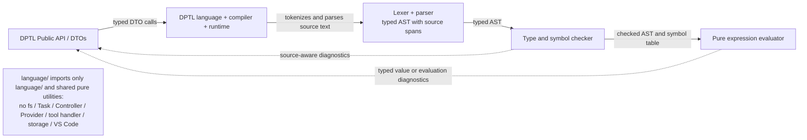
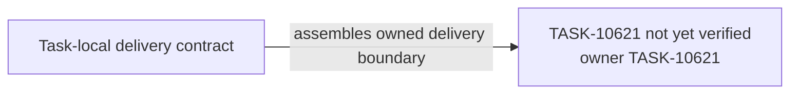

# TASK-10621 Plan

## Approach

按`WS-086/spec.md`语言合同在`src/core/prompts/dptl/language`交付纯语言核心：词法、语法、typed AST、类型/符号检查与表达式求值。它是`L2-dptl-dependency-direction`中`Core`的语言部分，只经`API`暴露不可变DTO；不读文件、不解析include（属于TASK-10622），不选择Profile、不渲染`ResolvedPromptContract`（属于TASK-10622/10623）。

## Architecture Design



- Owner/write boundary：`src/core/prompts/dptl/language`模块，以及`src/core/prompts/dptl/index.ts`中language-core导出段。
- 命令/事实方向：只有`API → Core`的typed调用；诊断与求值结果以不可变值返回，不回调调用方。
- 失败出口：词法/语法/类型/求值错误都是带source span的诊断值，不抛出未分类异常；没有可释放资源。

### Delivery Evidence Anchor



## Steps

1. 读取`WS-086/spec.md`的lexical syntax、expression grammar、literals、type system、symbols/functions与runtime evaluation章节，列出每条可观察规则及其错误码。
2. 定义token、AST节点、source span与diagnostic DTO；AST不可变且携带位置。
3. 实现lexer与parser（含错误恢复，保证一次报告多个诊断且不死循环）。
4. 实现类型与符号检查：符号表、函数签名、类型推断与不匹配诊断。
5. 实现纯求值器：输入checked AST与typed值环境，输出typed值或诊断；无I/O、无全局可变状态。
6. 在`index.ts`导出language-core公开DTO/API段；不导出内部可变结构。
7. 编写行为测试与import边界检查。

## Architecture Evidence

```yaml
architecture_evidence:
  schema_version: 2
  diagram_id: TASK-10621-delivery
  nodes:
    T10621Source:
      artifacts:
        - id: task10621-delivery-emitter
          role: emitter
          path: src/core/prompts/dptl/language
          symbol: DeliveryContract
          expectation: present
    T10621:
      artifacts:
        - id: task10621-delivery-receiver
          role: receiver
          path: src/core/prompts/dptl/language
          symbol: DeliveryBoundary
          expectation: present
  edges:
    - id: task10621-delivery-edge
      from: T10621Source
      to: T10621
      style: solid
      label: assembles owned delivery boundary
      kind: composition
      emit: {node: T10621Source, artifact: task10621-delivery-emitter}
      receive: {node: T10621, artifact: task10621-delivery-receiver}
      proof: [VER-TASK-10621-LANGUAGE]
```

## Verification

- `VER-TASK-10621-LANGUAGE`：`npm run test:run -- src/core/prompts/dptl/language`，用真实`.pmt`片段覆盖合法/非法词法、语法、literal、类型、符号/函数与求值，以及错误恢复与诊断位置；断言解析后的AST结构与诊断码，不用文本contains。
- `VER-TASK-10621-ISOLATION`：测试遍历`language/`源码import图，断言不出现fs、Task、Controller、Provider、tool handler、storage或vscode模块；同时`npm run check-types`与`npx biome check`覆盖改动文件。

## Risks

- WS-086语言合同若与当前实现前提冲突，按合同记录差异并请用户决定，不静默改语义。
- 解析器错误恢复不当会导致超时或级联诊断；用最小非法输入与随机截断输入回归。
- 公开DTO一旦被10622/10623消费即成为共享合同，变更需同步下游Task。
