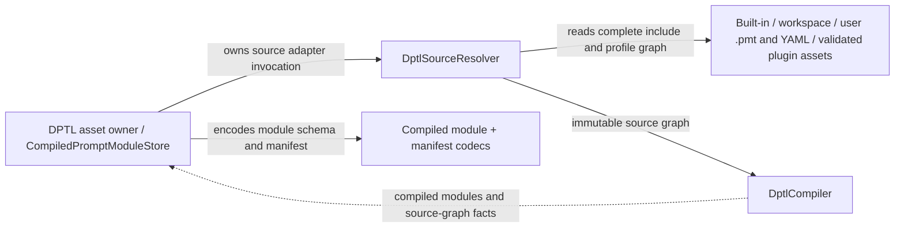
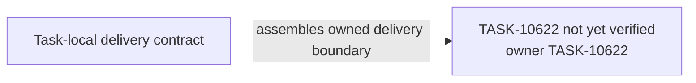

# TASK-10622 Plan

## Approach

在TASK-10621语言核心之上交付DPTL编译侧：`DptlSourceResolver`端口、include图与依赖分析、IR/source map/semantic hash/诊断、compiled module与manifest codec、`CompiledPromptModuleStore`、纯渲染runtime和check/compile工具链。规范合同沿用`WS-086/spec.md`编译章节。文件、workspace watcher与plugin资产发现只作为resolver端口的adapter实现，分别由TASK-10627与TASK-10633提供；本Task只提供内存与内建资产resolver。

## Architecture Design

编译与资产存储（细化`L1-prompt-pipeline`中DPTL侧节点）：



渲染边界（细化`L2-dptl-dependency-direction`）：


- Owner/write boundary：`dptl/compiler`、`dptl/artifacts`、`dptl/runtime`、`dptl/testing`模块，`index.ts`中对应导出段，`scripts`内DPTL入口与`package.json`的DPTL scripts节点。
- 命令/事实方向：Store调用resolver，resolver只返回不可变source graph；Compiler以事实返回compiled module，Store不被Compiler反向调用。
- 失败/释放：source缺失、循环include、超深/超大、类型错误均为source-aware诊断；Store按source/semantic identity淘汰且有条目/字节上限，旧schema条目重编译而非读取。

### Delivery Evidence Anchor



## Steps

1. 定义`DptlSourceResolver`端口、canonical source identity、metadata与include语义；实现内存resolver与内建资产resolver。
2. 实现include图、循环/深度/大小限制与依赖分析，产出IR、source map与semantic hash。
3. 定义compiled module/manifest schema与codec；实现`CompiledPromptModuleStore`（schema不匹配即重编译、有界淘汰）。
4. 实现纯渲染runtime：输入compiled module与typed值，输出渲染结果或诊断，执行WS-086资源限制。
5. 实现check/compile入口与`package.json` scripts；输出原子写入，不改源文件。
6. 导出compiler/artifacts/runtime公开段；补`testing/`的builder与golden fixture。

## Architecture Evidence

```yaml
architecture_evidence:
  schema_version: 2
  diagram_id: TASK-10622-delivery
  nodes:
    T10622Source:
      artifacts:
        - id: task10622-delivery-emitter
          role: emitter
          path: src/core/prompts/dptl/compiler
          symbol: DeliveryContract
          expectation: present
    T10622:
      artifacts:
        - id: task10622-delivery-receiver
          role: receiver
          path: src/core/prompts/dptl/compiler
          symbol: DeliveryBoundary
          expectation: present
  edges:
    - id: task10622-delivery-edge
      from: T10622Source
      to: T10622
      style: solid
      label: assembles owned delivery boundary
      kind: composition
      emit: {node: T10622Source, artifact: task10622-delivery-emitter}
      receive: {node: T10622, artifact: task10622-delivery-receiver}
      proof: [VER-TASK-10622-SOURCES]
```

## Verification

- `VER-TASK-10622-SOURCES`、`VER-TASK-10622-OUTPUT`、`VER-TASK-10622-RENDER`：`npm run test:run -- src/core/prompts/dptl`，断言解析后的模块结构、hash变化规则、诊断码与位置、资源限制错误。
- `VER-TASK-10622-TOOLS`：对临时目录中的合法/非法`.pmt`运行check/compile入口，断言退出码、诊断与原子输出，源文件内容不变。
- 改动文件运行`npx biome check`与`npm run check-types`。

## Risks

- semantic hash定义错误会造成缓存永不命中或错误复用；以comment-only与语义变化对照测试锁定。
- 工具链与运行时若各自实现编译路径会产生不一致；入口必须复用同一pipeline。
- resolver端口是10627/10633的共享合同，变更须同步下游。
