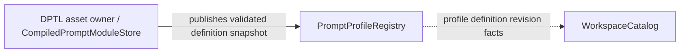
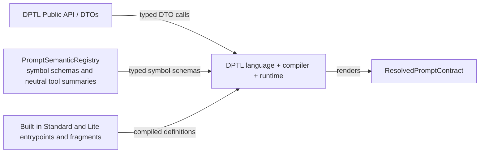
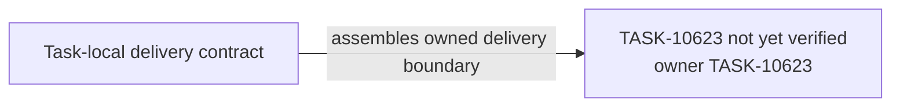

# TASK-10623 Plan

## Approach

在TASK-10622编译与渲染之上交付DPTL侧Profile与语义层和内建资产：`PromptProfileRegistry`、`PromptSemanticRegistry`（含neutral `PromptToolId`/`ToolFeatureSummary`）、不可变`ResolvedPromptContract`与`DptlRenderPort`/`cacheIdentityOf`公共API，以及Standard/Lite的DPTL入口与fragment。Task事实的物化、绑定解析与缓存属于TASK-10630；本Task不import Task、Provider、host或storage。

## Architecture Design

定义发布（细化`L1-prompt-pipeline`中Profile节点）：



公共API与语义（细化`L2-dptl-dependency-direction`）：



- Owner/write boundary：`dptl/profiles`、`dptl/semantics`、`dptl/contract`模块，`index.ts`中对应导出段，`src/core/prompts/profiles/dptl`内建资产。
- 命令/事实方向：Store向Registry发布已验证定义；Registry只以revision事实通知catalog，不反向驱动编译。
- 失败/释放：Profile冲突/缺失/phase错误返回诊断并令依赖工作unavailable，不回退旧固定Prompt；Registry不持有私有work值。

### Delivery Evidence Anchor



## Steps

1. 定义Profile descriptor（code/YAML/plugin统一归一化）、确定性选择与冲突诊断，实现`PromptProfileRegistry`版本化快照。
2. 定义语义schema、phase/version合同与neutral `PromptToolId`/`ToolFeatureSummary`。
3. 定义`ResolvedPromptContract`、`DptlRenderPort`与`cacheIdentityOf`；只依赖DTO与runtime。
4. 盘点当前Standard/Lite生产Prompt的工具暴露、权限、模式、角色与native/XML差异，写成可解析的行为矩阵。
5. 用DPTL编写Standard/Lite入口与fragment；以矩阵对照编译渲染结果。
6. 导出公开段并补import边界测试。

## Architecture Evidence

```yaml
architecture_evidence:
  schema_version: 2
  diagram_id: TASK-10623-delivery
  nodes:
    T10623Source:
      artifacts:
        - id: task10623-delivery-emitter
          role: emitter
          path: src/core/prompts/dptl/profiles
          symbol: DeliveryContract
          expectation: present
    T10623:
      artifacts:
        - id: task10623-delivery-receiver
          role: receiver
          path: src/core/prompts/dptl/profiles
          symbol: DeliveryBoundary
          expectation: present
  edges:
    - id: task10623-delivery-edge
      from: T10623Source
      to: T10623
      style: solid
      label: assembles owned delivery boundary
      kind: composition
      emit: {node: T10623Source, artifact: task10623-delivery-emitter}
      receive: {node: T10623, artifact: task10623-delivery-receiver}
      proof: [VER-TASK-10623-PROFILES]
```

## Verification

- `VER-TASK-10623-PROFILES`、`VER-TASK-10623-CONTRACT`：`npm run test:run -- src/core/prompts/dptl`，断言选择结果、诊断码、契约不可变与cache identity变化规则。
- `VER-TASK-10623-STANDARD-LITE`：以fixture语义输入渲染两种Profile，解析结果后与当前生产行为矩阵逐项比较（工具集合与顺序、权限、模式、native/XML），不用contains或字符串快照充当等价证明。
- `VER-TASK-10623-ISOLATION`：遍历`src/core/prompts/dptl` import图。
- 改动文件运行`npx biome check`与`npm run check-types`。

## Risks

- Standard/Lite迁移遗漏行为差异会在切换时静默删功能；行为矩阵必须来自当前代码盘点而非记忆。
- 当前生产Prompt若在实施期间被相邻任务修改，需要复核矩阵基线。
- `ResolvedPromptContract`与`cacheIdentityOf`是10630的共享合同，变更须同步。
