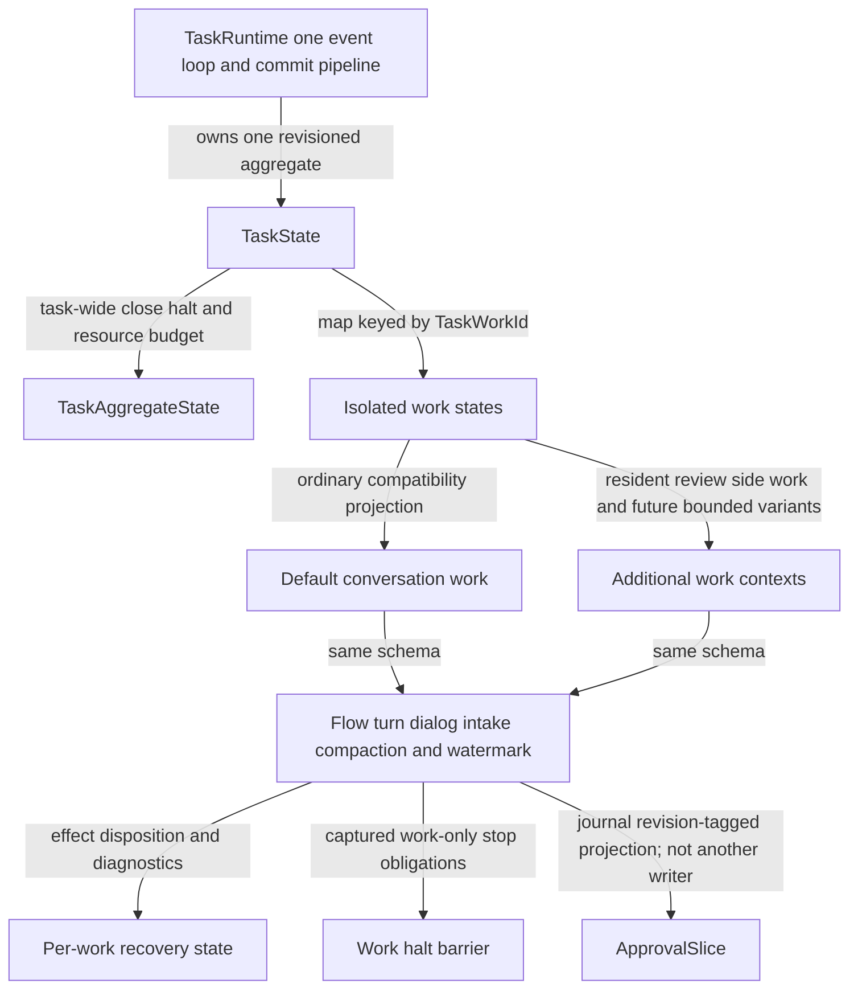
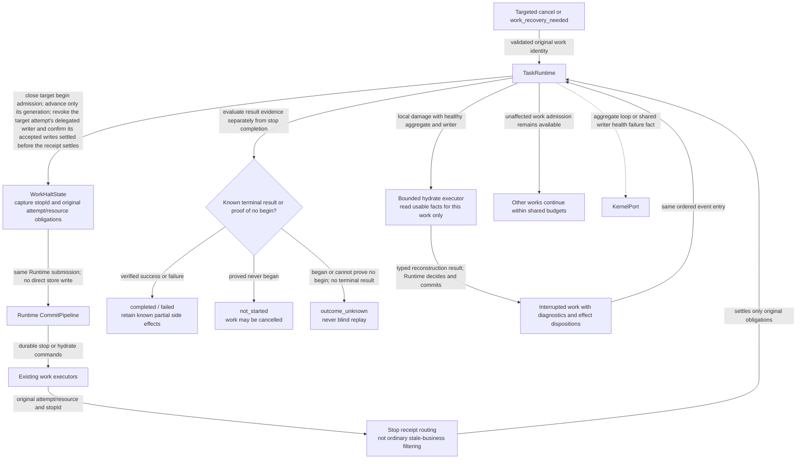
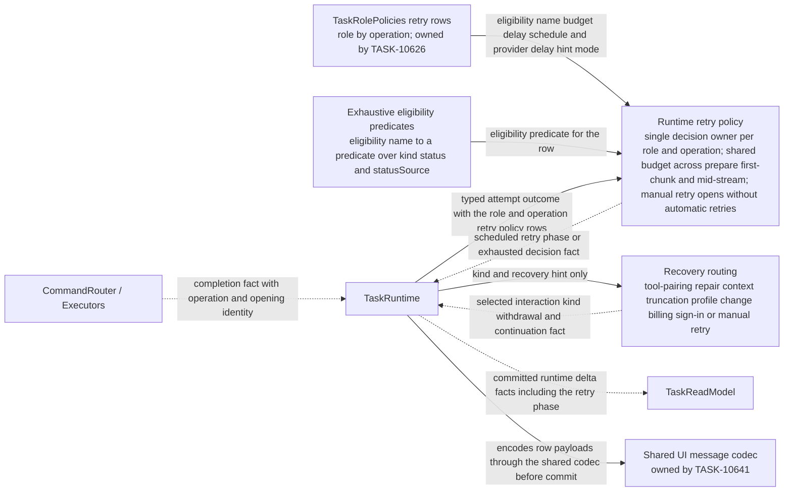
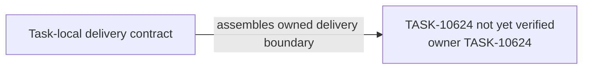

# TASK-10624 Plan

## Approach

在现有`src/core/task/runtime`（EventLoop、TaskRuntime、CommitPipeline、DurableCommandOutbox、CommandRouter）与`src/core/task/kernel`（TaskEvent、transition、dialog machine、hydrate）内扩展，使唯一Runtime拥有Task级aggregate与按`TaskWorkId`键控的work map，不另建状态机或第二writer。

- Work停止、per-work hydrate与effect disposition在Runtime内完成。
- aggregate健康故障只以事实交给KernelPort；生命周期恢复编排属于TASK-10628（`L4-self-healing`）。
- CanonicalWriterGate本身由TASK-10625提供；本Task只持有Runtime侧业务写入能力，并签发/撤销attempt级委托。

按spec PF-3，Runtime同时是turn与compaction两类provider operation的唯一重试与恢复决策owner：
- 读取TASK-10640单次attempt的类型化结果与`ProviderFailure`；
- 按TASK-10626声明的`TaskRolePolicies.retry`行（role×operation）与本Task的穷尽eligibility表决策；
- 发布重试阶段与`interaction_withdrawn`事实；
- 用TASK-10641的codec编码行事实。

CommitPipeline提供审批publication扩展点，AP-2的审批adapter由TASK-10635注册，本Task不实现审批规则。

## Architecture Design

状态所有权（细化`L2-task-work-state`）：



核心事件环与委托写入（细化`L2-runtime-core`中Runtime侧）：

```mermaid
flowchart LR
    %% id: TASK-10624-runtime-core
    %% layer: L3
    %% kind: flow
    %% refines: L2-runtime-core
    %% answers: how the Runtime advances work, delegates attempt writes and reports aggregate health
    %% concept: Delegation = AttemptWriter
    %% concept: Writer = CanonicalWriter
    KernelPort[KernelPort] -->|validated task or work event via installed narrow input port| Runtime[TaskRuntime ordered event loop]
    Runtime -->|TaskState plus addressed event| Reduce[Pure task-level or work-level transition]
    Reduce -->|accepted state and commands| Commit[Existing CommitPipeline and canonical owners]
    Reduce -->|invalid or stale request| Reject[Typed rejection; loop remains runnable]
    Reject -->|next event| Runtime
    Commit -->|durable command eligible| Outbox[Existing DurableCommandOutbox and CommandRouter]
    Outbox -->|bounded parallel work; serial state commits| Execute[Provider tool approval communication and other owning executors]
    Runtime -->|issues one attempt-scoped delegated write capability with each dispatched attempt; revokes it before that work's stop receipt; KernelPort stop revokes all before the writer-stopped fact| Delegation[Attempt-scoped delegated writer]
    Execute -->|appends attempt-owned journal records only through its own delegation| Delegation
    Delegation -->|commits through the Runtime-held gate; rejected after revocation| Writer[CanonicalWriterGate]
    Execute -->|result failure or unknown with original task and work identity| Result[Typed domain result]
    Result -->|same core event entry| Runtime
    Commit -->|committed facts only| ReadModel[TaskReadModel]
    Reduce -->|isolated bad work; healthy envelope and writer| WorkRepair[Work recovery state and commands\npure transition; other works remain admitted]
    WorkRepair -->|stop and incremental hydrate commands; no inline I/O| Commit
    Runtime -.->|aggregate loop or writer health failure fact; episode identity| KernelPort
```



Work停止与局部恢复（细化`L4-work-stop-recovery`）：



Provider失败决策（细化`L2-provider-failure-presentation`中Runtime侧）：



- Owner/write boundary（与`goals.yaml`一致）：
  - `src/core/task/runtime`模块；
  - `src/core/task/kernel`模块（work寻址变化；失败类dialog携带`ProviderFailure`，其他dialog kind保留`presentationRef`）；
  - `TaskPhase.ts`。

  KernelPort/ControlInbox/TaskControl与CanonicalWriterGate只作为边界节点出现，不在本Task实现。旧重试循环、`ProviderRetryGate`、`runInternalCompactionPassWithRetry`、`CompactionRetryPolicy`与旧行writer由TASK-10638移除。
- 命令/事实方向：唯一业务输入是KernelPort；结果以同一event入口回到Runtime；健康故障只以事实上交。
- 失败/释放：委托在停止receipt前撤销且确认已接纳写入结算；unknown保留对账身份且不重放；局部坏work不升级全Task停止。

### Delivery Evidence Anchor



## Steps

1. 读取当前runtime代码、WS-051 halt/hydrate合同与现有测试，记录default work回归基线。
2. 引入`TaskWorkId`、Task级aggregate与work map；把现有会话状态映射为default work，保持行为不变。
3. 将事件与命令改为work寻址；纯transition区分task级与work级，拒绝路径保持循环可运行。
4. 实现attempt级委托写入：随派发签发、仅追加attempt自有journal记录、停止前撤销、撤销后拒绝。
5. 实现`WorkHaltState`、work generation与stop receipt专用结算；Task级close冻结全部work后汇聚。
6. 实现per-work hydrate与EffectDisposition分类，替换executing block统一cancel语义；预算化恢复片与`recovery_pending`。
7. 输出aggregate健康故障事实与episode身份；接受恢复publication后的可运行状态。
8. 补齐转换、停止、恢复与重启测试。
9. 在TASK-10640采集的golden基线之上，盘点现有重试与恢复行为，作为PF-3的oracle fixture：
   - `DefaultProductionProviderService`与`ProviderRetryGate`的测试；
   - SubagentRunner的重试测试（只在可观察输出前重试、压缩消耗attempt）；
   - `runInternalCompactionPassWithRetry`、`CompactionRetryPolicy`与`ContextCompactionSession`的测试（自动与手动、可纠正回复、输出上限重放、按pass计预算）；
   - `TaskInteractionOwner`的Profile切换撤回；
   - `TaskViewMessageAdapter`的倒计时与强制截断输出。
10. 实现Runtime决策（按PF-8只从隔离组合可达，旧循环继续服务生产）：
    - 消费单次attempt结果（`succeeded`、`failed(ProviderFailure)`、`stale_handler`），stale先于分类；
    - 按role×operation（`turn`、`compaction_auto`、`compaction_manual`）策略行与穷尽eligibility谓词（kind、status、`statusSource`）决定重试；
    - main×turn：共享预算、重放同一已准备请求、pairing只在首chunk前修复一次、上下文截断不耗预算；
    - subagent×turn、compaction的行字段语义：流中不重试、截断耗预算、按pass计预算、可纠正回复重试、输出上限缩减重放；
    - `retryNow`、handBack、耗尽转人工，手动重试打开的请求不再自动重试；
    - 隔离路径的compaction operation以单次attempt边界包装调用`runInternalCompactionPass`，该函数体与签名不变（只读依赖），生产中的`runInternalCompactionPassWithRetry`保持原样直到TASK-10638。
11. 发布重试阶段work state事实（截止时间、attempt/maxAttempts、`retryNow`可用性、`forceTruncateAvailable`）。这些事实与失败dialog携带与失败卡片行相同的interaction identity，供spec PF-5的失败卡片与动作同源不变量使用；不得发布没有对应失败交互的动作可用事实。Profile切换时，只判断当前primary待决交互：其失败recovery提示为`profile_change`或kind为`profile_invalid`时，提交`interaction_withdrawn(reason: profile_changed)`事实，取代文本匹配撤回；投影隐藏该交互的行，并与今日一样隐藏最近一条`error_retry`行。
12. 在kernel中新增携带`ProviderFailure`的Provider/compose失败dialog变体，旧失败dialog分支保持不变，由TASK-10638移除；其余dialog kind保留`presentationRef`，已持久化的旧失败`presentationRef`只读解码。新路径写出的行事实全部经codec与TASK-10641的唯一编码器编码。
13. 在CommitPipeline提供审批publication扩展点（单事务内调用已注册adapter），供TASK-10635注册AP-2 adapter。

## Architecture Evidence

```yaml
architecture_evidence:
  schema_version: 2
  diagram_id: TASK-10624-delivery
  nodes:
    T10624Source:
      artifacts:
        - id: task10624-delivery-emitter
          role: emitter
          path: src/core/task/runtime
          symbol: DeliveryContract
          expectation: present
    T10624:
      artifacts:
        - id: task10624-delivery-receiver
          role: receiver
          path: src/core/task/runtime
          symbol: DeliveryBoundary
          expectation: present
  edges:
    - id: task10624-delivery-edge
      from: T10624Source
      to: T10624
      style: solid
      label: assembles owned delivery boundary
      kind: composition
      emit: {node: T10624Source, artifact: task10624-delivery-emitter}
      receive: {node: T10624, artifact: task10624-delivery-receiver}
      proof: [VER-TASK-10624-WORK-STATE]
```

## Verification

- `VER-TASK-10624-WORK-STATE`、`VER-TASK-10624-WORK-STOP`：`npm run test:run -- src/core/task/runtime`，以真实reducer与CommitPipeline驱动多work事件，断言状态、generation、receipt与预算；默认会话既有测试全部通过。
- `VER-TASK-10624-OUTCOMES`：构造执行中/已begin/未begin/有终态证据的快照与journal，hydrate后断言disposition，并验证unknown不重放、坏work在预算内恢复且其它work继续。
- `VER-TASK-10624-HEALTH`：注入writer/loop故障与局部payload损坏，断言仅前者产生aggregate事实。
- `VER-TASK-10624-PRESENTATION-PARITY`：分两部分。
  - 旧生产路径：断言默认会话产生的ask/say序列与golden行序列一致，并运行`InteractionRegistry`、`TaskViewMessageAdapter`的现有测试，不修改断言。
  - 隔离组合：把codec编码的行解码并投影后，与golden行序列比较。场景包括Provider失败、自动重试、重试耗尽、profile失败与撤回、mistake limit、恢复与完成。
- `VER-TASK-10624-RETRY-OWNER`：`npm run test:run -- src/core/task/runtime src/core/task/kernel`。用Step 9的oracle fixture做表驱动场景，经真实reducer、CommitPipeline与attempt结果驱动，断言以下内容与旧路径一致：各operation的重试次数、延迟、预算范围、阶段事实、交互种类、撤回与手动接管。已采纳的BD-2与BD-3按BD表的新行为断言：BD-2为`providerDelayHint: ignore`；BD-3为spec BD-3细表“采纳后”列的全部行，turn侧变化包括Cerebras 401/403/400与Dify 401/403/404/422，compaction侧只有Cerebras变化。eligibility谓词的穷尽性由类型检查与逐kind、逐`statusSource`测试共同保证。
- 改动文件运行`npx biome check`与`npm run check-types`。

## Risks

- 默认会话迁移到work map是高回归面；先建立行为基线再改结构。API错误卡片、自动重试行与恢复ask依赖现有消息产生时机，Runtime改写不得改变其种类、顺序或interaction身份。
- 委托撤销与CommitPipeline批处理交错可能出现撤销后写入；以撤销后写入必拒绝的测试锁定。
- CanonicalWriterGate接口来自TASK-10625；两者并行时以接口先行固定合同，实际区域碰撞按协调规则处理。
- PF-3把三套重试循环合为一个决策点；行为差异只能来自已采纳的BD-2与BD-3。以旧测试作oracle，先锁定节奏与交互时机，再切换决策来源；旧循环在TASK-10638前保持可用。
