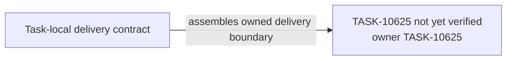

# TASK-10625 Plan

## Approach

交付`L0-persistence-authority`中的持久化权威：根准入（binding与delete intent事务适配）、InstanceLayout及child位置、CanonicalWriterGate（现有repository写能力的单持有者交接，不是第二writer或跨进程fencing）、TaskHistoryProjector（taskHistory.db唯一有序写入口）。锁算法保持现有TaskLockService，本Task只消费其同步held状态；TaskControl编排、删除协调与视图投影分别属于TASK-10628、TASK-10636与TASK-10631。

## Architecture Design

```mermaid
flowchart LR
    %% id: TASK-10625-persistence-authority
    %% layer: L2
    %% kind: structure
    %% refines: L0-persistence-authority
    %% answers: which persistence authority this task builds and how admission, layout, gate and history stay separate
    %% concept: RootAdmission = RootAdmission
    %% concept: Binding = Binding
    %% concept: DeleteIntent = DeleteIntent
    %% concept: Lock = Lock
    %% concept: RepositoryWriters = CanonicalWriter
    %% concept: Layout = InstanceStores
    %% concept: AttemptDelegation = AttemptWriter
    %% local-only: Acquisition
    %% local-only: RootClaim
    %% local-only: ChildLocation
    Acquisition[TaskControl / Factory / ChildLifecycleAdapter / OpeningSlot] -->|enroll before new existing-acquire or child resource access; publication revalidates the same receipt| RootAdmission[RootAdmissionBoundary\nhost-lifetime transaction adapter over durable binding + delete intent\nclosed admission allows only same-deleteId sealed-receipt close-only rebind; no lock epoch]
    RootAdmission -.->|open receipt closed rejection release or sealed-set fact| Acquisition
    RootAdmission -->|binding reserve commit reconcile tombstone and exact-scope identity| Binding[TaskBindingRepository]
    RootAdmission -->|admission deleteId inventory and phase commits| DeleteIntent[TaskDeleteIntentRepository]
    RootClaim[Independent root claim] -->|canonical path overlap and marker validation through the same admission transaction| RootAdmission
    Binding -->|main instance root and schema| Layout[InstanceLayout]
    RootAdmission -->|matching live child enrollment resolves exact child location under parent binding| ChildLocation[Child InstanceLocation\nsubagents / subagent-id]
    ChildLocation -->|validated child identity and marker; no new independent root claim| Layout
    Layout -->|opens typed fault domains| Journal[journal.db\nconversation control interaction child instance link result extension selection and typed jobs]
    Layout -->|constructs/opens| State[state.json plus backup\nkernel aggregate revision durable outbox]
    Layout -->|constructs/opens| Messages[messages.db\nderived UI message window]
    Layout -->|constructs/opens| Activities[activities.db\nactivity history]
    Layout -->|constructs/opens| Metrics[metrics.db\noptional usage and rate data]
    AttemptDelegation[Attempt-scoped delegated writer\nRuntime-issued per executor attempt; journal records only; revoked before its work stop receipt and every writer-stopped fact] -->|commits attempt-owned journal records through the Runtime-held gate; rejected after revocation| RepositoryWriters[CanonicalWriterGate plus existing repository writers\none Runtime business holder with revocable attempt-scoped executor delegations, or one bounded maintenance stage]
    Lock[TaskLockService\nTaskId lock namespace under tasksBasePath; existing algorithm] -.->|synchronous held or lost status at every gate admission; flips to lost before lock_lost is published| RepositoryWriters
    RepositoryWriters -->|commits via existing store transaction| Journal
    RepositoryWriters -->|commits through shared atomic-file| State
    RepositoryWriters -->|commits| Activities
    RepositoryWriters -->|commits| Metrics
    Journal -->|idempotent message projector executed under the Runtime-held CanonicalWriterGate| Messages
    Journal -.->|committed task metadata facts| HistoryProjector[TaskHistoryProjector\nmonotonic instance key taskId plus bindingRevision plus creationNonce and listing tombstone projection]
    State -.->|bounded lifecycle metadata facts| HistoryProjector
    Metrics -.->|optional summary facts| HistoryProjector
    HistoryProjector -->|commits monotonic instance revision or listing tombstone; older facts for the same binding identity cannot recreate rows and a later binding identity may be listed| GlobalHistory[TaskHistoryRepository\ntaskHistory.db]
```



- Owner/write boundary：`src/core/task/persistence`（新）、`src/core/storage/instance`、`src/core/task/stores`、新`TaskHistoryProjector.ts`与`TaskHistory.ts`写入/tombstone方法。
- 命令/事实方向：获取方先经RootAdmission登记再访问资源；gate只接受当前持有者；History只经projector写入，store只以事实喂给projector。
- 失败/释放：每个crash point可幂等roll-forward或补偿；锁失去时gate同步拒绝后续写入；maintenance stage在success/failed/unknown后都撤销并确认release（由TaskControl触发）。

### Delivery Evidence Anchor



## Steps

1. 读取`storage.md`、InstanceLayout/InstanceStorage、现有stores与TaskHistory写入路径，列出当前writer与fault domain矩阵。
2. 实现TaskBindingRepository与TaskDeleteIntentRepository（reserve/commit/delete/tombstone、collision、dangling/orphan）及RootAdmissionBoundary事务适配（enrollment、closed admission、close-only rebind）。
3. 在InstanceLayout中统一main与child位置解析，child只经已登记enrollment与marker校验。
4. 实现CanonicalWriterGate：单业务持有者+可撤销attempt委托、或单一有界maintenance stage；每次准入同步读锁held状态。
5. 将现有repository写入改为经gate准入，保持各store单writer语义与现有事务/原子写。
6. 实现TaskHistoryProjector：实例键单调revision、listing tombstone、flush/close。
7. 补并发、crash注入、撤销后写入与tombstone顺序测试。

## Architecture Evidence

```yaml
architecture_evidence:
  schema_version: 2
  diagram_id: TASK-10625-delivery
  nodes:
    T10625Source:
      artifacts:
        - id: task10625-delivery-emitter
          role: emitter
          path: src/core/task/persistence
          symbol: DeliveryContract
          expectation: present
    T10625:
      artifacts:
        - id: task10625-delivery-receiver
          role: receiver
          path: src/core/task/persistence
          symbol: DeliveryBoundary
          expectation: present
  edges:
    - id: task10625-delivery-edge
      from: T10625Source
      to: T10625
      style: solid
      label: assembles owned delivery boundary
      kind: composition
      emit: {node: T10625Source, artifact: task10625-delivery-emitter}
      receive: {node: T10625, artifact: task10625-delivery-receiver}
      proof: [VER-TASK-10625-ADMISSION]
```

## Verification

- `VER-TASK-10625-ADMISSION`、`VER-TASK-10625-LAYOUT`：`npm run test:run -- src/core/task/persistence src/core/storage/instance`，在临时root中并发与crash注入，断言磁盘上的binding/intent/marker状态。
- `VER-TASK-10625-WRITER-GATE`：`npm run test:run -- src/core/task/stores`，断言双持有者被拒、撤销/锁丢失后写入被拒且数据未变。
- `VER-TASK-10625-HISTORY`：对真实SQLite taskHistory.db驱动乱序/迟到事实与tombstone，断言行状态。
- 改动文件运行`npx biome check`与`npm run check-types`。

## Risks

- 现有stores被多处直接调用；改为经gate准入时须找全调用方，否则出现绕过gate的写入。
- 锁模型无原子条件释放；gate只同步读本地held状态，不承诺消除跨进程窗口（按UR-10保留）。
- Gate合同是10624/10628共享合同；并行期间以接口先行固定，实际区域碰撞按协调规则处理。
