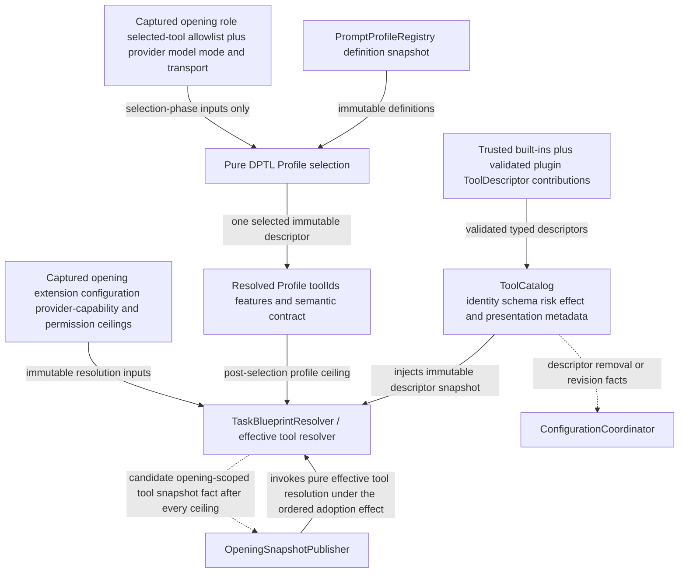
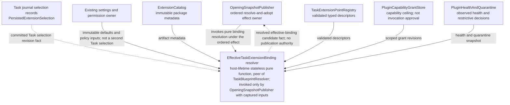
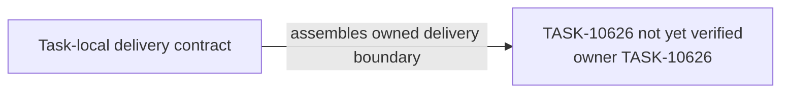

# TASK-10626 Plan

## Approach

交付每个opening采用的配置与工具事实生产者：process-owned配置投影协调器与唯一typed feed、纯配置resolver、静态ToolCatalog、唯一TaskBlueprintResolver（effective tool resolver）与宿主级纯扩展绑定resolver。它们都没有发布或调度权：feed事件进入ControlInbox，resolver只由OpeningSnapshotPublisher在TaskControl排定的effect内调用（Publisher、ControlInbox、TaskControl属于TASK-10628）。扩展registry、grant与health的生产属于TASK-10633；本Task定义resolver消费的typed输入DTO。

## Architecture Design

配置feed与候选（细化`L1-configuration-feed`）：

```mermaid
flowchart LR
    %% id: TASK-10626-configuration-feed
    %% layer: L2
    %% kind: structure
    %% refines: L1-configuration-feed
    %% answers: how canonical revisions become one typed feed and pure candidates without publication authority
    %% concept: Projection = ConfigurationCoordinator
    %% concept: GlobalSettings = SettingsAuthorities
    %% concept: HostServices = Controller
    %% concept: SnapshotPublisher = SnapshotsPort
    %% concept: Blueprint = BlueprintResolver
    %% concept: ToolDescriptors = ToolCatalog
    %% concept: ProfileDefinitions = PromptProfiles
    GlobalSettings[Global SettingsRepository] -.->|canonical commit and revision facts| Projection[TaskConfigurationProjectionCoordinator]
    WorkspaceSettings[Workspace SettingsRepository\nscoped keys only] -.->|canonical commit and revision facts| Projection
    RemoteConfig[RemoteConfig snapshot + policy revision] -.->|snapshot and policy revision facts| Projection
    SessionOverrides[Session override revision] -.->|overlay revision fact| Projection
    TaskSettings[TaskSettingsRepository] -.->|task override revision fact| Projection
    ProviderProfiles[Provider ProfileCatalog / permission policy revisions] -.->|catalog and policy revision facts| Projection
    Projection -->|process-only keys; no Task fanout| HostServices[Controller / host services]
    Projection -.->|live approval enablement configuration and availability facts| ResidentOwner
    Projection -->|classifies one coherent desired target| Classifier{Configuration intent\nrestrictions replacement requirement and ordinary changes}
    Classifier -->|same_opening: ordinary replaceable snapshot| Coalesce[Scoped notification coalescing]
    Coalesce -->|latest unadmitted ordinary state| Feed[TaskConfigurationFeed]
    Classifier -->|safety: revocation retained independently; never coalesced| Fence[Safety fence / revocation epoch]
    Classifier -->|replacement: lifecycle or resource intent| Feed
    Fence -->|safety-class typed event| Inbox[ControlInbox]
    Feed -->|typed event carrying change class and revision vector| Inbox
    Feed -->|captured desired target data for the ordered snapshots effect| ConfigResolver[EffectiveTaskConfigurationResolver]
    SnapshotPublisher[OpeningSnapshotPublisher\nowns ordered resolve-and-adopt; pure resolvers have no scheduling authority] -->|invokes pure configuration resolution under the ordered effect| ConfigResolver
    ConfigResolver -->|candidate only; not yet published| ConfigCandidate[Candidate EffectiveTaskConfigurationSnapshot]
    ConfigCandidate -->|captured role allowlist provider model mode transport and revision inputs| SelectionContext[Profile selection context]
    ProfileDefinitions[PromptProfileRegistry definition snapshot] -->|immutable definitions| ProfileSelection[Pure Profile selection]
    SelectionContext -->|selection-phase inputs only| ProfileSelection
    ProfileSelection -->|selected Profile tool feature and semantic policy| Blueprint[TaskBlueprintResolver / effective tool resolver]
    ConfigCandidate -->|extension runtime-context and permission ceilings| Blueprint
    SnapshotPublisher -->|invokes pure Profile and effective tool resolution under the same effect| Blueprint
    ToolDescriptors[ToolCatalog descriptor snapshot] -->|trusted descriptors| Blueprint
    Blueprint -->|candidate from the same pure resolver; no direct publication| ToolCandidate[Candidate opening-scoped SelectedToolSet revision]
    ConfigCandidate -.->|matching configuration candidate fact| SnapshotPublisher
    ToolCandidate -.->|matching tool candidate fact| SnapshotPublisher
```



工具事实源（细化`L1-tool-fact-projection`生产侧）：



扩展绑定纯resolver（细化`L0-extension-authority`中BindingResolver）：



- Owner/write boundary：`src/core/task/configuration`、`src/core/task/blueprint`、`src/core/task/tools/catalog`、`src/core/extensions/binding`（均为新模块）。
- 命令/事实方向：canonical owner只以revision事实喂给协调器；feed事件只进入ControlInbox；resolver只被Publisher调用并以候选事实返回。
- 失败/释放：feed不丢safety事件；resolver失败返回typed rejection由Publisher回报；协调器随host生命周期关闭并释放订阅。

### Delivery Evidence Anchor



## Steps

1. 盘点当前StateManager/SettingsRepository/RemoteConfig/session override/task settings/ProfileCatalog的revision与变更通知，定义`TaskConfigurationRevisionVector`。
2. 实现协调器、意图分类、scoped coalescing、safety fence与typed feed事件；process-only键只给host services。
3. 实现纯`EffectiveTaskConfigurationResolver`，包括Auto-Approve启用与审批专用Profile的独立配置事实。
4. 建立ToolCatalog（来自`tool-specs.ts`/`tool-ids.ts`的可信内建描述与已验证贡献），定义SelectedToolSet与neutral `PromptToolId`映射。
5. 实现唯一TaskBlueprintResolver：Profile选择后的ceiling与所有已捕获ceiling合成候选。
6. 实现扩展绑定纯resolver与输入DTO。
7. 补feed、resolver确定性与ceiling测试。
8. 在ToolCatalog描述符上声明PF-6的封闭`presentationVariants`。每个variant给出类别、标题、动词、图标键、头部颜色类、分组与折叠属性，并声明它升级的旧`UiSayTool.tool`值；每个现有旧值对应唯一的`{toolId, variant}`。这是旧tool kind映射的唯一来源。删除variant的颜色按spec BD表记录的BD-4决定。
9. 在`TaskRoleMap`同一文件声明`TaskRolePolicies`，其retry行按role×operation组织：main、subagent、approvalReviewer的`turn`，main与subagent的`compaction_auto`，以及main的`compaction_manual`。行字段见spec PF-3，行值按现状盘点写入：
   - `ProviderRetryGate`的次数与延迟；
   - SubagentRunner的节奏，以及只在可观察输出前重试、压缩消耗attempt；
   - `CompactionRetryPolicy`与`ContextCompactionSession`的计数、固定等待、按pass计预算、可纠正回复重试与输出上限重放；
   - 审批reviewer请求路径的行为。

   eligibility只声明封闭名称，其对（kind、status、`statusSource`）的判定谓词由TASK-10624的Runtime解释；`providerDelayHint`的取值按BD-2决定，BD-2待定只暂停这一取值，不暂停本步其余字段。Step 8中deleted variant的颜色类同理只受BD-4约束。

## Architecture Evidence

```yaml
architecture_evidence:
  schema_version: 2
  diagram_id: TASK-10626-delivery
  nodes:
    T10626Source:
      artifacts:
        - id: task10626-delivery-emitter
          role: emitter
          path: src/core/task/configuration
          symbol: DeliveryContract
          expectation: present
    T10626:
      artifacts:
        - id: task10626-delivery-receiver
          role: receiver
          path: src/core/task/configuration
          symbol: DeliveryBoundary
          expectation: present
  edges:
    - id: task10626-delivery-edge
      from: T10626Source
      to: T10626
      style: solid
      label: assembles owned delivery boundary
      kind: composition
      emit: {node: T10626Source, artifact: task10626-delivery-emitter}
      receive: {node: T10626, artifact: task10626-delivery-receiver}
      proof: [VER-TASK-10626-TOOL-PRESENTATION]
```

## Verification

- `VER-TASK-10626-FEED`：`npm run test:run -- src/core/task/configuration`，用真实SettingsRepository临时root提交变更，断言feed事件序列、合并与safety保留。
- `VER-TASK-10626-RESOLVERS`、`VER-TASK-10626-TOOLS`：`npm run test:run -- src/core/task/blueprint src/core/task/tools/catalog src/core/extensions/binding`，断言相同输入同identity、各ceiling收窄工具集合、能力视图无法新增ToolId、新权限不复活旧grant。
- `VER-TASK-10626-AUTO-APPROVE-CONFIG`：断言启用与审批Profile事实独立、默认关闭、不读取legacy字段。
- `VER-TASK-10626-TOOL-PRESENTATION`：表驱动测试遍历全部内建工具与每个现有tool kind，断言variant映射唯一，且投影元数据与当前`PresentationRenderers`、`ToolGroupRenderer`、ChatRow、`task-header/util`的输出一致；删除variant的颜色按BD-4决定断言。
- `VER-TASK-10626-ROLE-POLICIES`：断言各retry行与盘点值逐项相等，每行引用已声明的eligibility名称，且`providerDelayHint`符合BD-2决定。
- 改动文件运行`npx biome check`与`npm run check-types`。

## Risks

- 设置来源众多，漏接某个revision会使feed静默过期；以来源清单逐项测试。
- ToolCatalog与现有`tool-specs.ts`并存期间须保证唯一事实源，不复制描述字段。
- Resolver输入DTO是10628/10633共享合同，变更须同步。
