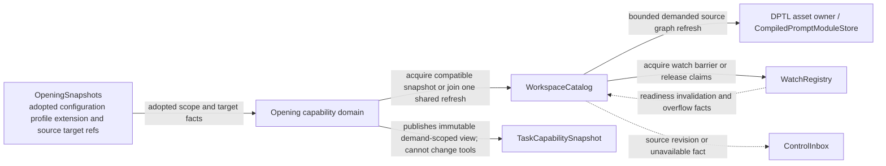
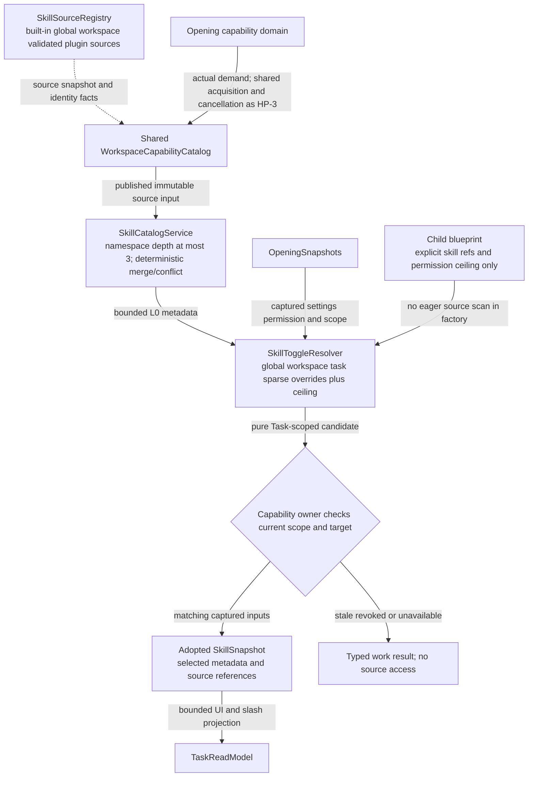
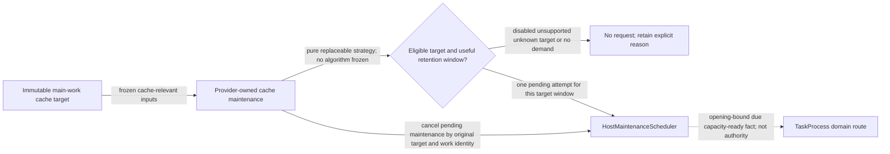
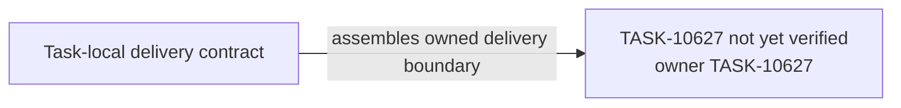

# TASK-10627 Plan

## Approach

交付共享能力来源与Task能力视图：每workspace唯一`WorkspaceCapabilityCatalog`（含watcher registry、physical watch pool、source adapters与共享发布检查）、按实际需求构建`TaskCapabilitySnapshot`的opening能力域、层级Skill目录与toggle解析、process级`HostMaintenanceScheduler`和未冻结算法的cache warmup扩展接缝。Skill内容的实际读取、usage记录与Prompt消费属于TASK-10630；ControlInbox/TaskControl/OpeningSnapshotPublisher属于TASK-10628。DPTL workspace/user `.pmt`来源以本Task的source adapter实现TASK-10622的resolver端口。

## Architecture Design

共享来源与Task能力视图（细化`L2-capability-provider-hot-path`的来源与能力段）：

```mermaid
flowchart LR
    %% id: TASK-10627-capability-hot-path
    %% layer: L3
    %% kind: flow
    %% refines: L2-capability-provider-hot-path
    %% answers: how shared sources are published once and how a Task adopts a demand-scoped capability view off the provider hot path
    %% concept: Catalog = WorkspaceCatalog
    %% concept: SettingsProjection = ConfigurationCoordinator
    %% concept: SourceAdapters = CapabilitySources
    %% concept: CapabilitySnapshot = CapabilityView
    %% concept: TaskCapability = CapabilityDemand
    %% concept: Snapshots = OpeningSnapshots
    PhysicalWatchers[PhysicalWatchPool] -->|filesystem events only| WatchRegistry[WorkspaceCapabilityWatcherRegistry]
    Catalog[WorkspaceCapabilityCatalog] -->|acquire watch claims and barrier before source read| WatchRegistry
    WatchRegistry -.->|readiness invalidation overflow and CapabilityWatchFence facts| Catalog
    SettingsProjection[TaskConfigurationProjectionCoordinator] -->|source-affecting revision only| Catalog
    Catalog -->|catalog-owned single-flight and cancellation| SourceAdapters[Rules / Workflows / Skills / Subagents / MCP / Extension source adapters]
    SourceAdapters -.->|immutable source snapshot and revision facts| Catalog
    Catalog -->|source key and watch fence after barrier ack| SourceCheck{Shared-source publish check\nCatalog owner; no Task opening}
    SourceCheck -->|valid shared source| CatalogSnapshot[WorkspaceCapabilityCatalogSnapshot]
    SourceCheck -->|invalid; no publication| SourceUnavailable[Superseded or unavailable source result]
    CatalogSnapshot -->|catalog revision event| Inbox[ControlInbox]
    FeatureDemand[TaskFeatureSet.capabilityDemand from the blueprint] -->|declared upper bound; data not a branch| Demand{Capability domain source demand\nowned by TaskCapabilitySnapshotBuilder}
    Snapshots[OpeningSnapshots] -->|published revision triggers lazy reprojection on next demand| Demand
    Demand -->|scoped source required| SourceReady{Already published compatible source?}
    SourceReady -->|yes; no source I/O| SnapshotBuilder[TaskCapabilitySnapshotBuilder]
    SourceReady -->|first or invalidated scope; wait outside control opening| TaskCapability[Opening capability domain\nbounded cancellable work waiter]
    TaskCapability -->|acquire snapshot or join one shared refresh| Catalog
    Catalog -.->|published snapshot or unavailable facts for registered waiters| TaskCapability
    TaskCapability -->|ready and still relevant| SnapshotBuilder
    TaskCapability -->|timeout unavailable or cancelled| WorkUnavailable[Only this work unavailable\nunrelated control continues]
    CancelWait[Work cancellation or opening disposal] -->|release this waiter and its demand ref only| TaskCapability
    SourceUnavailable -->|notify affected waiters; no false fresh snapshot| WorkUnavailable
    Demand -->|no source required by the declared contract| Empty[Explicit source-free Task view\nno watcher or catalog subscription]
    Empty -->|source-free candidate; same Task adoption fence| AdoptionCheck{Task adoption check\nopening target revision and scope}
    ConfigSnapshot[EffectiveTaskConfigurationSnapshot] -->|configuration and policy identity| Empty
    CatalogSnapshot -->|injects immutable snapshot| SnapshotBuilder
    ConfigSnapshot -->|injects immutable snapshot| SnapshotBuilder
    SnapshotBuilder -->|candidate and complete projection identity| AdoptionCheck
    Snapshots -->|OpeningGuard and target RevisionTuple for assertAdmissible| AdoptionCheck
    AdoptionCheck -->|valid Task candidate| CapabilitySnapshot[TaskCapabilitySnapshot]
    AdoptionCheck -->|invalid; no adoption| CandidateUnavailable[Superseded or unavailable Task candidate]
```



DPTL来源刷新（细化`L1-prompt-pipeline`中catalog段）：



Skill元数据与toggle（细化`L2-skill-demand`的目录段）：



宿主维护调度与warmup接缝（细化`L3-cache-warmup-extension`的调度段）：



- Owner/write boundary：`src/core/capabilities/catalog`、`src/core/task/capability`、`src/core/maintenance`（均为新模块）；ControlInbox、OpeningSnapshots、TaskProcess只作为边界节点。
- 命令/事实方向：catalog只向ControlInbox发布revision事件，Task侧只经adoption check采用；能力视图不能改变工具集合。
- 失败/释放：watch错误或overflow不发布虚假fresh snapshot；单waiter超时/取消只令本work unavailable并释放自身demand ref；订阅、handle、backlog、timer与日志均有界。

### Delivery Evidence Anchor



## Steps

1. 盘点现有rules/workflows/skills/subagents/MCP/AgentConfig的扫描与watcher，列出需移除的独立watcher与可复用解析。
2. 实现physical watch pool与watcher registry（逻辑拓扑、base key、去重物理claim、订阅级overlay、barrier/ack、sticky overflow）。
3. 实现catalog：source adapters（含DPTL workspace/user source adapter）、single-flight刷新、共享发布检查、拓扑切换原子化。
4. 实现opening能力域：需求上界、懒投影、有界可取消waiter、source-free视图与adoption check。
5. 实现SkillCatalogService（深度≤3、确定性合并）与SkillToggleResolver（稀疏覆盖+ceiling）。
6. 实现HostMaintenanceScheduler（优先级、并发、timer/I/O预算、公平）与warmup接缝（无策略时skip）。
7. 补并发、错误注入与热路径零扫描测试。

## Architecture Evidence

```yaml
architecture_evidence:
  schema_version: 2
  diagram_id: TASK-10627-delivery
  nodes:
    T10627Source:
      artifacts:
        - id: task10627-delivery-emitter
          role: emitter
          path: src/core/capabilities/catalog
          symbol: DeliveryContract
          expectation: present
    T10627:
      artifacts:
        - id: task10627-delivery-receiver
          role: receiver
          path: src/core/capabilities/catalog
          symbol: DeliveryBoundary
          expectation: present
  edges:
    - id: task10627-delivery-edge
      from: T10627Source
      to: T10627
      style: solid
      label: assembles owned delivery boundary
      kind: composition
      emit: {node: T10627Source, artifact: task10627-delivery-emitter}
      receive: {node: T10627, artifact: task10627-delivery-receiver}
      proof: [VER-TASK-10627-CATALOG]
```

## Verification

- `VER-TASK-10627-CATALOG`：`npm run test:run -- src/core/capabilities/catalog`，在临时workspace制造startup窗口、overflow、EPERM/ENOSPC与拓扑变化，断言发布与不发布的快照。
- `VER-TASK-10627-HOT-PATH`：以计数文件系统adapter驱动多Task多轮，断言无invalidation时扫描/重读为0，toggle只重算Task视图，waiter取消只释放自身。
- `VER-TASK-10627-SKILLS`：`npm run test:run -- src/core/task/capability`，断言合并、冲突诊断与toggle候选。
- `VER-TASK-10627-MAINTENANCE`：`npm run test:run -- src/core/maintenance`，断言预算、优先级、公平与无策略skip。
- 改动文件运行`npx biome check`与`npm run check-types`。

## Risks

- 移除各source owner独立watcher会触及多个现有服务；须在本Task内逐个迁移并保持现有行为。
- 平台watcher限制（ENOSPC、EPERM）难以稳定复现；使用可注入的watch backend做错误注入。
- warmup只交付接缝，不得暗含默认发送有费用的请求。
