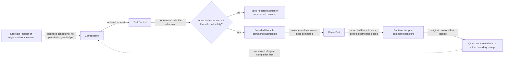
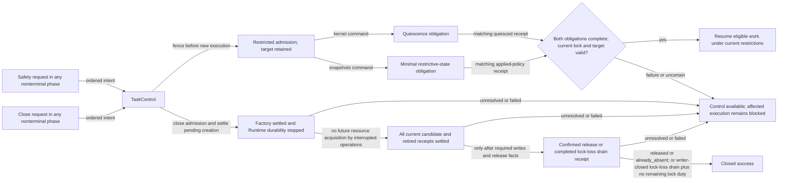
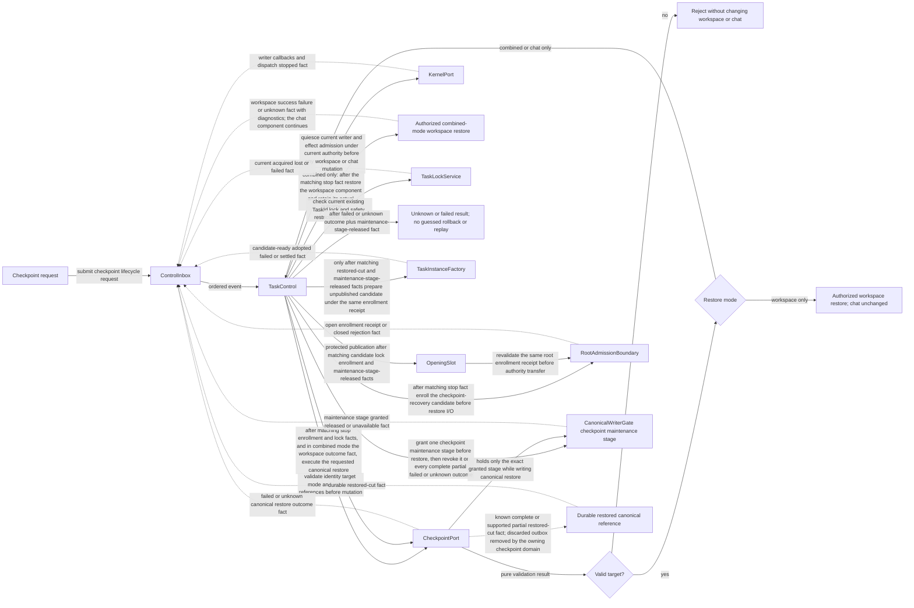
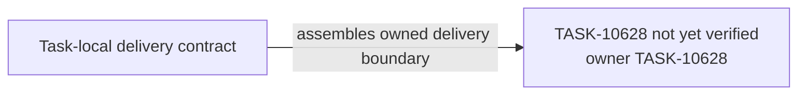

# TASK-10628 Plan

## Approach

在新模块`src/core/task/lifecycle`中交付生命周期控制面：TaskProcess及其声明式route、ControlInbox、TaskControl（RP/REC转换表）、KernelPort、OpeningSlot、OpeningSnapshotPublisher、CheckpointPort、现有锁adapter与TaskAccessView。TaskFacadeTable由Composer独占写入，属于TASK-10629。

## Architecture Design

短控制段与异步执行（细化`L2-control-admission`）：



安全与关闭收敛（细化`L4-control-convergence`）：



失锁排空与自动promotion（细化`L4-lock-loss-drain`）：

```mermaid
flowchart LR
    %% id: TASK-10628-lock-loss-drain
    %% layer: L5
    %% kind: flow
    %% refines: L4-lock-loss-drain
    %% concept: Inbox = Inbox
    %% concept: Control = Control
    %% concept: Kernel = KernelPort
    %% concept: Factory = Factory
    %% concept: Slot = Slot
    %% concept: Lock = Lock
    %% concept: Admission = RootAdmission
    %% answers: how lock loss stops every local writer before an automatic bounded promotion
    LockLost[TaskLockService heartbeat false\ngate held status already flipped to lost; then lock_lost source fact for the current opening] -.->|registered lifecycle source fact; no business append| Inbox[ControlInbox]
    Inbox -->|ordered lock-loss event| Control[TaskControl]
    Control -->|fence dispatch reduce and effect begin; gate write admission was already closed by the lost status| Fence[Revoking fence\nno new reduce command grant or effect begin]
    Fence -->|stop dispatch and close the current local writer/callback sources| Kernel[KernelPort]
    Fence -->|abandon only factory-owned candidate receipts| Factory[TaskInstanceFactory]
    Fence -->|release adopted-unpublished candidate and settle current/retired local receipts| Slot[OpeningSlot]
    Kernel -.->|writer-stopped receipt fact for every started local canonical callback| WriterClosed[Local writer-closed receipt]
    Factory -.->|candidate-settled or outcome-unknown receipt fact| CandidateSettled[Factory settlement receipt]
    Slot -.->|resource-settled or outcome-unknown receipt fact for candidate current and retired resources| ResourceSettled[Slot settlement receipt]
    WriterClosed -->|writer-stopped fact| Join{All local write and resource obligations confirmed?}
    CandidateSettled -->|factory-settled fact| Join
    ResourceSettled -->|slot-settled fact| Join
    Join -->|no; timeout failure or unknown is not stop proof| Held[Responsive control remains revoking\nno second writer and no business log repair]
    Held -->|matching original owner receipt or bounded availability fact| Join
    Join -->|yes| Access[TaskAccessView leaves revoking\nread_only foreign_lock or unavailable not_acquired]
    Access -->|same-holder or no-holder status after the writer-stopped boundary; emit automatic bounded promotion source event| RecoveryIntent[Ordinary promotion request]
    Access -->|foreign holder or lock check I/O unavailable| WaitPromotion[Read-only or unavailable; no writer\nregistered availability and bounded retry only]
    WaitPromotion -->|lock availability fact or bounded retry; explicit/open may also retrigger without user Resume| RecoveryIntent
    RecoveryIntent -->|submit ordinary promotion lifecycle event| Inbox
    Control -->|promotion enrollment before lock access| Admission[RootAdmissionBoundary]
    Admission -.->|open enrollment receipt or closed rejection fact| Inbox
    Control -->|only with the matching open receipt; no fencing epoch| Lock[TaskLockService]
    Lock -.->|acquired failed foreign or lost fact| Inbox
```



Checkpoint恢复（细化`L4-checkpoint-recovery`）：



- Owner/write boundary：`src/core/task/lifecycle`模块（新）与`TaskLockService.ts`中丢失通知/release结果上报符号。
- 命令/事实方向：所有生命周期意图只经ControlInbox进入TaskControl；执行方以相关事实回报；业务输入只经KernelPort。
- 失败/释放：unknown不当作停止证明；Held保持控制可用；maintenance stage在每个结果后撤销并确认release；失锁先排空再promotion。

### Delivery Evidence Anchor



## Steps

1. 定义operation/effect/subject关联身份、生命周期事件与receipt类型；实现ControlInbox有序提交与短控制段。
2. 实现TaskProcess（稳定facade、route映射：生命周期→ControlInbox，领域→KernelPort），并在关闭时先unpublish endpoint再回报correlated closed事实。
3. 实现TaskControl转换表：create/open/promotion、RP健康替换、REC分类与旧writer结算、safety fence、close收敛。
4. 实现OpeningSlot（唯一发布、captured authority、receipt资源结算）与OpeningSnapshotPublisher（唯一调用纯resolver并采用匹配tuple）。
5. 实现锁adapter与TaskAccessView：heartbeat丢失→排空→有界检查→自动promotion或等待availability；release结果分confirmed与failed/unknown。
6. 实现CheckpointPort编排：先静默、组合模式等待workspace结果、登记、锁检查、maintenance stage授予/撤销、Factory/Slot发布。
7. 补转换、竞态、重启与锁回归测试（复用现有多窗口锁/unlock回归）。

## Architecture Evidence

```yaml
architecture_evidence:
  schema_version: 2
  diagram_id: TASK-10628-delivery
  nodes:
    T10628Source:
      artifacts:
        - id: task10628-delivery-emitter
          role: emitter
          path: src/core/task/lifecycle
          symbol: DeliveryContract
          expectation: present
    T10628:
      artifacts:
        - id: task10628-delivery-receiver
          role: receiver
          path: src/core/task/lifecycle
          symbol: DeliveryBoundary
          expectation: present
  edges:
    - id: task10628-delivery-edge
      from: T10628Source
      to: T10628
      style: solid
      label: assembles owned delivery boundary
      kind: composition
      emit: {node: T10628Source, artifact: task10628-delivery-emitter}
      receive: {node: T10628, artifact: task10628-delivery-receiver}
      proof: [VER-TASK-10628-CONTROL]
```

## Verification

- `VER-TASK-10628-CONTROL`、`VER-TASK-10628-REC-RP`、`VER-TASK-10628-SNAPSHOTS`：`npm run test:run -- src/core/task/lifecycle`，以真实TaskControl转换表驱动有序事件与迟到事实，断言receipt结算、单writer与唯一publication。
- `VER-TASK-10628-LOCK`：现有TaskLockService测试全部通过；新增丢失→排空→promotion/等待的序列测试。
- `VER-TASK-10628-CHECKPOINT`：注入workspace成功/失败/unknown与canonical restore失败/unknown，断言顺序、stage撤销与无猜测回滚。
- 改动文件运行`npx biome check`与`npm run check-types`。

## Risks

- 生命周期与领域入口再次混合会让TaskControl变成业务路由器；以route表测试锁定。
- 现有锁模型无原子条件释放；只上报结果，不扩建fencing。
- 本Task汇合10624/10625/10626三个上游合同，任一上游变更都需复核本Task的端口。
