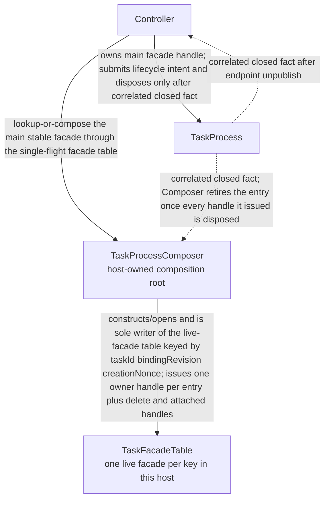
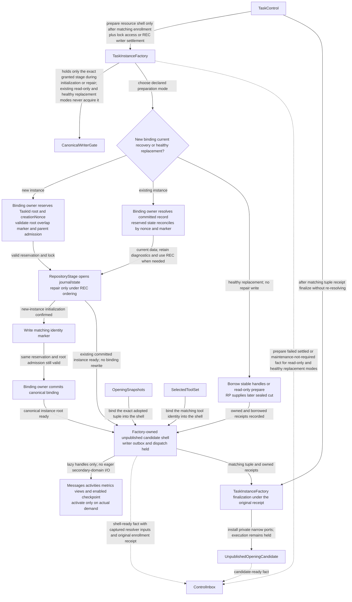
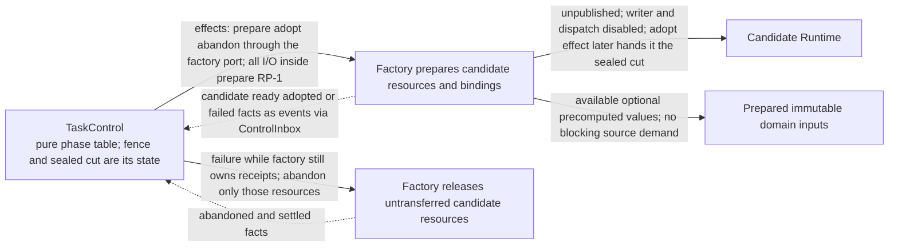

# TASK-10629 Plan

## Approach

交付宿主拥有的组合根与实例装配：`TaskProcessComposer`独占写入`TaskFacadeTable`并只在表未命中时组合稳定facade；角色中立的`TaskInstanceFactory`按准备模式产出未发布candidate；`TaskIncarnation`安装私有窄端口。生命周期编排、Slot发布与Snapshot采用属于TASK-10628；Prompt/Provider端口实现属于TASK-10630，本Task只定义Incarnation消费的端口合同。

## Architecture Design

组合根与facade表（细化`L1-creation-control-projection`）：



候选装配（细化`L3-task-assembly`中Factory段）：



健康替换中的Factory职责（细化`L3-opening-replacement`）：



- Owner/write boundary：`src/core/task/composition`、`src/core/task/factory`、`src/core/task/incarnation`（均为新模块）。
- 命令/事实方向：只有Composer写facade表；Factory只在TaskControl下令时准备并以事实回报；发布由OpeningSlot完成。
- 失败/释放：Factory失败只放弃自己持有的receipt；maintenance stage由TaskControl授予与撤销；facade条目在全部handle释放后才退役。

### Delivery Evidence Anchor


## Steps

1. 定义facade key、owner/delete/attached handle类型与生命周期；实现单飞lookup-or-compose与退役规则。
2. 实现Composer注入的命名端口（inbox、kernel、lock、snapshot、checkpoint），只在表未命中时组合稳定facade。
3. 实现Factory四种准备模式、未发布shell、懒句柄与finalize；只在初始化/修复中持有授予的stage。
4. 实现TaskIncarnation与私有窄端口安装合同（Prompt/Provider、domain adapters由下游实现）。
5. 用同一组合路径覆盖main、child、resident蓝图数据差异。
6. 补并发、失败放弃与handle释放测试。

## Architecture Evidence

```yaml
architecture_evidence:
  schema_version: 2
  diagram_id: TASK-10629-delivery
  nodes:
    T10629Source:
      artifacts:
        - id: task10629-delivery-emitter
          role: emitter
          path: src/core/task/composition
          symbol: DeliveryContract
          expectation: present
    T10629:
      artifacts:
        - id: task10629-delivery-receiver
          role: receiver
          path: src/core/task/composition
          symbol: DeliveryBoundary
          expectation: present
  edges:
    - id: task10629-delivery-edge
      from: T10629Source
      to: T10629
      style: solid
      label: assembles owned delivery boundary
      kind: composition
      emit: {node: T10629Source, artifact: task10629-delivery-emitter}
      receive: {node: T10629, artifact: task10629-delivery-receiver}
      proof: [VER-TASK-10629-FACADE]
```

## Verification

- `VER-TASK-10629-FACADE`：`npm run test:run -- src/core/task/composition`，并发lookup-or-compose与乱序dispose，断言facade唯一与退役时机。
- `VER-TASK-10629-FACTORY`：`npm run test:run -- src/core/task/factory`，在临时root中逐模式准备、注入失败，断言磁盘状态、receipt与stage持有。
- `VER-TASK-10629-SHARED`：以三种蓝图数据组合，断言使用同一Factory/Runtime/repository实现。
- 改动文件运行`npx biome check`与`npm run check-types`。

## Risks

- facade表是多个holder的共享事实源，退役竞态会造成过期路由；以并发测试锁定。
- Incarnation端口合同若与10630实现不一致，会在10637首次真实组合时暴露；端口变更须同步。
