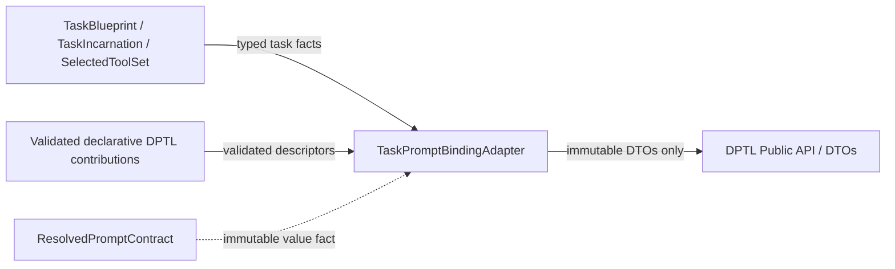
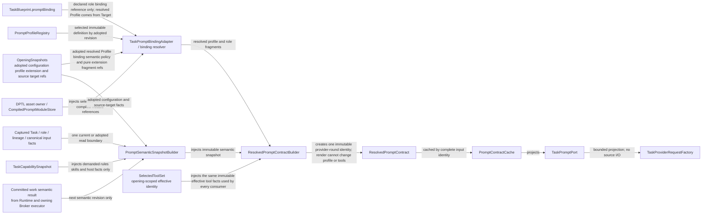
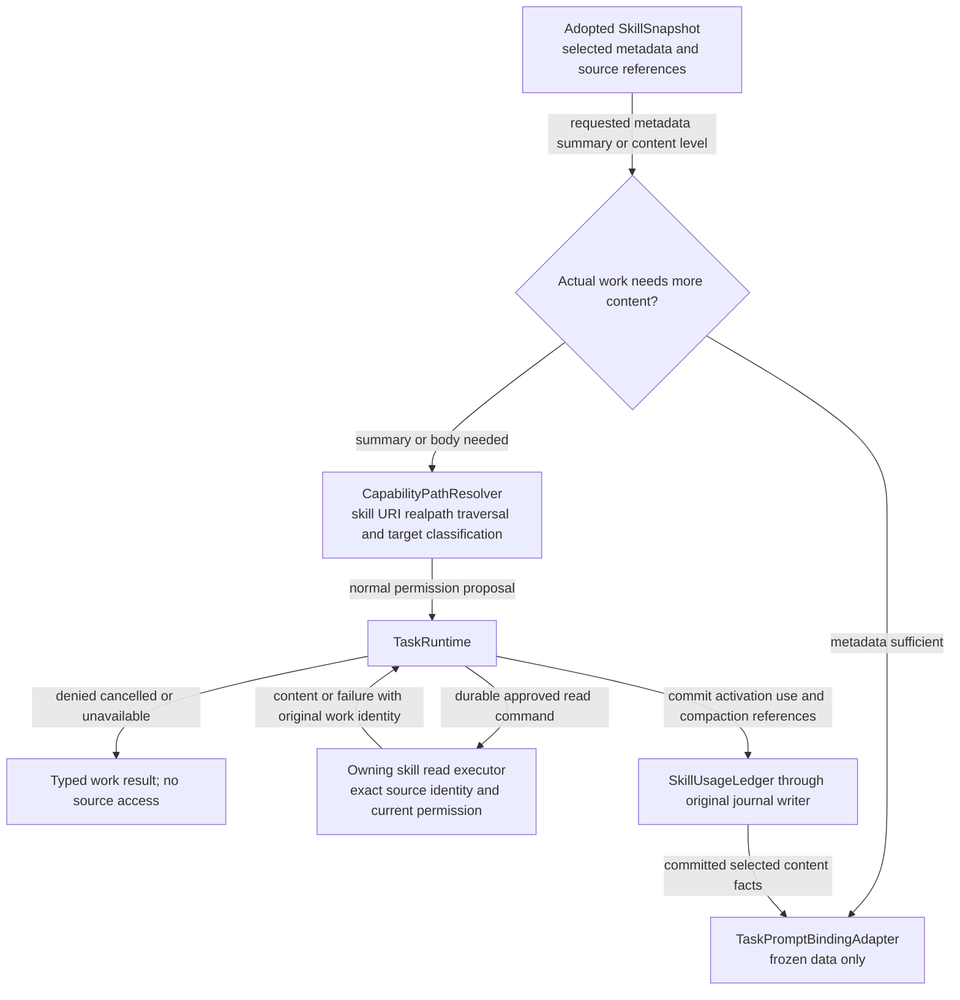
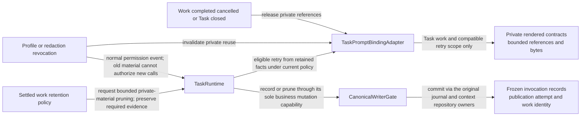

# TASK-10630 Plan

## Approach

把Task接到DPTL与Provider round：`TaskPromptBindingAdapter`是唯一DPTL导入边界，负责绑定解析、语义快照、契约构建、私有缓存与`TaskPromptPort`；`TaskProviderRequestFactory`在准入时原子捕获`ProviderRoundIdentity`并做已准入round的完成检查；Skill内容按实际需求经Runtime权限与所属读取executor获取并记录用量。公共编译资产与渲染属于TASK-10622/10623，能力视图属于TASK-10627，Runtime提交与journal writer属于TASK-10624；本Task实现TASK-10629定义的Incarnation端口。

## Architecture Design

导入方向（细化`L2-dptl-dependency-direction`）：



Prompt契约构建（细化`L1-prompt-pipeline`中adapter段）：



Provider round准入与完成检查（细化`L2-capability-provider-hot-path`的Provider段）：

```mermaid
flowchart LR
    %% id: TASK-10630-provider-round
    %% layer: L3
    %% kind: flow
    %% refines: L2-capability-provider-hot-path
    %% concept: CapabilitySnapshot = CapabilityView
    %% concept: SelectedTools = SelectedTools
    %% concept: PromptSemantics = Semantics
    %% concept: PromptBuilder = Builder
    %% concept: ProviderRequest = ProviderFactory
    %% answers: what the provider hot path captures, when it reprepares and how admitted results are judged
    CapabilitySnapshot[TaskCapabilitySnapshot] -->|injects immutable snapshot| PromptSemantics[PromptSemanticSnapshotBuilder]
    ConfigSnapshot[EffectiveTaskConfigurationSnapshot] -->|injects immutable snapshot| PromptSemantics
    SelectedTools[SelectedToolSet] -->|injects immutable tool facts| PromptBuilder[ResolvedPromptContractBuilder]
    PureExtensions[Pure TaskExtensionSnapshot descriptors] -->|validated declarative descriptors| PromptSemantics
    PromptSemantics -->|injects immutable semantic snapshot| PromptBuilder
    PromptBuilder -->|creates one immutable contract| PromptContract[ResolvedPromptContract]
    PromptContract -->|prepared contract with its input dependencies| ProviderRequest[TaskProviderRequestFactory\ncoherent capture with bounded request projection]
    ProviderRequest -->|compatible captured inputs; freeze ProviderRoundIdentity| Transport[Provider transport attempt]
    ProviderRequest -->|dependency mismatch; no dispatch| Reprepare[Superseded preparation\nreturn to owning admission path]
    ProviderRequest -->|frozen origin input and registered execution attempt| ResultCheck{Admitted-round completion check\nnot the latest candidate target}
    Transport -->|attempt result| ResultCheck
    LiveFence[Current execution opening / lock / safety fence] -.->|live fence state| ResultCheck
    ResultCheck -->|valid admitted round even after ordinary revision changes| Runtime[Existing TaskRuntime]
    ResultCheck -->|revoked or superseded operation| LateResult[Ack / cancelled / unknown outcome by operation kind]
    InputCommit[Captured canonical input and committed runtime facts] -->|state-dependent semantic inputs| PromptSemantics
    InputCommit -->|same captured facts for bounded request projection| ProviderRequest
```



Skill内容按需读取（细化`L2-skill-demand`的内容段）：



私有材料生命周期（细化`L4-prompt-material-lifetime`的私有段）：



- Owner/write boundary：`src/core/task/prompt`、`src/core/task/provider`、`src/core/task/skills`（均为新模块）。
- 命令/事实方向：adapter只向DPTL发送不可变DTO并接收契约值；Provider结果以原work身份回到Runtime；记录与裁剪只经Runtime的唯一业务写能力。
- 失败/释放：DPTL编译/渲染失败只令依赖该Prompt的work unavailable并给source-aware诊断，不回退旧Prompt；依赖不匹配不派发；私有引用在work结束/取消/撤销/关闭时释放。

### Delivery Evidence Anchor


## Steps

1. 定义Task facts→DPTL DTO映射与绑定解析（Profile来自已采用Target，不另做选择）。
2. 实现语义快照与契约构建：同一SelectedToolSet身份供native/XML、executor、权限与展示共用。
3. 实现PromptContractCache（条目/字节预算、作用域复用、释放触发）与TaskPromptPort。
4. 实现冻结调用记录与保留/裁剪命令（经Runtime提交，不复制缓存到磁盘）。
5. 实现TaskProviderRequestFactory：原子捕获ProviderRoundIdentity、依赖不匹配重新准备、已准入round完成检查；使用`providerFetch`/共享工厂。
6. 实现Skill内容路径：路径解析、权限提议、读取executor与SkillUsageLedger。
7. 补映射、缓存生命周期、热路径计数与Skill权限测试。

## Architecture Evidence

```yaml
architecture_evidence:
  schema_version: 2
  diagram_id: TASK-10630-delivery
  nodes:
    T10630Source:
      artifacts:
        - id: task10630-delivery-emitter
          role: emitter
          path: src/core/task/prompt
          symbol: DeliveryContract
          expectation: present
    T10630:
      artifacts:
        - id: task10630-delivery-receiver
          role: receiver
          path: src/core/task/prompt
          symbol: DeliveryBoundary
          expectation: present
  edges:
    - id: task10630-delivery-edge
      from: T10630Source
      to: T10630
      style: solid
      label: assembles owned delivery boundary
      kind: composition
      emit: {node: T10630Source, artifact: task10630-delivery-emitter}
      receive: {node: T10630, artifact: task10630-delivery-receiver}
      proof: [VER-TASK-10630-ADAPTER]
```

## Verification

- `VER-TASK-10630-ADAPTER`：import图测试断言只有`src/core/task/prompt`导入DPTL且只经`dptl/index.ts`；以Standard/Lite fixture渲染并解析工具投影，断言与SelectedToolSet一致。
- `VER-TASK-10630-CACHE-LIFETIME`：驱动work结束/取消/撤销/关闭与淘汰，断言引用释放、journal记录保留、裁剪后标记不可复现。
- `VER-TASK-10630-PROVIDER-ROUND`：计数source scan/重读为0；修改各revision验证重新准备与已准入round有效；用`mockFetchForTesting`验证取消、超时与流清理。
- `VER-TASK-10630-SKILL-CONTENT`：拒绝/取消/不可用无source访问；批准后读取并记录用量。
- 改动文件运行`npx biome check`与`npm run check-types`。

## Risks

- 若adapter以外的模块直接import DPTL，会形成第二拼装链；以import图测试锁定。
- 私有缓存与冻结记录生命周期混同会导致删除历史或无限保留；两者分别测试。
- Provider传输必须保留现有observed transport与凭据引用，不能为热路径绕开。
