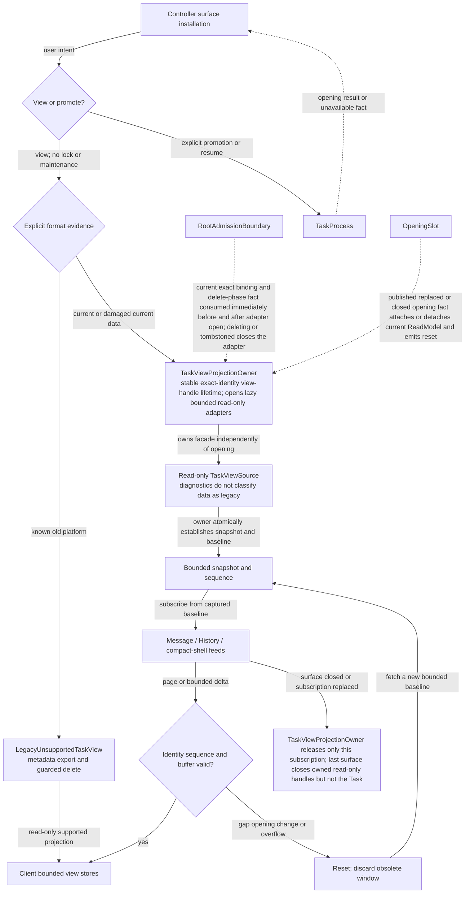
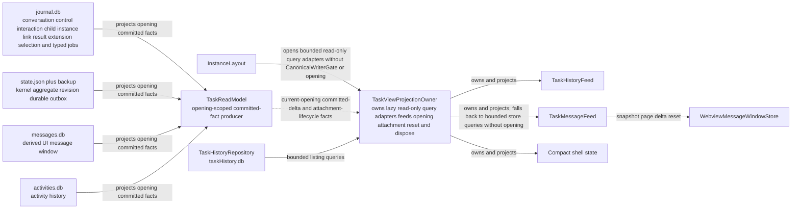
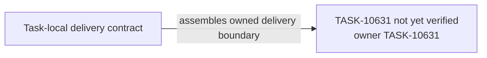

# TASK-10631 Plan

## Approach

交付只读视图数据面：opening级`TaskReadModel`只消费已提交事实；按精确实例身份键控的`TaskViewProjectionOwner`统一服务main/child/resident，不依赖opening也能提供同一`TaskViewSource`；feed提供原子snapshot+subscribe基线、有界分页/增量、gap/reset与dispose；Webview侧改为有界store，ExtensionState不再携带增长内容。生命周期promotion属于TASK-10628，删除排空的调用方是TASK-10636，Controller surface安装在TASK-10638切换。

## Architecture Design

视图订阅（细化`L4-view-subscription`）：



读投影来源（细化`L0-persistence-authority`中视图段）：



- Owner/write boundary（与`goals.yaml`一致）：
  - `src/core/task/views`（含增量行投影宿主、旧行只读升级调用与`TaskViewState`重试阶段投影）；
  - `src/core/controller/taskView`；
  - `proto/dline/task_view.proto`；
  - `webview-ui/src/stores/taskView`；
  - `chat-view`中接线组件的输入重构。`messageUtils`、`failurePresentation`、`explorationRuns`的规则抽取与`ToolGroupRenderer`的工具switch迁出属于TASK-10641；`ChatView.tsx`的数据源切换属于TASK-10638；
  - `ExtensionStateContext.tsx`中的增长字段段。
- 命令/事实方向：视图只读已提交事实，从不接收command或写canonical store；opening附着只来自OpeningSlot事实。
- 失败/释放：gap/overflow/opening变化一律reset后重取有界基线；删除时停止新附着、排空查询并释放root读句柄；最后一个surface关闭只关闭只读句柄，不关闭Task。

### Delivery Evidence Anchor



## Steps

1. 盘点当前Controller→Webview的messages/taskHistory/ExtensionState推送路径与已有分页上限。
2. 定义TaskViewSource/feeds合同与`task_view.proto`，运行`npm run protos`生成客户端。
3. 实现TaskReadModel（只消费committed facts）与TaskViewProjectionOwner（精确身份键控、懒只读adapter、opening附着/reset、删除排空、dispose）。
4. 实现feeds的原子snapshot+subscribe、有界page/delta、gap/reset与背压。
5. 实现LegacyUnsupportedTaskView（仅显式旧格式证据）。
6. 实现Webview有界store并从ExtensionState移除增长字段（生产路由切换在TASK-10638）。
7. 补规模、背压、reset与删除排空测试；Webview组件测试。
8. 在`TaskViewProjectionOwner`中按提交顺序托管TASK-10641的增量行投影：
   - cursor与carry随视图基线一起建立；
   - page与delta携带已投影行与稳定row id；
   - 重启、checkpoint恢复、generation变化或carry超限时，发出reset并从基线重算。
9. 发送前对当前Task中已有的旧格式行做只读升级：失败行调用TASK-10640的`upgradeLegacyFailureRow`；工具行按TASK-10626在ToolCatalog `presentationVariants`上声明的旧`UiSayTool.tool`值升级，这是旧tool kind映射的唯一来源；不改写存储，也不在Webview解析旧文本。
10. 把Runtime的重试阶段事实投影进`TaskViewState`（截止时间、attempt/maxAttempts、`retryNow`、`forceTruncateAvailable`），取代`TaskViewMessageAdapter`读取gate的做法；`interaction_withdrawn`对应交互的行由投影隐藏，并与今日一样隐藏最近一条`error_retry`行。
11. 对`MessagesArea`、`MessageRenderer`、`ExplorationRunRenderer`、`PendingApprovalCard`、`useChatState`与滚动hook做行为保持重构：尾部行事实、分组与请求状态改为输入。旧路径由现有推导提供这些输入，新路径由投影行与`TaskViewState`提供。按PF-8，新数据路径在TASK-10638切换前只在组件测试与Storybook中可达；`ChatView.tsx`的切换与combiner调用的移除属于TASK-10638。

## Architecture Evidence

```yaml
architecture_evidence:
  schema_version: 2
  diagram_id: TASK-10631-delivery
  nodes:
    T10631Source:
      artifacts:
        - id: task10631-delivery-emitter
          role: emitter
          path: src/core/task/views
          symbol: DeliveryContract
          expectation: present
    T10631:
      artifacts:
        - id: task10631-delivery-receiver
          role: receiver
          path: src/core/task/views
          symbol: DeliveryBoundary
          expectation: present
  edges:
    - id: task10631-delivery-edge
      from: T10631Source
      to: T10631
      style: solid
      label: assembles owned delivery boundary
      kind: composition
      emit: {node: T10631Source, artifact: task10631-delivery-emitter}
      receive: {node: T10631, artifact: task10631-delivery-receiver}
      proof: [VER-TASK-10631-FEEDS]
```

## Verification

- `VER-TASK-10631-FEEDS`、`VER-TASK-10631-OWNER`：`npm run test:run -- src/core/task/views`，用真实SQLite store驱动并发提交、慢消费者与opening替换，断言序列、reset与上限。
- `VER-TASK-10631-SHELL`：50K消息/10K history fixture下测量shell字节与消息变更时的shell推送次数。
- `VER-TASK-10631-LEGACY`：旧格式证据与损坏当前数据分别驱动，断言分类。
- Webview：`webview-ui`相关Vitest；`npm run protos`后`npm run check-types`、`npm run lint`。
- `VER-TASK-10631-PROJECTION-HOST`：`npm run test:run -- src/core/task/views`，以真实store与提交序列驱动以下场景并断言行、row id与`TaskViewState`：分页、增量、重启、checkpoint恢复、generation变化、旧行升级与`interaction_withdrawn`。倒计时页脚、`retryNow`与强制截断入口的输入，与当前`TaskViewMessageAdapter`测试的期望一致。另断言spec PF-5的同源不变量：上述每个场景以及消息窗口重同步之后，`TaskViewState`中的失败动作（Retry、Start New Task、`retryNow`、强制截断）只与同一交互的可见失败卡片行同时出现。
- `VER-TASK-10631-PRESENTATION-PARITY`：消息窗口store与投影行接入后，运行以下测试并保留其断言：
  - `webview-ui/src/task-interaction/renderers/__tests__/ErrorRenderer.test.tsx`；
  - `webview-ui/src/task-interaction/__tests__/InteractionHost.test.tsx`；
  - `webview-ui/src/components/chat/__tests__/ChatRow.auto-retry.test.tsx`；
  - TASK-10641迁移的combiner oracle fixture（对接后端宿主运行）。

  仅已采纳的BD行允许更新断言。另在Storybook检查`App.stories`中API失败、重试、倒计时与强制截断场景渲染一致。

## Risks

- `npm run protos`会整体重写生成文件；与其他Task（10633/10635）的proto变更须由controller在全部输入完成后统一生成并整文件集成。
- Webview迁移若与现有messages推送并存会出现双数据源；生产切换只在TASK-10638进行，本Task期间旧路径保持不变。
- 错误卡片、重试合并与BrowserSessionRow等组件目前依赖“最后一条消息”与完整messages数组。按PF-5改由后端投影字段提供后，分页不再影响这些判断；风险在于遗漏某个读取`isLast`或全数组的组件，以PF-5合同测试与import/prop检查兜底。
