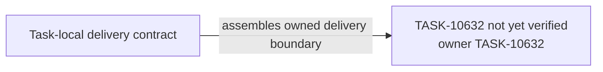

# TASK-10632 Plan

## Approach

交付Task通信边界：稳定地址目录、按owning policy解析的有序权限level、派发前目标复核、发送方Runtime提交的逐recipient outbox、`TaskCommunicationPort`（同进程adapter；未实现的跨进程backend返回`transport_unavailable`）以及接收方幂等摄入与ack。领域消息只经KernelPort进入Runtime，不进入TaskControl业务分支。审批request/reply使用预绑定最小通道；通用mail backend与群组产品属于WS-092，不在本Task宣称完成。

## Architecture Design

```mermaid
flowchart LR
    %% id: TASK-10632-communication
    %% layer: L3
    %% kind: flow
    %% refines: L2-communication-permissions
    %% answers: how a send passes ordered permission levels, freezes recipients and is ingested idempotently by the recipient
    Runtime[Sending TaskRuntime] -->|committed send intent; not transport permission| Intent[Stable message and recipient intent]
    Intent -->|read routing facts| Directory[TaskEndpointDirectory]
    Directory -->|resolved target set and location facts| Resolve[Freeze recipients scope and membership version]
    Resolve -->|owning policy resolves required levels| Levels[Ordered permission obligations]
    Levels -->|next unmet level| CheckLevel{Current scope allowed?}
    CheckLevel -->|deny| Deny[Typed denial; no send]
    CheckLevel -->|human or AI decision required| Wait[Sending Runtime approval work via AP-2; no held reservation]
    Wait -->|correlated decision; revalidate current target| CheckLevel
    CheckLevel -->|allowed; more required levels| Levels
    CheckLevel -->|all required levels satisfied| Granted[Target-bound send authority]
    Granted -->|before dispatch| Revalidate{Frozen recipient scope and authority still valid?}
    Revalidate -->|yes; validated target set fact| OutboxCommit[Sending Runtime CommitPipeline\nsole journal writer]
    OutboxCommit -->|durably freeze recipients membership version and one delivery identity per recipient| PerRecipient[Per-recipient outbox records\nsame messageId plus recipientTaskId and payloadHash]
    Revalidate -->|target location or membership exceeds authority| Resolve
    Revalidate -->|revoked cancelled or retry budget exhausted| Deny
    PerRecipient -->|dispatch pending recipient only| Communication[TaskCommunicationPort]
    Directory -.->|unresolved or unavailable routing fact| DeliveryStatus[Per-recipient pending delivered or terminal failure]
    Communication -.->|transport unavailable rejected or delivery failure fact| DeliveryStatus
    Communication -.->|per-recipient delivered or acknowledged fact| DeliveryStatus
    DeliveryStatus -->|domain result; never approval| Process[Sending TaskProcess]
    Process -->|receiver-local result envelope| KernelPort[Sending KernelPort]
    KernelPort -->|status event; approval failure opens manual immediately| Runtime
    Communication -->|local or future cross-process adapter| PeerEndpoint[Addressed recipient TaskProcess endpoint]
    PeerEndpoint -->|domain route through recipient KernelPort| Receive[Recipient Runtime validates origin and commits inbox through its sole writer]
    Receive -->|idempotent typed work intake; never plain user authority| Result[Recipient work event]
    Receive -->|commit protocol intake acknowledgement; not business success| Ack[Recipient ack with messageId recipient and payloadHash]
    Ack -.->|recipient acknowledgement fact| Communication
```



- Owner/write boundary：`src/core/task/communication`（新模块）。Directory中ordinary TaskProcess写自身endpoint binding、resident slot alias由ResidentTaskOwner写，属于各自Task；本Task提供Directory的数据结构与读取。
- 命令/事实方向：发送意图由发送方Runtime提交；投递状态以事实回到发送方TaskProcess；接收方只经其KernelPort摄入。
- 失败/释放：拒绝/撤销/预算耗尽终止发送；ack丢失按同身份重送；未实现backend返回`transport_unavailable`；通信失败不阻止主任务循环。

### Delivery Evidence Anchor



## Steps

1. 定义稳定地址、message/delivery身份、权限level与数据分类DTO（可被WS-092复用）。
2. 实现TaskEndpointDirectory（endpoint binding读取、resident alias、未解析/不可用事实）。
3. 实现有序level解析与审批等待（经发送方Runtime AP-2审批work，不另建审批循环）及派发前复核。
4. 实现逐recipient outbox记录（经发送方CommitPipeline）与同进程adapter；跨进程返回`transport_unavailable`。
5. 实现接收方origin校验、幂等摄入与ack。
6. 补权限扩权、成员变化、伪造/过期grant、ack丢失重送测试。

## Architecture Evidence

```yaml
architecture_evidence:
  schema_version: 2
  diagram_id: TASK-10632-delivery
  nodes:
    T10632Source:
      artifacts:
        - id: task10632-delivery-emitter
          role: emitter
          path: src/core/task/communication
          symbol: DeliveryContract
          expectation: present
    T10632:
      artifacts:
        - id: task10632-delivery-receiver
          role: receiver
          path: src/core/task/communication
          symbol: DeliveryBoundary
          expectation: present
  edges:
    - id: task10632-delivery-edge
      from: T10632Source
      to: T10632
      style: solid
      label: assembles owned delivery boundary
      kind: composition
      emit: {node: T10632Source, artifact: task10632-delivery-emitter}
      receive: {node: T10632, artifact: task10632-delivery-receiver}
      proof: [VER-TASK-10632-PERMISSIONS]
```

## Verification

- `VER-TASK-10632-PERMISSIONS`：`npm run test:run -- src/core/task/communication`，逐level组合allow/deny/manual/AI，断言不越级、不扩权、旧grant不复用。
- `VER-TASK-10632-DELIVERY`：注入部分recipient失败与ack丢失，断言独立结算与去重。
- `VER-TASK-10632-INGESTION`：断言来信只成为typed work intake，跨进程缺backend返回`transport_unavailable`。
- 改动文件运行`npx biome check`与`npm run check-types`。

## Risks

- 通信层若吸收审批状态机会形成第二审批循环；审批始终走发送方Runtime。
- WS-092后续backend接入时DTO须保持稳定；变更需同步该Workstream。
