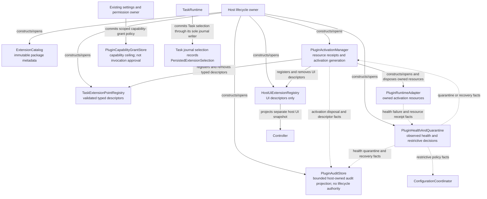
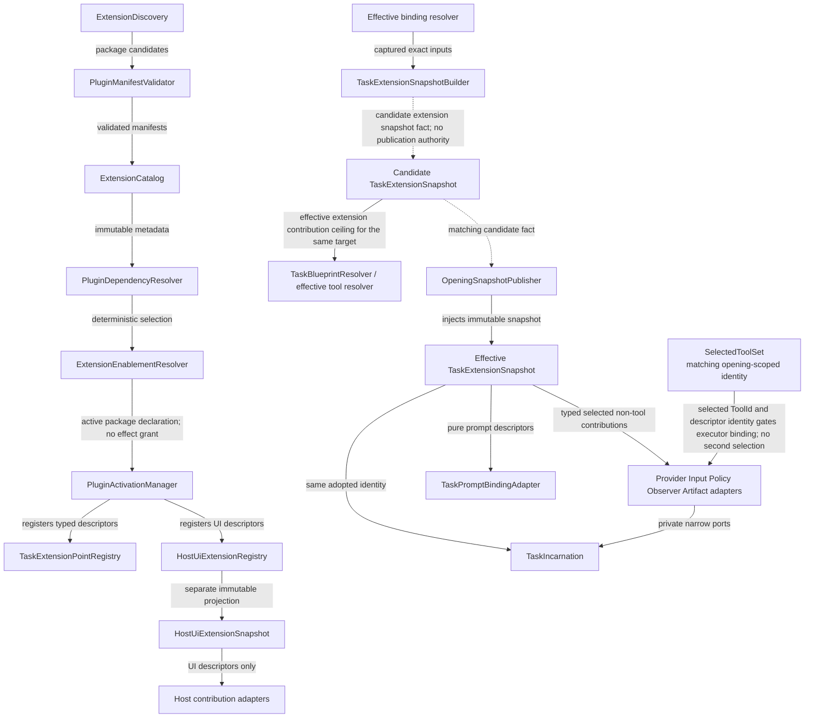
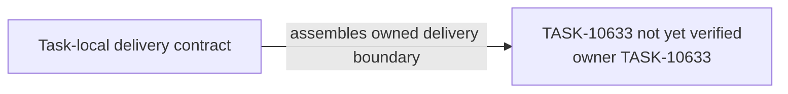

# TASK-10633 Plan

## Approach

在WS-106内交付ExtensionPlatformCore：宿主级目录/激活/registry/health/audit/grant、Task journal中的扩展选择与pending采用、TaskExtensionSnapshotBuilder，以及插件调用的唯一审批、单次grant、begin记录与有界能力端口。纯binding resolver属于TASK-10626；第三方包发现、签名、分发、隔离transport与配额属于WS-105。Runtime提交、审批规则与journal writer沿TASK-10624/10635既有合同，不新增插件专用writer或reducer。

## Architecture Design

宿主级扩展权威（细化`L0-extension-authority`）：



声明到快照（细化`L1-extension-platform`）：



插件调用（细化`L2-plugin-invocation`）：

```mermaid
flowchart LR
    %% id: TASK-10633-plugin-invocation
    %% layer: L3
    %% kind: flow
    %% refines: L2-plugin-invocation
    %% answers: how a selected plugin action gets one durable approval and begin record before bounded execution
    %% local-only: Broker
    %% local-only: Commit
    %% local-only: Wait
    %% local-only: NoEffect
    %% local-only: Grant
    %% local-only: Outbox
    %% local-only: Verifier
    %% local-only: Begin
    %% local-only: Executor
    %% local-only: Ports
    %% local-only: RuntimeAdapter
    Proposal[Plugin action proposal] -->|declared domain input| Process[TaskProcess]
    Responses[Authenticated human or verified review response] -->|declared response route| Process
    Process -->|validated envelope| KernelPort[KernelPort]
    KernelPort -->|work event; no control reservation| Runtime[TaskRuntime]
    Runtime -->|normalize target before approval; no external effect| Broker[PluginInvocationBroker]
    Broker -.->|normalized target and risk facts| Runtime
    Runtime -->|pure approval rules| ApprovalAuthority[ApprovalAuthority]
    ApprovalAuthority -.->|decision proposal facts| Runtime
    Runtime -->|ordered draft and publication| Commit[Runtime CommitPipeline]
    Commit -->|sole journal writer commits decision grant and effect records| InstanceStores
    Commit -->|durable pending| Wait[Work waits; no held reservation]
    Commit -->|durable rejection or cancellation| NoEffect[Settle without effect]
    Commit -->|durable approve| Grant[Single-use ExecutionGrant]
    Grant -->|original publication identity| Outbox[Existing Runtime outbox]
    Outbox -->|owning executor| Verifier[Live scope target opening and revocation checks]
    Verifier -->|request consumption and begin under current authority| Begin[Begin event]
    Begin -->|same Runtime transition and writer| Runtime
    Commit -->|confirmed consumption and begin receipt| Executor[Resumed owning plugin executor]
    Executor -->|live restrictions rechecked on each call| Ports[Bounded capability ports]
    Ports -->|DTO signal and timeout only| RuntimeAdapter[PluginRuntimeAdapter]
    RuntimeAdapter -.->|known result or unknown with original identity| Runtime
    InstanceStores -->|committed audit and results| ReadModel[TaskReadModel]
    Revocation[Security revoke or quarantine] -->|revoke unconsumed execution authority| Verifier
    Revocation -->|registered safety event| Inbox[ControlInbox]
```



- Owner/write boundary：`src/core/extensions/platform`、`src/core/extensions/snapshot`、`src/core/extensions/invocation`（均为新模块）；`src/core/extensions/binding`属于TASK-10626。
- 命令/事实方向：选择只由Runtime写入自身journal；候选快照只由Publisher采用；插件effect只经Runtime outbox与所属executor执行。
- 失败/释放：revoke/quarantine使未消费授权失效并进入ControlInbox安全事件；unknown结果保留原身份不重放；激活资源按receipt释放。

### Delivery Evidence Anchor



## Steps

1. 定义`ExtensionPointDescriptor<T>`与`TaskExtensionPointMap`，由descriptor派生registry、snapshot字段、grant scope与审计身份。
2. 实现内建/可信来源的discovery、validator、dependency、enablement与activation（资源receipt与generation）。
3. 实现Task/UI两个registry、health/quarantine、audit、grant store。
4. 实现PersistedExtensionSelection（Runtime journal）、selection pending与TaskExtensionSnapshotBuilder。
5. 实现PluginInvocationBroker：目标规范化、单次grant、begin、有界端口、unknown对账、revoke。
6. 补race/crash、revoke与quarantine测试。

## Architecture Evidence

```yaml
architecture_evidence:
  schema_version: 2
  diagram_id: TASK-10633-delivery
  nodes:
    T10633Source:
      artifacts:
        - id: task10633-delivery-emitter
          role: emitter
          path: src/core/extensions/platform
          symbol: DeliveryContract
          expectation: present
    T10633:
      artifacts:
        - id: task10633-delivery-receiver
          role: receiver
          path: src/core/extensions/platform
          symbol: DeliveryBoundary
          expectation: present
  edges:
    - id: task10633-delivery-edge
      from: T10633Source
      to: T10633
      style: solid
      label: assembles owned delivery boundary
      kind: composition
      emit: {node: T10633Source, artifact: task10633-delivery-emitter}
      receive: {node: T10633, artifact: task10633-delivery-receiver}
      proof: [VER-TASK-10633-PLATFORM]
```

## Verification

- `VER-TASK-10633-PLATFORM`：`npm run test:run -- src/core/extensions`，断言typed字段派生、UI与Task快照分离、binding内容寻址身份。
- `VER-TASK-10633-INVOCATION`：并发审批/revoke/崩溃点注入，断言单次消费、begin前复核、unknown不重放。
- `VER-TASK-10633-HEALTH-AUDIT`：注入运行时失败与资源泄漏，断言quarantine、恢复与审计投影上限。
- 改动文件运行`npx biome check`与`npm run check-types`。

## Risks

- 插件平台面广，须严格限于WS-106拥有的core范围，不实现WS-105的第三方分发与隔离transport。
- Broker不得吸收discovery、selection、policy决策、provider token streaming或通用重试调度。
