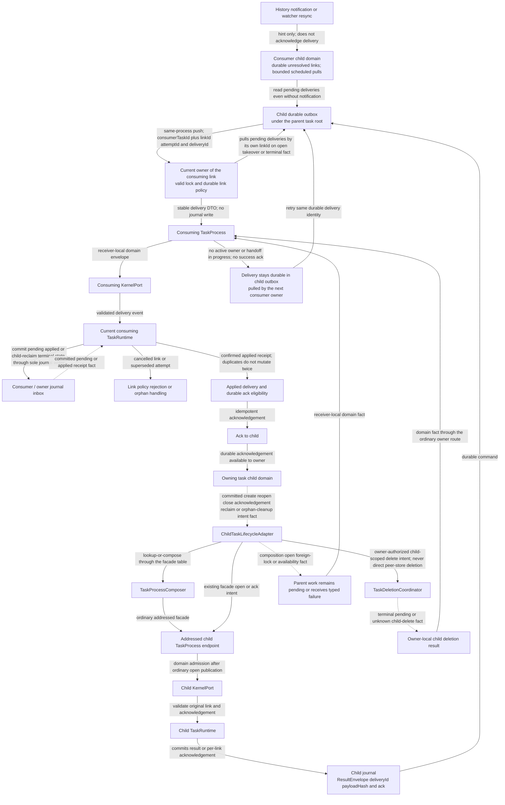
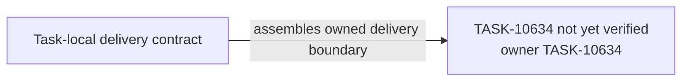

# TASK-10634 Plan

## Approach

让child成为共享平台上的普通Task：`TaskChildDomain`持有durable ChildTaskLink；`ChildTaskLifecycleAdapter`经Composer facade表组合child facade并持有handle直到closed/settled事实；结果从child durable outbox投递给当前消费owner，幂等apply后ack；无通知时有界discovery拉取；child删除只经删除协调器。生产路径中SubagentRunner的移除在TASK-10638；本Task先用完整child测试复现其行为矩阵。

## Architecture Design



- Owner/write boundary：`src/core/task/child`（新模块）。child与parent各自的journal只由各自Runtime写入；本Task不新增writer。
- 命令/事实方向：投递是DTO经消费方TaskProcess→KernelPort→Runtime；ack与生命周期意图作为事实回到child域与adapter。
- 失败/释放：无owner或交接中时投递保留在child outbox；重复投递不二次变更；组合失败以typed事实回给父work；adapter在closed/settled后才释放handle。

### Delivery Evidence Anchor



## Steps

1. 盘点当前SubagentRunner的provider/会话/工具/压缩/上下文预算/结果输出行为，写成可执行行为矩阵。
2. 定义ChildTaskLink、ResultEnvelope、deliveryId/payloadHash与ack DTO，以及child蓝图数据（role差异只作数据）。
3. 实现TaskChildDomain（durable link、discovery有界拉取与退避）。
4. 实现child outbox→当前owner投递、消费方幂等apply与ack。
5. 实现ChildTaskLifecycleAdapter（经Composer组合、handle持有与释放、typed失败）与child删除意图。
6. 用行为矩阵在共享Factory/Runtime/DPTL路径上运行child测试。

## Architecture Evidence

```yaml
architecture_evidence:
  schema_version: 2
  diagram_id: TASK-10634-delivery
  nodes:
    T10634Source:
      artifacts:
        - id: task10634-delivery-emitter
          role: emitter
          path: src/core/task/child
          symbol: DeliveryContract
          expectation: present
    T10634:
      artifacts:
        - id: task10634-delivery-receiver
          role: receiver
          path: src/core/task/child
          symbol: DeliveryBoundary
          expectation: present
  edges:
    - id: task10634-delivery-edge
      from: T10634Source
      to: T10634
      style: solid
      label: assembles owned delivery boundary
      kind: composition
      emit: {node: T10634Source, artifact: task10634-delivery-emitter}
      receive: {node: T10634, artifact: task10634-delivery-receiver}
      proof: [VER-TASK-10634-DELIVERY]
```

## Verification

- `VER-TASK-10634-DELIVERY`：`npm run test:run -- src/core/task/child`，注入重启、重试、parent close/takeover与批次部分失败，断言exactly-once与ack。
- `VER-TASK-10634-LIFECYCLE`：断言只经Composer组合、handle释放时机与typed失败。
- `VER-TASK-10634-PARITY`：行为矩阵测试在child Task上全部通过，且无contextPrefix/独立system prompt拼装器调用。
- 改动文件运行`npx biome check`与`npm run check-types`。

## Risks

- 当前Subagent行为有近期修复（上下文预算、缓存），矩阵须以当前代码为准重新盘点。
- 无界History扫描会带来后台成本；discovery拉取必须有预算、批次与退避。
