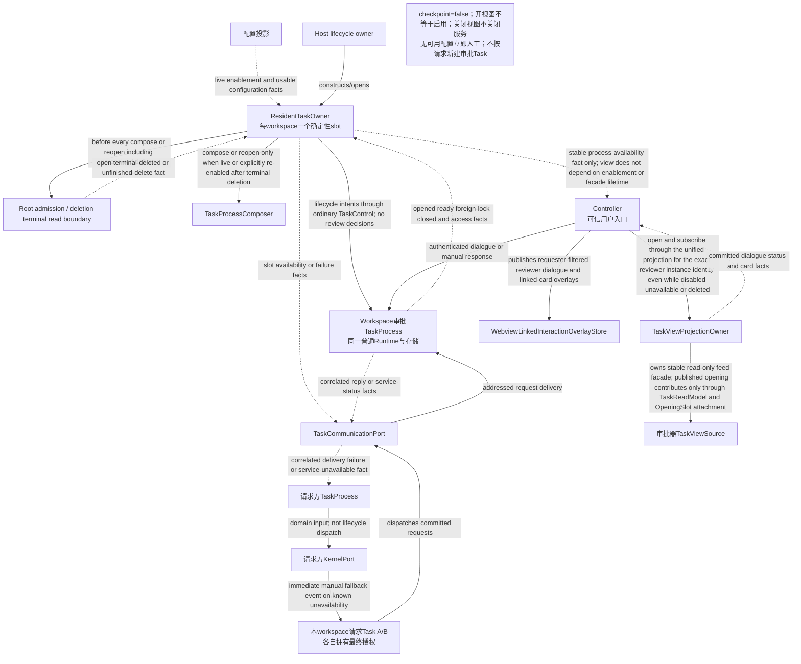
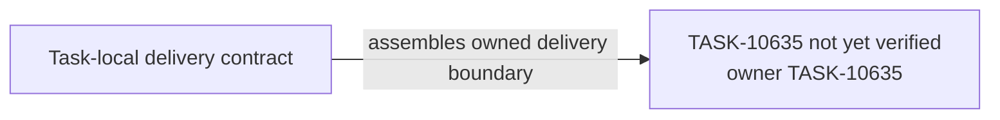

# TASK-10635 Plan

## Approach

把workspace AI审批器做成普通Task平台上的常驻服务：`ResidentTaskOwner`持有每workspace唯一slot并经Composer组合普通Task；启用归Auto-Approve，配置归Settings独立审批Profile；Activities旁入口用于用户原则对话与状态；请求方经预绑定最小通信通道发请求，结果作为领域事实回到请求方Runtime；请求方Runtime调用纯`ApprovalAuthority`规则并通过AP-2 journal publication屏障提交。不另建审批状态机或第二writer。

## Architecture Design



- Owner/write boundary：`src/core/task/resident`、`src/core/task/approval`（新模块，含注册到CommitPipeline审批publication扩展点的AP-2 adapter）、`webview-ui/src/components/approval-reviewer`。CommitPipeline本身及其扩展点属于TASK-10624，本Task不修改`src/core/task/runtime`。
- 命令/事实方向：服务生命周期只归ResidentTaskOwner；审批结果只是领域事实，最终授权与grant只由请求方Runtime提交。
- 失败/释放：服务不可用立即人工；foreign lock人工；配置撤销及时失效未结算AI attempt；Activities视图开关不启停服务。

### Delivery Evidence Anchor



## Steps

1. **实施前门禁**：把`L2-reviewer-coordination`、`L4-approval-winner`、`L4-approved-effect-recovery`细化为本plan的追加图（refines对应WS图），通过`--scope task:TASK-10635`后再写产品代码。
2. 实现纯ApprovalAuthority规则（eligibility/privacy/manual ceiling/self-approval/non-recursive、deadline、winner、grant）。
3. 实现AP-2 journal publication屏障与有限batch全序排队的审批adapter，并注册到请求方Runtime CommitPipeline的审批publication扩展点（TASK-10624提供，单事务内调用）。
4. 实现ResidentTaskOwner（确定性slot、终态删除读边界、组合/重开、service-status）与审批角色蓝图数据（checkpoint关闭）。
5. 接入预绑定最小通信通道（TASK-10632）与请求方manual fallback。
6. 实现Auto-Approve、独立审批Profile设置区与Activities旁入口（Webview）。
7. 补AP-2失败/unknown、winner竞争、配置撤销、foreign lock与重启测试。

## Architecture Evidence

```yaml
architecture_evidence:
  schema_version: 2
  diagram_id: TASK-10635-delivery
  nodes:
    T10635Source:
      artifacts:
        - id: task10635-delivery-emitter
          role: emitter
          path: src/core/task/resident
          symbol: DeliveryContract
          expectation: present
    T10635:
      artifacts:
        - id: task10635-delivery-receiver
          role: receiver
          path: src/core/task/resident
          symbol: DeliveryBoundary
          expectation: present
  edges:
    - id: task10635-delivery-edge
      from: T10635Source
      to: T10635
      style: solid
      label: assembles owned delivery boundary
      kind: composition
      emit: {node: T10635Source, artifact: task10635-delivery-emitter}
      receive: {node: T10635, artifact: task10635-delivery-receiver}
      proof: [VER-TASK-10635-AP2]
```

## Verification

- `VER-TASK-10635-AP2`、`VER-TASK-10635-WINNER`：`npm run test:run -- src/core/task/approval src/core/task/runtime`，注入journal/snapshot失败与unknown、人工与AI竞争、batch排队。
- `VER-TASK-10635-CONFIG`：设置开关与Profile撤销序列测试，断言默认关闭、无fallback、旧授权不复活。
- `VER-TASK-10635-RESIDENT`：多窗口/重启/Profile切换下slot唯一；视图开关不影响服务；无checkpoint I/O。
- Webview组件测试；改动文件运行`npx biome check`与`npm run check-types`。

## Risks

- 审批领域图（reviewer-coordination、approval-winner、approved-effect-recovery）尚未细化进本plan，是实施前门禁（Step 1）。
- AP-2依赖TASK-10624提供的扩展点合同（单事务、有序、失败即整批不发布）；扩展点不足以表达AP-2时，回到TASK-10624合同调整，不在本Task直接修改CommitPipeline。
- 常驻服务不能承诺跨Task事务互斥；只依据已验证的相关事实协调。
