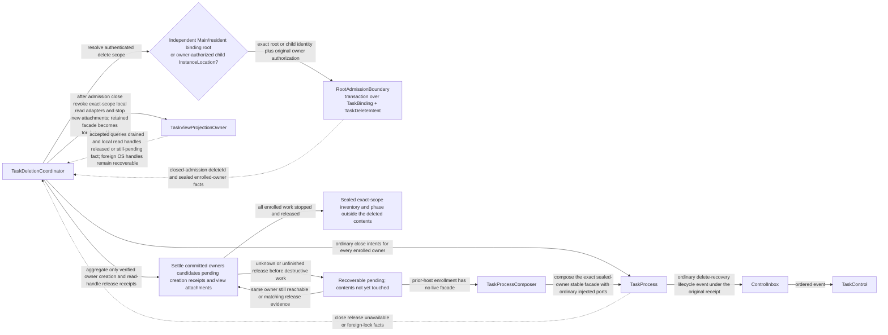
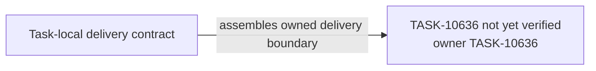

# TASK-10636 Plan

## Approach

交付宿主拥有的`TaskDeletionCoordinator`：先经RootAdmission关闭准入并冻结已登记集合，再排空视图附着与读句柄、对每个已登记owner走普通TaskProcess关闭（prior-host登记经Composer重开同一sealed owner），汇聚为sealed inventory或可恢复pending，最后执行破坏性删除、History tombstone与管理记录清理。根准入与delete intent持久化属于TASK-10625，视图排空属于TASK-10631，close-only恢复由TaskControl（TASK-10628）编排。

## Architecture Design



- Owner/write boundary：`src/core/task/deletion`（新模块）。delete intent与binding的提交只由RootAdmission（TASK-10625）执行，History只经TaskHistoryProjector写入。
- 命令/事实方向：协调器只发关闭/排空意图并汇聚receipt；不直接访问锁，不以stale或acquire作为删除证明。
- 失败/释放：任何未知或未完成释放都停在可恢复pending且不触碰内容；foreign OS handle保持pending；每个crash point可幂等前滚或补偿。

### Delivery Evidence Anchor



## Steps

1. 读取`L4-root-delete`后半段（破坏性删除、tombstone、child terminal、管理清理与resident重建检查），把剩余节点追加细化到本图后再实施。
2. 实现删除范围解析（独立root或owner授权child位置）与经RootAdmission关闭准入。
3. 实现视图排空、owner关闭意图与receipt汇聚（Settle/Pending）。
4. 实现prior-host登记的close-only重开（经Composer）与TaskControl恢复路径对接。
5. 实现sealed inventory后的破坏性删除、History tombstone、child listing与lock-only目录清理。
6. 补crash-point矩阵与并发删除/创建测试。

## Architecture Evidence

```yaml
architecture_evidence:
  schema_version: 2
  diagram_id: TASK-10636-delivery
  nodes:
    T10636Source:
      artifacts:
        - id: task10636-delivery-emitter
          role: emitter
          path: src/core/task/deletion
          symbol: DeliveryContract
          expectation: present
    T10636:
      artifacts:
        - id: task10636-delivery-receiver
          role: receiver
          path: src/core/task/deletion
          symbol: DeliveryBoundary
          expectation: present
  edges:
    - id: task10636-delivery-edge
      from: T10636Source
      to: T10636
      style: solid
      label: assembles owned delivery boundary
      kind: composition
      emit: {node: T10636Source, artifact: task10636-delivery-emitter}
      receive: {node: T10636, artifact: task10636-delivery-receiver}
      proof: [VER-TASK-10636-CRASH]
```

## Verification

- `VER-TASK-10636-CRASH`：`npm run test:run -- src/core/task/deletion`，在每个crash point注入失败后重启，断言幂等结果与内容未提前删除。
- `VER-TASK-10636-OWNERS`：prior-host登记、foreign lock与stale场景，断言无业务激活且不直接授权删除。
- `VER-TASK-10636-HISTORY`：迟到metadata不复活行；child与lock-only目录清理。
- 改动文件运行`npx biome check`与`npm run check-types`。

## Risks

- 删除涉及多个上游owner合同，任一receipt语义变化都会影响Settle判断。
- `L4-root-delete`后半段尚未细化进本plan，是实施前门禁（Step 1）。
