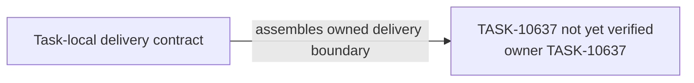

# TASK-10637 Plan

## Approach

在隔离composition root中首次真实组合全部领域owner（Integration Order 4），先沿`L1-workspace-reviewer`与`L2-reviewer-coordination`跑通审批旅程（checkpoint关闭），再接入child、plugin与views；同时实现`L4-host-shutdown`的有序关闭与receipt汇合。本Task不切换生产路由（TASK-10638），失败保留代码级回退点；集成发现回到所属领域Task修复，不在此打补丁。

## Architecture Design

```mermaid
flowchart LR
    %% id: TASK-10637-host-shutdown
    %% layer: L5
    %% kind: flow
    %% refines: L4-host-shutdown
    %% concept: SurfaceController = Controller
    %% concept: ViewOwner = ViewProjectionOwner
    %% concept: ChildHolder = ChildLifecycleAdapter
    %% concept: ResidentHolder = ResidentOwner
    %% answers: in which order the host stops admission, closes Tasks, drains views and joins holder receipts
    Shutdown[Host shutdown intent] -->|host-owned ordered close| HostOwner[Host lifecycle owner]
    HostOwner -->|stop new facade resident endpoint subscription and source acquisition admission| StopAdmission[Admission closed; existing owners retained]
    HostOwner -->|stop new surface installs but retain coordinator until its facade and view receipts settle| SurfaceController[Controller]
    StopAdmission -->|ordinary close intents| CloseTasks[All TaskProcess facades and resident Task close through L4-control-convergence]
    SurfaceController -->|ordinary close for owned main facades and revoke every exact-identity local read attachment| CloseTasks
    SurfaceController -->|drain accepted queries and release read handles; surfaces receive terminal reset rather than retaining root resources| ViewOwner[TaskViewProjectionOwner set]
    CloseTasks -.->|correlated child closed or settled fact after endpoint unpublish| ChildHolder[ChildTaskLifecycleAdapter]
    ChildHolder -.->|all child facade handles disposed fact| Join[Host shutdown receipt join]
    CloseTasks -.->|correlated resident closed fact after endpoint unpublish| ResidentHolder[ResidentTaskOwner]
    ResidentHolder -.->|resident facade handle disposed fact| Join
```



- Owner/write boundary：`src/core/task/host`（隔离组合根与host关闭，新模块）与`src/test/e2e/functional/task-platform`。
- 命令/事实方向：host只发关闭意图并汇合事实；各holder按自身receipt释放。
- 失败/释放：任一receipt未结算时保持可恢复pending；delivery/history/adapters在汇合后才关闭；HistoryProjector先flush再关闭。

### Delivery Evidence Anchor



## Steps

1. 实施前把`L4-host-shutdown`剩余节点（delete holder、HistoryProjector flush、delivery/adapters/sources/capacity关闭顺序）追加细化到本图。
2. 搭建隔离composition root，注入真实领域owner，不新增临时adapter或第二循环。
3. 跑通审批旅程：Settings独立配置→Auto-Approve启用→workspace唯一服务→Activities对话/隔离审批works→协调视图→四类结果→请求方结算。
4. 接入child、plugin、views旅程。
5. 实现有序host shutdown与receipt汇合。
6. 编写focused functional回归；记录分段性能基线（HP/AP/RP）。

## Architecture Evidence

```yaml
architecture_evidence:
  schema_version: 2
  diagram_id: TASK-10637-delivery
  nodes:
    T10637Source:
      artifacts:
        - id: task10637-delivery-emitter
          role: emitter
          path: src/core/task/host
          symbol: DeliveryContract
          expectation: present
    T10637:
      artifacts:
        - id: task10637-delivery-receiver
          role: receiver
          path: src/core/task/host
          symbol: DeliveryBoundary
          expectation: present
  edges:
    - id: task10637-delivery-edge
      from: T10637Source
      to: T10637
      style: solid
      label: assembles owned delivery boundary
      kind: composition
      emit: {node: T10637Source, artifact: task10637-delivery-emitter}
      receive: {node: T10637, artifact: task10637-delivery-receiver}
      proof: [VER-TASK-10637-COMPOSITION]
```

## Verification

- `VER-TASK-10637-COMPOSITION`：focused functional E2E（`src/test/e2e/functional/task-platform`）与对应Vitest，按`use-e2e`/`e2e-validation`选择最小tier。
- `VER-TASK-10637-SHUTDOWN`：注入未结算receipt与中断关闭，断言顺序、pending与projector flush。
- `npm run check-types`、`npm run lint`。

## Risks

- 首次组合会暴露跨Task合同偏差；发现须回到所属领域Task修复。
- `L4-host-shutdown`剩余节点尚未细化进本plan，是实施前门禁（Step 1）。
