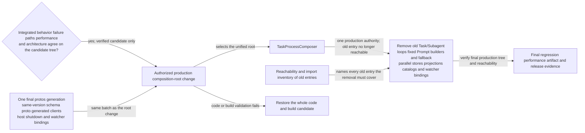
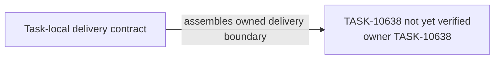

# TASK-10638 Plan

## Approach

按`L5-delivery-switch`执行单次生产切换（Integration Order 5）：以TASK-10637已验证的隔离组合为唯一候选，同批完成composition root选择、host shutdown/watcher绑定、同版本schema/proto/generated合同，并移除旧Task/Subagent循环、固定Prompt builder与fallback、Controller直达Task/session/store路径及平行store/projection/catalog/watcher。切换阶段不新增领域行为；发现领域偏差回到所属Task与总体图。任何代码或构建验证失败按整个代码/构建候选回退，不保留运行时双authority fallback。

## Architecture Design



- Owner/write boundary：`src/extension.ts`激活与deactivate段、`src/core/controller/index.ts`的Task访问段、`src/core/controller/task`、`src/core/task/index.ts`（旧Task coordinator整体移除）、`src/core/task/tools/subagent`、`src/core/prompts/system-prompt`，以及最终一次`npm run protos`的生成输出。
- 命令/事实方向：Proof是TASK-10637交付的验证事实；本Task只下达root选择与移除，Final的结论属于TASK-10639。
- 失败/释放：切换失败回到`Rollback`，整体恢复代码/构建候选；不存在运行时回退到旧authority的分支。

### Delivery Evidence Anchor



## Steps

1. 实施前复读spec的Production authority closure与当前生产入口，生成旧入口的可达性/导入清单。清单包括：
   - SubagentRunner、旧Task coordinator、固定system/Profile/role builder与`@KEY@` renderer；
   - Controller直达路径、平行catalog/watcher、ExtensionState增长内容；
   - PF-2/PF-3被取代的旧失败分类与重试owner：`ClineError.getErrorType`文本分类、`context-error-handling.ts`集中Provider分支、`auto-retry.ts`分类函数、`compaction-retryability.ts`、Task流量上的`withRetry`委托、旧Provider重试循环与`ProviderRetryGate`、执行器`ProviderFailure.ts`、`runInternalCompactionPassWithRetry`、`CompactionRetryPolicy`、compaction service与session中的重试路径；
   - 手写行JSON writer、`combineErrorRetryMessages`、`TaskViewMessageAdapter`对gate的读取。

   每一项都已在`goals.yaml`的`owns`中按符号或文件列明；清单若发现未列明的旧实现，先停止并更新Task合同，不在实施中临时扩大写入范围。
2. 记录切换前呈现基线：运行现有chat row、interaction、ErrorRenderer测试、迁移后的combiner oracle fixture与work smoke，保存结果作为对照。跨层套件的oracle是TASK-10640在任何PF改动前采集的golden基线；切换后不再需要运行旧路径。Webview侧的切换包括：`ChatView.tsx`改用窗口store与投影行，删除`legacy-row-adapter`、旧`processMessages`路径、`failurePresentation.ts`与`combineErrorRetryMessages`；后端侧删除kernel旧失败dialog分支与旧payload类型。
3. 在`src/extension.ts`选择TaskProcessComposer为唯一root，同批绑定host shutdown与watcher。
4. 将Controller的Task创建/附着/访问改为facade与TaskViewSource，移除直达owner与session回调。
5. 移除旧Task coordinator、SubagentRunner与固定Prompt pipeline；不保留兼容fallback。
6. 全部proto输入完成后执行一次`npm run protos`，整文件集成生成输出。
7. 运行可达性检查与切换后验证；失败整体回退候选。

## Architecture Evidence

```yaml
architecture_evidence:
  schema_version: 2
  diagram_id: TASK-10638-delivery
  nodes:
    T10638Source:
      artifacts:
        - id: task10638-delivery-emitter
          role: emitter
          path: src/extension.ts
          symbol: DeliveryContract
          expectation: present
    T10638:
      artifacts:
        - id: task10638-delivery-receiver
          role: receiver
          path: src/extension.ts
          symbol: DeliveryBoundary
          expectation: present
  edges:
    - id: task10638-delivery-edge
      from: T10638Source
      to: T10638
      style: solid
      label: assembles owned delivery boundary
      kind: composition
      emit: {node: T10638Source, artifact: task10638-delivery-emitter}
      receive: {node: T10638, artifact: task10638-delivery-receiver}
      proof: [VER-TASK-10638-SWITCH]
```

## Verification

- `VER-TASK-10638-SWITCH`：`npm run protos`、`npm run check-types`、`npm run lint`；检查生成diff无意外删除；`npm run package`构建通过；人为制造构建失败验证整体回退步骤。
- `VER-TASK-10638-REACHABILITY`：从`src/extension.ts`出发的import/可达性检查（静态import图与`rg`清单），逐项证明Step 1清单为0；LegacyUnsupported Task在History只读呈现，不导入不恢复。
- `VER-TASK-10638-PARITY`：
  - 跨层套件让golden中的原始错误fixture依次经过解释器、finalizer、Runtime策略、编码器、codec、后端投影与renderer，断言卡片模型与行序列和golden相等，只有已采纳的BD行允许不同。覆盖范围以`goals.yaml`中该VER列出的场景为准。
  - 重跑Step 2基线测试，不修改断言。
  - `npm run test:e2e:work`的smoke。
  - Storybook中API失败、自动重试、mistake limit、resume、完成、child与审批场景渲染一致。

## Risks

- 单次切换的风险集中在production routing；以隔离组合证据与整体回退降低风险，不以运行时双路径兜底。
- 旧入口可能存在未登记的间接引用（命令、hook、测试工具）；可达性清单必须从生产入口推导，而非只搜索类名。
- 生成文件整体重写可能覆盖其他Task的proto结果；只在全部proto输入完成后统一生成一次。
