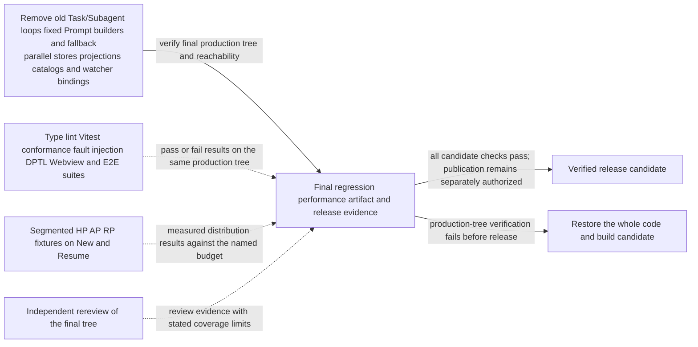
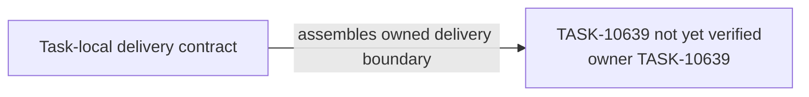

# TASK-10639 Plan

## Approach

针对TASK-10638交付的最终生产树执行全部WS-106验收与发布范围验证（Integration Order 6）。本Task只产生验证证据，不新增产品行为；任何失败按所属领域回到对应Task修复后整体重验，不在此打补丁。发布、推送与Marketplace仍需单独授权。

## Architecture Design



- Owner/write boundary：仅`src/test/scenarios/task-platform`（性能fixture与分段测量）；验证证据写入Memory，不修改产品代码。
- 命令/事实方向：各验证套件、性能测量与复审只向Final报告事实；Final决定候选是否成立。
- 失败/释放：失败回到`Rollback`并由所属Task修复；不存在“部分通过即发布”的出口。

### Delivery Evidence Anchor



## Steps

1. 复读spec的Acceptance Criteria与plan的“后续实现与集成验证范围”，逐条映射到套件与证据。
2. 运行`npm run check-types`、`npm run lint`、全量Vitest与repository/backend conformance。
3. 运行多窗口锁/unlock回归、自愈与storage/approval/plugin故障注入、DPTL测试。
4. 运行Webview组件与Storybook检查；按`e2e-validation`选择focused functional与required work E2E。
5. 在同一fixture上记录New/Resume分段性能与资源成本。
6. 收集TASK-10638的可达性/导入证据，交独立复审（不提供历史评分与Task结论）。
7. 汇总证据；失败项回到所属Task。

## Architecture Evidence

```yaml
architecture_evidence:
  schema_version: 2
  diagram_id: TASK-10639-delivery
  nodes:
    T10639Source:
      artifacts:
        - id: task10639-delivery-emitter
          role: emitter
          path: src/test/scenarios/task-platform
          symbol: DeliveryContract
          expectation: present
    T10639:
      artifacts:
        - id: task10639-delivery-receiver
          role: receiver
          path: src/test/scenarios/task-platform
          symbol: DeliveryBoundary
          expectation: present
  edges:
    - id: task10639-delivery-edge
      from: T10639Source
      to: T10639
      style: solid
      label: assembles owned delivery boundary
      kind: composition
      emit: {node: T10639Source, artifact: task10639-delivery-emitter}
      receive: {node: T10639, artifact: task10639-delivery-receiver}
      proof: [VER-TASK-10639-SUITES]
```

## Verification

- `VER-TASK-10639-SUITES`：Steps 2～4的实际命令与退出码逐项记录；任何失败不计为通过。
- `VER-TASK-10639-PERFORMANCE`：`src/test/scenarios/task-platform`的分段测量输出与预算对照。
- `VER-TASK-10639-REREVIEW`：独立复审报告（target为本Task的`reviews/`），结论须列出机械检查的覆盖局限。

## Risks

- 全量E2E耗时长、易受环境影响；首个未满足边界先诊断，不以提高超时或扩大范围代替根因。
- 性能预算受机器差异影响；同一机器同一fixture对照切换前基线。
- 复审发现需要改变总体架构时，回到总体图修订并经用户确认，不在最终验证阶段静默修补。
