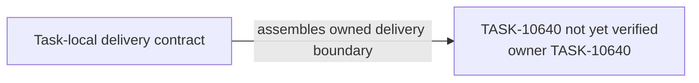

# TASK-10640 Plan

## Approach

按spec §Provider Failure Interpretation and Presentation Contracts的PF-1、PF-2，以及PF-3中“执行器只做单次attempt并上报类型化结果”的部分交付。决策部分属于TASK-10624。本Task的产出：

- `src/core/api/failure`失败模块：draft、ctx、唯一finalizer、`ProviderFailure`、有序默认解释器、单一提取器、从`ApiErrorBox`迁入的detail过滤、按BD决定实现的遮蔽/截断/链接校验，以及纯函数`upgradeLegacyFailureRow`；
- Provider可选解释器与Provider失败元数据（充值页、受信origin）；
- 新的单次attempt执行边界，同时服务turn与compaction请求。

BD-1、BD-3、BD-5、BD-6按spec BD表“决定”列记录的结果直接实现，不引入运行时开关；某行仍为待定时，只暂停该行“受影响的Task与VER”列中的步骤。按PF-8，新执行边界在TASK-10638前只从隔离组合与测试可达，生产路径不变。

## Architecture Design

```mermaid
flowchart LR
    %% id: TASK-10640-provider-failure
    %% layer: L3
    %% kind: flow
    %% refines: L2-provider-failure-presentation
    %% answers: where provider-specific failure knowledge lives and how exactly one typed failure leaves the executor attempt
    %% local-only: Extract
    %% local-only: Sanitize
    %% local-only: Finalizer
    %% local-only: LegacyText
    Attempt[Provider adapter attempt\nprepare send or stream; keeps status code headers and cause] -->|raw failure from any attempt phase inside the provider executor| Interpreter[Provider-owned failure interpreter\noptional; lives in the provider module]
    Interpreter -->|undecided not implemented or interpreter error| DefaultInterpreter[Default failure interpreter\nruns for every failure; ordered provider-agnostic heuristics]
    Interpreter -->|partial typed draft merged field by field over the default draft| Finalizer[Shared failure finalizer\nstrips raw data; one detail filter; decision-gated redaction caps and link checks; freezes the value]
    DefaultInterpreter -->|complete typed default draft| Finalizer
    Finalizer -->|sole constructor| Failure[ProviderFailure\nkind phase retry hint recovery hint and allowlisted presentation fields]
    Extract[Single status code request-id and retry-header extraction\nalso used by non-Task withRetry] -->|structured fields shared by both interpreters| DefaultInterpreter
    Sanitize[Strip raw data; moved ApiErrorBox detail filter; decision-gated masking caps and trusted-origin check] -->|policy applied once inside the finalizer| Finalizer
    LegacyText[Existing legacy failure row text\nread-only input of upgradeLegacyFailureRow] -->|parsed legacy failure fields| DefaultInterpreter
    Failure -.->|redacted status code and request id only| Diagnostics[Diagnostics and export]
    Failure -.->|typed failure inside the single-attempt outcome fact; raw error never crosses| Executors[CommandRouter / Executors]
```



- Owner/write boundary（与`goals.yaml`一致）：
  - `src/core/api/failure`（新模块）；
  - `ApiHandler`的解释器hook符号；
  - `src/core/api/providers`中的解释器、失败元数据与错误路径；
  - `src/core/api/retry.ts`中`withRetry`的提取符号；
  - 新模块`src/core/task/executors/provider/attempt`。

  不写`executors/provider/service`与执行器`ProviderFailure.ts`，它们由TASK-10638移除。
- 命令/事实方向：解释器只产出值，不决定重试或恢复；Runtime读取该值后决策（TASK-10624）。
- 失败/释放：
  - Provider解释器抛错时使用默认结果并记录诊断，不能让原始错误越过执行器边界；
  - `stale_handler`不是失败；
  - Profile准入拒绝在prepare阶段经finalizer成为`profile_invalid`。

### Delivery Evidence Anchor



## Steps

1. 采集golden基线（先于本Task其他步骤与其他PF Task的任何改动）。收集各Provider的真实SDK错误对象（或其序列化形态），经适配器catch后，记录以下旧分类器的输出；同时记录当前生产Webview对这些失败渲染出的卡片模型，以及失败、重试、Profile切换撤回与分组场景的行序列；全部存入`src/test/scenarios/failure-presentation-golden`。BD-3表中尚未盘点的仅文本status适配器也在此步盘点，并补入spec。采集时出现“有失败动作而无可见失败卡片”的场景（BUGFIX-208与2026-10-19用户截图所示症状）标注为已知缺陷，不作为旧路径oracle，期望值按spec PF-5的同源不变量。旧分类器包括：
   - `isRetryableProviderError`、`isRejectedCredentialError`、`isOutputLimitExceededError`；
   - `checkContextWindowExceededError`；
   - `isRetryableCompactionError`、`isDeterministicToolPairingError`；
   - `ClineError.getErrorType`；
   - Webview的`ApiFailureContent`卡片选择。
2. 定义失败模块：
   - draft、`ctx = { providerId, modelId, phase, attempt }`、`ProviderFailure`、kind/phase/recovery提示与充值目标union；
   - 默认解释器：按spec PF-2的判定顺序：额度/消费上限先于402～428区间；其余结构化status位于auth与rate-limit文本规则之后；各步status查找深度按PF-2所述。包含status表与按已采纳BD-1收窄的Anthropic SDK形态规则：`invalid_request_error`须带`context-error-handling.ts`中`CONTEXT_ERROR_PATTERNS`的上下文超限证据才判为`context_window`；
   - 提取器返回status及`statusSource`，先取结构化字段，再用今日`extractHttpStatus`的文本模式；
   - finalizer的五个固定步骤；
   - 单一status/code/request-id/retry-header提取，非Task流量的`withRetry`改用它；
   - 迁入`ApiErrorBox.parseApiErrorDetails`的完整推导：message选择、敏感key名、16条、深度2、去重、数组拼接。
3. 将`parseError`演进为可选解释器hook，并确定合并规则：draft逐字段覆盖默认结果，解释器抛错或返回undefined时用默认结果。迁移各Provider专属知识：
   - DeepSeek、Gemini、Bedrock、OpenRouter、Dify的专属规则；
   - Cerebras，按已采纳的BD-3；
   - OpenAI输出上限重放的缩减上限提示；
   - Dline：完整Auth规则加字面id `cline`时给出`signInPrompt: true`（与`profile_change`等recovery提示并存）；充值目标为用户credits页。

   Anthropic SDK形态规则是跨Provider的形态规则，留在默认解释器，按已采纳的BD-1收窄（见Step 2）。

   Provider元数据声明充值页与受信origin。
4. 按已采纳的BD-3处理Cerebras、SAP AI Core、Dify、OpenRouter、vscode-lm的错误路径：保留结构化status/code，范围见spec BD-3细表。
5. 实现`upgradeLegacyFailureRow`：覆盖四种`api_req_failed`格式与双重JSON `error_retry`，以`phase: legacy_unknown`、`attempt: 0`与行内providerId/model调用默认解释器与finalizer，返回`ProviderFailure`；畸形文本得到类型化generic失败。呈现DTO由TASK-10641的唯一编码器产生。
6. 在`executors/provider/attempt`实现单次attempt：turn与compaction请求共用；stale检查先于分类；执行器合成的失败也经finalizer；只上报`succeeded`、`failed(ProviderFailure)`或`stale_handler`。旧`DefaultProductionProviderService`循环与`ProviderRetryGate`在TASK-10638前保持不变，并继续服务生产。

## Architecture Evidence

```yaml
architecture_evidence:
  schema_version: 2
  diagram_id: TASK-10640-delivery
  nodes:
    T10640Source:
      artifacts:
        - id: task10640-delivery-emitter
          role: emitter
          path: src/core/api/failure
          symbol: DeliveryContract
          expectation: present
    T10640:
      artifacts:
        - id: task10640-delivery-receiver
          role: receiver
          path: src/core/api/failure
          symbol: DeliveryBoundary
          expectation: present
  edges:
    - id: task10640-delivery-edge
      from: T10640Source
      to: T10640
      style: solid
      label: assembles owned delivery boundary
      kind: composition
      emit: {node: T10640Source, artifact: task10640-delivery-emitter}
      receive: {node: T10640, artifact: task10640-delivery-receiver}
      proof: [VER-TASK-10640-INTERPRETATION]
```

## Verification

- `VER-TASK-10640-INTERPRETATION`：`npm run test:run -- src/core/api/failure src/core/api/providers src/core/task/executors/provider/attempt`。用按Provider族组织的真实错误fixture断言kind、phase、status、`statusSource`与hints，并覆盖：
  - 额度先于402～428区间；402～428之外的status位于文本规则之后，例如400加`INFERENCE_CAP_ERROR`→`quota`、400加auth文本→`auth_other`、500加rate-limit文本→`rate_limited`；
  - 各步status查找深度：顶层403→`auth_other`；仅嵌套的403不进入区间auth，落入第10步；嵌套401与嵌套408、409、425按凭据拒绝与豁免规则判定；文本status不参与kind判定；
  - BD-1收窄：带上下文超限证据的Anthropic SDK `invalid_request_error`→`context_window`，不带证据→`invalid_request`；
  - status表、Dline登录与充值目标、部分draft的合并、解释器抛错与undefined的回落、pairing先于上下文超限、prepare阶段的`ProfileNotValidError`与执行器合成失败。
- `VER-TASK-10640-GOLDEN`：在未改动的树上重跑采集脚本，结果与已提交的fixture逐字节一致；“有失败动作而无可见失败卡片”的场景在fixture中带已知缺陷标注，期望值为PF-5同源不变量。
- `VER-TASK-10640-PARITY`：Step 1的golden决策表在新值与turn/compaction eligibility谓词上逐行比对，范围包括重试资格、Profile失败、登录、计费与上下文恢复；只有已采纳的BD-1、BD-3所列行允许差异，且差异必须等于BD表中的新行为；其他行出现差异即失败。
- `VER-TASK-10640-SANITIZE`：
  - 含key/token/authorization/header/body的fixture断言原始数据不在值与序列化形式中；
  - 卡片message与detail条目与golden中`parseApiErrorDetails`的结果逐项相等；
  - BD-5、BD-6按记录的决定断言精确输出：截断后文本与标注，或未改变的文本与链接。
- `VER-TASK-10640-LEGACY-UPGRADE`：旧格式fixture经升级后得到的`ProviderFailure`的kind、recovery提示与呈现字段，与golden中旧卡片分类一致。
- `npm run check-types`、`npm run lint`。

## Risks

- Provider错误形态多且依赖SDK版本；fixture必须来自真实SDK错误对象或其序列化形态，并经过适配器catch，不能只用手写字符串或只测分类器。
- BD表某行待定时，只暂停该行影响的步骤；不以运行时开关同时保留两种行为。
- golden基线必须在其他PF改动之前采集；采集晚于任何行为保持重构都会让oracle失真。
