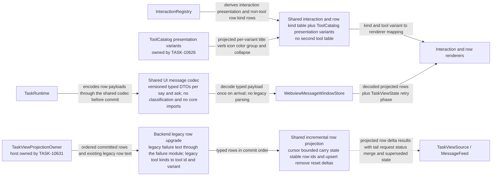
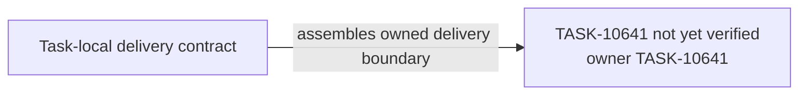

# TASK-10641 Plan

## Approach

按spec PF-4～PF-6收敛呈现层耦合，本Task交付共享合同与Webview行组件改造：

- 共享codec只承载版本化DTO，取代散落的行内JSON解析；不含分类规则。
- 纯增量行投影取代Webview对窗口敏感的combiner调用、`supersededFailureIndexes`与“窗口内最后一行”推导。`combineApiRequests`、`combineCommandSequences`、`combineHookSequences`的归并规则抽成纯规则函数，由投影与后端全量helper（checkpoint、usage、environment投影）共用，规则只有一份。
- 唯一的交互/行kind表与按`{toolId, variant}`作键的工具呈现，取代多处映射与按名字switch。

不在本Task范围的部分：投影在后端的宿主、旧行升级的调用与chat-view组件的输入重构属于TASK-10631；Runtime写入方使用codec属于TASK-10624；生产切换与旧路径移除属于TASK-10638。现有卡片外观、文案、按钮与重试呈现保持不变（PF-7），BD-4、BD-5按spec BD表记录的决定实现。

按PF-8迁移：两条路径共用的行组件只做行为保持的typed props重构；组件内的旧解析原样移入`legacy-row-adapter`，继续服务当前生产数据路径；新数据路径只在组件测试与Storybook中可达。失败呈现DTO只由`src/core/task/presentation`的唯一编码器产生。交互kind表在`src/shared`声明，`InteractionRegistry`消费它。所有parity以TASK-10640采集的golden基线为oracle。

## Architecture Design



- Owner/write boundary（与`goals.yaml`一致）：
  - 新模块：`src/shared/ui-message-codec`、`src/shared/chat-row-projection`、`src/shared/interaction-presentation`、`src/core/task/presentation`（唯一失败呈现编码器）、`webview-ui/src/components/chat/legacy-row-adapter`；
  - 三个combiner的规则抽取段，以及`ExtensionMessage.ts`中新增的版本化payload类型段；
  - `InteractionRegistry.ts`的kind表消费段与`ProductionDialogAdapter.ts`的kind发出段；
  - `webview-ui/src/task-interaction`；
  - `webview-ui/src/components/chat`中列名行组件的typed props重构；
  - `chat-view`下的规则抽取符号：`messageUtils`的分组与`processMessages`中的combiner调用、`failurePresentation`、`explorationRuns`，以及`ToolGroupRenderer`的工具switch迁出。

  `ChatView.tsx`的数据源切换属于TASK-10638，其余`chat-view`组件的输入重构属于TASK-10631。
- 命令/事实方向：共享合同只提供纯函数、DTO与表；投影在后端运行（TASK-10631），Webview只读取已投影行与`TaskViewState`。
- 失败/释放：解码失败返回类型化fallback行，不在渲染时抛错；旧格式只在后端只读升级，不改写存储。

### Delivery Evidence Anchor



## Steps

1. 建立基线并迁移oracle：
   - 运行`combineApiRequests`、`combineCommandSequences`、`combineHookSequences`、`combineErrorRetryMessages`、`failurePresentation`、`messageUtils`、ChatRow、ErrorRenderer、InteractionHost、ApiErrorBox、ErrorRow的现有测试，以及checkpoint、`MessageUsageProjection`、`TaskEnvironmentProjection`的测试，并记录Storybook状态；
   - 把ChatView的combiner链与`supersededFailureIndexes`的测试用例迁为`chat-row-projection`的整流oracle fixture。
2. 为各类payload定义版本化DTO：`api_req_started`、`error_retry`、`api_req_failed`（失败呈现DTO）、tool（`{toolId, variant}`）、browser、MCP、subagent、command等；codec不导入`src/core`与`src/services`，也不含旧tool kind映射（旧值由ToolCatalog的variant声明，TASK-10626）。在`src/core/task/presentation`实现唯一的`ProviderFailure`→失败呈现DTO编码器。
3. 把以下规则抽成共用纯规则函数，全量helper与旧Webview推导改为调用它们且结果不变：
   - `combineApiRequests`、`combineCommandSequences`、`combineHookSequences`的归并；
   - `supersededFailureIndexes`；
   - `groupMessages`、`groupLowStakesTools`、`groupExplorationRuns`、`placeTurnEndLast`的分组与放置。

   在此基础上实现增量投影reducer：
   - 组成：配置输入（`hooksEnabled`，变化时reset）、cursor、有界carry、稳定row id，以及`upsert | remove | reset` delta；
   - 低风险工具分组规则以“是否低风险”谓词为输入：旧路径传入`isLowStakesTool`，新路径传入variant的分组属性；
   - 计算：尾部行事实（类型与ask/say种类）与请求状态；
   - 合同测试：任意分块拼接后与整流oracle逐行一致。
4. 在`src/shared/interaction-presentation`声明交互、呈现与非工具行kind表（typed union，含`focusChainChanged`、`statusUpdate`、`genericTool`）；`InteractionRegistry`消费它并做类型级等价检查，`ProductionDialogAdapter`只发出表中的kind。工具呈现只读取TASK-10626在ToolCatalog上声明并投影的variant元数据。
5. 对两条路径共用的Webview行组件做行为保持的typed props重构，组件内的旧解析原样移入`legacy-row-adapter`。之后新数据路径中：
   - ErrorRenderer按failure kind与recovery提示选择卡片；
   - `ApiErrorBox`只显示finalizer产出的卡片message与detail条目；`parseApiErrorDetails`只留在legacy row adapter；
   - `CreditLimitError`按充值目标union渲染：`dline_account`由账户状态选择用户或组织页；回调与今日一样按子串规则追加：任何目标URL包含`app.dline.bot`即追加，不按origin判断；`PROVIDER_RECHARGE_URLS`只留在legacy row adapter；
   - 工具名或旧tool kind switch（`PresentationRenderers`、`ToolGroupRenderer`、ChatRow、RequestStartRow、`getIconByToolName`、`task-header/util`）移入legacy row adapter，新路径读取variant元数据；
   - 行组件接收尾部行事实、请求状态、分组与superseded等props，由legacy路径的旧推导或新路径的投影提供。
6. 按记录的决定实现BD-4（删除variant颜色）与BD-5（遮蔽与截断由finalizer完成，Webview只显示结果）。

## Architecture Evidence

```yaml
architecture_evidence:
  schema_version: 2
  diagram_id: TASK-10641-delivery
  nodes:
    T10641Source:
      artifacts:
        - id: task10641-delivery-emitter
          role: emitter
          path: src/shared/ui-message-codec
          symbol: DeliveryContract
          expectation: present
    T10641:
      artifacts:
        - id: task10641-delivery-receiver
          role: receiver
          path: src/shared/ui-message-codec
          symbol: DeliveryBoundary
          expectation: present
  edges:
    - id: task10641-delivery-edge
      from: T10641Source
      to: T10641
      style: solid
      label: assembles owned delivery boundary
      kind: composition
      emit: {node: T10641Source, artifact: task10641-delivery-emitter}
      receive: {node: T10641, artifact: task10641-delivery-receiver}
      proof: [VER-TASK-10641-CODEC]
```

## Verification

- `VER-TASK-10641-CODEC`：`npm run test:run -- src/shared/ui-message-codec src/core/task/presentation`。覆盖：每种payload往返、畸形输入fallback、import边界检查，以及编码器对golden中每个失败生成的卡片模型与golden一致。
- `VER-TASK-10641-PROJECTION`：`npm run test:run -- src/shared/chat-row-projection`。对golden行序列与Step 1迁移的整流oracle，在每个可能的分块点（含请求、重试、hook、命令与分组内部）切分喂入，断言拼接delta后逐行相等，包括尾部行事实、请求状态与分组id；同时验证：`hooksEnabled`变化发出reset、row id跨分页稳定、reset后重建出相同的行、全量helper与旧推导经共用规则函数结果不变。另以独立断言检查spec PF-5的失败卡片与动作同源不变量：任何分块与reset下，失败动作可用只与同一交互的可见失败卡片行同时出现；失败呈现编码出错时，由同一`ProviderFailure`产出降级卡片并记录诊断，不出现只有动作的状态。golden中标注为已知缺陷的场景按该不变量断言。
- `VER-TASK-10641-MAPPINGS`：表驱动测试比较kernel、dialog adapter与视图投影得到的kind，`InteractionRegistry`偏离共享表时编译失败。静态检查范围是新共享模块与本Task拥有的文件，legacy row adapter除外：无工具名/旧tool kind switch、行与卡片代码无providerId分支、无第二套detail推导，且无直接导入`src/core/**`或`src/services/**`。其他Task文件中残留的旧检查（如`compactionCardOf`、`LOW_STAKES_TOOLS`）列入TASK-10638的移除清单。
- `VER-TASK-10641-PARITY`：经legacy row adapter渲染每个golden场景、经typed DTO渲染golden卡片模型，均须一致；Step 1基线测试保留断言，仅已采纳的BD行允许更新；Storybook检查以下状态：API失败、自动重试倒计时、强制截断、各充值目标的额度卡与回调（URL包含`app.dline.bot`的目标追加回调，其他目标不追加）、带提额的消费上限、登录、Profile失败与browser session中断。
- `npm run check-types`、`npm run lint`。

## Risks

- 行内payload读写点数十处，遗漏会静默失效；以codec类型约束与import检查兜底，不靠人工搜索。
- 增量投影的carry必须有界；超出上限时发出reset并从基线重算，不能静默丢弃归并状态。
- 全量helper同时服务后端checkpoint、usage与environment投影；规则抽取必须保持其输出不变，由其现有测试与Step 1基线验证。
- `combineErrorRetryMessages`在TASK-10638切换前仍服务现有Webview路径；本Task不修改它，只把它的用例迁为oracle。
- 行为保持重构直接作用于生产组件；每一步都以golden场景经legacy row adapter渲染一致为门槛，不一致即回退该步。
