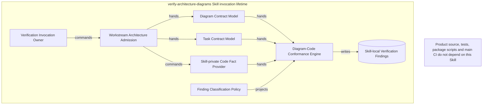
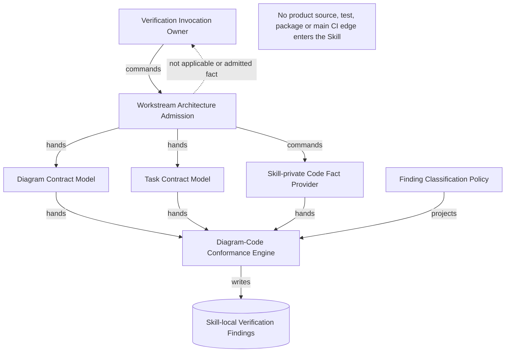
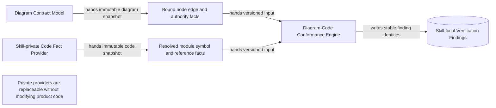
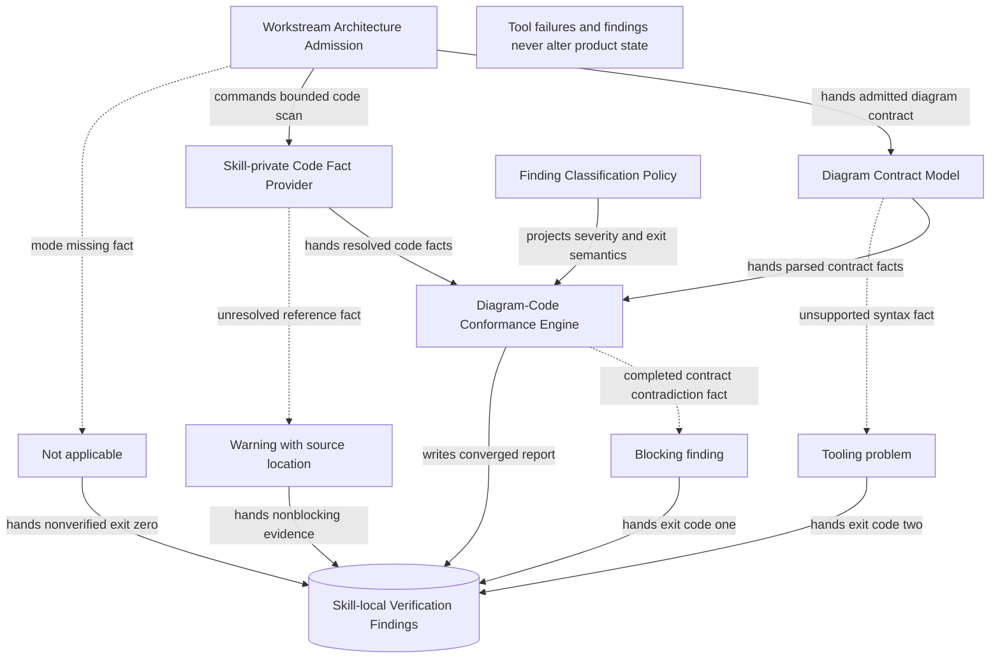
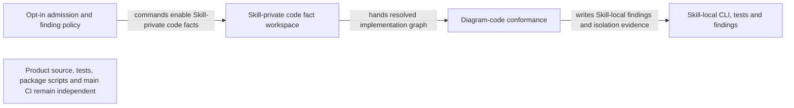

# WS-114 Diagram-Code Architecture Conformance

Architecture-Mode: diagram-driven-v1

**Architecture revision:** `WS114-A5`

## Goal

让显式选择图驱动设计的当前 Workstream 能通过一次确定性的脚本调用，把 L0–L5/Task 设计图、Task 状态、机器可读接线证据与 vendored Tree-sitter/Proto/generated 架构事实放在同一份验证报告中。

## Scope

- Workstream `spec.md` 只有在标题后的第一条非空正文行精确声明 `Architecture-Mode: diagram-driven-v1` 时 opt-in；缺失时 verifier 输出 `not applicable` 并以 exit code 0 跳过。
- 默认 `--scope all` 在一次加载中依次执行 Workstream、全部当前 Task、cross-task 与 code conformance，输出一份去重报告；focused scope 只用于诊断。
- 保留当前 Mermaid L0–L5、Task 图、Task Graph、Memory gate 与记录矛盾检查，并把 code conformance 作为 opt-in WS 的实现阶段。
- `verify-architecture-diagrams` Skill vendoring `web-tree-sitter` runtime、13 种启用语言 grammar/query 与许可证；从显式 artifact seeds 构建 bounded closure，不依赖目标 package、tsconfig、Python 或产品源码。
- dependency facts 分类为 `runtime|type|mixed|unknown`；仅 runtime/mixed workspace edges 进入耦合 SCC，无法证明的 alias/package-root 保持 unresolved。
- Proto service/method 是 RPC 的 canonical fact；generated client/server binding 只是派生 artifact，不替代 `.proto` 合同。
- `%% module:` 保留为单 declaration artifact 的兼容简写；可重复 `%% artifact:` 与 Task `Architecture Evidence` 记录一个节点的 declaration、assembly、writer、reader、emitter、receiver 和 generated artifact。
- `goals.yaml.owns` 只表示允许写入的 path+boundary，不再推导 artifact 必须存在或 canonical writer；artifact expectation 与 authority claim 由 evidence/diagram 单独声明。
- completed Task 的明确合同违背给出 blocking；planned/active/blocked Task 尚未完成的节点、边和 artifact 只给 warning。
- 代码中存在而当前 WS 未声明的 module/edge 只给 warning；不因 warning 自动改图或阻断交付。
- 修复统一 identity、完整 merged graph SCC、显式 authority claim、层序检查和当前 WS owned-boundary overlap。
- CLI、scanner 与 hermetic fixture/mutation tests 全部由 `verify-architecture-diagrams` Skill 私有；产品 `package.json`、主 CI、源码和产品架构测试不得依赖该 Skill。

## Non-goals

- 不读取根 `status.yml`、`execution.md` 或 sibling Workstream 计算架构、状态或依赖；目标 WS 的 `progress.md` 是状态权威来源。
- 不批量扫描、迁移或重新裁决历史、archived、superseded Workstream。
- 不维护其它 Workstream 的 marker allowlist；每个 WS owner 在自己的变更中 opt-in。
- 不因代码中出现图外结构就自动修改设计图、Task DAG 或实现。
- 不要求每条 command edge 都表现为直接 import；依赖注入、composition root、event、callback 与 RPC 是合法接线形式。
- 不把 import、`owns` overlap 或 edge label 单独当作实际 mutation writer 证明。
- 不把 warning、pending、not-checked 或 not-applicable 默认升级为失败。
- 不改变 Dline 产品运行时、Provider、Task、Webview、存储或协议行为；不为 Skill 修改产品源码、产品架构测试、package scripts 或主 CI。

## Behavior

1. CLI 接收明确的 `--workstream <dir>`；默认 `--scope all`，focused scope 保留用于诊断。
2. admission 在读取任何 Mermaid、Task、root status 或 code facts 前解析 `Architecture-Mode`。
3. mode 缺失时输出 `Not applicable`、verdict `not_applicable` 与 exit 0；不得写 verified/conformant。
4. mode 为未知 token 时输出 warning、verdict `incomplete` 与 exit 0；重复、错位或损坏的 mode 声明是 tooling、exit 2。
5. admitted invocation 只能访问目标 WS 目录、显式代码 project/config 与绑定 artifact；filesystem tripwire 证明它不读取 sibling WS、root status 或 execution graph。
6. Diagram binding 允许一个节点绑定多个带稳定 id 的角色 artifact；schema-v2 edge endpoint 只能用 `{node, artifact}` 引用并匹配 from/to 与 emitter/receiver/contract/assembly role。重复 annotation 累积，未知 node、artifact id、role、expectation 或重复 edge evidence id 给出可操作 finding；schema v1 只作迁移读取，completed Task 使用时阻断 conformant。
7. Skill-local Tree-sitter facts 记录确定性 path/category/capture/location/text hash；bounded closure 有 maxFiles/maxDepth，runtime/value edge 与 type-only edge 分图检查。
8. 13 种启用语言共享 imports/declarations/calls/writes/boundaries 事实模型；不支持语言与语法错误报告 unverifiable/diagnostic，不静默当作缺失。
9. Proto provider 从 `.proto` service/method 生成 RPC facts；generated TS 记录 source/provenance，verifier 不自动运行 generator或修改文件。
10. conformance 只扫描 evidence/`%% artifact`/`%% module`/Task `owns|reads` 组成的 artifact set 发出的 workspace edges；internal、outbound-boundary 与 external-package 分别分类，不做全仓无界 warning。
11. completed Task 的 required artifact expectation 不满足、真实 runtime edge 明确反转设计方向、形成禁止 SCC，或两个 completed authority claim 指向同一 canonical fact 的不同 writer 时 blocking。
12. planned/active/blocked Task 缺少 artifact、symbol、edge evidence 或 wiring 时 warning；状态不影响图合同本身的 cycle/direction blocking。
13. 真实 code edge 没有 diagram/read/evidence counterpart 时 warning `actual-edge-undeclared`；type-only edge 不构成 runtime cycle 或 writer blocking。
14. direct import 与可观察 composition 可由结构事实证明；injected port、event、callback 与 RPC 的 contract/Proto 前置条件不能证明 runtime delivery 时必须 `unverifiable`，禁止弱证明冒充通过。
15. authority writer 只来自 diagram authority claim 与 evidence writer/sink；未声明 mutation sink 时 code-level writer 保持 not-checked，禁止从 imports 推断。
16. merged Task solid graph 使用完整 SCC；Depends On 必须从 upstream-owned node 经至少一条 solid edge到 downstream-owned node，不能靠共享节点零跳通过。
17. B1/B2/B3/Depends/code binding 共用一个 identity 模块：concept→exact id→NFKC/lowercase/Unicode letter-number label；去除 Unicode whitespace/punctuation/symbol，多候选即 ambiguity。
18. owned-boundary overlap 规范化 path/case；`whole_file|module|symbol` 使用可计算 containment，`section|line_range|structured_node` 无稳定 selector 时只 warning，不假装无冲突。
19. 报告固定分为 Tooling、Blocking、Warning、Pending、Unverifiable、Not checked、Not applicable，并输出正交 verdict。
20. verdict 为 `conformant|incomplete|not_applicable|failed|tooling_error`；exit 0 覆盖前三者，exit 1 为 failed，exit 2 为 tooling_error。

## Boundaries and Error Paths

- `spec.md` 不存在、mode 重复/错位/损坏：tooling，exit 2。
- mode 缺失：not applicable，exit 0，不运行 parser/self-test/code scan。
- mode unknown：warning + incomplete，exit 0。
- opted-in Mermaid 使用 parser 不支持语法：tooling，exit 2；禁止要求用户修改正确设计去迎合 parser bug。
- Skill-local Tree-sitter runtime/grammar/query 或 Proto provider 无法初始化：tooling，exit 2；不能回退正则并声称已核对。
- 单个 import/symbol/generated binding 无法解析：warning/unverifiable，保留 source、specifier、classification 与 location。
- `owns` 只授权写入；artifact `present|absent|generated` expectation 决定完成态存在性检查。
- completed expectation mismatch：blocking；未完成 Task expectation mismatch：warning。
- code graph 图外 edge：warning；只有它同时构成明确 runtime reverse/SCC 或已声明 authority conflict 时升级。
- edge evidence 缺失：warning；required verification 与 evidence/progress 自相矛盾时作为 record blocking。
- generated artifact 缺失或 provenance 不一致：warning/not-checked；生成命令由交付验证显式运行，verifier 不产生写入。
- fixture/mutation self-test 不能检出注入缺陷：tooling，exit 2。

## Architecture-Mode Grammar

- 文件允许 UTF-8 BOM；第一行必须是单个 H1 Workstream 标题。
- 标题后的第一条非空正文行必须逐字为 `Architecture-Mode: diagram-driven-v1`；不允许前后空白、大小写变体或 Markdown quote/list/fence 包裹。
- fenced code、inline code 和引用中的相同文本不参与识别。
- 全文第二条 `Architecture-Mode:` 候选行视为重复并产生 tooling。
- 精确 key 加其它非空 token 是 unsupported mode warning；key 拼写错误按 marker 缺失处理。

## Architecture Evidence Contract

Task `plan.md` 可以包含一个 `## Architecture Evidence` 下的 YAML block；它是 diagram→code 映射事实源，Markdown ledger 只能由它渲染，不得另存第二份事实：

```yaml
architecture_evidence:
  schema_version: 2
  diagram_id: TASK11403-conformance
  nodes:
    Conformance:
      artifacts:
        - {id: conformance-emitter, role: emitter, path: .agents/skills/verify-architecture-diagrams/scripts/lib/checks-code-conformance.mjs, symbol: checkCodeConformance, expectation: present}
    Integration:
      artifacts:
        - {id: report-receiver, role: receiver, path: .agents/skills/verify-architecture-diagrams/scripts/lib/report.mjs, symbol: renderTextReport, expectation: present}
  edges:
    - id: TASK11403-conformance/Conformance/writes/Integration
      from: Conformance
      to: Integration
      style: solid
      label: writes
      kind: direct_import
      emit: {node: Conformance, artifact: conformance-emitter}
      receive: {node: Integration, artifact: report-receiver}
      proof: [VER-TASK-11403-SEVERITY]
```

- schema v2 node artifact 必须有当前 Evidence 内唯一、稳定的 `id`；role 只允许 `declaration|assembly|writer|reader|emitter|receiver|generated`。
- expectation 只允许 `present|absent|generated`；`absent` 支持删除任务，`generated` 必须携带 canonical source/provenance。
- edge `id` 在当前 WS 唯一；from/to/style/label 必须精确匹配 diagram edge，图变更会使旧 evidence 失效。
- `emit` 必须以 `{node, artifact}` 绑定 `from` 节点的 emitter artifact，`receive` 必须绑定 `to` 节点的 receiver artifact；contract/assembly endpoint 分别要求 declaration/assembly role。endpoint 禁止另写 path/symbol。
- proof 只引用 `goals.yaml.required_verification` ID；progress 必须有匹配结果，但测试结果不替代 endpoint artifact 检查。
- schema v1 仅可读取以辅助迁移；它缺少稳定 artifact/endpoint identity，不能支撑 completed Task 的 conformant 结论。
- `%% artifact: <node> role=<role> path=<path> [symbol=<symbol>] [expect=<expectation>]` 可重复；`%% module:` 等价于一个 declaration/present artifact。
- canonical authority 来自 L0/L1 authority edge；writer role 负责把 authority 映射到代码，未声明 sink 时实际 mutation 保持 not-checked。

## Finding Classification Matrix

| Fact plane | Condition | Task status | Severity |
|---|---|---|---|
| diagram | structure cycle、direction/style、identity ambiguity | any | blocking/unverifiable，沿用图规则 |
| record | completed 与 required verification/blocker/waiting 矛盾 | completed | blocking |
| artifact | present/absent/generated expectation mismatch | completed | blocking |
| artifact | expectation 尚未满足 | planned/active/blocked | warning |
| proof | emit/receive/proof 缺失 | any | warning；required record 自相矛盾时 blocking |
| runtime code | actual edge 无 diagram/read/evidence counterpart | any | warning |
| runtime code | actual edge 明确反转设计或形成禁止 SCC | completed implementation | blocking |
| type graph | reverse/cycle/undeclared edge | any | warning/not-checked，不作为 runtime blocking |
| authority | 不同 completed writer claim 指向同一 canonical fact | completed | blocking |
| authority | writer claim 未完成或无 mutation sink | unfinished/unknown | warning/not-checked |
| boundary | 可计算 owns overlap | completed different writers | blocking |
| boundary | overlap 涉及 unfinished 或不可定位 selector | any | warning |

## Shared Contracts

- `Architecture-Mode: diagram-driven-v1` 是唯一 opt-in；其它 WS 由各自 owner 管理 marker，不维护中央 allowlist。
- Arrow labels are normative: `owns`, `composes`, `commands`, `hands`, `writes`, `consults`, `projects`; dotted edges carry facts, failures, durability or constraints only.
- `goals.yaml.owns` 只表示写边界；artifact expectation、edge evidence 与 authority claim 各自只有一个事实源。
- `progress.md` 是 Task status 与 required verification 权威来源；root status projection 不参与 verifier 设计结论。
- code fact scanner 是 Skill 的私有实现；产品源码、产品架构测试、package scripts 与主 CI 不得导入或调用它。
- Tree-sitter/Proto/explicit-generated providers 产出 immutable facts；conformance engine 不依赖 Dline 产品模块或目标项目配置。
- focused scope 仅诊断；`--scope all` 是减少人工漏跑的交付入口。

## Architecture Design

### L0 Ownership and Lifetime



### L1 Control and Fact Direction



### L2 Verification Hot Path

```mermaid
flowchart LR
    %% id: WS114-L2-hot-path
    %% layer: L2
    %% kind: flow
    %% refines: WS114-L1-flow
    %% answers: bounded Skill-local verification sequence and early skip
    %% concept: Admission = Workstream Architecture Admission
    %% concept: Diagram = Diagram Contract Model
    %% concept: Code = Code Fact Provider
    %% concept: Compare = Diagram-Code Conformance Engine
    %% concept: Findings = Verification Findings
    %% concept: ProductIsolation = Product Independence Constraint
    %% local-only: Input
    %% local-only: Skip
    %% local-only: Done
    %% note-node: ProductIsolation
    Input[Explicit Workstream path] -->|commands read mode| Admission[Workstream Architecture Admission]
    Admission -->|hands opted-in contract| Diagram[Diagram Contract Model]
    Admission -->|commands bounded Skill-private scan| Code[Skill-private Code Fact Provider]
    Admission -.->|mode absent or unsupported fact| Skip[Report not applicable or warning]
    Diagram -->|hands canonical graph| Compare[Diagram-Code Conformance Engine]
    Code -->|hands resolved module graph| Compare
    Compare -->|writes classified findings| Findings[(Skill-local Verification Findings)]
    Findings -->|hands deterministic exit code| Done[Invocation complete]
    Skip -->|hands exit code zero| Done
    ProductIsolation["Product lifecycle remains outside this hot path"]
```



### L3 Stable Code-Fact Handoff



### L4 Failure and Classification



### L5 Delivery Order



## Acceptance Criteria

- **WS-114/AC-01**：只有标题后第一条非空正文行精确声明 `Architecture-Mode: diagram-driven-v1` 的目标 WS 才进入校验；缺失返回 `not_applicable`/exit 0，重复或损坏返回 tooling/exit 2。
- **WS-114/AC-02**：unknown mode 返回 warning、`incomplete`/exit 0；自然语言、Mermaid 和 fenced text 不参与 opt-in 推断。
- **WS-114/AC-03**：一次调用只访问目标 WS、显式 project/config 与绑定 artifact；不读取 root status、execution.md、sibling 或历史 WS，filesystem tripwire 可证明该边界。
- **WS-114/AC-04**：默认 `--scope all` 一次运行 Workstream、全部 Task、cross-task 与 code conformance，统一去重、summary、verdict 和 exit code；focused scopes 只用于诊断。
- **WS-114/AC-05**：Skill vendoring Tree-sitter runtime、13 种启用语言 grammar/query、Proto service/method 与显式 generated provenance；bounded closure 在无 package/tsconfig 的复制项目中工作，并隔离不稳定 Swift grammar。
- **WS-114/AC-06**：可重复 `%% artifact:` 与 schema-v2 Architecture Evidence 把节点映射到带稳定 id 的 role artifact；edge endpoint 强绑定 node/artifact/from/to/role，未知或重复 artifact id、endpoint 漂移、未知 role/expectation、重复 edge id 或 edge mismatch 有确定 finding；schema v1 不能支撑 completed conformant。
- **WS-114/AC-07**：`owns` 只表示写边界；`present|absent|generated` expectation 支持 create/delete/generated Task，禁止从 owns 推导 artifact 或 writer。
- **WS-114/AC-08**：当前 runtime code edge 无 diagram/read/evidence counterpart 统一 warning；扫描范围只包含 current WS artifact set 发出的 workspace edge，不产生全仓噪声。
- **WS-114/AC-09**：planned/active/blocked Task 缺少 artifact、symbol、edge 或 proof 时 warning；completed expectation mismatch、记录矛盾和明确 runtime contract contradiction 才 blocking。
- **WS-114/AC-10**：direct import 与 observable composition 可机器证明；DI/event/callback/RPC 无法由通用 syntax facts 证明 runtime delivery 时返回 unverifiable，不把共同 import 或 Proto 存在当作完成。
- **WS-114/AC-11**：merged Task graph 检测任意长度 SCC；Depends On 要求 upstream-owned 到 downstream-owned 至少一条 solid edge，不能用共享节点零跳通过。
- **WS-114/AC-12**：所有 stage 共用 NFKC/Unicode identity 与 ambiguity 规则；annotation 指向未知 node 必须报告，不能静默丢 binding。
- **WS-114/AC-13**：canonical writer 只来自 diagram/evidence authority claim；不同 completed writer claim 冲突才 blocking，未声明 mutation sink 的 code writer 保持 not-checked。
- **WS-114/AC-14**：owned boundary 使用规范 path 与 containment lattice；不可计算的 section/line/structured selector 只 warning，不假装已证明无重叠。
- **WS-114/AC-15**：报告七类 finding 并输出 `conformant|incomplete|not_applicable|failed|tooling_error` verdict；warning/pending/not-checked 不改变 0/1/2 exit code但不得表述为 clean verified。
- **WS-114/AC-16**：Skill 私有 hermetic fixture/mutation suite 能捕获 opt-in、root-read、resolver、Proto/generated、三 Task SCC、zero-hop、identity、writer、delete/generated、severity 与 proof 缺陷。
- **WS-114/AC-17**：Skill 通过自身 `scripts/verify-diagrams.mjs` 提供单 WS aggregate CLI；产品 `package.json`、主 CI、源码和产品架构测试均不依赖 Skill，隔离测试可证明该边界。
- **WS-114/AC-18**：WS-114 只自举自己的 opt-in；其它当前 WS 由各自 owner 在自身变更中选择 marker，历史/archived 对象不迁移。
