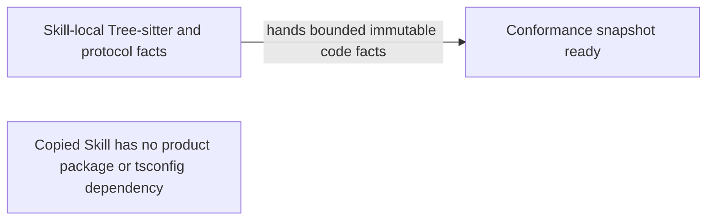

# TASK-11402 Plan

## Approach

在 Skill 内 vendoring `web-tree-sitter` runtime、grammar WASM、queries 与许可证。代码事实从显式 artifact seed 构建 bounded closure；Proto 与显式 generated provenance 保持独立 provider。目标项目不需要 package、tsconfig、Python、language-provider 或 Dline 产品源码。

## Architecture Design



## Architecture Evidence

```yaml
architecture_evidence:
  schema_version: 2
  diagram_id: TASK11402-code-graph
  nodes:
    CodeGraph:
      artifacts:
        - {id: tree-facts-declaration, role: declaration, path: .agents/skills/verify-architecture-diagrams/scripts/lib/tree-sitter-facts.mjs, symbol: scanTreeSitterSource, expectation: present}
        - {id: dependency-closure-declaration, role: declaration, path: .agents/skills/verify-architecture-diagrams/scripts/lib/tree-sitter-dependencies.mjs, symbol: buildDependencyClosure, expectation: present}
        - {id: dependency-closure-emitter, role: emitter, path: .agents/skills/verify-architecture-diagrams/scripts/lib/tree-sitter-dependencies.mjs, symbol: buildDependencyClosure, expectation: present}
        - {id: proto-facts-declaration, role: declaration, path: .agents/skills/verify-architecture-diagrams/scripts/lib/proto-facts.mjs, symbol: readProtoServiceFacts, expectation: present}
        - {id: generated-provenance-declaration, role: declaration, path: .agents/skills/verify-architecture-diagrams/scripts/lib/generated-provenance.mjs, symbol: readGeneratedProvenance, expectation: present}
    Ready:
      artifacts:
        - {id: code-snapshot-receiver, role: receiver, path: .agents/skills/verify-architecture-diagrams/scripts/lib/code-facts.mjs, symbol: createCodeFactSnapshot, expectation: present}
        - {id: conformance-assembly, role: assembly, path: .agents/skills/verify-architecture-diagrams/scripts/lib/checks-code-conformance.mjs, symbol: checkCodeConformance, expectation: present}
  edges:
    - id: TASK11402-code-graph/CodeGraph/hands/Ready
      from: CodeGraph
      to: Ready
      style: solid
      label: hands bounded immutable code facts
      kind: composition
      emit: {node: CodeGraph, artifact: dependency-closure-emitter}
      receive: {node: Ready, artifact: code-snapshot-receiver}
      assembly: {node: Ready, artifact: conformance-assembly}
      proof: [VER-TASK-11402-RESOLUTION, VER-TASK-11402-PROTOCOL]
```

## Steps

1. Vendoring runtime、grammar、queries 和许可证，并隔离不稳定 Swift grammar。
2. 产出确定性多语言 facts 与 bounded dependency closure。
3. 只把 runtime/mixed workspace edge 纳入 SCC，type/unknown 不伪装成 runtime。
4. 保持 Proto canonical facts 与显式 generated provenance；不运行 generator。
5. 用 Stage 6、跨语言、复制 Skill CLI 与 mutation fixtures 验证自包含边界。

## Verification

- `VER-TASK-11402-RESOLUTION`：helper closure、bound、runtime/type 与 SCC fixtures。
- `VER-TASK-11402-SYNTAX`：13 种启用语言五类 facts、unsupported/syntax diagnostics。
- `VER-TASK-11402-PROTOCOL`：Proto/generated explicit fixtures。
- `VER-TASK-11402-PARITY`：复制 Skill 到无 package/tsconfig 项目后的 CLI E2E。

## Risks

- alias、package-root 与语言语义无法证明时保持 unresolved/unverifiable，禁止猜测。
- Swift 在当前 runtime/grammar 组合下保持 quarantined，返回 unsupported。
