# TASK-11403 Plan

## Approach

先建立唯一、版本化的 Architecture Evidence 与 Unicode identity，再比较 diagram/task/evidence/code 四个事实平面。`owns` 只参与写边界；artifact expectation 与 authority claim 分开分类。不读取跨 WS 对象。

## Architecture Design

```mermaid
flowchart LR
    %% id: TASK11403-conformance
    %% layer: L5
    %% kind: flow
    %% refines: WS114-L5-delivery
    %% answers: diagram-code conformance delivery
    %% concept: Conformance = Diagram-Code Conformance Engine
    %% artifact: Conformance role=declaration path=.agents/skills/verify-architecture-diagrams/scripts/lib/checks-code-conformance.mjs symbol=checkCodeConformance expect=present
    %% artifact: Conformance role=declaration path=.agents/skills/verify-architecture-diagrams/scripts/lib/architecture-identity.mjs symbol=normalizeArchitectureIdentity expect=present
    %% artifact: Conformance role=declaration path=.agents/skills/verify-architecture-diagrams/scripts/lib/evidence-model.mjs symbol=parseArchitectureEvidence expect=present
    %% artifact: Ready role=assembly path=.agents/skills/verify-architecture-diagrams/scripts/tests/conformance.test.mjs expect=present
    %% local-only: Ready
    Conformance[Diagram-code conformance] -->|hands verified conformance engine| Ready[Conformance engine ready]
```



## Architecture Evidence

```yaml
architecture_evidence:
  schema_version: 2
  diagram_id: TASK11403-conformance
  nodes:
    Conformance:
      artifacts:
        - {id: conformance-declaration, role: declaration, path: .agents/skills/verify-architecture-diagrams/scripts/lib/checks-code-conformance.mjs, symbol: checkCodeConformance, expectation: present}
        - {id: identity-declaration, role: declaration, path: .agents/skills/verify-architecture-diagrams/scripts/lib/architecture-identity.mjs, symbol: normalizeArchitectureIdentity, expectation: present}
        - {id: evidence-model-declaration, role: declaration, path: .agents/skills/verify-architecture-diagrams/scripts/lib/evidence-model.mjs, symbol: parseArchitectureEvidence, expectation: present}
        - {id: conformance-emitter, role: emitter, path: .agents/skills/verify-architecture-diagrams/scripts/lib/checks-code-conformance.mjs, symbol: checkCodeConformance, expectation: present}
    Ready:
      artifacts:
        - {id: conformance-tests-assembly, role: assembly, path: .agents/skills/verify-architecture-diagrams/scripts/tests/conformance.test.mjs, expectation: present}
        - {id: conformance-tests-receiver, role: receiver, path: .agents/skills/verify-architecture-diagrams/scripts/tests/conformance.test.mjs, expectation: present}
  edges:
    - id: TASK11403-conformance/Conformance/hands/Ready
      from: Conformance
      to: Ready
      style: solid
      label: hands verified conformance engine
      kind: composition
      emit: {node: Conformance, artifact: conformance-emitter}
      receive: {node: Ready, artifact: conformance-tests-receiver}
      proof: [VER-TASK-11403-BINDING]
```

## Steps

1. 解析 schema-v2 evidence 与 repeatable `%% artifact:`；验证 Workstream 唯一 artifact id、node/role/path/symbol、endpoint 的 `{node, artifact}` 绑定、edge id 和 diagram edge match；schema v1 只作迁移读取。
2. 统一 concept→exact id→NFKC/lowercase/Unicode label identity，多候选即 ambiguity。
3. 合并 Task solid graphs运行 SCC；Depends On 必须 upstream-owned→downstream-owned 至少一条 edge。
4. 调用按 refinement lineage 的 layer sequence；未知 node-targeted annotation 产生 finding。
5. 将 `owns` 与 artifact expectation/authority claim 分离；实现 whole_file/module/symbol containment lattice。
6. 建立 bounded actual-edge comparison：只扫描 current WS artifact set importer，分类 internal/outbound/external。
7. 按 classification matrix处理 expectation、proof、runtime/type graph、authority 与 boundary findings。
8. 实现 direct import、injected port、composition、event/callback、RPC proof adapters。

## Verification

- `VER-TASK-11403-EVIDENCE`：one-to-many artifact、delete/generated、edge mismatch 与第二事实源拒绝。
- `VER-TASK-11403-SEVERITY`：fact-plane/status/confidence matrix。
- `VER-TASK-11403-GRAPH`：2/3/N-node SCC、zero-hop、Unicode ambiguity fixtures。
- `VER-TASK-11403-BINDING`：各 transport proof adapter fixtures。
- `VER-TASK-11403-OWNERSHIP`：authority claim 与 boundary lattice fixtures。

## Risks

- actual edge 可能是 local detail；默认 warning，禁止自动升级。
- import graph 不能证明 mutation；没有明确 authority sink 时必须保持 not-checked。
- section/line/structured selector 无稳定定位时只 warning，不能假装已比较。
