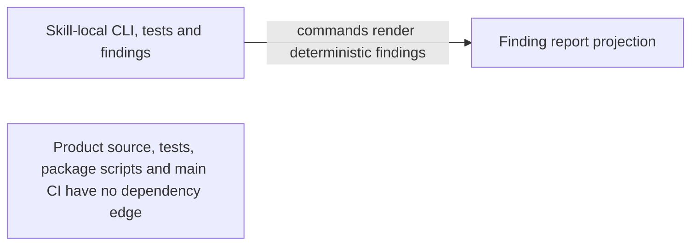

# TASK-11404 Plan

## Approach

在 conformance engine 稳定后，由 Skill 自身脚本提供 aggregate CLI 和独立 hermetic fixture suite。产品 package、主 CI、源码和产品架构测试不接入该 Skill；其它 WS 是否 opt-in 由其 owner 在自身变更中决定。

## Architecture Design



## Architecture Evidence

```yaml
architecture_evidence:
  schema_version: 2
  diagram_id: TASK11404-integration
  nodes:
    Delivery:
      artifacts:
        - {id: delivery-cli-assembly, role: assembly, path: .agents/skills/verify-architecture-diagrams/scripts/verify-diagrams.mjs, symbol: main, expectation: present}
        - {id: delivery-cli-emitter, role: emitter, path: .agents/skills/verify-architecture-diagrams/scripts/verify-diagrams.mjs, symbol: main, expectation: present}
    Report:
      artifacts:
        - {id: report-json-receiver, role: receiver, path: .agents/skills/verify-architecture-diagrams/scripts/lib/report.mjs, symbol: renderJsonReport, expectation: present}
  edges:
    - id: TASK11404-integration/Delivery/commands/Report
      from: Delivery
      to: Report
      style: solid
      label: commands render deterministic findings
      kind: direct_import
      emit: {node: Delivery, artifact: delivery-cli-emitter}
      receive: {node: Report, artifact: report-json-receiver}
      proof: [VER-TASK-11404-COMMAND]
```

## Steps

1. 通过 `.agents/skills/verify-architecture-diagrams/scripts/verify-diagrams.mjs --workstream <dir>` 提供默认 scope all 的 aggregate CLI。
2. 使用 Skill 私有 Node tests 与临时 fixture WS/code projects，不读取真实 Memory。
3. 建立 mutation probes，确认 seeded admission/root-read/resolver/Proto/generated/SCC/zero-hop/identity/authority/severity/evidence defects被捕获。
4. 增加隔离断言：产品 package、主 CI、源码和产品架构测试不得依赖 Skill，且不得存在为 Skill 抽取的 `scripts/architecture` 层。
5. 更新两个 skills 与两个 workflows，记录 exact opt-in、structured evidence、aggregate scope、warning/verdict 和 proof semantics，并使用 Skill-local command。
6. WS-114 只保留自身 marker；不修改其它当前或历史对象。

## Verification

- `VER-TASK-11404-FIXTURES`：Skill-private hermetic fixture/mutation suite。
- `VER-TASK-11404-COMMAND`：single-target Skill-local aggregate CLI acceptance。
- `VER-TASK-11404-ISOLATION`：product package/CI/source/test no-dependency tripwire。
- `VER-TASK-11404-DOCS`：skills/workflows contract consistency。

## Risks

- Skill 不得通过 package script、主 CI job、源码 adapter 或共享 scanner 反向取得产品生命周期。
- fixture 必须使用临时目录和明确 project config，禁止依赖当前 WS 状态获得假通过。
