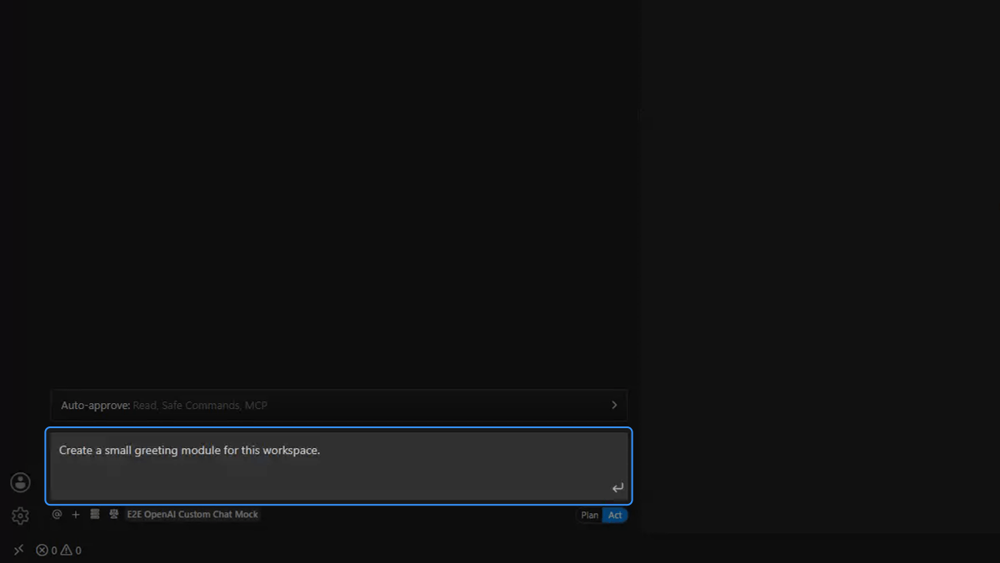
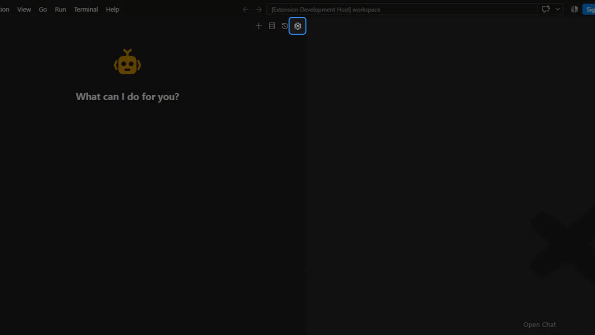

<div align="center">


# Dline

English · [中文](README_zh.md)

**Independent coding agent for task-scoped work in separate VS Code panels**

Bring your own model provider, preserve each task's state across reloads, and configure tool approvals by action type.

[Documentation](https://docs.dline.cc/) · [Privacy](https://docs.dline.cc/privacy/) · [Security](https://docs.dline.cc/security/) · [Changelog](docs/changelog/CHANGELOG_en.md)

</div>

> **Independent project notice:** Dline is independently maintained community software. It is based on the Apache-2.0 licensed Cline project, but it is not an official Cline release, is not published by Cline Bot Inc., and is not affiliated with or endorsed by Cline Bot Inc.

<p align="center"></p>

## What Dline Is Built For

Dline is designed for development work that needs more than a single chat response:

- **Task-scoped model Profiles** keep each task bound to its own provider, endpoint, model, and reasoning settings.
- **Separate task state** keeps mode, conversation, approvals, capability toggles, Activities, checkpoints, and recovery state attached to the owning task.
- **Configurable approvals** classify tool actions by type: trusted reads and safe commands can run automatically, while edits and higher-impact operations can remain reviewable.
- **Recoverable long-running work** persists task state, Activities, message history, and command output so interrupted work can be inspected and resumed.
- **Scoped capabilities** let rules, skills, workflows, subagents, and MCP server toggles resolve through global, workspace, and task scope.

## Start a Task

1. Install Dline and open the Dline icon in the VS Code activity bar.
2. Open **API Configuration**, create a Profile, choose a provider and model, and add the credentials required by that provider.
3. Start a task in **Plan** mode when you want investigation and an agreed approach, or in **Act** mode when the task is ready for implementation.
4. Review requested tool access. You can approve one operation, reject it, or configure narrow auto-approval rules for operations you trust.

**Requirement:** VS Code 1.134.0 or newer.

<p align="center"></p>

## Control and Separate Task State

### Per-task execution state

Every task owns its selected Profile, mode, capability settings, message history, Activities, checkpoints, queued input, and recovery state. Changing one task does not silently change another running task. Separate panels share the same workspace files by default; use worktrees when tasks also need filesystem isolation.

### Explicit access boundaries

Dline separates its project-tool access into read, write, execute, and visibility permissions. A workspace `.agentignore` file can remove one or more permissions with `.gitignore`-style patterns:

```gitignore
secrets/          # no access
vendor/ -w        # readable, not writable
generated/ -s     # hidden from listing and search
scripts/ext/ -x   # cannot be used as a command working directory
logs/ -r          # not readable
```

Auto-approval does not bypass `.agentignore`, workspace boundaries, host restrictions, or tool-specific safety checks. `.agentignore` governs Dline's own tools; it is not an operating-system sandbox.

### Observable work

The **Work** view shows the conversation and tool results. The **Activities** view retains command and subagent runs, including output, attempts, cancellation, interruption, API rate, and context usage. Completed and interrupted Activities remain available with the task.

## Models and External Capabilities

Dline supports hosted and local model providers through user-created API Profiles. The provider and model used by one task do not have to match another task or its subagents.

Optional capabilities include:

- local or provider-hosted web search and page retrieval;
- MCP servers configured by you or your workspace;
- browser automation governed by the current approval settings;
- image generation through a configured image source;
- named research subagents and independent peer tasks;
- LSP-backed references and rename operations;
- bounded foreground and background terminal commands.

Availability, billing, data handling, and retention for a model provider or external service are governed by that service. Review its terms before adding credentials or sending data.

## Local Data and Network Requests

Dline stores settings, credentials, task history, messages, activities, checkpoints, and recovery data on your machine under Dline-owned storage roots. Credentials are kept in dedicated credential stores rather than task messages or Profile documents.

When you submit a task, the prompt, selected context, and tool results needed for that request are sent to the model provider configured in the task's Profile. MCP servers, web services, image providers, browser targets, and other tools receive requests according to the current approval and auto-approval policy.

Dline also has separate **usage reporting** and **error reporting** controls. Both are enabled by default in the current build, honor VS Code's telemetry setting, and can be turned off independently in **Settings → About**. The public [Privacy Policy](https://docs.dline.cc/privacy/) describes the data categories, purposes, destinations, retention boundaries, controls, and current privacy-request limitation. The [telemetry reference](https://docs.dline.cc/troubleshooting/telemetry/) documents the current reporting schema and local diagnostic behavior.

## Configuration Locations

| Path | Purpose |
|---|---|
| `.agents/rules/` | Project rules added to Dline's task context |
| `.agents/workflows/` | Reusable ordered procedures |
| `.agents/skills/` | Task-specific methods and verification guidance |
| `.agents/subagents/` | Named subagent definitions |
| `.agents/mcp/` | Workspace MCP server descriptors |
| `.agents/bashrc.yml` | Terminal environment configuration |
| `.agentignore` | Read, write, execute, and visibility restrictions |

Dline can also read selected compatibility formats such as `AGENTS.md`, `.clinerules/`, `.cursor/rules/`, `.cursorrules`, `.windsurfrules`, and `.claude/skills/`. Compatibility does not imply affiliation with the projects that introduced those formats.

## Migration from Cline

Dline does not automatically read, copy, modify, or delete Cline data. To reuse selected settings, MCP configuration, rules, or workflows, follow the [manual migration guide](https://docs.dline.cc/getting-started/migration-cline-to-dline/). Cline task history is not compatible with Dline and cannot be imported.

## Support, Security, and Privacy

- Product questions and bug reports: [Dline issues](https://github.com/TuvokYang/Dline/issues)
- Security reports: [Report a Security Vulnerability](https://docs.dline.cc/security/)
- Privacy terms and request limitations: [Dline Privacy Policy](https://docs.dline.cc/privacy/)
- Documentation: [docs.dline.cc](https://docs.dline.cc/)

## Open-source Origin

Dline is a derivative work of the Apache-2.0 licensed [Cline](https://github.com/cline/cline) project. Dline retains applicable upstream copyright, license, and attribution notices. References to Cline describe source origin, compatibility, or migration only; they do not claim sponsorship, endorsement, or an official relationship.

## License

[Apache License 2.0](LICENSE)
