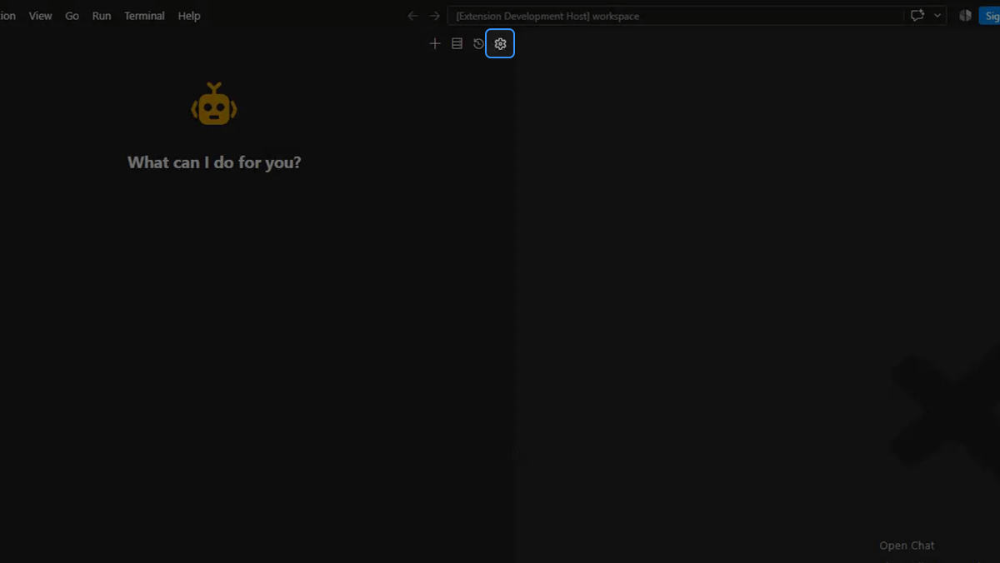

# Dline

**Comprehensive multi-task automated coding agent**

Task-scoped multi-model configuration, persistent task state and checkpoints, layered capability configuration, and fine-grained global approval controls

**English · [中文](marketplace.zh-cn.md)**

[Documentation](https://docs.dline.cc/) | [Changelog](docs/changelog/CHANGELOG_en.md) | [Security](https://docs.dline.cc/security/) | [Privacy](https://docs.dline.cc/privacy/)

Dline is a professional-grade automated coding agent for running multiple coding and code review tasks in parallel within the same workspace. It helps define architecture and coding tasks, write code, review and fix issues, and maintain project documentation. Each task retains its own context across planning, implementation, and verification.

The following features equip Dline to handle complex development work across multiple tasks:

- **Multi-model configuration**: <small>Connect cloud services or local models and choose models separately for each task's **Act**, **Plan**, and **Subagent** roles, rather than using one model for all work.</small>
- **Parallel task execution**: <small>Advance feature development, issue resolution, refactoring, UI debugging, and documentation tasks concurrently, each with its own conversation, progress, and execution records. Within a task, delegate independent module investigations to multiple subagents in parallel, then bring their findings together to continue planning, implementation, and verification.</small>
- **Layered configuration**: <small>Rules, skills, workflows, subagents, and MCP can be enabled or disabled at global, project, and task scope. Nested `AGENTS.md` files within a project support progressive disclosure, loading relevant guidance for the directories targeted by the current operation. Subagent roles, models, tools, and skills can be configured globally or per project; projects can also define terminal environment variables, startup scripts, and pre- and post-command actions for different operating systems and terminals.</small>
- **Resumable long-running tasks**: <small>Use automatic context compaction while keeping original conversations and execution records locally. Reopen an interrupted task to inspect progress and continue.</small>
- **Persistent task records**: <small>Inspect command and subagent output, execution states, and retry records to see what has been completed and what still needs attention.</small>
- **Rich tool capabilities**: <small>Search the web and retrieve page content; open pages, click, type, and scroll in a browser, using screenshots and console output to check pages and interactions; generate images through a configured image service with reference-image support, with exact image capabilities depending on the selected service.</small>
- **Scoped MCP integration**: <small>Configure MCP servers globally or per project, invoke external tools and access resources, and authorize remote servers through OAuth. Store private values such as API keys separately on your machine and reference them through variables when connecting.</small>
- **Fine-grained operation approvals**: <small>Configure approvals separately for reads and writes inside and outside the project; distinguish safe commands from all commands, and configure browser, web, MCP, and image generation approvals individually. Approval settings apply globally.</small>
- **Persistent checkpoints**: <small>Use Git to create file checkpoints and persistent conversation storage to create conversation checkpoints. Roll back files and conversations to any existing checkpoint.</small>

## Coding Tasks

- **Architecture design and coding task planning**: <small>Review requirements and the current project, design architecture and interfaces, and break the work into coding tasks, an implementation sequence, and verification steps.</small>
- **Code implementation**: <small>Implement features, refactor code, adjust the UI and configuration, add tests, and verify the results.</small>
- **Code review and issue resolution**: <small>Review code logic, structure, and edge cases; use errors and logs to identify problems, then fix them and run regression checks.</small>
- **Documentation maintenance**: <small>Write or update architecture documents, project descriptions, user guides, and change records to reflect the project.</small>

## Feature Overview

- **Parallel tasks**: work in the sidebar and separate task panels, each with its own conversation and execution records.
- **Per-task model selection**: choose different models for different tasks, or configure separate models for planning, execution, and subagents.
- **Resumable long-running work**: keep task history, command output, and activity records so you can inspect progress and continue after an interruption.
- **Parallel subagents**: delegate independent code investigations to subagents, then bring their findings back to the main task.
- **Task-specific rules and tools**: manage general preferences, project conventions, and the rules, skills, and MCP tools needed for a particular task separately.

## Multiple Tasks and Model Selection

Click **New Task** (`+`) to open a separate task panel without ending work in the sidebar. Work on different goals in parallel, with each panel showing its own conversation, model selection, and follow-up instructions.

Tasks share the current project files by default; separate panels do not provide filesystem isolation. Give tasks different areas to change, or prepare separate workspaces with Git worktrees or another isolation method.

Create a model configuration (Profile) in **API Configuration** to save a provider, model, and authentication details, then select it from the task input area. Dline supports cloud model services, compatible APIs, and local models. Available models, capabilities, and costs depend on the service and configuration you use.

- Different tasks can select different Profiles.
- Enable **Split Model** to choose separate models for **Plan** and **Act**.
- Subagents can also use separately configured models.

See [model configuration](https://docs.dline.cc/getting-started/authorizing-with-dline/) for the steps.

## Planning and Execution

Use **Plan** to read code, investigate a problem, and discuss an approach; use **Act** to edit files, run commands, and verify the results. Both modes keep the conversation in the same task, so you can switch as the work progresses.

Start directly with execution for a well-defined change, or agree on an approach first for work spanning several modules. Mode selection does not replace approval: tool access remains subject to the current permission settings.

## Task Recovery and Execution Records

Conversations and activity records are stored locally with the task. After an interruption or a VS Code reload, reopen it from history, inspect the completed steps, and continue through **Resume** or a follow-up message. Reopening a record does not automatically restart earlier commands.

The **Work** view shows the conversation and tool results. **Activities** retains command and subagent output, execution states, and retry records. The task header also shows model usage and context consumption, with cost information when pricing is available.

For long conversations, [context compaction](https://docs.dline.cc/features/auto-compact/) can reduce the content carried into later requests. Compaction summarizes earlier conversation; it does not guarantee that the model retains every detail. The original conversation remains available to review.

## Permissions and Change Review

Approve or reject tool requests, or use **Auto-approve** to allow action types such as reading, editing, command execution, and browser use. With the default settings, project reads and commands marked as safe can run automatically, while file edits require approval. The model classifies safe commands; this is not an operating-system security guarantee.

Auto-approval settings are global, not separate for each task. Before enabling automatic edits or commands, make sure you accept the effects of those actions.

A project `.agentignore` file can restrict which paths Dline's tools scan, read, write, or use. It is not an operating-system sandbox and cannot guarantee that arbitrary terminal commands or external tools cannot access sensitive files.

When checkpoints are enabled and file snapshots are available, you can compare changes or restore the relevant files and conversation. File restoration overwrites later changes within its restore scope, including your own edits. Review the diff first.

See [auto-approval](https://docs.dline.cc/features/auto-approve/), [file access restrictions](https://docs.dline.cc/customization/agentignore/), and [checkpoints](https://docs.dline.cc/core-workflows/checkpoints/).

## Rules and Additional Tools

Use rules, skills, and workflows to give Dline coding conventions, project background, and reusable procedures. Their enabled state, along with subagents and MCP servers, can be managed globally, per project, or per task. After changing these settings during a task, follow the UI prompt to refresh the task's prompt so the relevant changes take effect.

- **Rules**: record project conventions and requirements instead of repeating them in every request.
- **Skills and workflows**: reuse methods and steps for testing, troubleshooting, release preparation, and other recurring work.
- **Subagents**: investigate different modules or questions in parallel. The default subagent is read-only; review tool permissions before giving a custom subagent write or command access.
- **MCP**: connect external tools and services you configure.
- **Web and browser tools**: search for information, retrieve page content, interact with websites, and inspect screenshots and console output.
- **Image and code tools**: generate images through a configured service, or find references and rename code symbols when language services are available.

Tool availability depends on the current model, feature configuration, and permissions. External services may charge separately and apply their own data-handling terms.

Configuration guides: [rules](https://docs.dline.cc/customization/rules/), [skills](https://docs.dline.cc/customization/skills/), [workflows](https://docs.dline.cc/customization/workflows/), [subagents](https://docs.dline.cc/features/subagents/), and [MCP](https://docs.dline.cc/mcp/mcp-overview/).

## Getting Started

1. Install Dline, open a project folder in VS Code, and click the Dline icon in the activity bar.
2. Open **Settings → API Configuration**, create a Profile, choose a provider and model, and complete the required authentication or local connection setup.
3. Describe the task and attach relevant files, errors, or screenshots. Choose **Plan** to discuss an approach first, or **Act** when ready to execute.
4. Send the task and respond to approval requests. Add requirements through the conversation, then review the changes and verification results when the task finishes.

Click **New Task** to open another panel when you need another task. See the [user guide](https://docs.dline.cc/usage/ide/) for a complete walkthrough.

## Data and Privacy

Settings, credentials, task history, and execution records are stored locally. When you use a cloud model, the prompt, selected code, attachments, and tool results needed for the request are sent to the model service connected to the task. MCP, web, browser, and image services also receive the data needed for their respective operations. Local records do not mean that all content stays on your machine.

Dline has separate **usage reporting** and **error reporting** controls. Both are currently enabled by default, honor VS Code's telemetry setting, and can be turned off independently in **Settings → About**.

See the [Privacy Policy](https://docs.dline.cc/privacy/) for data categories, purposes, recipients, retention boundaries, and privacy-request limitations. Review third-party services' privacy and billing terms before using them.

## Support and Feedback

- Product questions and bug reports: [Dline issues](https://github.com/TuvokYang/Dline/issues)
- Security reports: [Report a Security Vulnerability](https://docs.dline.cc/security/)
- Privacy terms and request limitations: [Dline Privacy Policy](https://docs.dline.cc/privacy/)
- Documentation: [docs.dline.cc](https://docs.dline.cc/)

## Open Source and License

Dline is independently maintained and based on the Apache-2.0 licensed [Cline](https://github.com/cline/cline) project. It retains applicable copyright, license, and attribution notices. Dline is not an official Cline release and is not affiliated with or endorsed by Cline.

[Apache License 2.0](LICENSE)
