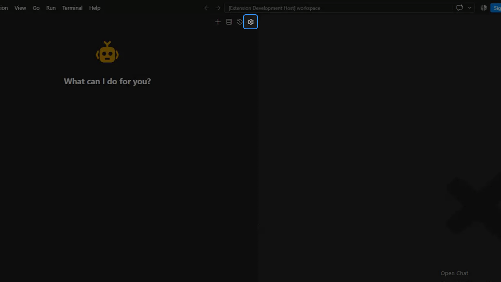

# Dline

**功能完备的多任务自动化编程代理**

任务级多模型配置、任务状态与检查点持久化、分层能力配置、细粒度全局授权

**[English](README.marketplace.md) · 中文**

[文档](https://docs.dline.cc/zh-cn/) | [更新](CHANGELOG.md) | [安全](https://docs.dline.cc/zh-cn/security/) | [隐私](https://docs.dline.cc/zh-cn/privacy/)

Dline 是一款支持在同一工作区内并行开展多个编程与代码审查任务的专业级自动化编程代理，用于制定架构与编码任务、编写代码、开展代码审查与问题修复，以及维护项目文档。它支持同时推进多个开发目标，让每个任务在自己的上下文中衔接规划、实施与验证。

Dline 的以下特性确保它能胜任复杂多任务编程工作：

- **多模型配置**：<small>接入不同云端服务或本地模型，为每个任务的 **Act**（执行）、**Plan**（规划）和 **Subagent**（子代理）分别选择模型，不必让所有工作共用一个模型。</small>
- **多任务并行执行**：<small>同时推进功能开发、缺陷修复、代码重构、界面调试和文档维护等任务，各自保留对话、进度与执行记录。任务内可委派多个子代理并行调查不同模块，再汇总结果继续规划、实施和验证。</small>
- **多层级配置**：<small>规则、技能、工作流、子代理和 MCP 可按全局、项目和任务分别启用或停用。支持项目内多层级 `AGENTS.md` 的渐进式披露，按当前操作涉及的目录加载相关约定。子代理支持按全局或项目配置职责、模型、工具和技能；项目还可设置终端环境变量、启动脚本及命令执行前后的操作，适配不同操作系统与终端。</small>
- **长任务续接**：<small>带上下文自动压缩，原始对话与运行记录保留在本机，中断后可以重新打开、检查进展并继续。</small>
- **持久化任务记录**：<small>查看命令和子代理的输出、运行状态及重试记录，了解任务已经完成的步骤和需要处理的问题。</small>
- **丰富的工具能力**：<small>搜索网络资料、获取网页正文；通过浏览器打开网页、点击、输入和滚动，结合截图与控制台输出检查页面和交互；通过已配置的图像服务生成图片，支持参考图，具体图像能力取决于所选服务。</small>
- **多层级 MCP 扩展**：<small>按全局或项目配置 MCP 服务，调用外部工具并获取资源，支持远程服务的 OAuth 授权；支持将授权 Key 等私有内容单独保存在本机，通过变量引用供服务连接使用。</small>
- **细分的操作授权**：<small>项目内外的读写可分别设置批准方式；命令执行区分安全命令与全部命令，浏览器、Web 联网、MCP 和图片生成等操作也可单独设置。授权设置全局生效。</small>
- **持久化的检查点**：<small>利用 Git 构建文件检查点，利用持久化对话存储构建对话检查点，可将文件和对话回滚至任意已有检查点。</small>

## 编程任务

- **制定架构与编码任务**：<small>梳理需求与项目现状，设计架构和接口，拆解编码任务、实施顺序与验证步骤。</small>
- **代码编写**：<small>实现功能、重构代码、调整界面与配置，补充测试并验证结果。</small>
- **代码审查与问题修复**：<small>审查代码逻辑、结构与边界情况，结合报错和日志定位问题，完成修复与回归验证。</small>
- **文档维护**：<small>根据项目实际情况，编写或更新架构设计、项目说明、使用指南和变更记录等文档。</small>

## 功能概览

- **多任务并行**：在侧边栏和独立任务面板中同时推进工作，每个任务保留自己的对话与执行记录。
- **按任务选择模型**：不同任务可以使用不同模型，也可以为规划、执行和子代理分别配置模型。
- **长任务续接**：保存任务历史、命令输出和活动记录，中断后可以查看进展并继续。
- **并行子代理**：把相互独立的代码调查交给子代理，分别收集信息，再把结果交回主任务。
- **按任务配置规则与工具**：通用偏好、项目约定和当前任务需要的规则、技能及 MCP 工具可以分别管理。

## 多任务与模型选择

点击 **New Task**（`+`）可以打开独立任务面板，不必先结束侧边栏中的工作。你可以并行处理不同目标，在各自面板中查看对话、选择模型和继续发送指令。

多个任务默认共享当前项目文件，不等于文件系统隔离。让任务修改不同范围；需要隔离文件时，使用 Git worktree 等方式准备独立工作区。

在 **API Configuration** 中创建模型配置（Profile），保存服务商、模型和认证信息，再从任务输入区选择使用。Dline 支持云端模型服务、兼容接口和本地模型；具体可用模型、能力与费用取决于你连接的服务和配置。

- 不同任务可以选择不同的 Profile。
- 开启 **Split Model** 后，可为 **Plan** 与 **Act** 分别选择模型。
- 子代理也可以使用单独配置的模型。

详细步骤见[模型配置](https://docs.dline.cc/zh-cn/getting-started/authorizing-with-dline/)。

## 规划与执行

**Plan** 用于先阅读代码、调查问题并讨论方案，**Act** 用于修改文件、运行命令和执行验证。两种模式在同一个任务中保留对话，可以按工作阶段切换。

目标明确的小改动可以直接开始执行；涉及多个模块的工作可以先整理方案，再进入实现。模式选择不代替操作审批，工具访问仍受当前权限设置约束。

## 任务续接与执行记录

对话和活动记录随任务保存在本机。任务中断或 VS Code 重载后，可以从历史中重新打开，查看已完成的步骤，再通过 **Resume** 或发送后续指令继续。重新打开记录不代表会自动重启之前的命令。

**Work** 视图显示对话与工具结果；**Activities** 视图保留命令和子代理的输出、运行状态及重试记录。任务头还可查看模型用量和上下文占用，有定价信息时显示费用。

长对话可以通过[上下文压缩](https://docs.dline.cc/zh-cn/features/auto-compact/)减少后续请求携带的内容。压缩会总结较早的对话，不代表模型会始终记住所有细节；原有对话记录仍可回看。

## 操作权限与变更检查

你可以批准或拒绝工具请求，也可以通过 **Auto-approve** 按读取、编辑、命令执行、浏览器等操作类型设置自动批准。默认配置下，项目内读取和标记为安全的命令可自动执行，文件编辑需要批准。“安全命令”由模型判断，不是操作系统级的安全保证。

自动批准设置是全局的，不是每个任务各有一份。开启文件编辑或命令的自动批准前，请确认你接受对应操作的影响。

项目中的 `.agentignore` 可以限制 Dline 工具扫描、读取、写入或使用哪些路径。它不是操作系统沙箱，也不能保证任意终端命令或外部工具都无法接触敏感文件。

启用检查点且文件快照可用时，可以比较文件变化，或恢复相关文件与对话。文件恢复会覆盖恢复范围内之后的修改，包括你手动做的修改；执行前先检查差异。

参阅[自动批准](https://docs.dline.cc/zh-cn/features/auto-approve/)、[文件访问限制](https://docs.dline.cc/zh-cn/customization/agentignore/)和[检查点](https://docs.dline.cc/zh-cn/core-workflows/checkpoints/)。

## 规则与扩展工具

通过规则、技能和工作流，把编码约定、项目背景和常用操作流程提供给 Dline。它们以及子代理、MCP 服务的启用状态，可以按全局、项目和任务分别管理。运行中修改这些配置后，按界面提示刷新任务提示词，使相关变化生效。

- **规则**：记录项目约定和需要遵守的要求，减少重复说明。
- **技能与工作流**：复用测试、排查、发布准备等工作的操作方法和步骤。
- **子代理**：并行调查不同模块或问题。默认子代理只读；为自定义子代理开放写入、命令等能力前，应检查它的工具权限。
- **MCP**：连接你配置的外部工具与服务。
- **网页与浏览器工具**：搜索资料、获取页面内容、操作网页并查看截图与控制台输出。
- **图片与代码工具**：通过已配置的图像服务生成图片，或在语言服务可用时查找引用、重命名代码符号。

工具是否可用取决于当前模型、功能配置和权限。外部服务可能单独收费，并遵循各自的数据处理条款。

配置说明见[规则](https://docs.dline.cc/zh-cn/customization/rules/)、[技能](https://docs.dline.cc/zh-cn/customization/skills/)、[工作流](https://docs.dline.cc/zh-cn/customization/workflows/)、[子代理](https://docs.dline.cc/zh-cn/features/subagents/)和[MCP](https://docs.dline.cc/zh-cn/mcp/mcp-overview/)。

## 开始使用

1. 安装 Dline，在 VS Code 中打开项目文件夹，再点击活动栏的 Dline 图标。
2. 进入 **Settings → API Configuration**，创建 Profile，选择服务商和模型，完成该服务需要的认证或本地连接配置。
3. 输入任务目标，可以附上相关文件、报错或截图。需要先讨论方案时选择 **Plan**，准备执行时选择 **Act**。
4. 发送任务，处理需要你批准的操作；通过对话补充要求，在任务结束后检查改动与验证结果。

需要另一个任务时，点击 **New Task** 打开新面板。完整操作流程见[使用指南](https://docs.dline.cc/zh-cn/usage/ide/)。

## 数据与隐私

设置、凭据、任务历史和运行记录保存在本机。使用云端模型时，请求所需的提示词、选定代码、附件和工具结果会发送给任务所连接的模型服务；MCP、网页、浏览器和图像服务也会收到完成相应操作所需的数据。本地保存记录不代表所有内容都不会离开本机。

Dline 的**用量上报**和**错误上报**是两个独立选项，当前默认开启，遵循 VS Code 的遥测设置。你可以在 **Settings → About** 中分别关闭。

数据类别、用途、接收方、保留边界及隐私请求限制见[隐私政策](https://docs.dline.cc/zh-cn/privacy/)。使用第三方服务前，请同时查看该服务的隐私与计费条款。

## 支持与反馈

- 产品问题与缺陷报告：[Dline issues](https://github.com/TuvokYang/Dline/issues)
- 安全问题报告：[报告安全漏洞](https://docs.dline.cc/zh-cn/security/)
- 隐私条款与请求限制：[Dline 隐私政策](https://docs.dline.cc/zh-cn/privacy/)
- 文档：[docs.dline.cc](https://docs.dline.cc/zh-cn/)

## 开源与许可

Dline 基于 Apache-2.0 许可的 [Cline](https://github.com/cline/cline) 项目独立维护，保留适用的版权、许可和署名声明。Dline 不是 Cline 的官方版本，与 Cline 不存在官方隶属或背书关系。

[Apache License 2.0](LICENSE)
